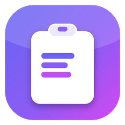
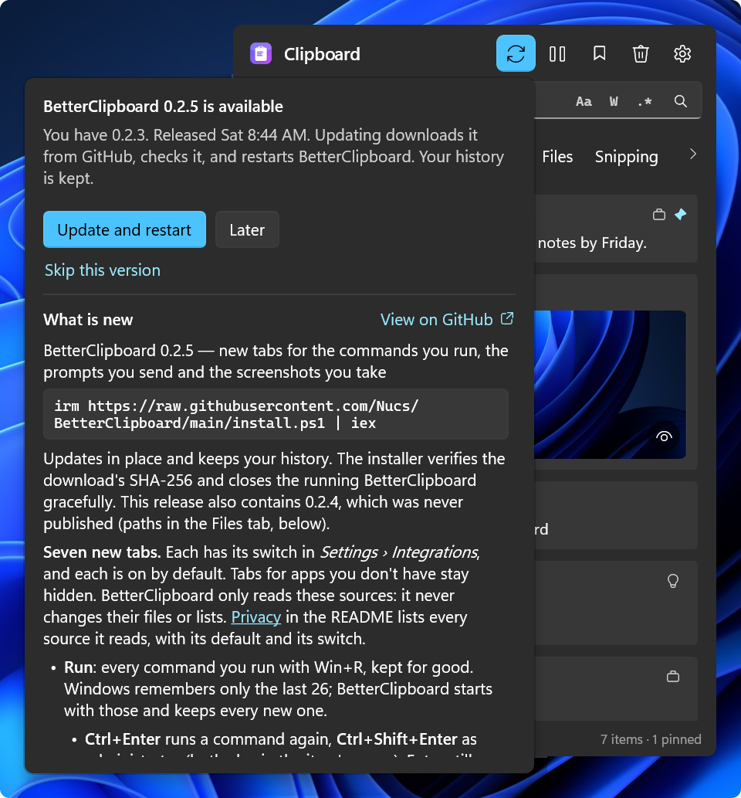
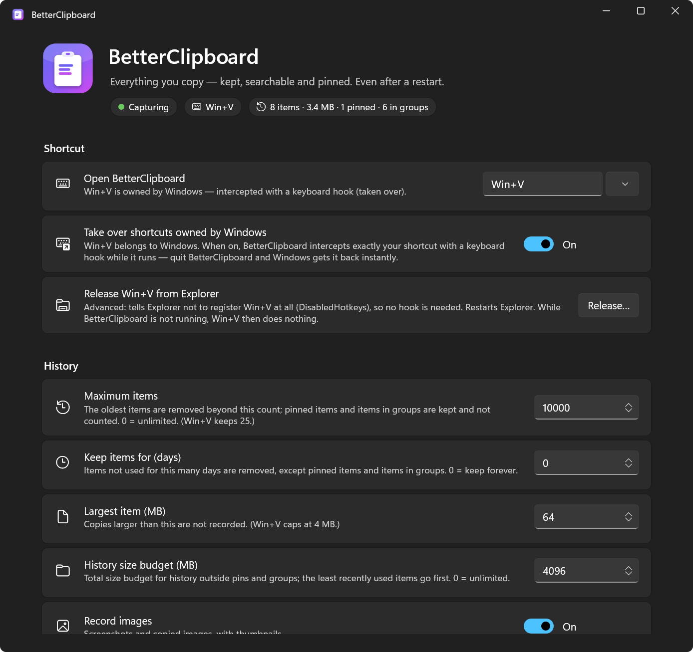
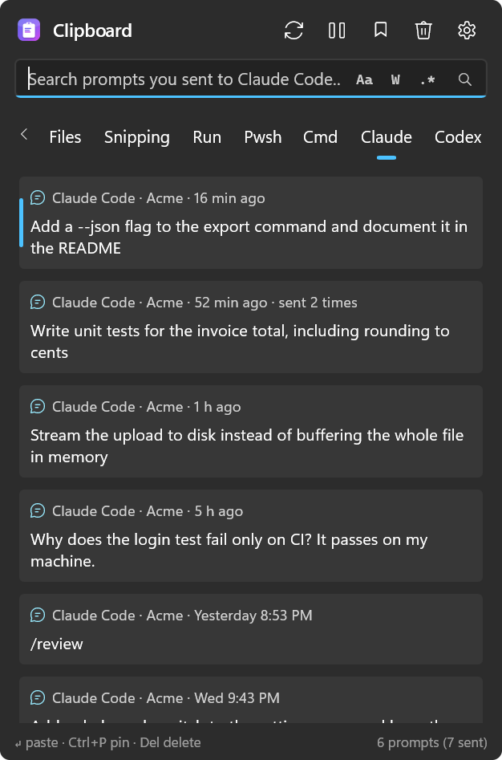

<div align="center">

#  BetterClipboard

[](https://github.com/Nucs/BetterClipboard/actions/workflows/ci.yml)
[](https://github.com/Nucs/BetterClipboard/releases/latest)
[](LICENSE)

**ENG** / [简体中文](docs/translations/README.zh-CN.md)

**The Win+V clipboard history Windows should have shipped.** Same shortcut, same panel by your cursor —
but it remembers everything, survives restarts, searches instantly, and keeps it all encrypted on your PC.
It also keeps what other tools forget: your screenshots, your Win+R commands, your shell history and the prompts
you send to Claude Code and Codex.

</div>

<p align="center">
  
</p>

## Features

- **Takes over Win+V.** Same shortcut, and the panel is there at once, by your text cursor: it is kept drawn and up to
  date while hidden, so Win+V only has to show it ([How it works](#how-it-works)). The installer releases Win+V from
  Explorer; a copy you run without the installer intercepts it with a keyboard hook. Add more shortcuts, or keep Win+V
  for Windows and pick your own: press any key or combination in *Settings › Shortcut* (numpad and media keys, F13–F24
  and the Copilot key included), and the shortcuts you used before stay one click away
  ([Choosing shortcuts](#choosing-shortcuts)).
- **Remembers everything, also after a restart.** 10,000 items by default, each up to 64 MB, with a size budget and an
  optional age limit, all adjustable. Win+V keeps 25 items of up to 4 MB, and a restart wipes all but its pins.
- **Every kind of copy**, with the source app and time on each card, and tabs that filter by kind and by source. A copy
  you make again moves to the top instead of adding a duplicate ([Tabs](#tabs)):
  - **Text, rich text and HTML, links, and colors** with a swatch.
  - **Long texts** show their first four lines, and a thin dotted line and an eye say when there is more. Rest the
    mouse on the text to read all of it, or press `F3` for a viewer that draws Markdown, colors code in 22 languages,
    re-indents XML and JSON, wraps and numbers lines, and opens megabyte copies a page at a time
    ([Text previews](#text-previews)).
  - **Files** copied in Explorer, and **paths copied as text** (`C:\…`, `~/.bashrc`, `src/app/main.cs`), which still
    paste as text ([Paths in the Files tab](#paths-in-the-files-tab)).
  - **Images** with thumbnails. Rest the mouse on one to see it full size, or open it in a viewer that zooms and pans
    ([Image previews](#image-previews)). The same picture as PNG or bitmap is one item. A screenshot keeps the file it
    was saved to: right-click it to copy its path, copy it as a file, open it or open its folder, and *Save to temp
    and* does the same for any picture ([Pictures and their files](#pictures-and-their-files)).
  - **Windows' own history:** what Win+V still remembers, its pins included, is imported at each start. What you delete
    in BetterClipboard is not imported again.
  - **ShareX:** every screenshot that [ShareX](https://getsharex.com) saves, the moment it is saved.
  - **Snipping:** every screenshot that Snipping Tool's auto-save and `Win+PrtScn` save.
  - **Notepad++:** the text of [Notepad++](https://notepad-plus-plus.org/)'s unsaved "new" tabs, kept up to date as
    you edit them, and the full path of every file you open in Notepad++.
  - **Run:** every command you run with `Win+R`, also after Windows' list of 26 forgets it. `Ctrl+Enter` runs one again
    (`Ctrl+Shift+Enter`: as administrator).
  - **Pwsh:** PowerShell's whole command history, also the old commands that its Up arrow no longer reaches.
  - **Cmd:** the commands typed in your Command Prompt windows, kept after a window closes.
  - **Claude and Codex:** every prompt you send to Claude Code and Codex, kept for good.
  - **Everything:** the files you open from [Everything](https://www.voidtools.com/), to paste as a file or as a path.

  The last eight are tabs for other apps. Each one has its own switch and is on by default, BetterClipboard only reads
  its source, and the tab of an app you don't have stays hidden ([Tabs for other apps](#tabs-for-other-apps)).
  *Delete stored…* on each one's Settings card shows what BetterClipboard kept from it, part by part with examples,
  and deletes what you tick; the other app's own files are never touched.
- **Instant search** in any language, Hebrew, CJK and emoji included, with VS Code's toggles: match case (`Alt+C`),
  whole word (`Alt+W`) and regular expression (`Alt+E`) ([Search](#search)). Win+V has no search.
- **Made for the keyboard.** `Enter` pastes into the app you came from and `Shift+Enter` pastes plain text. `↑` `↓`
  move through the items, `←` `→` through the tabs in a circle, and `↑` from the top item steps into your groups.
  `Ctrl+1` … `Ctrl+9` paste the n-th item, `Ctrl+P` pins, `Del` deletes, `F3` shows all of an item, and the Menu key
  opens an item's menu (copy only, open the link, show in Explorer, …). `Esc` gives the focus back to where you were ([Use](#use)).
- **A panel that fits you.** It opens in the tab you used last, also after a restart. Drag any empty spot to move it,
  and drag an edge to resize it: it opens at that size from then on. Tabs that don't fit scroll sideways with the ‹ ›
  arrows, the mouse wheel or a drag. Right-click a tab to move it left or right, to hide it, or to hide it together
  with its items in every list; *Show all hidden* brings them back, and your order is kept ([Tabs](#tabs)). The mouse
  selects the item it is over.
- **Pins and groups.** Pin what you reuse: pinned items are listed on top, and the panel still opens on your newest copy
  just below them, so `Win+V` `Enter` pastes what you copied last and `↑` reaches the pins. Make groups with your own
  icons, drag cards onto them, and show one group or several at once (`Ctrl+click`, `Shift+click`, or `Space` on a group
  you reach with the arrow keys). Pinned and grouped items outlive every limit, and *Clear* keeps them
  ([Groups](#groups)).
- **Reads every copy at once.** Copies 2 ms apart or more are all kept. A program that copies faster than that
  overwrites its own copies before any app, Win+V included, can read them: BetterClipboard keeps the last one and
  counts the rest (*Settings › Capture reliability*).
- **Private.** No telemetry and no account. The one thing it asks a server by itself is GitHub's public list of its
  releases, once a day, to tell you about updates; a switch turns that off ([Privacy](#privacy)).
  - **Encrypted at rest:** the whole history (ChaCha20-Poly1305), with a key that only your account on this PC can
    unseal ([How it works](#how-it-works)). Win+V encrypts only its pins.
  - **Private copies stay out:** copies that apps mark as private are never recorded, and 46 password managers and
    authenticator apps are ignored out of the box. *Pause capturing* and *Ignored apps* cover the rest.
  - **Forget forever** deletes an item and never records its content again, whichever app copies it
    ([Forget forever](#forget-forever)).
- **A command line for scripts and AI agents.** `bclip` lists, searches and greps your history, prints any item byte for
  byte, puts text on the clipboard, waits for your next copy and searches your archived prompts, with JSON output. It
  is off by default ([Command line](#command-line-for-scripts-and-ai-agents)).
- **One line to install.** Per user, no admin rights, SHA-256 checked, Windows 10 (2004 or newer) and Windows 11, x64
  and ARM64, nothing else to install; it starts with Windows from then on. As administrator, or from Intune or an RMM
  tool, it installs for every user of a PC instead, and each user can still turn the start at sign-in off for
  themselves. Uninstalling keeps your history unless you ask ([Install](#install)). A Microsoft Store edition is
  built and waits for its listing ([Microsoft Store edition](#microsoft-store-edition)).
- **Updates when you approve them.** The update button in the panel's header, left of Pause, is highlighted when a
  newer release is on GitHub, and once a week its tooltip says so by itself for a few seconds. A click shows the
  decision — *Update and restart* or *Later* — with the release notes below it. Only then is the update downloaded,
  checked against the release's SHA-256 and installed in place, also in a folder you extracted from the release zip:
  BetterClipboard restarts by itself, and your history is kept ([Updates](#updates)).
- **In your language.** English, Simplified Chinese (简体中文), Russian (Русский), Spanish (Español) and Hebrew (עברית),
  all in every download. The first start shows the languages with their flags, with Windows' language already
  selected: one click on the green check and the whole app speaks it. An update from a version that did not ask yet
  asks once too. *Settings › App › Language* changes it later:
  pick a language and press *Restart now*. Hebrew reads right to left inside the usual layout. What you copy, file
  names and the names you give groups are never translated.
- **Settings you can search.** Type in the box at the top of Settings (`Ctrl+F`) and the page keeps only the settings
  that match, in their places, with the matched letters highlighted. Any word on a setting counts — its title,
  description, section, buttons and options — and so do initials ("rfe" for *Release from Explorer*) and typos
  ("pasword"). `Esc` brings the whole page back where it was.
- **Settings for the rest:** start with Windows, the theme (light, dark or Windows'), where the panel opens (next to the
  text cursor or the mouse, or in the middle of the main screen or of the screen you are typing on — with several
  monitors, at any scale), and a page that credits every app it works with and every component it ships, with their
  official links.

## Install

Windows 10 version 2004 or newer / Windows 11, x64 or ARM64. Nothing else to install (the release is
self-contained). In PowerShell:

```powershell
irm https://raw.githubusercontent.com/Nucs/BetterClipboard/main/install.ps1 | iex
```

The installer downloads the latest [release](https://github.com/Nucs/BetterClipboard/releases/latest) for
your architecture, **verifies its SHA-256**, installs per user into `%LOCALAPPDATA%\Programs\BetterClipboard`
(no admin rights), adds a Start menu shortcut, starts BetterClipboard with Windows and registers it under
*Settings › Apps › Installed apps*. It also **takes over Win+V**: Explorer stops registering it and restarts once (the
taskbar blinks, and open folder windows close). See [Taking over Win+V](#taking-over-winv). Running it again updates in
place, and so does the app's own update button ([Updates](#updates)); your history is never touched. It runs from any
folder, also one you cannot write to, and leaves your PowerShell in that folder when it is done.

At its first start, BetterClipboard asks for your language: English, 简体中文, Русский, Español or עברית, each with its
flag, with Windows' language already selected. Press the green check (or `Enter`) and everything opens in that
language. If you update from a version that did not ask yet, the first start after the update asks once.

Once a day, the installed app asks GitHub whether a newer release exists. Nothing about you, your PC or your clipboard
is sent, and nothing is installed without your approval ([Privacy](#privacy)). `-NoUpdateCheck` installs with that
check off.

Options (pass them through a script block):

```powershell
& ([scriptblock]::Create((irm https://raw.githubusercontent.com/Nucs/BetterClipboard/main/install.ps1))) -NoTakeOverWinV -Hotkey Win+Alt+V
```

| Option | Effect |
|---|---|
| `-NoTakeOverWinV` | Leave Win+V to Windows. BetterClipboard then opens with the `-Hotkey` shortcuts, or with Win+Alt+V. If Win+V was released before, Explorer gets it back. |
| `-Hotkey A, B, …` | The shortcuts that open BetterClipboard, e.g. `-Hotkey Win+Alt+V, Ctrl+Alt+F9`. Win+V comes first unless `-NoTakeOverWinV` is given. Each one is taken over the same way as Win+V (see [Taking over Win+V](#taking-over-winv)). |
| `-TakeOverWinV` | The default. Kept for older command lines; if your shortcuts no longer include Win+V, it adds Win+V back. |
| `-AddToPath` | Put the install folder on your user PATH so terminals can run `bclip` (see [Command line](#command-line-for-scripts-and-ai-agents)). |
| `-NoUpdateCheck` | Install with the automatic update check off: BetterClipboard then never asks GitHub by itself. *Settings › Updates* has *Check now* and the switch to turn it on again. |
| `-Version 0.1.0` | Install a specific release instead of the latest. |
| `-Package <zip>` | Install from a release zip on disk instead of downloading one (an offline install). Put the release's `SHA256SUMS.txt` next to the zip, or give `-PackageSha256 <hash>`, and it is verified first. |
| `-AllUsers` | Install for every user of this PC (in PowerShell as administrator); see [For every user of a PC](#for-every-user-of-a-pc). |
| `-InstallDir <path>` | Install somewhere else. |
| `-NoStartup` / `-NoShortcut` / `-NoLaunch` | Skip starting with Windows / the Start menu shortcut / launching after install. |
| `-Uninstall [-RemoveData]` | Remove the app (history is kept unless `-RemoveData`, which also deletes the temporary pictures). |

Prefer doing it by hand? Download the zip for your architecture and `SHA256SUMS.txt` from the release,
check the hash (`Get-FileHash .\BetterClipboard-*.zip`), extract anywhere and run `BetterClipboard.exe`.
Releases are not code-signed yet, so Windows may say *Windows protected your PC* for a copy downloaded this
way: check the hash, then *More info › Run anyway*. See [Code signing policy](#code-signing-policy).

### For every user of a PC

In PowerShell as administrator:

```powershell
& ([scriptblock]::Create((irm https://raw.githubusercontent.com/Nucs/BetterClipboard/main/install.ps1))) -AllUsers
```

- **What it sets up:** the app in `Program Files\BetterClipboard`, in a folder only administrators may change; a Start
  menu shortcut, an *Installed apps* entry and "Start with Windows" for every user. Each user who signs in gets
  BetterClipboard started, with their own encrypted history in their own profile.
- **Each user decides for themselves:** turning off *Settings › App › Start with Windows* stops the start at sign-in
  for that user only. A user's own "Start with Windows" entry, if they have one, takes precedence, so BetterClipboard
  never starts twice.
- **Picked by itself** when it is not the signed-in user who installs: when the installer runs as SYSTEM (Intune, an
  RMM tool), or with an administrator's credentials on someone else's desktop. A copy in that account's own profile
  would serve nobody who signs in at the PC.
- **What stays per user:** Win+V and the other shortcuts. BetterClipboard takes Win+V over with its keyboard hook for
  everyone, and each user can release it from Explorer in *Settings › Shortcut*. `-Hotkey` and `-NoTakeOverWinV`
  apply only when the signed-in user installs. `-AddToPath` puts the folder on the PATH of every user.
- **Updates:** this copy does not replace itself or check for updates by itself, because its users may not be
  administrators. An administrator runs the same command again: run as administrator on a PC with a copy for every
  user, the installer updates that copy. *Settings › Updates › Check now* still tells you whether there is a new
  version, and the update dialog copies the command.

The [Chocolatey package](packaging/chocolatey) follows the same rule for "Start with Windows". Installed by the
signed-in user, the entry is theirs. Installed by SYSTEM or another account, or with `/AllUsersStartup`, it is for
every user.

### Microsoft Store edition

**Not in the Store yet.** The edition is built and tested ([docs/microsoft-store.md](docs/microsoft-store.md)); its
listing is being prepared. This is what it is:

- **Installed and updated by the Store.** Microsoft signs the package, so Windows shows no "unknown publisher"
  warning. The app itself makes no network request at all, because the Store updates it.
- **It asks first.** The first start asks for your language and then shows a welcome with two switches, *Open with
  Win+V* and *Start with Windows*. Nothing is recorded and no shortcut is taken until you press *Start*.
- **Win+V without a system change.** It answers Win+V with the keyboard hook while it runs; quit it and Win+V is
  Windows' again at once. *Release from Explorer* is not part of this edition.
- **Your history comes along.** Only one BetterClipboard is meant to be installed. When the Store edition finds a
  copy you installed with the installer, it says what it will do and checks that it can. On *Move to this edition* it
  closes that copy, copies your history and settings, checks the copy, uninstalls the other copy (which gives Win+V
  back to Windows) and removes the old folder. If a step fails, your history stays where it was. A copy for every
  user, or the Chocolatey copy, is for an administrator to remove: the Store edition says how and waits. The
  installer, in turn, tells you when the Store edition is installed.
- **`bclip` runs in every terminal** without a PATH entry, once you turn the command line on.
- **Removing it** removes its history too: it keeps the history in its own app data, which Windows deletes with the
  app.

## Updates

BetterClipboard updates itself from its [GitHub releases](https://github.com/Nucs/BetterClipboard/releases), and only
when you say so.

<p align="center">
  
</p>

- **The update button** is in the panel's header, left of Pause. It looks like its neighbors while you have the latest
  version. When a newer release exists, it is filled with your accent color, and the tray icon's menu gets
  *Update to x.y.z…*.
- **A reminder once a week.** While a newer release waits, the button's tooltip — *Update available: BetterClipboard
  x.y.z* — opens by itself for a few seconds when you open the panel, at most once in seven days. It opens above the
  panel, where it covers nothing (beside the button when the panel is at the top of the screen), and it closes by
  itself: there is nothing to dismiss, and typing goes on as usual. A click on it opens the update dialog. Opening
  that dialog counts as a reminder too, so *Later* means a week. There is no reminder while the automatic check is
  off.
- **A click opens the update dialog:** the decision on top — *Update and restart*, *Later* or *Skip this version* —
  and the release notes below it. While you are up to date, it shows what is new in your version, and *Check now*.
- **Nothing is installed without your approval.** *Update and restart* downloads the release for your PC from GitHub
  and compares its SHA-256 with the release's `SHA256SUMS.txt` and with GitHub's own digest. Then the installer from
  that release replaces the app's files: BetterClipboard closes and starts again by itself, in the background. Your
  history, settings and shortcuts stay as they are, and a notification says how it went.
- **If an update fails,** the installed version stays in place and keeps running, and the dialog or a notification
  says why. A download that does not match its checksum is deleted. An install folder that another program holds
  open is left as it was.
- **The check:** once a day (the first time, a minute after it starts), BetterClipboard asks GitHub for the public
  list of this project's releases. The request names only the app's version: nothing about you, your PC or your
  clipboard is sent ([Privacy](#privacy)). *Settings › Updates* switches the check off, and so does installing with
  `-NoUpdateCheck`. *Check now* asks once, whatever the switch says.
- **Skip this version** ends the highlight and the weekly reminder for that release. The next release brings both
  back.
- **A development build** (a version such as `0.2.10-dev.12.gabc1234`, see [Build from source](#build-from-source))
  is offered the builds published to its PC's `dev-builds` folder first: *Dev build available*, and *Update and
  restart* copies the build from that folder instead of downloading it. Otherwise it is always offered GitHub's latest
  release, also an older one, as the way back to the official version (*Install and restart*). It gets no weekly
  reminder.
- **A copy you extracted from the release zip** updates itself in its own folder, from 0.2.11 on. *Update and restart*
  downloads and checks the release as above; then the new version closes BetterClipboard, replaces the release's
  files one by one and starts again. Files that are not part of the release (your own, if the folder holds any) stay
  as they are, and if one of its files cannot be replaced (another program holds it open), every file goes back as it
  was. A copy in a folder you may not change, such as Program Files without administrator rights, gets the download
  page and the install command instead.
- **A newer copy takes over.** Start a newer BetterClipboard while an older one runs (a new release extracted into a
  new folder, say), and the older one closes and the newer one carries on, instead of the older one's Settings coming
  up. If *Start with Windows* starts an older copy, or one that is no longer there, it moves to the copy you run; an
  entry you turned off in Windows' startup apps stays off.
- **A copy installed for every user** neither replaces itself nor checks by itself: only an administrator may change
  its folder. *Check now* still asks, and the dialog copies the command to run in PowerShell as administrator
  ([For every user of a PC](#for-every-user-of-a-pc)).
- **The Microsoft Store edition** has no update button and asks GitHub nothing: the Store updates it, and
  *Settings › Updates from the Microsoft Store* opens its Store page.

## Use

Press **Win+V**. The panel appears at once by your text cursor, in the tab you used last, with the search box focused
— just type. Your newest copy is selected, so `Enter` pastes it. Pinned items are listed above it (*Settings › Pasting*
can list them in time order instead), and `↑` reaches them.

*Settings › Shortcut › Panel position* opens it next to the mouse instead, or in the middle of a screen: the main one,
or the one you are typing on (with several monitors, the screen with the window you were in; after a click on the
desktop, the screen with the mouse).

| Key | Action |
|---|---|
| *type* | Search (substring, case-insensitive, Hebrew/CJK/emoji included) |
| `Alt+C` / `Alt+W` / `Alt+E` | Toggle the search box's **Aa** (match case), **W** (whole word) and **.\*** (regular expression) — or click them. They stay as you leave them. |
| `↑` `↓` `PgUp` `PgDn` | Move the selection. The panel opens on your newest copy, so `↑` goes first to the pinned items above it, the lowest one first. With the groups column open, press `↑` on the top item to step into the groups (see [Groups](#groups)). |
| `Space` / `Enter` in the groups column | While the arrow keys are in the groups column: keep the group under the ring and go back to the items. While several groups are open: add the group under the ring to the list, or take it out (see [Groups](#groups)). Everywhere else, `Space` is typed and `Enter` pastes. |
| `←` `→` | Previous / next tab, in a circle: `←` on the first tab goes to the last tab, `→` on the last tab to the first. While you edit search text, they move its caret instead; after `↑` or `↓` they switch tabs again. A held key stops at the first or last tab. |
| Mouse over an item | Select it. Tabs and group icons are only selected by a click. |
| `Enter` / click | Paste into the app you came from |
| `Shift+Enter` | Paste as plain text |
| `Ctrl+Enter` | On a command you ran with Win+R: run it again (`Ctrl+Shift+Enter`: as administrator) |
| `Ctrl+1` … `Ctrl+9` | Paste the n-th item |
| `Ctrl+P` | Pin / unpin (pinned items ignore retention and "clear") |
| `Del` (or `Shift+Del` while searching) | Delete the item. In the Pwsh, Cmd and Everything tabs, hide the command or file until you use it again. In the Claude and Codex tabs, delete the prompt until you send it again. |
| `Ctrl+F` | Back to the search box |
| `Ctrl+G` | Show / hide the groups column (same as the bookmark button) |
| `F3` | View the selected item: all of its text in the text viewer, or a picture in the image viewer (see [Text previews](#text-previews)) |
| `Menu` / `Shift+F10` / right-click | Item menu: paste, paste as plain text, copy only, view (`F3`), pin, groups (add / remove), open link / show in Explorer / show in Everything, run (Win+R commands), a picture's file (copy path, copy image as a file, open file, open folder) and *Save to temp and* (see [Pictures and their files](#pictures-and-their-files)), delete, forget forever |
| Right-click a tab (or `Menu` on a tab you clicked) | Tab menu: *Move left*, *Move right*, *Hide tab*, *Hide tab & clipboard rows*, *Show all hidden*. A right-click on the tabs' empty space offers *Show all hidden* too (see [Tabs](#tabs)). |
| `Esc` | Clear the search, then close — focus returns to where you were |
| Drag any empty spot | Move the panel, like dragging a title bar (`Esc` while dragging puts it back). It opens where *Panel position* says again next time. |
| Drag an edge | Resize the panel. It opens at that size from then on. |
| Wheel or drag over the tabs | Scroll the tabs sideways when they don't fit, or click the ‹ › arrows at their ends |
| Rest the mouse on an image | See it full size; its eye button opens a zoom viewer (see [Image previews](#image-previews)) |
| Rest the mouse on a long text | Read all of it and scroll it with the wheel (moving the mouse closes it); right-click it to copy it or for the item's menu; its eye button opens the text viewer, which stays (see [Text previews](#text-previews)) |
| The update button, left of Pause | Open the update dialog: the release notes, and *Update and restart* when a newer version exists (the button is highlighted then; see [Updates](#updates)) |

Type and press `Enter` as fast as you like: `Enter` waits for the search to finish and pastes its best match — the
newest one that is not pinned, when pinned matches are listed above it.

**Pasting into a window that runs as administrator** (an elevated terminal, say): Windows does not let an app that runs
without administrator rights type into it. BetterClipboard puts the item on the clipboard, goes back to that window, and
tells you once (a notification) to press `Ctrl+V` yourself. The shortcut itself works over such windows when Win+V is
released from Explorer (the installer's default).

The tray icon opens the panel and Settings. The search box at the top of Settings (`Ctrl+F`) filters the page as you
type, typos included; `Esc` clears it. Its sections:

- **Shortcut:** the keys that open the panel (add as many as you like: click the box and press them, or pick one from
  its menu of suggestions and shortcuts used before), where the panel opens (next to the text cursor, next to the mouse,
  in the middle of the main screen, or in the middle of the screen you are typing on), and releasing Win+letter
  shortcuts from Explorer ([Choosing shortcuts](#choosing-shortcuts)).
- **History:** how many items, for how many days, how large, what to record, and how long *Save to temp and*'s
  pictures are kept.
- **Pasting:** paste after choosing, move pasted items to the top, pinned items first.
- **Privacy:** pause, ignored apps, *Forgotten forever*, capture reliability, clear history.
- **Windows clipboard:** Windows' own history, and **Import from Windows**, which pulls in everything Win+V still
  remembers — including its pinned items.
- **Integrations:** one switch for each tab of another app, two for Notepad++ (its unsaved tabs, and the files you
  open in it), and on each card *Delete stored…*: a dialog that lists what BetterClipboard kept from that source, part
  by part with counts, sizes and the newest examples, and deletes the parts you tick — optionally turning the switch
  off first (see [Tabs for other apps](#tabs-for-other-apps)).
- **App:** the interface language (Windows' or one you pick; *Restart now* next to the list applies it), start with
  Windows (for you alone, also when BetterClipboard was installed for every user), theme, the command line, the data
  folder.
- **Updates:** the switch for the daily check, *Check now*, and the update dialog ([Updates](#updates)).
- **Third party:** the apps BetterClipboard works with and the components it is built with, with their official
  links.

**Closing Settings gives its memory back.** Settings leaves memory behind that only a new process returns (about 80 to
100 MB), so a few seconds after you close it, once the panel is closed and keyboard and mouse have paused, BetterClipboard
quietly replaces itself with a fresh copy. Nothing opens or flickers, and the pointer does not change: the tray icon stays
where it is, the shortcuts keep working (one pressed in that second opens the panel a moment later), and a copy made
meanwhile is recorded.

<p align="center">
  
</p>

### Tabs

| Tab | What it lists | Shown |
|---|---|---|
| All | Your whole history, newest first | Always |
| Pinned | The items you pinned | Always |
| Text | Text and rich text, paths included | Always |
| Images | Pictures you copied, and saved screenshots | Always |
| Links | Copied URLs | Always |
| Files | Files you copied in Explorer, and text that is nothing but paths | Always |
| ShareX | Screenshots that ShareX saved, and everything you copied from ShareX | When ShareX is installed |
| Snipping | Screenshots that Snipping Tool and Win+PrtScn saved | When your history has a screenshot from them |
| Notepad++ | The text of Notepad++'s unsaved tabs, the files you opened in Notepad++, and what you copied in it | When your history has something from Notepad++ |
| Run | Commands you ran with Win+R | When your history has a Win+R command |
| Pwsh | PowerShell's own command history | When PowerShell has a history file |
| Cmd | Commands typed in Command Prompt windows | Always |
| Claude | Prompts you sent to Claude Code | When Claude Code has prompts |
| Codex | Prompts you sent to Codex | When Codex has prompts |
| Everything | Files you opened in Everything | When Everything is installed or running |

Every tab after Files has its own switch in *Settings › Integrations*. All of them are on by default; turn one off
and its tab goes away. [Tabs for other apps](#tabs-for-other-apps) tells what each one reads.

**Arrange the tabs** by right-clicking one:
- *Move left* and *Move right* move it one place among the tabs you see. All always stays first and can't be moved.
- *Hide tab* takes the tab out of the row. Only the tab goes: its items still show in All and the other tabs, its
  switch in *Settings › Integrations* stays on, and BetterClipboard keeps gathering for it. Hiding the tab you are in
  switches to All. All can't be hidden.
- *Hide tab & clipboard rows* also takes the tab's items out of every list: All, the other tabs, searches. Items you put
  in a group stay where they show. The footer then says how many are hidden (`1,240 items · 37 hidden`). Nothing is
  deleted, and `bclip` still lists them.
- *Show all hidden* brings every hidden tab back, with how many there are, and the items hidden with them. A
  right-click on the row's empty space offers it too.

Your order and your hidden tabs are kept, also after a restart. `←` and `→` skip hidden tabs.

**The panel opens in the tab you used last**, also after a restart. `←` and `→` go through the tabs in a circle. If
the tab you used last is not there (its app is gone, its switch is off, or you hid it), the panel opens in All, and
returns to your tab when it is back. The search text and the groups you opened are not kept: each Win+V starts with an empty
search over your whole history.

### Search

Type to search. A word matches anywhere in an item's text, in any language, in upper or lower case. Three toggles
in the search box narrow the search, as in VS Code:

- **Aa** (`Alt+C`): match case.
- **W** (`Alt+W`): whole words only. `log` then finds "log file", but not "login" or "my_log".
- **.\*** (`Alt+E`): a regular expression (.NET syntax); `^` and `$` match at each line. An invalid pattern turns
  the toggle's outline red and says what is wrong.

The toggles stay as you leave them, and the search text clears each time the panel opens. They work in every tab
and group, except the Everything tab, where Everything itself does the searching.

### Image previews

- **Peek:** rest the mouse on an image card. After a moment the picture appears full size in the middle of the
  screen (up to 80% of it). Move the mouse and it is gone.
- **Viewer:** click the eye button at the bottom-right corner of an image card. The picture opens over the whole
  screen and stays until you close it. Turn the mouse wheel to zoom toward the pointer, drag to pan, and
  double-click to switch between fit and zoomed in. Close it with `Esc`, its X button, or a click outside the
  picture.

### Text previews

A card shows the first four lines of a text. When the text is longer, a thin dotted line under them and a small eye
at the card's corner say so.

- **Peek:** rest the mouse on the card's text. After a moment the whole text appears in the middle of the panel,
  colored the way the viewer shows it, and the wheel scrolls it. Moving the mouse closes it, and so does `Esc`. A
  right-click with the mouse still offers *Copy* and *Select all* above the item's own menu. A text over 64,000
  characters shows its start, and says so.
- **Viewer:** click the eye, press `F3`, or choose *View* in the item's menu. The screen dims and the text opens in a
  large card over it:
  - **Markdown** is drawn as a document: headings, lists, tables, quotes, links and code blocks, each code block
    colored in its own language. Markdown is also what a text is shown as when no language is recognized.
  - **Code** is colored, in C#, Java, Kotlin, JavaScript, TypeScript, Python, Ruby, PHP, Go, Rust, C and C++,
    PowerShell, shell scripts, batch files, SQL, CSS, HTML, XML, JSON, YAML, INI and TOML, and diffs. The language is
    recognized by itself; the language button picks another (the recognized one is marked *(detected)*).
  - **XML and JSON** are re-indented, one element or value per line; *As copied* shows them as they were copied.
  - **Wrap** breaks long lines at the window's edge (off: they scroll sideways), **Line numbers** numbers the lines
    of code, and **A−** / **A+** (`Ctrl+Minus`, `Ctrl+Plus`, `Ctrl+0`, or `Ctrl` with the wheel) change the text
    size. All three are remembered.
  - **Megabyte copies** open a page of about 64,000 characters at a time, with ‹ › to turn the pages
    (`Ctrl+PageUp`, `Ctrl+PageDown`); line numbers count on across pages.
  - Select and copy as anywhere. Moving the mouse does not close it: `Esc`, its X button, or a click outside the
    text does.

### Pictures and their files

A screenshot that ShareX, Snipping Tool or `Win+PrtScn` saved keeps the file it was saved to: its name, folder, format,
size and dates are kept with the picture in your history.

- **Right-click the picture.** The menu names the file, with its format, size and when it last changed. While the file
  is on disk, four items follow: *Copy path*; *Copy image as a file*, to paste it into a folder, a mail or a chat as a
  file, like a file copied in File Explorer; *Open file*; and *Open folder*, File Explorer with the file selected. A
  file that was moved or deleted is named as such, and these four are left out.
- **Any picture, also one you copied from an app:** *Save to temp and ›* has the same four items. BetterClipboard first
  writes the picture as a PNG into a folder of its own in your temporary files (`%TEMP%\BetterClipboard\Images`),
  named after its file when it has one. Saving the same picture again finds that file; a copy you edited since is
  never overwritten.
- **Temporary pictures are deleted when BetterClipboard starts,** once they were not used for 30 days. *Settings ›
  History › Keep temporary pictures for (days)* changes that, and 0 deletes them at every start. They are never deleted
  while BetterClipboard runs, so a picture you just pasted as a file stays there for the app that reads it.
- **In the viewer,** the picture's file is shown above it: its name, format, size and pixel size on one row, its folder
  and dates on the next. Click the name to open the file, or the folder to open it in File Explorer.
- **Screenshots already in your history** find their files once, at the first start of a version that keeps them: each
  gets the file in ShareX's folders or the Screenshots folder that was saved within two minutes of it and holds the
  same pixels.
- **Files on a network drive** are never checked (a share that is gone would make the menu wait), so their items stay.

### Paths in the Files tab

**The Files tab** lists files you copied in Explorer, and text that is nothing but paths:

- **Absolute paths:** `C:\Users\you\notes.txt`, `C:/a/path`, `\\server\share`, `/var/log/syslog`,
  `%APPDATA%\Code`.
- **Relative paths:** `~/.bashrc`, `./build.sh`, `src\app\main.cs`, `folder/file.cs`.
- **Several:** one path per line, as many lines as you like.
- **It stays text:** a copied path still pastes as text, and the Text tab still lists it.

It is strict on purpose, so these stay in Text only:

- slashes in prose (`and/or`, `24/7`);
- a sentence that starts with a path (`C:\Windows is where …`);
- URLs, and a command line (`./run.sh src/a.txt`);
- a relative path without a file name at the end (`src/app`).

A folder name with spaces counts when it looks like a name (`C:\Program Files (x86)`, `D:\Games\Call of
Duty`). Lowercase ones (`C:\Users\you\my stuff`) count when quoted, as Explorer's *Copy as path* writes them.

### Groups

Collect the things you reuse — snippets, addresses, links for a project — into groups.

- **Open the column:** the bookmark button next to Pause (or `Ctrl+G`). The panel widens to the left and a
  column of icons appears. The clipboard logo at the top is your whole history.
- **Make a group:** press **+** at the bottom, give it a name if you like, and pick an icon.
- **Fill it:** drag any card onto a group's icon. The card then shows that group's icon.
- **Open it:** click the icon, and the panel shows only that group's items (search and the filter tabs
  still work inside it). Click the icon again, or the logo, to go back to everything.
- **Open several:** `Ctrl+click` more icons to show their groups together, or `Shift+click` for a run of icons.
  They merge into one list in the usual order, with each item once, and the search and the tabs work on it.
  Without a keyboard: right-click an icon › *Add to view*.
- **With the keyboard:** press `↑` on the top item. A ring appears on the icon of what you have open: the group, or
  the logo when no group is open (your whole history). Nothing else changes yet. `↑` and `↓` now step through the
  column, and each step opens what it lands on: `↓` from the logo opens the first group, and `↑` from the first group
  shows your whole history again. To go back to the items with the group you are on, press `Enter`, `Space` or `→`,
  or press `↓` on the last group. Typing, or moving the mouse over an item, goes back too. `Enter` then pastes the
  selected item.
- **Several groups with the keyboard:** while more than one group is open, `↑` on the top item puts the ring on the
  first of them, and `↑` and `↓` then move only the ring: your merged list stays, and `↓` stops on the last group.
  Press `Space` or `Enter` to add the group under the ring to the list, or to take it out. On the logo, they show
  your whole history. The footer shows these keys. `→` goes back to the items, where `Enter` pastes again.
  `Shift+Enter` pastes the selected item as plain text at any time, also while the ring is in the groups column.
- **Take things out:** right-click a card → *Remove from …*, or use *Groups* in the same menu. Right-click
  a group's icon to rename it, change its icon or delete it. Deleting a group never deletes its items.

Items in a group are **kept like pinned items**: no retention limit (count, age, size) removes them and
*Clear* skips them. When an item leaves its last group, its retention clock starts over. It won't be
removed just because it is old, and it keeps its place in the list.

### Forget forever

Copied a password, a token or anything else you never want in your history? Right-click it (or press
the Menu key) and choose **Forget forever…**. It is deleted, and **BetterClipboard never records it again**,
whichever app copies it next time: a browser, a terminal, ShareX, or `bclip put`. It is also never
re-imported from Windows' own clipboard history.

- **What counts as the same:** everything must match, letter case included. Line endings and spaces
  around the text don't matter, so `token` copied again from a terminal with a line break after it is
  kept out too.
  Copies already in your history that differ only that way disappear together with the one you forget.
- **Pictures and files:** a picture is recognized by its pixels, so the same screenshot as PNG or bitmap
  counts. A file list is recognized by its paths (not by the files' contents).
- **What is kept:** a fingerprint (a SHA-256 hash) of the content, encrypted with the rest of your history,
  plus its kind, length and source app, so you can tell entries apart. The content itself is gone.
- **Not only copies:** it works the same on a command in the Pwsh or Cmd tab (a password you typed, say), a
  file in the Everything tab, and a prompt in the Claude or Codex tab. A forgotten prompt leaves the prompt
  archive and is never archived again.
- **Changed your mind?** *Settings › Forgotten forever* lists every entry with how often it was kept out
  since. *Allow again* records it again from its next copy. Nothing that was deleted comes back.

**Password managers are ignored out of the box.** *Ignored apps* comes filled with 46 password managers
and authenticator apps, 65 process names in all: 1Password, Bitwarden, KeePass, KeePassXC, LastPass,
Dashlane, Keeper, NordPass, Proton Pass, RoboForm, Enpass and many more. See the
[full list with sources](docs/password-managers.md). Delete any you do want recorded and they stay
deleted; updates only ever add names that are new to the catalog.

## Taking over Win+V

Explorer owns Win+V. BetterClipboard supports two ways to take it:

- **Release it from Explorer** (what the installer does, or *Settings › Release from Explorer*). Explorer is told not
  to register Win+V (`DisabledHotkeys` = `V`) and BetterClipboard registers it normally, so it also works while an
  elevated (admin) window is focused. Trade-off: while BetterClipboard isn't running, Win+V does nothing.
  Uninstalling gives Win+V back to Windows.
- **Keyboard hook — no system change** (a copy you run without the installer, the Microsoft Store edition, or after
  `-NoTakeOverWinV` if you add Win+V back). While BetterClipboard runs, a low-level keyboard hook intercepts Win+V
  before Explorer sees it. Exit BetterClipboard and Windows' own panel is back instantly.

**Rather keep Win+V for Windows?** Install with `-NoTakeOverWinV` and pick your own shortcuts with `-Hotkey`, or add and
remove them in *Settings › Shortcut*. Any number of shortcuts can open the panel, and each one is taken over the same
way:

- **Win plus a letter or digit that Explorer owns** (Win+E, Win+R, Win+1): Explorer can release it, like Win+V. The
  installer does that for every such shortcut you give it; in the app, *Settings › Release from Explorer* does it. Some
  belong to another part of Windows (Win+C, Copilot, on Windows 11 25H2): the keyboard hook takes those over.
- **Any other shortcut that an app already uses** (Win+Shift+V is PowerToys' Advanced Paste): the keyboard hook
  intercepts exactly that combination while BetterClipboard runs. *Settings › Take over shortcuts owned by Windows*
  switches this off.
- **A free shortcut** (Win+Alt+V, Ctrl+Alt+F9): BetterClipboard registers it.

Explorer can release only an exact Win+letter or Win+digit shortcut: the `V` releases Win+V, but Win+Ctrl+V stays with
Windows.

### Choosing shortcuts

In *Settings › Shortcut*, click the box and **press the shortcut**. The box shows it (`Ctrl+Shift+K`), and `Enter` or
**Add** saves it. Nothing is saved before that, so a combination pressed by mistake costs nothing. While the box has
focus it takes the keys even when Explorer or BetterClipboard itself owns them: `Win+E` is written into the box instead
of opening File Explorer.

- **Any key works:** letters, digits and punctuation, the numeric keypad (`Ctrl+Alt+Num5`, `Ctrl+NumPlus`), `Pause`,
  `PrintScreen`, the Lock keys, the Menu key (`Apps`), media and volume keys, browser keys, `F1`–`F24` (the Copilot
  key of new laptops sends `Shift+Win+F23`), and keys without a name, which are written as their code (`0x97`, from
  macro pads).
- **Keys that do nothing in text may stand alone:** `F9`, `Pause`, `MediaPlayPause`. Keys that type or edit need
  `Ctrl`, `Alt` or `Win`, because a bare `V` (or `Shift+V`) as a global shortcut would stop that key from typing in
  every app.
- **Refused, with the reason under the box:** `Ctrl+C`, `Ctrl+X`, `Ctrl+V` and `Ctrl+Insert` (copying must keep
  working, and BetterClipboard pastes with `Ctrl+V` itself), and the keys Windows keeps: `Ctrl+Alt+Delete`, `Win+L`,
  `Alt+Tab`, `Alt+Esc`, `Ctrl+Esc`, `Ctrl+Shift+Esc` and `Alt+F4`. These keep working in the box (`Alt+Tab` switches
  windows, `Ctrl+V` pastes text).
- **Typing still works:** letters, `Backspace` and `Enter` reach the box, so you can also type a name such as
  `ctrl + alt + page down` or `0x97`.
- **The menu next to the box** lists suggestions, then **Used before**: every shortcut you had, newest first. A check
  marks the ones in use; click one to add or remove it.

## Tabs for other apps

BetterClipboard also keeps what other tools on your PC forget or bury: screenshots, Notepad++'s unsaved tabs, Win+R
commands, shell history, the prompts you send to AI coding agents, and the files you open in Everything. Each source
has its own tab and its own switch in *Settings › Integrations*. All of them are on by default, and the tab of an app
you don't have stays hidden. BetterClipboard only reads these sources; it never changes their files or lists.
[Privacy](#privacy) sums up what each one reads.

**Deleting what a source left.** *Delete stored…* on each card opens a dialog that shows what BetterClipboard kept
from that source, one part per row: how many, how large, and the newest examples (thumbnails for screenshots). The
everyday parts are ticked; pinned and grouped items, and the lists of commands or picks you hid, are kept unless you
tick them. Cancel is the default button, so `Enter` deletes nothing. The other app's files are never touched — ShareX's
screenshots stay in ShareX's folders — and what you deleted is not imported again by the next catch-up, while new
screenshots, runs and prompts are recorded as long as the switch is on (the dialog's *Also turn off* switches it off
first). For Claude Code and Codex, whatever the agent still has is read again at once while the switch is on.

<p align="center">
  
</p>

### ShareX screenshots

With [ShareX](https://getsharex.com) installed, every screenshot it saves is in your history the moment the
file is written. The panel gets a **ShareX** tab holding those screenshots and everything you copied from
ShareX. Paste one with `Enter` like any other item.

- **Where it looks.** BetterClipboard reads ShareX's own settings:
  - the personal folder: portable mode, the `PersonalPath` registry value, or `PersonalPath.cfg`;
  - the screenshots folder: the custom path and its fallback;
  - the subfolder patterns: `%y-%mo` by default, plus per-hotkey folder overrides.

  It imports only from folders those patterns can produce, so other images saved nearby (a synced phone
  folder, say) stay out. `UploadersConfig.json`, where ShareX keeps upload credentials, is never opened.
- **Nothing half-written, nothing missed.** A file is read only after ShareX has finished writing it.
  Screenshots saved while BetterClipboard wasn't running arrive at its next start, up to the 100 newest.
  The first time, only new screenshots count; your existing archive is left alone.
- **Skipped:**
  - thumbnails;
  - GIF screen recordings and videos;
  - everything while *Pause capturing* is on.

  Add `ShareX` to *Ignored apps* to leave ShareX out entirely, or turn off *Settings › Integrations › ShareX
  screenshots*.
- Screenshots that ShareX only uploads or only copies aren't files. The copies still arrive through
  normal clipboard capture and show up in the same tab. A picture that was both copied and saved is kept
  once.

### Snipping Tool and Win+PrtScn

Windows saves your screenshots in *Pictures › Screenshots*: Snipping Tool's auto-save (`Win+Shift+S`, `PrtScn`)
and `Win+PrtScn`. Each one is in your history the moment Windows finishes writing it, in the **Snipping** tab. The
tab shows once your history has a screenshot from them, and goes when you delete the last one.

- **One item per picture.** Snipping Tool also copies each snip to the clipboard. The copy and the saved file
  become one item.
- **Nothing missed.** Screenshots saved while BetterClipboard wasn't running arrive at its next start, up to the
  100 newest. The first time, the screenshots already in the folder are left alone.
- **Never in the way.** BetterClipboard reads a file without locking it, so Windows can always finish writing it.
- **Only fresh screenshots.** A picture you copy or move into the folder later is not imported.
- **Snipping Tool's own settings** show in *Settings › Integrations*: whether it auto-saves, and whether it
  saves to a folder of its own (BetterClipboard does not watch that folder).

### Notepad++

[Notepad++](https://notepad-plus-plus.org/) keeps the text of its unsaved "new" tabs in backup files, and forgets it
when you close such a tab. BetterClipboard keeps it in the **Notepad++** tab, with the full path of every file you
open in Notepad++ and whatever you copy in it. The tab shows once your history has something from Notepad++. Two
switches in *Settings › Integrations*: *Notepad++ unsaved tabs* and *Files opened in Notepad++*.

- **Unsaved tabs, kept up to date.** A tab is read from Notepad++'s backup once you stop typing in it for a minute
  (at the latest five minutes after its first change, if you keep typing). A small change updates the tab's item
  where it is, and the card says when it was edited. Once more than a fifth of the text is gone (deleted or
  rewritten, added up over the edits), the old version stays as an item of its own and the new text becomes a new
  item. Typing more never splits a tab. The card names the tab ("new 3"), also after you rename it.
- **Files you open, as if you copied their path.** Opening a file in Notepad++ puts its full path in your history;
  opening it again later moves that item from its old date to the top. BetterClipboard asks a running Notepad++
  which files it has open. The files Notepad++ restores from its last session at start do not count; the files you
  start it with (a double-click in Explorer) do.
- **The first time,** the unsaved tabs Notepad++ remembers then are imported. Files opened before are not.
- **Never in Notepad++'s way.** Its files are read without locking them, and nothing of Notepad++ is ever changed.
  BetterClipboard asks only a Notepad++ signed by its makers. *Pause capturing*, *Ignored apps* (add `notepad++`)
  and the size limit apply.
- **Deleting a tab's item** is respected: that text does not come back, and the tab's next change is a new item.
- **Not seen:** a file opened again while it is still open in Notepad++ (Notepad++ only switches to its tab); unsaved
  tabs while Notepad++'s *Settings › Preferences › Backup › Enable session snapshot and periodic backup* is off
  (*Settings › Integrations* says so); a Notepad++ running as administrator while BetterClipboard does not.

### Win+R history

Windows remembers only your last 26 Win+R commands. BetterClipboard keeps every command you run with `Win+R`, in
the **Run** tab, starting with the 26 that Windows remembers today. The tab shows once there is a command in it:
if Windows remembers none, with the first one you run.

- `Enter` pastes a command. `Ctrl+Enter` runs it again, the way the Run dialog does; `Ctrl+Shift+Enter` runs it
  as administrator. Both are also in the item's menu.
- Windows' own list is never changed.
- Windows records a command only when it ran successfully. When you run your newest command again, Windows'
  list does not change, so that run is not seen (the command is already in the tab).

### PowerShell and Command Prompt

- **Pwsh** lists PowerShell's own history file: every command you typed in PowerShell 7 or Windows PowerShell,
  newest first. The search reaches all of them, also the old ones that PowerShell's Up arrow no longer loads.
- **Cmd** lists the commands typed in your Command Prompt windows. Command Prompt forgets them when its window
  closes, so BetterClipboard reads your open windows every 30 seconds and keeps what it saw. Windows that other
  programs start (build tools, AI agents) are skipped. A window closed within 30 seconds of its last read loses
  the commands typed since.

Neither tab fills your history: a command becomes a history item only when you paste, copy, pin or group it. It
still shows once, in its place among the commands: on top only while you used it after the newest one. `Del` hides
a command until you type it again, and *Forget forever* keeps one out for good. PowerShell's file and the Command
Prompt windows are never changed.

### Everything

With [Everything](https://www.voidtools.com/) by voidtools installed, the **Everything** tab lists the files and
folders you opened from Everything's results, newest first and how often, plus everything you copied in
Everything.

- `Enter` pastes the file itself, as Explorer's *Copy* would. `Shift+Enter` pastes its path as text.
- The item's menu has *Open*, *Show in Explorer* and *Show in Everything*. File items anywhere in your history
  get *Show in Everything* too.
- `Del` hides a file until you open it in Everything again. Nothing in Everything is ever changed.
- BetterClipboard talks only to an Everything that voidtools signed, and asks it for your opened files only
  when the tab loads. While Everything isn't running, the tab shows the history that Everything saved on disk.
- Everything Lite has no interface for this, so it is not supported.

### Claude Code and Codex prompts

Every prompt you send to [Claude Code](https://claude.com/product/claude-code) or
[Codex](https://openai.com/codex/) is kept in BetterClipboard's encrypted database, also after Claude Code's own
cleanup removes old prompts from its history.

- **Where from:** Claude Code's `history.jsonl` in its config folder (`%USERPROFILE%\.claude`, or
  `CLAUDE_CONFIG_DIR`), and Codex's session files and history in `%USERPROFILE%\.codex` (or `CODEX_HOME`).
- **When:** the prompts you sent before are imported at the first start. After that, each new prompt arrives the
  moment the agent writes it; BetterClipboard reads only the new bytes.
- **The Claude and Codex tabs** list one card per prompt, newest first, with its project folder, when you last
  sent it and how often. `Enter` pastes it, `Ctrl+P` keeps it in your clipboard history, and `Del` deletes it
  until you send it again. A prompt you pasted or pinned shows once, at the later of when you used it and when you
  last sent it.
- **Kept apart:** prompts never appear under *All*, and they never count against your history's limits.
- **Only yours:** Codex's subagents and `codex exec` runs are left out. Images are counted, not kept.
- `bclip prompts` lists and searches them from a terminal. *Delete stored…* on the card in Settings deletes what
  was kept ([Deleting what a source left](#tabs-for-other-apps)).

## Command line for scripts and AI agents

`bclip` lets terminals, scripts and AI coding agents (Claude Code, Codex, Copilot CLI, …) work with your
history: list, search and grep it, read any item exactly as it was copied, put something back on the
clipboard, or wait for your next copy. It ships next to the app and asks the running BetterClipboard —
it never opens the encrypted history itself — and starts BetterClipboard in the background if needed.

**It is off by default.** Turn it on in *Settings › Command line (bclip)* and click *Add bclip to PATH*
(or install with `-AddToPath`). While it is on, any program running as you can read your clipboard history
through it — the same trust you already give those programs with your files. Other Windows accounts and
the network cannot connect, and each command is logged by name only, never with content.

| Command | What it does |
|---|---|
| `bclip list [-n 20] [-f FILTER] [-s 2h]` | Recent items: id (`*` = pinned), kind, age, source app, first line. `FILTER` is `pinned`, `text`, `images`, `links` or `files` (copied paths included, as kind `path`), or a tab: `sharex`, `snipping`, `notepad++`, `run`, `pwsh`, `cmd`, `claude`, `codex`, `everything` |
| `bclip search <words…>` | Items containing all the words (substring, any language) |
| `bclip grep [-i] <regex>` | Matching lines as `id:line: text`, like `grep -n` |
| `bclip get [ID \| -r N] [--format text\|html\|rtf\|files\|png] [-o FILE]` | An item's content, byte for byte (default: the latest); images need `-o file.png` |
| `bclip copy [ID] [--plain]` | Put an item back on the clipboard, like picking it in the panel |
| `bclip put <text>` or `… \| bclip put` | Copy text (or standard input) to the clipboard and the history |
| `bclip pin [ID]` · `unpin [ID]` · `delete ID` | Keep an item forever, release it, or delete it |
| `bclip forget ID` | Forget forever: delete the item and never record its content again (undo only in Settings) |
| `bclip wait [-t 60]` | Block until you copy something, then print it |
| `bclip prompts [words…] [-a claude\|codex] [--all]` | Your archived Claude Code and Codex prompts, newest first, one row per text (`--all`: one row per send); words search them |
| `bclip prompt ID [-o FILE]` | One archived prompt, exactly as you sent it |
| `bclip status` | Version, item counts, archived prompts, capture statistics |

With the `pwsh`, `cmd`, `claude`, `codex` and `everything` filters, `bclip list` shows what you pasted, copied or
kept from those tabs. The prompts themselves are in `bclip prompts`.

Add `--json` to any command for structured output (ids, kinds, times, source app, formats, grep matches, and a
picture's file: path, name, format, size and dates).
Exit codes: `0` ok · `1` nothing found or timed out · `2` bad usage · `3` BetterClipboard unreachable or the
command line is off · `4` other error. `bclip help <command>` shows every option. `bclip` always answers in English,
whatever the app's or Windows' language: scripts and agents rely on its output.

```powershell
bclip get                                 # what did I just copy?
bclip grep -i "exception|error" -s 1h     # errors copied in the last hour, as id:line: text
bclip search invoice --json               # structured results for an agent
bclip get 42 -o shot.png                  # an image, as a PNG file an agent can open
bclip wait -t 120                         # "copy the stack trace and I'll read it"
git diff | bclip put                      # hand text back to you on the clipboard
bclip list -f run -n 5                    # the last five Win+R commands
bclip prompts migration -a claude         # what did I ask Claude Code about the migration?
```

## How it works

- **The panel.** It is built once and never hidden between uses: Windows keeps it off the screen (cloaked) while it
  stays drawn, and after every copy its list is updated in the background. Win+V moves the finished panel to your cursor
  and puts it on screen in one step, with no fade or slide. On a test machine without a graphics card, the panel was
  complete about 0.1 s after the key, against 0.6 s before this change.
- **Capture.** BetterClipboard listens with `AddClipboardFormatListener` — the same change notification
  Windows' own clipboard-history service uses (there is no "atomic, never miss" clipboard API in
  Windows; every consumer reads the clipboard right after being told it changed). It reads each change
  immediately on a high-priority thread.
  - **What was measured:** copies 2 ms apart or more are all captured, and at 1 ms nearly all. A program
    that copies in a tight loop overwrites its intermediate copies before anyone, Win+V included, can
    read them.
  - **What happens then:** BetterClipboard still gets the last copy and keeps an exact tally of the
    overwritten ones, shown in Settings › Capture reliability.
  - **Safety net:** a watchdog re-arms the listener if Windows ever stops delivering.
- **Privacy markers.** Copies flagged by apps as private (`ExcludeClipboardContentFromMonitorProcessing`,
  `CanIncludeInClipboardHistory = 0`, `Clipboard Viewer Ignore` — used by password managers) are never
  recorded. Many managers, Electron-based ones especially, don't set these flags. The ignored-apps list
  catches those by the name of the process that made the copy.
- **Other sources.** Each tab for another app watches its source in the cheapest way that still sees every
  change:
  - screenshot folders: a folder watcher;
  - the Win+R list: a registry change notification;
  - the agents' history files: a reader that keeps a checkpoint per file and reads only the bytes added since. A
    folder watcher alone is not enough: Windows reports no writes to a file that another app keeps open, so a
    short check every 5 seconds backs it up;
  - Notepad++'s unsaved tabs: a folder watcher on its backup folder; a tab is read only once it rests for a minute;
  - files opened in Notepad++: a notification when its window title changes, and every 5 seconds one question for how
    many documents it has open; BetterClipboard asks which ones only when the title or the count changed;
  - PowerShell's history file and Everything's list of opened files: read only when you open their tab;
  - Command Prompt windows: read by a short-lived helper process, so that a window that closes during the read
    can never take BetterClipboard down with it.
- **Forget forever.** Everything that would be stored — live copies, screenshots, Win+R commands, kept commands
  and prompts, `bclip put`, the Windows import — is checked against the forget list before anything is written.
  Text is fingerprinted after unifying line endings and trimming surrounding whitespace, pictures by their
  decoded pixels, file lists by their paths. While the list is empty, nothing is even hashed. The list lives in the encrypted database, not in `settings.json`: a bare
  hash of a short password could be guessed offline.
- **Storage.** One SQLite database, fully encrypted with [SQLite3 Multiple Ciphers](https://github.com/utelle/SQLite3MultipleCiphers)
  (ChaCha20-Poly1305: every page, the write-ahead log, the full-text index, thumbnails and the prompt archive).
  Search uses an FTS5 trigram index on the decrypted pages in memory.
- **The key.** A random 256-bit key, stored only sealed with Windows DPAPI for your account, with extra
  entropy derived (HKDF-SHA256) from this PC's `MachineGuid` and your account's SID. The history folder
  name is a UUIDv5 computed from the same binding. Result: the history opens only for BetterClipboard, on
  this Windows installation, signed in as you. It protects the data at rest — stolen disks, backups,
  other accounts — but, like every DPAPI-based app, not against malware already running as you.
  A history that can no longer be decrypted (e.g. after reinstalling Windows) is set aside, never deleted.
- **Updates.** The check reads GitHub's release list and keeps a copy with its entity tag, so an unchanged list
  costs one "not modified" answer a day. A failed check is tried again after 1, 2, 4 … hours, and never before a
  rate limit ends. An approved update is downloaded only from this repository's release downloads, and its
  SHA-256 must equal both the release's `SHA256SUMS.txt` and the digest GitHub computed at upload. A running
  program cannot replace its own folder, so the app takes `install.ps1` out of the verified package and runs it
  with Windows PowerShell, without a window: it checks the package once more, asks BetterClipboard to close
  (queued copies are saved first), swaps the folder by renames — a failed swap puts the old folder back — and starts
  the app again. It writes its outcome to a file, which the app reads at its next start to tell you how it went.
  Only the install folder is touched. A copy extracted from the zip is updated by the new version's own program
  instead, started from the unpacked package: it asks BetterClipboard to close, renames each of the release's files
  aside and copies the new one in its place (a file that cannot be replaced puts every file back), writes the same
  outcome file and starts the app again from the same folder.
- **Languages.** Each interface language is one catalog embedded in the program, with its flag, so one build holds
  every language and no copy can miss a language file. Strings are found by their English text, counts take the form
  each language needs (CLDR's plural rules), and a string a translation lacks shows in English; a language is offered
  once nearly all of it is translated. Every English string carries a description for translators. A right-to-left
  language keeps the left-to-right layout, and its text is embedded right to left so each sentence reads in its own
  order. Logs and `bclip`'s output stay English. See [docs/localization.md](docs/localization.md).

Data lives in `%LOCALAPPDATA%\BetterClipboard` (`stores\<id>\history.db` + `history.key`, `settings.json`,
`logs\`, `updates\`); the Microsoft Store edition keeps the same files in its own app data
(`%LOCALAPPDATA%\Packages\<its package>\LocalState\BetterClipboard`). Logs never contain clipboard content.

The research behind all this — how Win+V is built (service `cbdhsvc`, the `TextInputHost` panel,
Explorer's hotkey), why it forgets, its on-disk format for pins, and the measurements quoted above — is
in [CLAUDE.md](CLAUDE.md).

## Privacy

**BetterClipboard sends nothing about you, your PC or your clipboard to anyone.** It has no telemetry and no account.
It uses the network in these cases only:

- **The update check, the one request it makes by itself.** Once a day (the first time, a minute after it starts), it
  asks GitHub for the public list of this project's releases
  (`https://api.github.com/repos/Nucs/BetterClipboard/releases`), so that the update button can tell you about a
  newer version.
  - **What is sent:** a plain web request without an account, a cookie or an identifier. Like any web request, it
    shows GitHub your network address, and it names the app and its version (`BetterClipboard/0.2.6`). Nothing
    else: no clipboard content, no file names, no settings. GitHub's
    [privacy statement](https://docs.github.com/site-policy/privacy-policies/github-general-privacy-statement)
    covers what GitHub does with requests.
  - **How to switch it off:** *Settings › Updates › Check for updates automatically*, or install with
    `-NoUpdateCheck`: the installer says so when it finishes. Off means no request at all until you press
    *Check now*.
  - **Who never checks by itself:** a copy that a package manager updates.
- **When you ask for it:** *Check now* asks GitHub for the release list. *Update and restart* downloads the release
  and its checksum list from GitHub. The installer downloads the release from GitHub. *Open link*, the links in release
  notes and the links in *Settings › Third party* open in your browser.

Apart from the update check, **this program will not transfer any information to other networked systems unless
specifically requested by the user or the person installing or operating it.**

**The Microsoft Store edition** makes no request by itself at all: it has no update check, because the Store updates
it. It records nothing until you press *Start* in its welcome window. It changes no Windows setting: Win+V is answered
by a keyboard hook while the app runs, and it starts with Windows through the *Startup apps* list, where you can turn
it off. Its history is in its own app data folder, which Windows removes when you uninstall it. When it replaces a
copy from the installer, with your go-ahead, it copies that copy's history into its own folder and removes the old
one; nothing leaves your PC.

What it keeps stays on your PC, in the encrypted history described in [How it works](#how-it-works). Besides the
clipboard, it reads a few other places on your PC, each behind its own switch in Settings:

| Source | What BetterClipboard does with it | Default | Setting |
|---|---|---|---|
| The clipboard | Keeps every copy, except copies apps mark as private and copies made by *Ignored apps* (password managers, out of the box) | On | *Pause capturing*, *Ignored apps* |
| Windows' own clipboard history | Imports what Win+V still remembers, its pinned items included, at each start | On | *Import from Windows › Import automatically every time BetterClipboard starts* |
| ShareX's screenshot folders | Keeps each screenshot ShareX saves | On, while ShareX is installed | *ShareX screenshots* |
| Windows' Screenshots folder | Keeps each screenshot Snipping Tool or Win+PrtScn saves there | On | *Snipping Tool and Win+PrtScn* |
| Notepad++'s session and backup files | Keeps the text of its unsaved tabs, read once a tab rests for a minute | On, while Notepad++ is installed | *Notepad++ unsaved tabs* |
| A running Notepad++ | Asks it which files it has open (its plugin messages), and keeps the path of each file you open | On, while Notepad++ runs | *Files opened in Notepad++* |
| Windows' Win+R list | Keeps every command the list records | On | *Win+R history* |
| PowerShell's history file | Lists its commands in the Pwsh tab; keeps a command only when you paste, copy, pin or group it | On | *Pwsh tab (PowerShell history)* |
| Command Prompt windows you opened | Reads their command history every 30 seconds and keeps it, since Command Prompt forgets it when the window closes | On | *Cmd tab (Command Prompt history)* |
| voidtools Everything | Asks Everything which files you opened from it whenever the Everything tab loads; remembers a file only when you act on it (paste, copy, pin, group or hide) | On, while Everything is installed or running | *Everything* |
| Claude Code and Codex | Keeps the prompts you sent them, read from their own history files | On | *Claude Code prompts*, *Codex prompts* |

- **Nothing private in the logs:** they record what happened (counts, versions, errors), never what you copied,
  ran, typed or sent. They are always in English.
- **Temporary pictures are plain files:** *Save to temp and* writes a picture as an ordinary PNG into
  `%TEMP%\BetterClipboard\Images`, outside the encrypted history, so that other apps can open it. BetterClipboard
  deletes such pictures when it starts, once they were not used for 30 days (*Settings › History*).
- **The command line is off by default.** While *Command line (bclip)* is on, any program running as you can read
  the history through it (see [Command line](#command-line-for-scripts-and-ai-agents)).
- **Windows' own features:** an item you paste goes onto the clipboard like any copy, so Windows' clipboard history
  and its sync between devices (*Clipboard history across your devices*) treat it the way you set them up in
  Windows (Microsoft's [privacy statement](https://privacy.microsoft.com/privacystatement) covers those).
- **Removing it:** uninstalling with `-RemoveData` deletes everything BetterClipboard stored, the temporary pictures
  included; uninstalling the Microsoft Store edition always deletes the history, while its temporary pictures stay in
  `%TEMP%\BetterClipboard` until you or Windows' clean-up of temporary files delete them. *Settings › Clear history*,
  and *Delete stored…* on each source's card in *Settings › Integrations*, delete parts of it; neither touches the
  other apps' own files.

## Uninstall

*Settings › Apps › Installed apps › BetterClipboard › Uninstall*, or:

```powershell
powershell -ExecutionPolicy Bypass -File "$env:LOCALAPPDATA\Programs\BetterClipboard\install.ps1" -Uninstall
```

Your history stays in `%LOCALAPPDATA%\BetterClipboard` unless you add `-RemoveData`, which also deletes the pictures
*Save to temp and* left in `%TEMP%\BetterClipboard`. Win+V, and every other
Win+ shortcut that BetterClipboard released from Explorer, goes back to Windows (add `-KeepWinVReleased` to keep them
released).

A copy for every user: the same entry in *Installed apps* (it asks for administrator rights), or in PowerShell as
administrator:

```powershell
powershell -ExecutionPolicy Bypass -File "$env:ProgramFiles\BetterClipboard\install.ps1" -Uninstall -AllUsers
```

Each user's history stays in their own profile.

The Microsoft Store edition: *Settings › Apps › Installed apps › BetterClipboard › Uninstall*. Its history is removed
with it.

## Build from source

Requires the [.NET 10 SDK](https://dotnet.microsoft.com/download/dotnet/10.0) on Windows.

```powershell
dotnet build BetterClipboard.sln
dotnet test --solution BetterClipboard.sln        # clipboard tests run in a private window station,
                                                  # so they never touch your real clipboard
pwsh tools/release/package.ps1 -Version 0.1.0     # the exact release zips and .7z archives + SHA256SUMS.txt
pwsh tools/release/package-msix.ps1 -Version 0.1.0 -Architectures x64 -NewTestCertificate
                                                  # the Microsoft Store package, signed for a test PC
```

Set `BETTERCLIPBOARD_DATA_DIR` to a scratch folder when experimenting so your real history stays clean.

To run your own build as your installed app, publish it to this PC's dev-builds folder
(`%LOCALAPPDATA%\BetterClipboard\dev-builds`); the installed app's update button then offers it:

```powershell
pwsh tools/release/publish-dev.ps1             # builds HEAD's commit (never uncommitted changes) as X.Y.Z-dev.N.g<sha>
pwsh tools/release/publish-dev.ps1 -Install    # the first time: installs it now (an installed 0.2.9 or older cannot
                                               # read the folder); the update button does the rest
```

A development build's update button always offers GitHub's latest release too, as the way back.
Releases are built by [`.github/workflows/release.yml`](.github/workflows/release.yml) from a `v*` tag.
Translations live in the build itself, one file per language: [docs/localization.md](docs/localization.md) explains how
to add one or fix a string.

## Code signing policy

**Not signed yet.** The releases so far are unsigned, so Windows may say the publisher is unknown when you run a
downloaded copy. The installer checks every download against the release's `SHA256SUMS.txt`, and you can do the
same by hand (see [Install](#install)). Signing is planned through the [SignPath Foundation](https://signpath.org),
which signs open-source projects for free. Once it is granted, this paragraph will read: *Free code signing
provided by [SignPath.io](https://about.signpath.io), certificate by [SignPath Foundation](https://signpath.org).*

The rules signed releases follow:

- **Only this project's own files are signed:** `BetterClipboard.exe`, `BetterClipboard.dll`,
  `BetterClipboard.Core.dll`, `BetterClipboard.Windows.dll`, `bclip.exe` and `bclip.dll`. Each one is built by
  GitHub Actions ([`release.yml`](.github/workflows/release.yml)) from the tagged commit of this repository, never
  on a developer's PC, and carries the product name `BetterClipboard` and the release's version.
- **Other makers' files are never signed with this project's certificate.** Microsoft's .NET and Windows App SDK
  runtime files and CommunityToolkit.Mvvm ship with their makers' own signatures. SQLite3 Multiple Ciphers,
  SQLitePCLRaw and ZstdSharp ship unsigned, as their open-source projects publish them. All of them are listed in
  [THIRD-PARTY-NOTICES.md](THIRD-PARTY-NOTICES.md).
- **Every release is approved by hand** before it is signed.
- **Team roles:**
  - Committers and reviewers: [Eli Belash (@Nucs)](https://github.com/Nucs)
  - Approvers: [Eli Belash (@Nucs)](https://github.com/Nucs)

  Changes from anyone else arrive as pull requests, and a committer reviews them before they are merged.
- **Privacy policy:** [Privacy](#privacy). In short: once a day the program asks GitHub for the public list of its
  releases, which sends nothing about the user and can be switched off in Settings or at install time
  (`-NoUpdateCheck`). Apart from that, this program will not transfer any information to other networked systems
  unless specifically requested by the user or the person installing or operating it. The same section lists what
  the program reads and keeps on your PC.

## License

[MIT](LICENSE). Third-party components are listed in [THIRD-PARTY-NOTICES.md](THIRD-PARTY-NOTICES.md), and in
the app under *Settings › Third party*, together with the apps it works with (Claude Code, Codex, Everything,
PowerShell and ShareX), each with its official link. BetterClipboard is not affiliated with Anthropic, Microsoft,
OpenAI, voidtools or the ShareX team.
