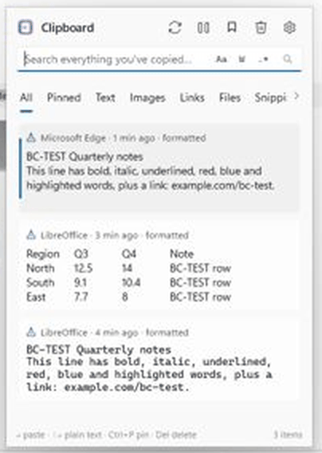
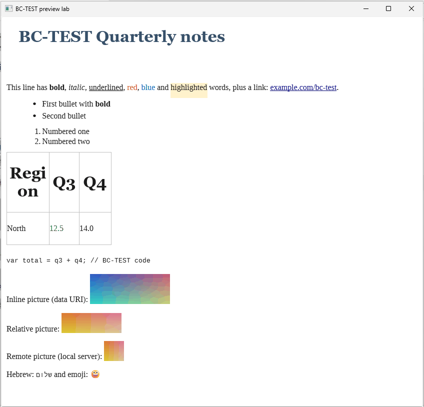
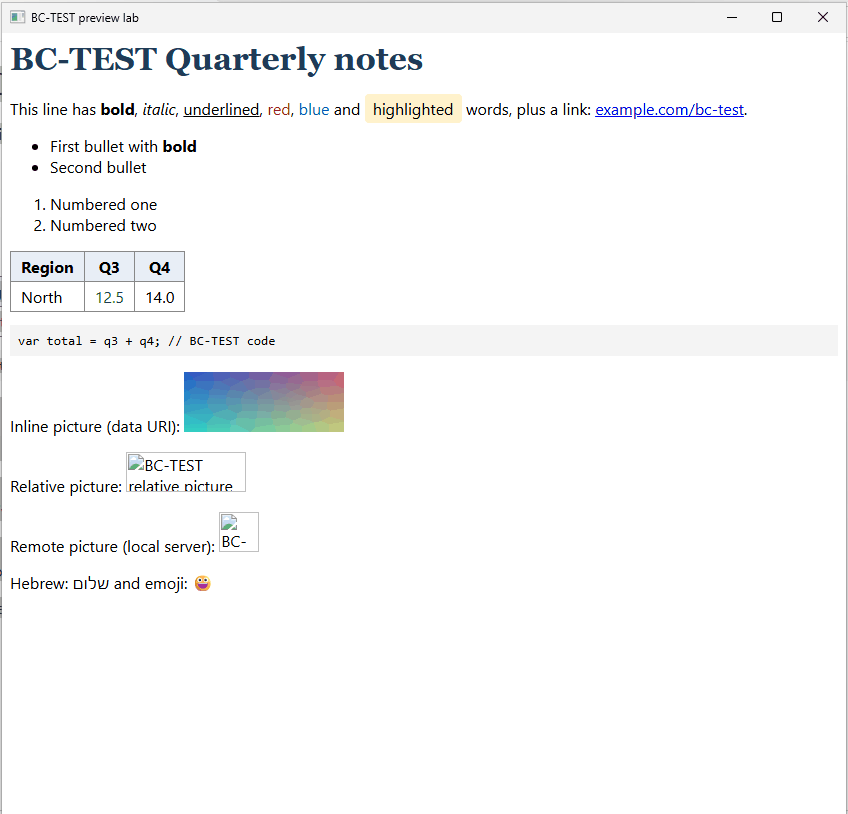

# Rich previews: what Word, Teams, LibreOffice and web pages put on the clipboard, and how the panel could show it

User request (2026-10-16): "When someone copies from teams or microsoft word or open office or libre office or even
html — The clipboard preview is not supporting a preview.. can we think about that and other types of clipboard data
showing a preview or even potentially tooltip and opening the preview like an image now supports. Task: Discover."

This report says what the panel does with such copies today, what each app actually puts on the clipboard, which engine
could show it (measured), what must never happen (fetching a copy's pictures from the web), and a proposal, cheapest
first. Nothing was built. The summary for the code is in `CLAUDE.md` §2.33.

**How it was learned.**
- **The code** of 0.2.8: `ContentClassifier`, `ClipboardReader`, `ClipItemViewModel`, the card template in
  `ClipboardFlyout.xaml`, the image overlays (`ClipboardFlyout.ImagePreview.cs`, `CLAUDE.md` §2.24).
- **A new probe,** [`tools/probes/probe_rich_formats.cs`](../tools/probes/probe_rich_formats.cs): it describes every
  format of a copy without printing content, watches live copies, saves copies of BC-TEST documents only, and draws RTF
  and metafiles with Windows' own RichEdit and GDI.
- **A disposable claude-desktops Windows 11 Pro 25H2 desktop** (26200, 1600×900, 4 cores, 6 GB, no GPU) with LibreOffice
  26.2.5.2 (the build on the owner's PC), Edge 155, and BetterClipboard 0.2.8 installed from GitHub. BC-TEST documents
  came from [`make_samples.py`](../tools/probes/preview_lab/make_samples.py), a web page from
  [`serve.ps1`](../tools/probes/preview_lab/serve.ps1) on 127.0.0.1, which logs every request. The desktop was deleted
  afterwards.
- **A preview lab,** [`tools/probes/preview_lab`](../tools/probes/preview_lab): a WinUI 3 app built from BetterClipboard's
  own Windows App SDK components. It loaded the saved copies into a read-only `RichEditBox` and into a locked-down
  WebView2 in that desktop.
- **Word, Teams, Outlook and Excel were not run:** Office needs a license and Teams an account, neither of which belongs
  in a test desktop. Their facts come from public format dumps and documentation, and §8 has the content-free live
  check that measures them on the owner's PC.

Legend: **[verified]** = measured on the desktop (or on this PC for the renderers), **[docs]** = public documentation,
forums and format dumps (§11), **[inferred]** = deduced, not measured.

---

## 0. Summary

| Question | Answer |
|---|---|
| What does the panel show today? | A copy with HTML or RTF next to its text is a "Formatted text" card that shows **only its plain text**, at most 4 lines, with "· formatted" in the caption. There is no peek and no viewer: those exist for image cards only. A copy with HTML and **no** text reads "Formatted content" and cannot be found by search **[verified]**. |
| Is the formatting kept? | Yes. HTML and RTF are stored next to the text and paste with it. Calc's and Excel's **picture of the copied cells is stored too, but never shown** **[verified]**. |
| What do the apps give? | Word, Outlook, Excel and LibreOffice: **RTF with every picture inside it**, plus HTML whose pictures are **temp files that vanish** (`msohtmlclip1`, LibreOffice's `lu*.tmp`). Calc and Excel also give a ready picture of the range (PNG/bitmap, EMF). Teams, browsers and VS Code: **HTML only**, whose pictures are web links (Teams' need the signed-in session). LibreOffice 26.2 adds **Markdown** **[verified for LibreOffice and Edge; docs/inferred for Word and Teams]**. |
| Which engine can show it? | **WinUI's `RichEditBox` for RTF:** faithful (pictures, tables, lists, colors, links, color emoji), in-process, nothing to fetch; 11–45 ms once warm, **0.85 s the first time** after a boot (warm it with the panel). **WebView2 for HTML:** exact, and its requests can be blocked (verified: 0 left the machine), but 5 processes and ~257 MB, 3–19 s to start in the VM. An **own HTML → XAML converter** (like the release-notes Markdown renderer) is the light alternative **[verified, except the converter]**. |
| Must anything be avoided? | **Never fetch a copy's pictures.** Rendering copied HTML with the network allowed loaded both web pictures of the test page (4 requests in the control run): a tracking pixel tells its sender that an item was looked at, and Teams' pictures would need the owner's session **[verified]**. |
| Other kinds? | A file copied from inside a .zip arrives as virtual files only and **is not recorded at all** **[verified]**; Outlook attachments and phone (MTP) files arrive the same way **[inferred]**. Long text, code, file lists, links and colors all have more to show than the card's 4 lines (§6). |
| Proposal | §7: first show what is already stored (spreadsheet pictures, text from HTML-only copies), then a hover peek for every card and an eye-button viewer for formatted copies (RTF in `RichEditBox`; HTML through an own converter, WebView2 only on request with requests blocked), then capture more (virtual files, Markdown). |

---

## 1. The panel today (0.2.8)

**Capture** (`ClipboardReader`): only the portable formats are stored: Unicode text, the file list and its drop effect,
`HTML Format`, `Rich Text Format`, the browser URL, `PNG`/`image/png` and the producer's own DIB flavor.
- Handle formats are never read: `CF_ENHMETAFILE`, `CF_METAFILEPICT`, `CF_BITMAP` (Windows makes `CF_DIB` from a
  bitmap, and that is stored).
- Everything else, Markdown and `FileGroupDescriptorW` included, is stored only with *Preserve all formats*.

**Classification** (`ContentClassifier`): files, then text (refined to link, color, rich text), then image, then
"rich-only".
- Text with HTML or RTF next to it is `RichText`: a "Formatted text" card, FontColor glyph E8D3, caption
  "… · formatted". Its body is the plain text, 4 lines at most.
- HTML or RTF without text is `RichText` with the preview "Formatted content" and **an empty search text**: it never
  matches a search, and "paste as plain text" has nothing to paste.
- A picture next to text (Calc, Excel) is kept for paste fidelity, but image analysis runs for `Image` cards only, so the
  entry has no thumbnail and the card shows no picture.
- A copy with neither text, nor HTML/RTF, nor a picture, nor a file list is not an entry at all.

**What it looked like** in the test desktop after three copies (Edge page, Calc range, Writer document):



- Edge's copy: the first lines of its text.
- Calc's copy: a tab-aligned text grid; the PNG and DIB of the range were stored (51,426 bytes with the HTML, RTF and
  text) but are not shown.
- Writer's copy: drawn in the **code font**. `CodeHeuristics.LooksLikeCode` counts a line as code when it is indented or
  ends in `;`; LibreOffice's text has its list items indented with tabs, and the document has one code line, which
  together pass the one-third threshold.

`bclip get -r N --format formats` listed what each entry kept: Writer RTF + HTML + text; Calc PNG (2,432 B) + `CF_DIB`
(45,464 B) + HTML + text + RTF; Edge HTML + text **[verified]**.

---

## 2. What each app puts on the clipboard

### 2.1 LibreOffice Writer 26.2.5, a whole document **[verified]**

Owner `soffice.bin` through OLE's clipboard window (`CLIPBRDWNDCLASS`): every format is rendered when asked.

| # | Format | Size | Notes |
|---|---|---|---|
| 1 | DataObject | — | OLE's |
| 2 | Star Embed Source (XML) | — | an embedded Writer object |
| 3 | **Rich Text Format** | 103,291 B | generator `LibreOffice/26.2.5.2…`; 3 pictures, all `\pngblip` (45,513 B, 88 % of the RTF as hex); 2 table rows, 6 cells; 1 hyperlink field; 4 list items; 13 fonts |
| 4 | Richtext Format | 103,291 B | the same RTF under an old name |
| 5 | HTML (HyperText Markup Language) | 3,939 B | a plain HTML document; rendered in 118–173 ms on request |
| 6 | **HTML Format** | 3,985 B | CF_HTML 1.0, no `SourceURL`; a `<style>` block in the head; pictures as `file:` (2) and `http:` (1) |
| 7 | **Markdown** | 1,048 B | new in LibreOffice 26.2: headings, `**bold**`, `*italic*`, links, lists, a pipe table with alignment, a code fence, pictures (`data:`, `file:`, `http:`); underline and colors are lost |
| 8 | CF_UNICODETEXT | 808 B | 403 characters, list items indented with tabs |
| 9–14 | CF_TEXT, Link, Star Object Descriptor (XML), Ole Private Data, CF_LOCALE, CF_OEMTEXT | | |

- **No picture of the selection:** a text copy from Writer has no EMF and no bitmap.
- **The HTML's pictures are temporary.** The picture that came from a `data:` URI is written as
  `file:///C:/Users/<user>/AppData/Local/Temp/lu10808jb0i.tmp/lu10808jb0r_tmp_e812dc94.png`, a file in LibreOffice's
  temp folder that goes away when LibreOffice exits. A picture with a web address keeps it.
- The probe kept the clipboard open 175–232 ms because asking for the plain HTML document made LibreOffice render it.

### 2.2 LibreOffice Calc, a 4 × 4 range **[verified]**

24 formats: Star Embed Source, Star Object Descriptor, GDIMetaFile, **`CF_ENHMETAFILE`** (8,484 B, 136 records with 3
EMF+ records; frame 58.6 × 18.1 mm; rendered on request in 30 ms; drawn by GDI in 15 ms), `CF_METAFILEPICT`,
**`image/svg+xml`** (6,370 B), **`PNG`** (222 × 68), **`CF_DIB`** (24 bpp), Windows Bitmap, the plain HTML, `HTML Format`
(one table, 4 rows, 16 cells), `CF_SYLK`, Link, `CF_DIF`, `CF_UNICODETEXT` (tab-separated, 4 × 4), `CF_TEXT`,
`Rich Text Format` (894 B, a table; it starts `{\rtf\ansi`, without the version number), Richtext Format, Ole Private
Data, `CF_LOCALE`, `CF_OEMTEXT`, `CF_BITMAP`, `CF_DIBV5`.

The PNG and the EMF drawing show the range exactly as Calc draws it. BetterClipboard stores the PNG and the DIB.

### 2.3 Microsoft Edge 155 (Chromium), a whole page **[verified]**

7 formats: **`HTML Format`** (40,160 B), `CF_UNICODETEXT` (451 characters), `Chromium internal source RFH token`,
**`Chromium internal source URL`** (the page's address), `CF_LOCALE`, `CF_TEXT`, `CF_OEMTEXT`.
- CF_HTML **version 0.9** with `SourceURL`. No `<style>` block: every element carries its computed style inline, 24
  properties in all (`color`, `font-*`, `text-decoration-*`, `-webkit-text-stroke-width`, `orphans`, `widows`, …).
- Pictures: a `data:` URI stays inline (which is why the HTML is 40 KB); relative pictures become absolute `http(s)`
  addresses.
- No RTF, no picture of the selection.

### 2.4 New Teams **[inferred]** and Word, Excel, Outlook, VS Code **[docs]**

- **Teams** (the new client) is a WebView2 app, so its copies are Chromium's: `HTML Format` + text + Chromium's source
  URL, as in §2.3. The pictures in a message are `https` links to Teams' servers, which need the signed-in session.
  - One user reported (Microsoft Q&A, 2024-08) that Teams put **only HTML** on the clipboard, no text, until its cache
    was cleared. Such a copy is a "Formatted content" card in BetterClipboard.
- **Word** (format dumps; Outlook's editor is Word): `Object Descriptor`, `Rich Text Format`, `HTML Format`, text,
  `CF_ENHMETAFILE`, `CF_METAFILEPICT`, `Embed Source`, `Link Source`, `Link Source Descriptor`, `ObjectLink`, and with a
  picture selected also `PNG`, `GIF`, `JFIF` (+ "Office Art" variants) and a bitmap.
  - Its HTML points at temp files: `file:///…/AppData/Local/Temp/msohtmlclip1/01/clip_image001.png`, which web editors
    (CKEditor) famously cannot load and which do not last.
  - Its RTF carries the pictures (`\shppict` with the picture, `\nonshppict` with a WMF copy for old readers).
  - Its EMF is a picture of the selection, drawn when asked (a large selection takes long).
- **Excel:** `CF_ENHMETAFILE`, `CF_METAFILEPICT`, `CF_BITMAP`, Biff12/8/5, SYLK, DIF, XML Spreadsheet, `HTML Format`,
  text, `Csv`, `Rich Text Format`, `Embed Source`, `Object Descriptor`, `Link Source`(s), Hyperlink. BetterClipboard
  stores the DIB Windows makes from the bitmap, so an Excel range, like a Calc one, already has a picture.
- **VS Code** writes the code as HTML with its syntax colors (`editor.copyWithSyntaxHighlighting`, on by default), and
  `vscode-editor-data`: JSON whose `mode` is the language, e.g. `csharp`.

### 2.5 Explorer, a file inside a .zip **[verified]**

6 formats: DataObject, `Shell IDList Array`, **`FileGroupDescriptorW`** (1 virtual file, `.png`), `FileContents`,
AsyncFlag, Ole Private Data. No `CF_HDROP` (no path exists until the file is extracted) and no text. **BetterClipboard
recorded nothing** (`bclip list` unchanged).

---

## 3. The engines

### 3.1 WinUI `RichEditBox`, read-only, with RTF **[verified]**

The lab loaded Writer's real RTF (§2.1):



- **Shown:** the heading's font and color, bold, italic, underline, red and blue text, the highlight, the link, both
  lists, the table with its borders, the code font, **all three PNG pictures**, Hebrew, and the emoji in color
  (DirectWrite).
- **Not quite:** the table's header row came out large (LibreOffice gave it a heading style), and the Hebrew word looked
  letter-spaced.
- **Time:** 855 ms for the first `SetText(FormatRtf)` of the desktop's session (engine, imaging and fonts loading), then
  11 ms for the same RTF. A 2 MB RTF with 40 pictures (`make_samples.py`'s `bc-test-big.rtf`) in a new process: 92 ms,
  then 45 ms, all 40 pictures shown.
- **Memory:** +30 MB (103 KB RTF) and +40 MB (2 MB) working set.
- **Network:** none. RTF has no references to fetch: its pictures are inside it.
- The box must not be read-only while `SetText` runs (it refuses), so load, then lock.

### 3.2 Classic RichEdit window (`RICHEDIT50W`, Msftedit 10.0.26100) **[verified]**

The probe's `--render-rtf` draws through a hidden window and `EM_FORMATRANGE` (the path a capture-time thumbnail would
take, off the UI thread).
- Text, fonts, colors, highlight, lists, links and a shaded table drew correctly; loading 52 KB took 10–70 ms, drawing
  1–15 ms.
- **Pictures need an OLE callback** (`IRichEditOleCallback.GetNewStorage`); without one every `\pict` is dropped (0
  objects). With one, a `\dibitmap` picture is drawn, but **a `\pngblip` picture is still dropped**, also inside
  `\shppict`. Word's `\nonshppict` WMF copy would probably show (not tested); LibreOffice's PNG-only pictures would not.
- So a picture-true RTF thumbnail needs WinUI's control (§3.1), which decodes PNG pictures itself.

### 3.3 WebView2 with HTML: scripts off, every request blocked **[verified]**

The lab followed PowerToys Peek's lockdown (MIT; studied, not copied): no scripts, script dialogs, dev tools, host
objects, web messages or autofill, its own profile folder, and a `WebResourceRequested` filter on `*` that answers every
request with 403.



- **Shown:** Edge's copy exactly as on the page (inline styles, the table, the lists, the code block, the `data:`
  picture). The two `http:` pictures show their alt text.
- **Blocked:** the filter saw 4 requests (2 pictures × 2 loads) and answered all; `serve.ps1` logged **none**. In the
  control run (requests allowed) it logged 4. So without the filter, viewing a copy would contact its pictures' servers.
- **Time** (GPU-less VM): start-up (`EnsureCoreWebView2Async`) 18.8 s the first time (a new profile), 6.2 s and 3.4 s in
  later runs; the first page 1.6–3.8 s, the next 0.25–0.34 s; a PNG capture 35–135 ms. Real hardware should be much
  faster **[inferred]**, but the first page of a session still costs a process start.
- **Cost:** 5 processes (browser, renderer, GPU, 2 utility), 256–259 MB working set (92–93 MB private) while open, on
  top of the app.
- `NavigateToString` takes at most 2 MB **[docs]**: a larger copy needs a virtual host or a request handler that serves
  it.

### 3.4 An own HTML → XAML converter **[not built]**

The release notes already go through an own Markdown → XAML renderer (`MarkdownRenderer`, `CLAUDE.md` §2.29). The HTML
census of the copies (probe output) says what such a converter must handle:
- tags: `p`, `span`, `b`/`i`/`u`, `a`, `ul`/`ol`/`li`, `table`/`tr`/`td`/`th`, `pre`/`code`, `img`, `h1`–`h6`, `font`,
  `col`; Word adds `o:p`, VML and conditional comments;
- styles: Chromium puts ~24 computed properties on every element, so pick a few (`color`, `background-color`,
  `font-weight`, `font-style`, `text-decoration`, `font-family`, `font-size`); Word and LibreOffice style through
  classes in the head's `<style>` block, so the whole document is needed, not only the fragment;
- pictures: `data:` URIs inline; everything else as a placeholder with its alt text.

It costs no process and no network, and draws instantly. It will not match the page's layout (floats, grids, widths).

### 3.5 The app's own picture of the selection **[verified for Calc]**

Calc and Excel attach a picture of the range, and BetterClipboard stores it already. Word and Excel also offer an EMF of
any selection; it is not read today (a handle format), and asking for it makes the app draw the whole selection while
BetterClipboard holds the clipboard (Calc: 30 ms for 4 × 4 cells; Word: measured by the live check, §8).

---

## 4. What a preview must never do

- **Fetch.** Copied HTML points at web pictures (§2.3), tracking pixels included, and Teams' at its own servers (§2.4).
  An offline preview shows `data:` pictures and alt text, nothing else. WebView2 only with every request blocked (§3.3).
- **Run scripts.** Copied HTML can carry handlers; WebView2 with scripts off, a converter that never executes anything.
- **Read files a copy points at** without limits. Word's and LibreOffice's `file:` pictures sit in temp folders, but any
  HTML can name any local path. If such pictures are ever inlined at capture, restrict it to those temp folders, image
  files and a size cap.

---

## 5. Where the formatted text is the only good preview

| Source | Best preview source | Lasting? | Engine |
|---|---|---|---|
| Word, Outlook (desktop), WordPad-likes, Visual Studio | RTF | yes (pictures inside) | `RichEditBox` |
| LibreOffice Writer | RTF (Markdown as a light alternative) | yes | `RichEditBox` |
| Excel, Calc | the stored picture of the range; RTF or the tab-separated text as a grid | yes | the image overlays (§2.24) |
| Teams, browsers, web apps (Notion, Slack, Gmail) | HTML | text yes; web pictures never shown | own converter; WebView2 on request |
| VS Code | HTML (colors) + `vscode-editor-data` (language) | yes | own converter |

---

## 6. Other kinds

| Kind | What the peek could show | Cost |
|---|---|---|
| Long text, Win+R and shell commands, prompts | the full text, monospace for code, with its line count | small: a text block in the existing peek |
| Code from VS Code | the full code with VS Code's colors (its HTML) and the language | the converter |
| File lists | the files' thumbnails (the shell's own, `IShellItemImageFactory`), sizes, whether they still exist (local fixed disks only, like the Everything tab's rule, CLAUDE.md §2.14) | medium: shell calls off the UI thread |
| Links | the address in parts (scheme, host, path, decoded query), an IDN/punycode warning; never a fetched page title | small |
| Colors | a large swatch, HEX/RGB/HSL, contrast with white and black | small |
| Tables (tab-separated text) | a grid | small |
| Virtual files (§2.5) | not stored today: a new capture kind (names, sizes, maybe small contents) is needed first | medium |

---

## 7. Proposal, cheapest first (to decide; nothing built)

1. **Show what is already stored.**
   - A `RichText` entry that carries a PNG or DIB (Calc, Excel) gets a thumbnail at capture (lazily for older entries),
     and its card the image row with the hover peek and the eye viewer of §2.24, unchanged.
   - An HTML-only copy gets its plain text from the HTML fragment: a real preview, a search text, and "paste as plain
     text" that works. No more "Formatted content" cards.
   - No code font for a formatted copy unless its HTML is code (`<pre>`/`<code>`) or it came from VS Code
     (`vscode-editor-data`).
   - The caption can say what is inside: "formatted · 3 pictures · table".
2. **A peek for every card, a viewer for formatted copies,** on the overlay machinery of §2.24.
   - RTF in a read-only `RichEditBox`, prepared with the panel (CLAUDE.md §2.27), so the first peek does not pay the
     0.85 s start; selectable, so part of a stored item can be copied.
   - HTML-only copies through an own HTML → XAML converter: instant, offline.
   - The viewer adds "as the page" for HTML (WebView2 with scripts off and every request blocked, created when asked and
     closed with the viewer), a zoom, and the stored formats with their sizes.
   - The other kinds per §6.
3. **Capture more.** Virtual files as a new kind; LibreOffice's `Markdown`; perhaps Word's and Excel's EMF for small
   selections only, if the live check (§8) shows it is cheap.

Not recommended: WebView2 for the hover peek (a process start, ~250 MB, and the panel must stay instant), and rendering
copied HTML with the network allowed.

---

## 8. Live check on the owner's PC (Word, Teams, Outlook, Excel)

```bash
dotnet run tools/probes/probe_rich_formats.cs -- --watch 180
```

Then copy from each app: a paragraph with a picture and a table in Word, a message with an emoji and a picture in
Teams, a range in Excel, a part of an e-mail in Outlook.
- Each copy is read 750 ms after its notification, after BetterClipboard has read it.
- The output names each format, its size, how long the app took to render it, the HTML's and RTF's structure (generator,
  picture kinds and where pictures point: scheme only), and the known host of a source URL (Teams, Outlook, SharePoint)
  or "another host". **No text, no HTML or RTF content, no file name, no URL path.** It never writes to the clipboard.
- `--no-metafile` skips asking Word and Excel for their EMF; leave it out once to learn what that costs.

---

## 9. How to reproduce

1. A claude-desktops Windows desktop (skill `claude-desktops`); BetterClipboard with `EnableCommandLine` on (`bclip get
   -r N --format formats` lists what an entry kept).
2. `python tools/probes/preview_lab/make_samples.py <dir>` writes the BC-TEST documents;
   `serve.ps1 -Root <dir>` serves the page on http://127.0.0.1:8123/ and logs requests.
3. LibreOffice 26.2.5 (`msiexec /i LibreOffice_26.2.5_Win_x86-64.msi /qn`); `soffice --headless --infilter="HTML
   (StarWriter)" --convert-to odt bc-test.html` and `--convert-to ods bc-test.csv`.
4. The probe, published (`dotnet publish tools/probes/probe_rich_formats.cs -r win-x64 --self-contained
   -p:PublishSingleFile=true`), started with the desktop's `launch` tool through `cmd.exe /c … > watch.log 2>&1`, not
   with `Start-Process -RedirectStandardOutput` from `run_command` (that inherits the agent's pipes and blocks its calls
   until the probe ends). `--watch 1800 --save C:\rich\saved`, then copy in each app.
5. The lab: `dotnet publish tools/probes/preview_lab -c Release -o …`, then `PreviewLab.exe rtf <saved .rtf> <log>` and
   `PreviewLab.exe html <saved .html> <log> [--network]`. It refuses to run outside a claude-desktops desktop.

---

## 10. Found on the way

- **richedit.h packs its structures to 4 bytes** (`pshpack4.h`). On x64 `EDITSTREAM.pfnCallback` is at offset 12, not
  16; with C#'s default packing RichEdit called a garbage pointer and Control Flow Guard ended the process (0xC0000409,
  no message). `[StructLayout(LayoutKind.Sequential, Pack = 4)]`.
- **A WinUI 3 app without App.xaml cannot create `XamlControlsResources`** in code: "Cannot find a resource with the
  given key: AcrylicBackgroundFillColorDefaultBrush" (no XAML metadata provider). A two-line App.xaml fixes it.
- **LibreOffice's HTML import fetches remote pictures** while converting (`--convert-to`): the test page's server logged
  them, and the document then holds them.
- **Writer's copy is drawn in the code font** (§1): the heuristic should not judge formatted copies by their text alone.
- **A test desktop's `run_command` + `Start-Process -RedirectStandardOutput`** (§9): the agent waited for the inherited
  pipe; its later calls queued for minutes.

---

## 11. Sources

- HTML Clipboard Format: https://learn.microsoft.com/windows/win32/dataxchg/html-clipboard-format
- WebView2 request handling: https://learn.microsoft.com/microsoft-edge/webview2/how-to/webresourcerequested
- RichEditBox and RTF: https://learn.microsoft.com/windows/apps/develop/ui/controls/rich-edit-box
- PowerToys Peek's browser control (MIT): `microsoft/PowerToys` `src/modules/peek/Peek.FilePreviewer/Controls/BrowserControl.xaml.cs` (read 2026-10-16)
- Word's `msohtmlclip1` pictures: https://stackoverflow.com/questions/29891774 , https://github.com/ckeditor/ckeditor5/issues/9077
- Word and Excel format dumps: https://www.experts-exchange.com/questions/21926370 , https://stackoverflow.com/questions/13647945 , https://www.mrexcel.com/board/threads/how-to-copy-format-without-using-clipboard.569960/page-2
- LibreOffice format lists (2020): https://thebiasplanet.blogspot.com/2020/12/amultiformatscompositefromandtothewindowsclipboardincsharp.html
- Teams putting only HTML on the clipboard: https://learn.microsoft.com/answers/questions/4430902
- VS Code's `vscode-editor-data`: https://github.com/TriliumNext/Trilium/pull/11854 , https://discuss.prosemirror.net/t/4108
- Chromium's custom clipboard data: https://github.com/w3c/clipboard-apis/issues/244
