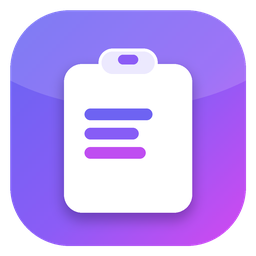
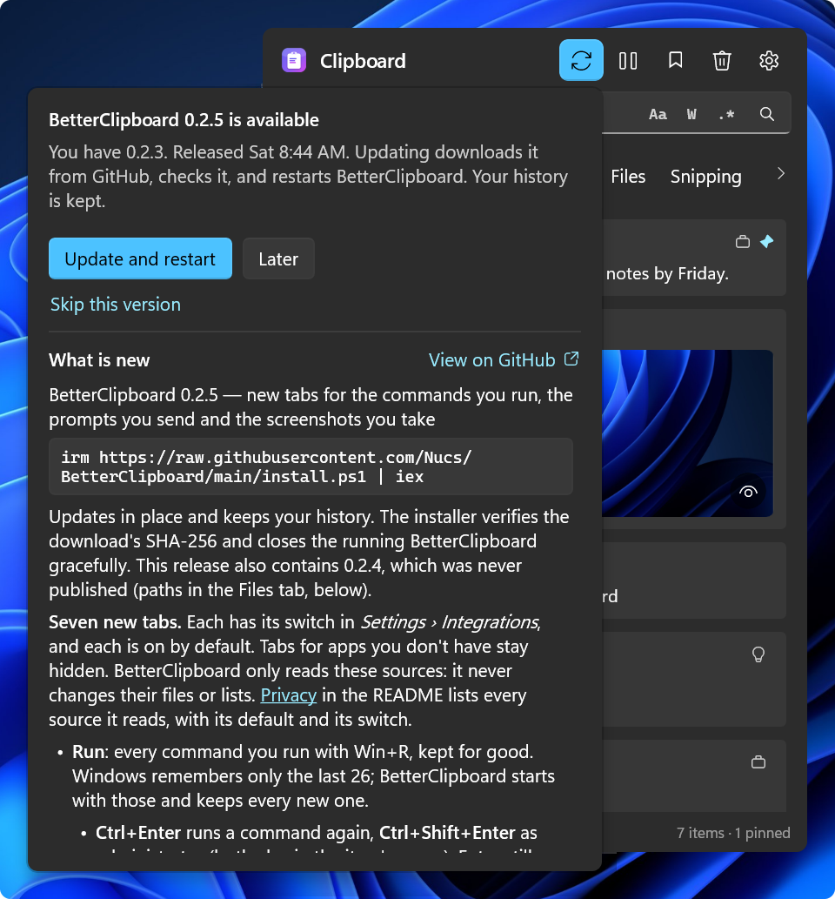
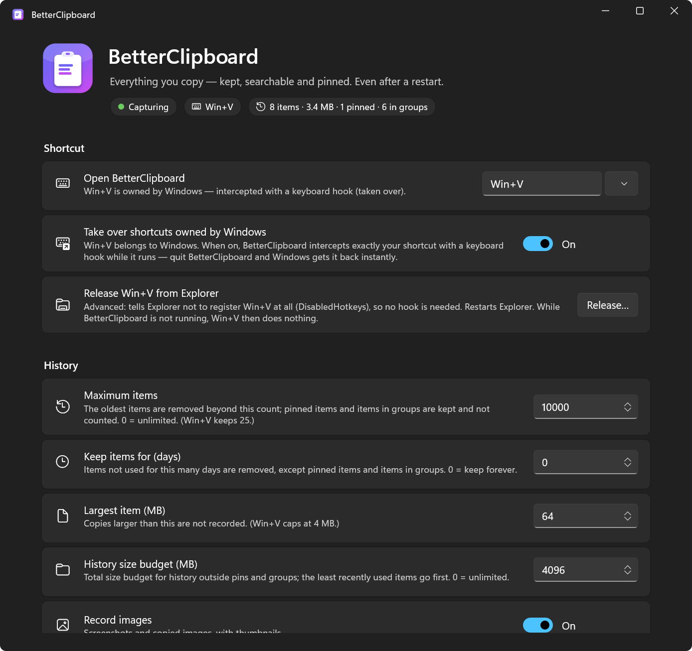
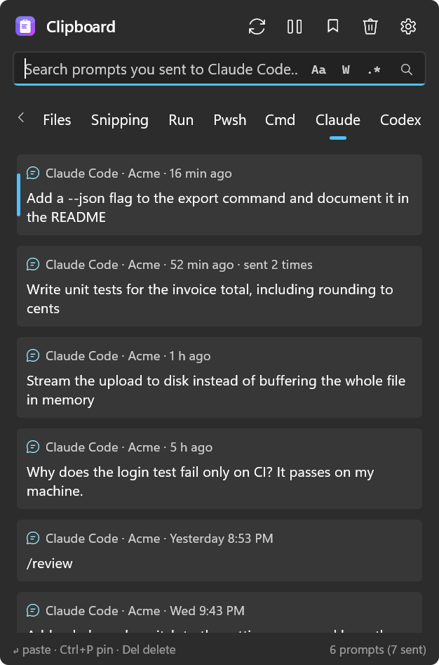

<div align="center">

#  BetterClipboard

[](https://github.com/Nucs/BetterClipboard/actions/workflows/ci.yml)
[](https://github.com/Nucs/BetterClipboard/releases/latest)
[](../../LICENSE)

[ENG](../../README.md) / [简体中文](README.zh-CN.md) / [Русский](README.ru.md) / **Español** / [עברית](README.he.md)

</div>

> Esta es una traducción del [README](../../README.md) en inglés. La versión en inglés puede actualizarse antes que la traducción; si no coinciden, vale la versión en inglés.

<div align="center">

**El historial del portapapeles de Win+V que Windows debió traer de serie.** El mismo atajo, el mismo panel junto a tu cursor, pero recuerda todo, sobrevive a los reinicios, busca al instante y lo guarda todo cifrado en tu PC.
También guarda lo que otras herramientas olvidan: tus capturas de pantalla, tus comandos de Win+R, el historial de tu shell y los prompts que envías a Claude Code y Codex.

</div>

<p align="center">
  
</p>

<a id="features"></a>
## Funciones

- **Reemplaza Win+V.** El mismo atajo, y el panel aparece al instante junto a tu cursor de texto: se mantiene dibujado y al día mientras está oculto, así que Win+V solo tiene que mostrarlo ([Cómo funciona](#how-it-works)). El instalador libera Win+V del Explorador; una copia que ejecutas sin el instalador lo intercepta con un hook de teclado. Agrega más atajos, o deja Win+V para Windows y elige los tuyos: presiona cualquier tecla o combinación en *Configuración › Atajo de teclado* (incluidas las teclas del teclado numérico y multimedia, F13–F24 y la tecla Copilot), y los atajos que usaste antes quedan a un clic ([Elegir atajos](#choosing-shortcuts)).
- **Recuerda todo, también después de reiniciar.** 10.000 elementos de forma predeterminada, cada uno de hasta 64 MB, con un límite de tamaño total y un límite de antigüedad opcional, todo ajustable. Win+V guarda 25 elementos de hasta 4 MB, y un reinicio borra todo salvo lo anclado.
- **Todo tipo de copia**, con la aplicación de origen y la hora en cada tarjeta, y pestañas que filtran por tipo y por origen. Lo que vuelves a copiar sube arriba en vez de duplicarse ([Pestañas](#tabs)):
  - **Texto, texto enriquecido y HTML, vínculos y colores** con su muestra.
  - **Los textos largos** muestran sus primeras cuatro líneas, y una fina línea de puntos y un ojo indican que hay más. Deja el mouse sobre el texto para leerlo entero, o presiona `F3` para abrir un visor que dibuja Markdown, colorea código en 22 lenguajes, vuelve a sangrar XML y JSON, ajusta y numera las líneas y abre copias de varios megabytes página a página ([Vista previa de texto](#text-previews)).
  - **Archivos** copiados en el Explorador y **rutas copiadas como texto** (`C:\…`, `~/.bashrc`, `src/app/main.cs`), que se siguen pegando como texto ([Rutas en la pestaña Archivos](#paths-in-the-files-tab)).
  - **Imágenes** con miniaturas. Deja el mouse sobre una para verla a tamaño completo, o ábrela en un visor con zoom y desplazamiento ([Vista previa de imágenes](#image-previews)). La misma imagen en PNG o en mapa de bits es un solo elemento. Una captura de pantalla recuerda el archivo en el que se guardó: haz clic derecho para copiar su ruta, copiarla como archivo, abrirla o abrir su carpeta, y *Guardar en carpeta temporal y* hace lo mismo con cualquier imagen ([Imágenes y sus archivos](#pictures-and-their-files)).
  - **El historial propio de Windows:** lo que Win+V todavía recuerda, incluido lo anclado, se importa en cada inicio. Lo que eliminas en BetterClipboard no se vuelve a importar.
  - **ShareX:** cada captura que guarda [ShareX](https://getsharex.com), en el momento en que se guarda.
  - **Recortes:** cada captura que guardan el guardado automático de Recortes y `Win+PrtScn`.
  - **Notepad++:** el texto de las pestañas «new» sin guardar de [Notepad++](https://notepad-plus-plus.org/), actualizado mientras las editas, y la ruta completa de cada archivo que abres en Notepad++.
  - **Ejecutar:** cada comando que ejecutas con `Win+R`, también después de que la lista de 26 de Windows lo olvide. `Ctrl+Enter` lo vuelve a ejecutar (`Ctrl+Shift+Enter`: como administrador).
  - **Pwsh:** todo el historial de comandos de PowerShell, también los comandos antiguos a los que ya no llega su flecha hacia arriba.
  - **Cmd:** los comandos que escribes en las ventanas del Símbolo del sistema, que se conservan después de cerrar la ventana.
  - **Claude y Codex:** cada prompt que envías a Claude Code y Codex, guardado para siempre.
  - **Everything:** los archivos que abres desde [Everything](https://www.voidtools.com/), para pegarlos como archivo o como ruta.

  Las últimas ocho son pestañas para otras aplicaciones. Cada una tiene su propio interruptor y está activada de forma predeterminada, BetterClipboard solo lee su origen, y la pestaña de una aplicación que no tienes permanece oculta ([Pestañas para otras aplicaciones](#tabs-for-other-apps)). *Eliminar lo guardado…* en la tarjeta de cada una en la configuración muestra lo que BetterClipboard guardó de ella, parte por parte y con ejemplos, y elimina lo que marques; los archivos propios de la otra aplicación nunca se tocan.
- **Búsqueda instantánea** en cualquier idioma, incluidos hebreo, CJK y emoji, con los interruptores de VS Code: coincidir mayúsculas y minúsculas (`Alt+C`), palabra completa (`Alt+W`) y expresión regular (`Alt+E`) ([Búsqueda](#search)). Win+V no tiene búsqueda.
- **Hecho para el teclado.** `Enter` pega en la aplicación de la que viniste y `Shift+Enter` pega texto sin formato. `↑` `↓` recorren los elementos, `←` `→` recorren las pestañas en círculo, y `↑` desde el primer elemento entra en tus grupos. `Ctrl+1` … `Ctrl+9` pegan el elemento n, `Ctrl+P` ancla, `Del` elimina, `F3` muestra un elemento completo, y la tecla de menú abre el menú de un elemento (solo copiar, abrir el vínculo, mostrar en el Explorador, …). `Esc` devuelve el foco a donde estabas ([Uso](#use)).
- **Un panel a tu medida.** Se abre en la pestaña que usaste por última vez, también después de reiniciar. Arrastra cualquier espacio vacío para moverlo, y arrastra un borde para cambiar su tamaño: desde entonces se abre con ese tamaño. Las pestañas que no caben se desplazan de lado con las flechas ‹ ›, la rueda del mouse o arrastrando. Haz clic derecho en una pestaña para moverla a la izquierda o a la derecha, ocultarla u ocultarla junto con sus elementos en todas las listas; *Mostrar todas las ocultas* las devuelve, y tu orden se conserva ([Pestañas](#tabs)). El mouse selecciona el elemento sobre el que está.
- **Anclados y grupos.** Ancla lo que reutilizas: los elementos anclados aparecen arriba, y el panel igualmente se abre en tu copia más reciente, justo debajo de ellos, así que `Win+V` `Enter` pega lo último que copiaste y `↑` llega a los anclados. Crea grupos con tus propios iconos, arrastra tarjetas sobre ellos y muestra un grupo o varios a la vez (`Ctrl+clic`, `Shift+clic`, o `Space` sobre un grupo al que llegas con las flechas). Los elementos anclados y agrupados sobreviven a todos los límites, y *Borrar* los conserva ([Grupos](#groups)).
- **Poca memoria.** Después de cada uso devuelve la memoria que ya no necesita: mientras espera tu próximo Win+V, la columna *Memoria* del Administrador de tareas muestra unos pocos megabytes. Lo que deja atrás la configuración también vuelve: unos segundos después de cerrarla, BetterClipboard se reemplaza en silencio por una copia nueva, y no se abre ni parpadea nada ([Cómo funciona](#how-it-works)).
- **Lee cada copia al instante.** Las copias separadas por 2 ms o más se guardan todas. Un programa que copia más rápido sobrescribe sus propias copias antes de que cualquier aplicación, Win+V incluido, pueda leerlas: BetterClipboard guarda la última y cuenta las demás (*Configuración › Fiabilidad de la captura*).
- **Privado.** Sin telemetría y sin cuenta. Lo único que consulta por su cuenta a un servidor es la lista pública de sus versiones en GitHub, una vez al día, para avisarte de actualizaciones; un interruptor también lo desactiva ([Privacidad](#privacy)).
  - **Cifrado en reposo:** todo el historial (ChaCha20-Poly1305), con una clave que solo tu cuenta en esta PC puede abrir ([Cómo funciona](#how-it-works)). Win+V cifra solo lo anclado.
  - **Las copias privadas quedan fuera:** las copias que las aplicaciones marcan como privadas nunca se registran, y 46 administradores de contraseñas y aplicaciones de autenticación se ignoran desde el principio. *Pausar la captura* y *Aplicaciones ignoradas* cubren el resto.
  - **Olvidar para siempre** elimina un elemento y nunca vuelve a registrar su contenido, sea cual sea la aplicación que lo copie ([Olvidar para siempre](#forget-forever)).
- **Una línea de comandos para scripts y agentes de IA.** `bclip` lista tu historial, busca en él y le aplica grep, imprime cualquier elemento byte a byte, pone texto en el portapapeles, espera tu próxima copia y busca en tus prompts archivados, con salida en JSON. Está desactivada de forma predeterminada ([Línea de comandos](#command-line-for-scripts-and-ai-agents)).
- **Se instala con una línea.** Por usuario, sin derechos de administrador, con comprobación SHA-256, Windows 10 (2004 o posterior) y Windows 11, x64 y ARM64, sin nada más que instalar; desde entonces se inicia con Windows. Como administrador, o desde Intune o una herramienta RMM, se instala para todos los usuarios de una PC, y cada usuario puede igualmente desactivar el inicio al iniciar sesión para sí mismo. Al desinstalarlo conservas tu historial, salvo que pidas lo contrario ([Instalación](#install)). Una edición para Microsoft Store está lista y espera su página en la tienda ([Edición de Microsoft Store](#microsoft-store-edition)).
- **Actualizaciones cuando tú lo apruebas.** El botón de actualización del encabezado del panel, a la izquierda de Pausa, se resalta cuando hay una versión más nueva en GitHub, y una vez por semana su información sobre herramientas lo avisa por sí sola durante unos segundos. Un clic muestra la decisión —*Actualizar y reiniciar* o *Más tarde*— con las notas de la versión debajo. Solo entonces se descarga la actualización, se comprueba con el SHA-256 de la versión y se instala en su lugar, también en una carpeta que extrajiste del zip de la versión: BetterClipboard se reinicia solo, y tu historial se conserva ([Actualizaciones](#updates)).
- **En tu idioma.** Inglés, chino simplificado (简体中文), ruso (Русский), español (Español) y hebreo (עברית), todos en cada descarga. El primer inicio muestra los idiomas con sus banderas, con el idioma de Windows ya seleccionado: un clic en la marca verde y toda la aplicación lo habla. Una actualización desde una versión que todavía no preguntaba también pregunta una vez. *Configuración › Aplicación › Idioma* lo cambia después: elige un idioma y presiona *Reiniciar ahora*. El hebreo se lee de derecha a izquierda dentro del diseño habitual. Lo que copias, los nombres de archivo y los nombres que das a los grupos nunca se traducen.
- **Configuración en la que puedes buscar.** Escribe en el cuadro de la parte superior de la configuración (`Ctrl+F`) y la página deja solo las opciones que coinciden, en su sitio, con las letras coincidentes resaltadas. Cuenta cualquier palabra de una opción —su título, descripción, sección, botones y opciones— y también las iniciales («lde» para *Liberar del Explorador*) y las erratas (los nombres en inglés también se buscan, así que «pasword» también sirve). `Esc` devuelve toda la página a donde estaba.
- **Configuración para lo demás:** iniciar con Windows, el tema (claro, oscuro o el de Windows), dónde se abre el panel (junto al cursor de texto o al mouse, o en el centro de la pantalla principal o de la pantalla en la que escribes, con varios monitores y a cualquier escala) y una página que acredita cada aplicación con la que funciona y cada componente que incluye, con sus vínculos oficiales.

<a id="install"></a>
## Instalación

Windows 10 versión 2004 o posterior / Windows 11, x64 o ARM64. No hay nada más que instalar (la versión es autónoma). En PowerShell:

```powershell
irm https://raw.githubusercontent.com/Nucs/BetterClipboard/main/install.ps1 | iex
```

El instalador descarga la [versión](https://github.com/Nucs/BetterClipboard/releases/latest) más reciente para tu arquitectura, **comprueba su SHA-256**, la instala por usuario en `%LOCALAPPDATA%\Programs\BetterClipboard` (sin derechos de administrador), agrega un acceso directo en el menú Inicio, hace que BetterClipboard se inicie con Windows y lo registra en *Configuración › Aplicaciones › Aplicaciones instaladas*. También **toma Win+V**: el Explorador deja de registrarlo y se reinicia una vez (la barra de tareas parpadea y las ventanas de carpetas abiertas se cierran). Consulta [Tomar Win+V](#taking-over-winv). Ejecutarlo de nuevo actualiza en el mismo lugar, igual que el botón de actualización de la propia aplicación ([Actualizaciones](#updates)); tu historial nunca se toca. Funciona desde cualquier carpeta, también una en la que no puedes escribir, y al terminar deja tu PowerShell en esa carpeta.

En su primer inicio, BetterClipboard te pregunta tu idioma: English, 简体中文, Русский, Español o עברית, cada uno con su bandera, con el idioma de Windows ya seleccionado. Presiona la marca verde (o `Enter`) y todo se abre en ese idioma. Si actualizas desde una versión que todavía no preguntaba, el primer inicio después de la actualización pregunta una vez.

Una vez al día, la aplicación instalada pregunta a GitHub si hay una versión más nueva. No se envía nada sobre ti, tu PC o tu portapapeles, y no se instala nada sin tu aprobación ([Privacidad](#privacy)). `-NoUpdateCheck` instala con esa comprobación desactivada.

Opciones (pásalas a través de un bloque de script):

```powershell
& ([scriptblock]::Create((irm https://raw.githubusercontent.com/Nucs/BetterClipboard/main/install.ps1))) -NoTakeOverWinV -Hotkey Win+Alt+V
```

| Opción | Efecto |
|---|---|
| `-NoTakeOverWinV` | Dejar Win+V para Windows. Entonces BetterClipboard se abre con los atajos de `-Hotkey`, o con Win+Alt+V. Si Win+V se había liberado antes, el Explorador lo recupera. |
| `-Hotkey A, B, …` | Los atajos que abren BetterClipboard, por ejemplo `-Hotkey Win+Alt+V, Ctrl+Alt+F9`. Win+V va primero salvo que se indique `-NoTakeOverWinV`. Cada uno se toma de la misma forma que Win+V (consulta [Tomar Win+V](#taking-over-winv)). |
| `-TakeOverWinV` | El valor predeterminado. Se conserva para líneas de comandos antiguas; si tus atajos ya no incluyen Win+V, vuelve a agregar Win+V. |
| `-AddToPath` | Agregar la carpeta de instalación a tu PATH de usuario para que las terminales puedan ejecutar `bclip` (consulta [Línea de comandos](#command-line-for-scripts-and-ai-agents)). |
| `-NoUpdateCheck` | Instalar con la comprobación automática de actualizaciones desactivada: así BetterClipboard nunca consulta GitHub por su cuenta. *Configuración › Actualizaciones* tiene *Comprobar ahora* y el interruptor para volver a activarla. |
| `-Version 0.1.0` | Instalar una versión concreta en lugar de la más reciente. |
| `-Package <zip>` | Instalar desde un zip de versión en el disco en lugar de descargar uno (una instalación sin conexión). Coloca el `SHA256SUMS.txt` de la versión junto al zip, o indica `-PackageSha256 <hash>`, y se comprueba primero. |
| `-AllUsers` | Instalar para todos los usuarios de esta PC (en PowerShell como administrador); consulta [Para todos los usuarios de una PC](#for-every-user-of-a-pc). |
| `-InstallDir <path>` | Instalar en otro lugar. |
| `-NoStartup` / `-NoShortcut` / `-NoLaunch` | No iniciar con Windows / no crear el acceso directo del menú Inicio / no abrir la aplicación después de instalar. |
| `-Uninstall [-RemoveData]` | Quitar la aplicación (el historial se conserva salvo con `-RemoveData`, que también elimina las imágenes temporales). |

¿Prefieres hacerlo a mano? Descarga el zip para tu arquitectura y `SHA256SUMS.txt` de la versión, comprueba el hash (`Get-FileHash .\BetterClipboard-*.zip`), extráelo donde quieras y ejecuta `BetterClipboard.exe`. Las versiones aún no están firmadas con código, así que Windows puede decir *Windows protegió su PC* ante una copia descargada así: comprueba el hash y luego elige *Más información › Ejecutar de todas formas*. Consulta [Política de firma de código](#code-signing-policy).

<a id="for-every-user-of-a-pc"></a>
### Para todos los usuarios de una PC

En PowerShell como administrador:

```powershell
& ([scriptblock]::Create((irm https://raw.githubusercontent.com/Nucs/BetterClipboard/main/install.ps1))) -AllUsers
```

- **Lo que configura:** la aplicación en `Program Files\BetterClipboard`, en una carpeta que solo los administradores pueden cambiar; un acceso directo en el menú Inicio, una entrada en *Aplicaciones instaladas* y el inicio con Windows para todos los usuarios. Cada usuario que inicia sesión encuentra BetterClipboard en marcha, con su propio historial cifrado en su propio perfil.
- **Cada usuario decide por sí mismo:** desactivar *Configuración › Aplicación › Iniciar con Windows* detiene el inicio al iniciar sesión solo para ese usuario. La entrada propia de inicio con Windows de un usuario, si la tiene, tiene prioridad, así que BetterClipboard nunca se inicia dos veces.
- **Se elige solo** cuando no es el usuario que inició sesión quien instala: cuando el instalador se ejecuta como SYSTEM (Intune, una herramienta RMM) o con las credenciales de un administrador en el escritorio de otra persona. Una copia en el perfil de esa cuenta no le serviría a nadie que inicie sesión en la PC.
- **Lo que sigue siendo de cada usuario:** Win+V y los demás atajos. BetterClipboard toma Win+V con su hook de teclado para todos, y cada usuario puede liberarlo del Explorador en *Configuración › Atajo de teclado*. `-Hotkey` y `-NoTakeOverWinV` solo se aplican cuando instala el usuario que inició sesión. `-AddToPath` agrega la carpeta al PATH de todos los usuarios.
- **Actualizaciones:** esta copia no se reemplaza a sí misma ni busca actualizaciones por su cuenta, porque sus usuarios pueden no ser administradores. Un administrador vuelve a ejecutar el mismo comando: ejecutado como administrador en una PC con una copia para todos los usuarios, el instalador actualiza esa copia. *Configuración › Actualizaciones › Comprobar ahora* sigue diciéndote si hay una versión nueva, y el cuadro de diálogo de actualización copia el comando.

El [paquete de Chocolatey](../../packaging/chocolatey) sigue la misma regla para el inicio con Windows. Si lo instala el usuario que inició sesión, la entrada es suya. Si lo instala SYSTEM u otra cuenta, o con `/AllUsersStartup`, es para todos los usuarios.

<a id="microsoft-store-edition"></a>
### Edición de Microsoft Store

**Todavía no está en la tienda.** La edición está compilada y probada ([docs/microsoft-store.md](../microsoft-store.md)); su página en la tienda se está preparando. Esto es lo que es:

- **La instala y la actualiza la tienda.** Microsoft firma el paquete, así que Windows no muestra ninguna advertencia de «editor desconocido». La aplicación en sí no hace ninguna solicitud de red, porque la actualiza la tienda.
- **Pregunta primero.** El primer inicio pregunta tu idioma y luego muestra una bienvenida con dos interruptores, *Abrir con Win+V* e *Iniciar con Windows*. No se registra nada ni se toma ningún atajo hasta que presionas *Empezar*.
- **Win+V sin cambios en el sistema.** Mientras se ejecuta, responde a Win+V con el hook de teclado; ciérrala y Win+V vuelve a ser de Windows al instante. *Liberar del Explorador* no forma parte de esta edición.
- **Tu historial viene contigo.** Lo previsto es que solo haya un BetterClipboard instalado. Cuando la edición de la tienda encuentra una copia que instalaste con el instalador, te dice lo que hará y comprueba que puede hacerlo. Con *Pasar a esta edición* cierra esa copia, copia tu historial y tu configuración, comprueba la copia, desinstala la otra copia (lo que devuelve Win+V a Windows) y quita la carpeta antigua. Si un paso falla, tu historial se queda donde estaba. Una copia para todos los usuarios, o la copia de Chocolatey, la quita un administrador: la edición de la tienda dice cómo y espera. El instalador, a su vez, te avisa cuando la edición de la tienda está instalada.
- **`bclip` funciona en cualquier terminal** sin entrada en el PATH, una vez que activas la línea de comandos.
- **Quitarla** también quita el historial: lo guarda en sus propios datos de aplicación, que Windows elimina junto con la aplicación.

<a id="updates"></a>
## Actualizaciones

BetterClipboard se actualiza desde sus [versiones en GitHub](https://github.com/Nucs/BetterClipboard/releases), y solo cuando tú lo dices.

<p align="center">
  
</p>

- **El botón de actualización** está en el encabezado del panel, a la izquierda de Pausa. Mientras tienes la versión más reciente, se ve como sus vecinos. Cuando existe una versión más nueva, se rellena con tu color de énfasis, y el menú del icono de la bandeja muestra *Actualizar a x.y.z…*.
- **Un recordatorio una vez por semana.** Mientras espera una versión más nueva, la información sobre herramientas del botón —*Actualización disponible: BetterClipboard x.y.z*— se abre por sí sola durante unos segundos al abrir el panel, como mucho una vez cada siete días. Se abre encima del panel, donde no tapa nada (junto al botón cuando el panel está en la parte superior de la pantalla), y se cierra sola: no hay nada que descartar y puedes seguir escribiendo como siempre. Un clic en ella abre el cuadro de diálogo de actualización. Abrir ese cuadro de diálogo también cuenta como recordatorio, así que *Más tarde* significa una semana. No hay recordatorio mientras la comprobación automática está desactivada.
- **Un clic abre el cuadro de diálogo de actualización:** arriba la decisión —*Actualizar y reiniciar*, *Más tarde* u *Omitir esta versión*— y debajo las notas de la versión. Mientras estás al día, muestra las novedades de tu versión y *Comprobar ahora*.
- **No se instala nada sin tu aprobación.** *Actualizar y reiniciar* descarga de GitHub la versión para tu PC y compara su SHA-256 con el `SHA256SUMS.txt` de la versión y con el resumen que calcula el propio GitHub. Luego el instalador de esa versión reemplaza los archivos de la aplicación: BetterClipboard se cierra y vuelve a iniciarse solo, en segundo plano. Tu historial, tu configuración y tus atajos se quedan como están, y una notificación te dice cómo fue.
- **Si una actualización falla,** la versión instalada se queda en su lugar y sigue funcionando, y el cuadro de diálogo o una notificación dice por qué. Una descarga que no coincide con su suma de comprobación se elimina. Una carpeta de instalación que otro programa mantiene abierta se deja como estaba.
- **La comprobación:** una vez al día (la primera vez, un minuto después de iniciarse), BetterClipboard pide a GitHub la lista pública de versiones de este proyecto. La solicitud solo indica la versión de la aplicación: no se envía nada sobre ti, tu PC o tu portapapeles ([Privacidad](#privacy)). *Configuración › Actualizaciones* desactiva la comprobación, y también instalar con `-NoUpdateCheck`. *Comprobar ahora* pregunta una vez, diga lo que diga el interruptor.
- **Omitir esta versión** quita el resaltado y el recordatorio semanal de esa versión. La siguiente versión trae ambos de vuelta.
- **Una compilación de desarrollo** (una versión como `0.2.10-dev.12.gabc1234`, consulta [Compilar desde el código fuente](#build-from-source)) recibe primero las compilaciones publicadas en la carpeta `dev-builds` de su PC: *Compilación de desarrollo disponible*, y *Actualizar y reiniciar* copia la compilación de esa carpeta en vez de descargarla. Si no, siempre se le ofrece la versión más reciente de GitHub, aunque sea más antigua, como camino de vuelta a la versión oficial (*Instalar y reiniciar*). No recibe recordatorio semanal.
- **Una copia que extrajiste del zip de la versión** se actualiza a sí misma en su propia carpeta, a partir de 0.2.11. *Actualizar y reiniciar* descarga y comprueba la versión como se describe arriba; luego la versión nueva cierra BetterClipboard, reemplaza los archivos de la versión uno a uno y vuelve a iniciarse. Los archivos que no forman parte de la versión (los tuyos, si la carpeta tiene alguno) se quedan como están, y si alguno de sus archivos no se puede reemplazar (otro programa lo mantiene abierto), todos los archivos vuelven a como estaban. Una copia en una carpeta que no puedes cambiar, como Program Files sin derechos de administrador, recibe en su lugar la página de descarga y el comando de instalación.
- **Una copia más nueva toma el relevo.** Inicia un BetterClipboard más nuevo mientras se ejecuta uno más antiguo (una versión nueva extraída en una carpeta nueva, por ejemplo), y el antiguo se cierra y el nuevo sigue, en lugar de abrirse la configuración del antiguo. Si *Iniciar con Windows* inicia una copia más antigua, o una que ya no existe, pasa a la copia que ejecutas; una entrada que desactivaste en las aplicaciones de inicio de Windows sigue desactivada.
- **Una copia instalada para todos los usuarios** ni se reemplaza a sí misma ni busca actualizaciones por su cuenta: solo un administrador puede cambiar su carpeta. *Comprobar ahora* sigue preguntando, y el cuadro de diálogo copia el comando para ejecutarlo en PowerShell como administrador ([Para todos los usuarios de una PC](#for-every-user-of-a-pc)).
- **La edición de Microsoft Store** no tiene botón de actualización y no le pregunta nada a GitHub: la actualiza la tienda, y *Configuración › Actualizaciones de Microsoft Store* abre su página en la tienda.

<a id="use"></a>
## Uso

Presiona **Win+V**. El panel aparece al instante junto a tu cursor de texto, en la pestaña que usaste por última vez, con el foco en el cuadro de búsqueda: solo escribe. Tu copia más reciente está seleccionada, así que `Enter` la pega. Los elementos anclados aparecen encima de ella (*Configuración › Pegado* puede ordenarlos por fecha en su lugar), y `↑` llega a ellos.

*Configuración › Atajo de teclado › Posición del panel* lo abre junto al mouse en su lugar, o en el centro de una pantalla: la principal o aquella en la que escribes (con varios monitores, la pantalla de la ventana en la que estabas; después de un clic en el escritorio, la pantalla del mouse).

| Tecla | Acción |
|---|---|
| *escribir* | Buscar (por subcadena, sin distinguir mayúsculas, incluidos hebreo, CJK y emoji) |
| `Alt+C` / `Alt+W` / `Alt+E` | Activan o desactivan **Aa** (coincidir mayúsculas y minúsculas), **W** (palabra completa) y **.\*** (expresión regular) del cuadro de búsqueda, o haz clic en ellos. Se quedan como los dejas. |
| `↑` `↓` `PgUp` `PgDn` | Mueven la selección. El panel se abre en tu copia más reciente, así que `↑` va primero a los elementos anclados que están encima, empezando por el de más abajo. Con la columna de grupos abierta, presiona `↑` en el primer elemento para entrar en los grupos (consulta [Grupos](#groups)). |
| `Space` / `Enter` en la columna de grupos | Mientras las flechas están en la columna de grupos: quedarse con el grupo bajo el anillo y volver a los elementos. Mientras hay varios grupos abiertos: agregar a la lista el grupo bajo el anillo, o quitarlo (consulta [Grupos](#groups)). En cualquier otro lugar, `Space` escribe un espacio y `Enter` pega. |
| `←` `→` | Pestaña anterior / siguiente, en círculo: `←` en la primera pestaña va a la última, `→` en la última va a la primera. Mientras editas el texto de búsqueda, mueven su cursor; después de `↑` o `↓` vuelven a cambiar de pestaña. Una tecla mantenida se detiene en la primera o la última pestaña. |
| Mouse sobre un elemento | Lo selecciona. Las pestañas y los iconos de grupo solo se seleccionan con un clic. |
| `Enter` / clic | Pegar en la aplicación de la que viniste |
| `Shift+Enter` | Pegar como texto sin formato |
| `Ctrl+Enter` | En un comando que ejecutaste con Win+R: volver a ejecutarlo (`Ctrl+Shift+Enter`: como administrador) |
| `Ctrl+1` … `Ctrl+9` | Pegar el elemento n |
| `Ctrl+P` | Anclar / desanclar (los elementos anclados ignoran la retención y «borrar») |
| `Del` (o `Shift+Del` mientras buscas) | Eliminar el elemento. En las pestañas Pwsh, Cmd y Everything, ocultar el comando o el archivo hasta que lo vuelvas a usar. En las pestañas Claude y Codex, eliminar el prompt hasta que lo vuelvas a enviar. |
| `Ctrl+F` | Volver al cuadro de búsqueda |
| `Ctrl+G` | Mostrar / ocultar la columna de grupos (igual que el botón del marcador) |
| `F3` | Ver el elemento seleccionado: todo su texto en el visor de texto, o una imagen en el visor de imágenes (consulta [Vista previa de texto](#text-previews)) |
| `Menu` / `Shift+F10` / clic derecho | Menú del elemento: pegar, pegar como texto sin formato, solo copiar, ver (`F3`), anclar, grupos (agregar / quitar), abrir vínculo / mostrar en el Explorador / mostrar en Everything, ejecutar (comandos de Win+R), el archivo de una imagen (copiar ruta, copiar imagen como archivo, abrir archivo, abrir carpeta) y *Guardar en carpeta temporal y* (consulta [Imágenes y sus archivos](#pictures-and-their-files)), eliminar, olvidar para siempre |
| Clic derecho en una pestaña (o `Menu` en una pestaña en la que hiciste clic) | Menú de la pestaña: *Mover a la izquierda*, *Mover a la derecha*, *Ocultar pestaña*, *Ocultar pestaña y sus filas del portapapeles*, *Mostrar todas las ocultas*. Un clic derecho en el espacio vacío de las pestañas también ofrece *Mostrar todas las ocultas* (consulta [Pestañas](#tabs)). |
| `Esc` | Borrar la búsqueda y luego cerrar: el foco vuelve a donde estabas |
| Arrastrar cualquier espacio vacío | Mover el panel, como arrastrar una barra de título (`Esc` mientras arrastras lo devuelve a su sitio). La próxima vez se abre de nuevo donde indica *Posición del panel*. |
| Arrastrar un borde | Cambiar el tamaño del panel. Desde entonces se abre con ese tamaño. |
| Rueda o arrastre sobre las pestañas | Desplazar las pestañas de lado cuando no caben, o hacer clic en las flechas ‹ › de sus extremos |
| Dejar el mouse sobre una imagen | Verla a tamaño completo; su botón de ojo abre un visor con zoom (consulta [Vista previa de imágenes](#image-previews)) |
| Dejar el mouse sobre un texto largo | Leerlo entero y desplazarlo con la rueda (mover el mouse lo cierra); clic derecho para copiarlo o para el menú del elemento; su botón de ojo abre el visor de texto, que se queda abierto (consulta [Vista previa de texto](#text-previews)) |
| El botón de actualización, a la izquierda de Pausa | Abrir el cuadro de diálogo de actualización: las notas de la versión y *Actualizar y reiniciar* cuando existe una versión más nueva (entonces el botón está resaltado; consulta [Actualizaciones](#updates)) |

Escribe y presiona `Enter` tan rápido como quieras: `Enter` espera a que termine la búsqueda y pega su mejor coincidencia, la más reciente que no está anclada cuando las coincidencias ancladas aparecen encima.

**Pegar en una ventana que se ejecuta como administrador** (una terminal con privilegios elevados, por ejemplo): Windows no deja que una aplicación sin derechos de administrador escriba en ella. BetterClipboard pone el elemento en el portapapeles, vuelve a esa ventana y te avisa una vez (con una notificación) para que presiones `Ctrl+V` tú mismo. El propio atajo funciona sobre esas ventanas cuando Win+V está liberado del Explorador (lo que hace el instalador de forma predeterminada).

El icono de la bandeja abre el panel y la configuración. El cuadro de búsqueda de la parte superior de la configuración (`Ctrl+F`) filtra la página mientras escribes, erratas incluidas; `Esc` lo vacía. Sus secciones:

- **Atajo de teclado:** las teclas que abren el panel (agrega todas las que quieras: haz clic en el cuadro y presiónalas, o elige una en su menú de sugerencias y atajos usados antes), dónde se abre el panel (junto al cursor de texto, junto al mouse, en el centro de la pantalla principal o en el centro de la pantalla en la que escribes) y la liberación de atajos Win+letra del Explorador ([Elegir atajos](#choosing-shortcuts)).
- **Historial:** cuántos elementos, durante cuántos días, de qué tamaño, qué registrar y cuánto tiempo se conservan las imágenes de *Guardar en carpeta temporal y*.
- **Pegado:** pegar al elegir un elemento, mover al principio los elementos pegados, anclados primero.
- **Privacidad:** pausa, aplicaciones ignoradas, *Olvidados para siempre*, fiabilidad de la captura, borrar historial.
- **Portapapeles de Windows:** el historial propio de Windows e **Importar desde Windows**, que trae todo lo que Win+V todavía recuerda, incluidos sus elementos anclados.
- **Integraciones:** un interruptor para cada pestaña de otra aplicación, dos para Notepad++ (sus pestañas sin guardar y los archivos que abres en él), y en cada tarjeta *Eliminar lo guardado…*: un cuadro de diálogo que enumera lo que BetterClipboard guardó de ese origen, parte por parte con cantidades, tamaños y los ejemplos más recientes, y elimina las partes que marques, con la opción de desactivar antes el interruptor (consulta [Pestañas para otras aplicaciones](#tabs-for-other-apps)).
- **Aplicación:** el idioma de la interfaz (el de Windows o uno que elijas; *Reiniciar ahora*, junto a la lista, lo aplica), iniciar con Windows (solo para ti, también cuando BetterClipboard se instaló para todos los usuarios), el tema, la línea de comandos, la carpeta de datos.
- **Actualizaciones:** el interruptor de la comprobación diaria, *Comprobar ahora* y el cuadro de diálogo de actualización ([Actualizaciones](#updates)).
- **Terceros:** las aplicaciones con las que funciona BetterClipboard y los componentes con los que está hecho, con sus vínculos oficiales.

**La memoria vuelve después de cada uso.** Poco después de que guardas el panel o cierras la configuración, BetterClipboard devuelve la memoria que ya no necesita, así que mientras espera, la columna *Memoria* del Administrador de tareas muestra unos pocos megabytes. La configuración además deja atrás memoria que solo un proceso nuevo devuelve (entre 80 y 100 MB, aproximadamente), así que unos segundos después de cerrarla, una vez que el panel está cerrado y el teclado y el mouse llevan un momento quietos, BetterClipboard se reemplaza en silencio por una copia nueva. No se abre ni parpadea nada, y el puntero no cambia: el icono de la bandeja se queda donde está, los atajos siguen funcionando (uno presionado en ese segundo abre el panel un momento después) y se registra cualquier copia hecha mientras tanto.

<p align="center">
  
</p>

<a id="tabs"></a>
### Pestañas

| Pestaña | Lo que muestra | Cuándo aparece |
|---|---|---|
| Todo | Todo tu historial, lo más reciente primero | Siempre |
| Anclados | Los elementos que anclaste | Siempre |
| Texto | Texto y texto enriquecido, rutas incluidas | Siempre |
| Imágenes | Las imágenes que copiaste y las capturas guardadas | Siempre |
| Vínculos | Las URL copiadas | Siempre |
| Archivos | Los archivos que copiaste en el Explorador y el texto que no es más que rutas | Siempre |
| ShareX | Las capturas que guardó ShareX y todo lo que copiaste desde ShareX | Cuando ShareX está instalado |
| Recortes | Las capturas que guardaron Recortes y Win+PrtScn | Cuando tu historial tiene una captura de ellos |
| Notepad++ | El texto de las pestañas sin guardar de Notepad++, los archivos que abriste en Notepad++ y lo que copiaste en él | Cuando tu historial tiene algo de Notepad++ |
| Ejecutar | Los comandos que ejecutaste con Win+R | Cuando tu historial tiene un comando de Win+R |
| Pwsh | El historial de comandos propio de PowerShell | Cuando PowerShell tiene un archivo de historial |
| Cmd | Los comandos escritos en ventanas del Símbolo del sistema | Siempre |
| Claude | Los prompts que enviaste a Claude Code | Cuando Claude Code tiene prompts |
| Codex | Los prompts que enviaste a Codex | Cuando Codex tiene prompts |
| Everything | Los archivos que abriste en Everything | Cuando Everything está instalado o en ejecución |

Cada pestaña después de Archivos tiene su propio interruptor en *Configuración › Integraciones*. Todas están activadas de forma predeterminada; desactiva una y su pestaña desaparece. [Pestañas para otras aplicaciones](#tabs-for-other-apps) explica lo que lee cada una.

**Ordena las pestañas** haciendo clic derecho en una:
- *Mover a la izquierda* y *Mover a la derecha* la mueven un lugar entre las pestañas que ves. Todo siempre se queda primera y no se puede mover.
- *Ocultar pestaña* saca la pestaña de la fila. Solo se va la pestaña: sus elementos siguen apareciendo en Todo y en las demás pestañas, su interruptor en *Configuración › Integraciones* sigue activado y BetterClipboard sigue recopilando para ella. Ocultar la pestaña en la que estás cambia a Todo. Todo no se puede ocultar.
- *Ocultar pestaña y sus filas del portapapeles* además saca los elementos de la pestaña de todas las listas: Todo, las demás pestañas, las búsquedas. Los elementos que pusiste en un grupo se quedan donde aparecen. El pie del panel dice entonces cuántos están ocultos (`1.240 elementos · 37 ocultos`). No se elimina nada, y `bclip` los sigue listando.
- *Mostrar todas las ocultas* devuelve todas las pestañas ocultas, con cuántas son, y los elementos ocultos con ellas. Un clic derecho en el espacio vacío de la fila también lo ofrece.

Tu orden y tus pestañas ocultas se conservan, también después de reiniciar. `←` y `→` se saltan las pestañas ocultas.

**El panel se abre en la pestaña que usaste por última vez**, también después de reiniciar. `←` y `→` recorren las pestañas en círculo. Si la pestaña que usaste por última vez no está (su aplicación ya no está, su interruptor está desactivado o la ocultaste), el panel se abre en Todo y vuelve a tu pestaña cuando regresa. El texto de búsqueda y los grupos que abriste no se conservan: cada Win+V empieza con una búsqueda vacía sobre todo tu historial.

<a id="search"></a>
### Búsqueda

Escribe para buscar. Una palabra coincide en cualquier parte del texto de un elemento, en cualquier idioma, en mayúsculas o minúsculas. Tres interruptores en el cuadro de búsqueda acotan la búsqueda, como en VS Code:

- **Aa** (`Alt+C`): coincidir mayúsculas y minúsculas.
- **W** (`Alt+W`): solo palabras completas. Así `log` encuentra «log file», pero no «login» ni «my_log».
- **.\*** (`Alt+E`): una expresión regular (sintaxis de .NET); `^` y `$` coinciden en cada línea. Un patrón no válido pone en rojo el contorno del interruptor y dice qué está mal.

Los interruptores se quedan como los dejas, y el texto de búsqueda se borra cada vez que se abre el panel. Funcionan en todas las pestañas y grupos, salvo la pestaña Everything, donde busca el propio Everything.

<a id="image-previews"></a>
### Vista previa de imágenes

- **Vistazo:** deja el mouse sobre una tarjeta de imagen. Tras un momento la imagen aparece a tamaño completo en el centro de la pantalla (hasta el 80% de ella). Mueve el mouse y desaparece.
- **Visor:** haz clic en el botón de ojo de la esquina inferior derecha de una tarjeta de imagen. La imagen se abre sobre toda la pantalla y se queda hasta que la cierres. Gira la rueda del mouse para hacer zoom hacia el puntero, arrastra para desplazarte y haz doble clic para alternar entre ajustar y ampliar. Ciérralo con `Esc`, con su botón X o con un clic fuera de la imagen.

<a id="text-previews"></a>
### Vista previa de texto

Una tarjeta muestra las primeras cuatro líneas de un texto. Cuando el texto es más largo, lo indican una fina línea de puntos debajo de ellas y un pequeño ojo en la esquina de la tarjeta.

- **Vistazo:** deja el mouse sobre el texto de la tarjeta. Tras un momento todo el texto aparece en el centro del panel, coloreado como lo muestra el visor, y la rueda lo desplaza. Mover el mouse lo cierra, y también `Esc`. Un clic derecho con el mouse quieto ofrece *Copiar* y *Seleccionar todo* encima del propio menú del elemento. Un texto de más de 64.000 caracteres muestra su comienzo y lo indica.
- **Visor:** haz clic en el ojo, presiona `F3` o elige *Ver* en el menú del elemento. La pantalla se oscurece y el texto se abre encima en una tarjeta grande:
  - **Markdown** se dibuja como un documento: encabezados, listas, tablas, citas, vínculos y bloques de código, cada bloque de código coloreado en su propio lenguaje. Markdown también es como se muestra un texto cuando no se reconoce ningún lenguaje.
  - **El código** se colorea en C#, Java, Kotlin, JavaScript, TypeScript, Python, Ruby, PHP, Go, Rust, C y C++, PowerShell, scripts de shell, archivos por lotes, SQL, CSS, HTML, XML, JSON, YAML, INI y TOML, y diffs. El lenguaje se reconoce solo; el botón de lenguaje elige otro (el reconocido aparece marcado como *(detectado)*).
  - **XML y JSON** se vuelven a sangrar, un elemento o valor por línea; *Tal como se copió* los muestra como se copiaron.
  - **Ajustar** corta las líneas largas en el borde de la ventana (desactivado, se desplazan de lado), **Números de línea** numera las líneas de código, y **A−** / **A+** (`Ctrl+Minus`, `Ctrl+Plus`, `Ctrl+0`, o `Ctrl` con la rueda) cambian el tamaño del texto. Los tres se recuerdan.
  - **Las copias de varios megabytes** se abren en páginas de unos 64.000 caracteres, con ‹ › para pasar las páginas (`Ctrl+PageUp`, `Ctrl+PageDown`); los números de línea siguen de una página a otra.
  - Selecciona y copia como en cualquier sitio. Mover el mouse no lo cierra: lo cierran `Esc`, su botón X o un clic fuera del texto.

<a id="pictures-and-their-files"></a>
### Imágenes y sus archivos

Una captura que guardaron ShareX, Recortes o `Win+PrtScn` recuerda el archivo en el que se guardó: su nombre, carpeta, formato, tamaño y fechas se conservan con la imagen en tu historial.

- **Haz clic derecho en la imagen.** El menú nombra el archivo, con su formato, su tamaño y cuándo cambió por última vez. Mientras el archivo está en el disco, le siguen cuatro elementos: *Copiar ruta*; *Copiar imagen como archivo*, para pegarla en una carpeta, un correo o un chat como archivo, igual que un archivo copiado en el Explorador de archivos; *Abrir archivo*; y *Abrir carpeta*, el Explorador de archivos con el archivo seleccionado. Un archivo que se movió o se eliminó se indica como tal, y esos cuatro elementos no aparecen.
- **Cualquier imagen, también una que copiaste desde una aplicación:** *Guardar en carpeta temporal y ›* tiene los mismos cuatro elementos. BetterClipboard primero escribe la imagen como PNG en una carpeta propia dentro de tus archivos temporales (`%TEMP%\BetterClipboard\Images`), con el nombre de su archivo cuando lo tiene. Guardar de nuevo la misma imagen encuentra ese archivo; una copia que editaste desde entonces nunca se sobrescribe.
- **Las imágenes temporales se eliminan al iniciarse BetterClipboard,** cuando llevan 30 días sin usarse. *Configuración › Historial › Conservar imágenes temporales (días)* lo cambia, y 0 las elimina en cada inicio. Nunca se eliminan mientras BetterClipboard está en ejecución, así que una imagen que acabas de pegar como archivo sigue ahí para la aplicación que la lee.
- **En el visor,** el archivo de la imagen aparece encima de ella: su nombre, formato, tamaño y tamaño en píxeles en una fila, su carpeta y fechas en la siguiente. Haz clic en el nombre para abrir el archivo, o en la carpeta para abrirla en el Explorador de archivos.
- **Las capturas que ya están en tu historial** encuentran sus archivos una vez, en el primer inicio de una versión que los conserva: cada una recibe el archivo de las carpetas de ShareX o de la carpeta Capturas de pantalla que se guardó en los dos minutos cercanos y tiene los mismos píxeles.
- **Los archivos en una unidad de red** nunca se comprueban (un recurso compartido que ya no está haría esperar al menú), así que sus elementos se quedan.

<a id="paths-in-the-files-tab"></a>
### Rutas en la pestaña Archivos

**La pestaña Archivos** muestra los archivos que copiaste en el Explorador y el texto que no es más que rutas:

- **Rutas absolutas:** `C:\Users\you\notes.txt`, `C:/a/path`, `\\server\share`, `/var/log/syslog`, `%APPDATA%\Code`.
- **Rutas relativas:** `~/.bashrc`, `./build.sh`, `src\app\main.cs`, `folder/file.cs`.
- **Varias:** una ruta por línea, tantas líneas como quieras.
- **Sigue siendo texto:** una ruta copiada se sigue pegando como texto, y la pestaña Texto la sigue mostrando.

Es estricta a propósito, así que esto se queda solo en Texto:

- barras en la prosa (`and/or`, `24/7`);
- una oración que empieza con una ruta (`C:\Windows is where …`);
- las URL y una línea de comandos (`./run.sh src/a.txt`);
- una ruta relativa sin nombre de archivo al final (`src/app`).

Un nombre de carpeta con espacios cuenta cuando parece un nombre (`C:\Program Files (x86)`, `D:\Games\Call of Duty`). Los que van en minúsculas (`C:\Users\you\my stuff`) cuentan entre comillas, como los escribe *Copiar como ruta de acceso* del Explorador.

<a id="groups"></a>
### Grupos

Reúne en grupos lo que reutilizas: fragmentos, direcciones, vínculos de un proyecto.

- **Abre la columna:** el botón del marcador junto a Pausa (o `Ctrl+G`). El panel se ensancha hacia la izquierda y aparece una columna de iconos. El logotipo del portapapeles de arriba es todo tu historial.
- **Crea un grupo:** presiona **+** abajo, ponle un nombre si quieres y elige un icono.
- **Llénalo:** arrastra cualquier tarjeta sobre el icono de un grupo. Entonces la tarjeta muestra el icono de ese grupo.
- **Ábrelo:** haz clic en el icono y el panel muestra solo los elementos de ese grupo (la búsqueda y las pestañas de filtro siguen funcionando dentro). Haz clic otra vez en el icono, o en el logotipo, para volver a todo.
- **Abre varios:** `Ctrl+clic` en más iconos muestra sus grupos juntos, y `Shift+clic`, una serie de iconos. Se combinan en una sola lista en el orden habitual, con cada elemento una vez, y la búsqueda y las pestañas funcionan sobre ella. Sin teclado: clic derecho en un icono › *Agregar a la vista*.
- **Con el teclado:** presiona `↑` en el primer elemento. Aparece un anillo en el icono de lo que tienes abierto: el grupo, o el logotipo cuando no hay ningún grupo abierto (todo tu historial). Nada más cambia todavía. Ahora `↑` y `↓` recorren la columna, y cada paso abre aquello en lo que cae: `↓` desde el logotipo abre el primer grupo, y `↑` desde el primer grupo vuelve a mostrar todo tu historial. Para volver a los elementos con el grupo en el que estás, presiona `Enter`, `Space` o `→`, o presiona `↓` en el último grupo. Escribir, o mover el mouse sobre un elemento, también vuelve. Después `Enter` pega el elemento seleccionado.
- **Varios grupos con el teclado:** mientras hay más de un grupo abierto, `↑` en el primer elemento pone el anillo en el primero de ellos, y luego `↑` y `↓` mueven solo el anillo: tu lista combinada se queda, y `↓` se detiene en el último grupo. Presiona `Space` o `Enter` para agregar a la lista el grupo bajo el anillo, o para quitarlo. Sobre el logotipo, muestran todo tu historial. El pie del panel muestra estas teclas. `→` vuelve a los elementos, donde `Enter` pega de nuevo. `Shift+Enter` pega el elemento seleccionado como texto sin formato en cualquier momento, también mientras el anillo está en la columna de grupos.
- **Saca cosas:** clic derecho en una tarjeta → *Quitar de …*, o usa *Grupos* en el mismo menú. Haz clic derecho en el icono de un grupo para cambiarle el nombre, cambiar su icono o eliminarlo. Eliminar un grupo nunca elimina sus elementos.

Los elementos de un grupo **se conservan como los anclados**: ningún límite de retención (cantidad, antigüedad, tamaño) los elimina y *Borrar* los salta. Cuando un elemento sale de su último grupo, su reloj de retención vuelve a empezar. No se eliminará solo por ser antiguo, y conserva su lugar en la lista.

<a id="forget-forever"></a>
### Olvidar para siempre

¿Copiaste una contraseña, un token o cualquier otra cosa que nunca quieres en tu historial? Haz clic derecho en ella (o presiona la tecla de menú) y elige **Olvidar para siempre…**. Se elimina, y **BetterClipboard nunca vuelve a registrarla**, sea cual sea la aplicación que la copie la próxima vez: un navegador, una terminal, ShareX o `bclip put`. Tampoco se vuelve a importar nunca desde el historial del portapapeles propio de Windows.

- **Qué cuenta como lo mismo:** todo debe coincidir, mayúsculas y minúsculas incluidas. Los finales de línea y los espacios alrededor del texto no importan, así que `token` copiado de nuevo desde una terminal con un salto de línea detrás también queda fuera. Las copias que ya están en tu historial y solo difieren en eso desaparecen junto con la que olvidas.
- **Imágenes y archivos:** una imagen se reconoce por sus píxeles, así que la misma captura en PNG o en mapa de bits también cuenta. Una lista de archivos se reconoce por sus rutas (no por el contenido de los archivos).
- **Lo que se conserva:** una huella (un hash SHA-256) del contenido, cifrada con el resto de tu historial, además de su tipo, su longitud y su aplicación de origen, para que puedas distinguir las entradas. El contenido en sí ya no está.
- **No solo copias:** funciona igual con un comando de la pestaña Pwsh o Cmd (una contraseña que escribiste, por ejemplo), un archivo de la pestaña Everything y un prompt de la pestaña Claude o Codex. Un prompt olvidado sale del archivo de prompts y nunca se vuelve a archivar.
- **¿Cambiaste de opinión?** *Configuración › Olvidados para siempre* lista cada entrada con cuántas veces se dejó fuera desde entonces. *Volver a permitir* la vuelve a registrar a partir de su próxima copia. Nada de lo que se eliminó regresa.

**Los administradores de contraseñas se ignoran desde el principio.** *Aplicaciones ignoradas* viene llena con 46 administradores de contraseñas y aplicaciones de autenticación, 65 nombres de proceso en total: 1Password, Bitwarden, KeePass, KeePassXC, LastPass, Dashlane, Keeper, NordPass, Proton Pass, RoboForm, Enpass y muchos más. Consulta la [lista completa con fuentes](../password-managers.md). Elimina los que sí quieras registrar y se quedarán eliminados; las actualizaciones solo agregan nombres nuevos para el catálogo.

<a id="taking-over-winv"></a>
## Tomar Win+V

Win+V es del Explorador. BetterClipboard admite dos formas de tomarlo:

- **Liberarlo del Explorador** (lo que hace el instalador, o *Configuración › Liberar del Explorador*). Se le indica al Explorador que no registre Win+V (`DisabledHotkeys` = `V`) y BetterClipboard lo registra de forma normal, así que también funciona cuando el foco está en una ventana con privilegios elevados (de administrador). La contrapartida: mientras BetterClipboard no se está ejecutando, Win+V no hace nada. Al desinstalar, Win+V vuelve a Windows.
- **Hook de teclado, sin cambios en el sistema** (una copia que ejecutas sin el instalador, la edición de Microsoft Store, o después de `-NoTakeOverWinV` si vuelves a agregar Win+V). Mientras BetterClipboard se ejecuta, un hook de teclado de bajo nivel intercepta Win+V antes de que el Explorador lo vea. Cierra BetterClipboard y el panel propio de Windows vuelve al instante.

**¿Prefieres dejar Win+V para Windows?** Instala con `-NoTakeOverWinV` y elige tus propios atajos con `-Hotkey`, o agrégalos y quítalos en *Configuración › Atajo de teclado*. Cualquier cantidad de atajos puede abrir el panel, y cada uno se toma de la misma forma:

- **Win más una letra o un dígito que tiene el Explorador** (Win+E, Win+R, Win+1): el Explorador puede liberarlo, como Win+V. El instalador lo hace para cada atajo de ese tipo que le das; en la aplicación lo hace *Configuración › Liberar del Explorador*. Algunos pertenecen a otra parte de Windows (Win+C, Copilot, en Windows 11 25H2): esos los toma el hook de teclado.
- **Cualquier otro atajo que ya usa una aplicación** (Win+Shift+V es el Pegado avanzado de PowerToys): el hook de teclado intercepta exactamente esa combinación mientras BetterClipboard se ejecuta. *Configuración › Tomar atajos que usa Windows* lo desactiva.
- **Un atajo libre** (Win+Alt+V, Ctrl+Alt+F9): BetterClipboard lo registra.

El Explorador solo puede liberar un atajo exacto de Win+letra o Win+dígito: la `V` libera Win+V, pero Win+Ctrl+V sigue siendo de Windows.

<a id="choosing-shortcuts"></a>
### Elegir atajos

En *Configuración › Atajo de teclado*, haz clic en el cuadro y **presiona el atajo**. El cuadro lo muestra (`Ctrl+Shift+K`), y `Enter` o **Agregar** lo guarda. No se guarda nada antes, así que una combinación presionada por error no cuesta nada. Mientras el cuadro tiene el foco, recibe las teclas aunque sean del Explorador o del propio BetterClipboard: `Win+E` se escribe en el cuadro en lugar de abrir el Explorador de archivos.

- **Cualquier tecla sirve:** letras, dígitos y signos de puntuación, el teclado numérico (`Ctrl+Alt+Num5`, `Ctrl+NumPlus`), `Pause`, `PrintScreen`, las teclas de bloqueo, la tecla de menú (`Apps`), las teclas multimedia y de volumen, las teclas del navegador, `F1`–`F24` (la tecla Copilot de los portátiles nuevos envía `Shift+Win+F23`) y teclas sin nombre, que se escriben con su código (`0x97`, de teclados de macros).
- **Las teclas que no hacen nada en un texto pueden ir solas:** `F9`, `Pause`, `MediaPlayPause`. Las teclas que escriben o editan necesitan `Ctrl`, `Alt` o `Win`, porque una `V` sola (o `Shift+V`) como atajo global impediría que esa tecla escriba en todas las aplicaciones.
- **Rechazadas, con el motivo debajo del cuadro:** `Ctrl+C`, `Ctrl+X`, `Ctrl+V` y `Ctrl+Insert` (copiar tiene que seguir funcionando, y BetterClipboard pega él mismo con `Ctrl+V`), y las teclas que Windows se reserva: `Ctrl+Alt+Delete`, `Win+L`, `Alt+Tab`, `Alt+Esc`, `Ctrl+Esc`, `Ctrl+Shift+Esc` y `Alt+F4`. En el cuadro siguen funcionando (`Alt+Tab` cambia de ventana, `Ctrl+V` pega texto).
- **Escribir sigue funcionando:** las letras, `Backspace` y `Enter` llegan al cuadro, así que también puedes escribir un nombre como `ctrl + alt + page down` o `0x97`.
- **El menú junto al cuadro** muestra sugerencias y luego **Usados antes**: todos los atajos que tuviste, el más reciente primero. Una marca señala los que están en uso; haz clic en uno para agregarlo o quitarlo.

<a id="tabs-for-other-apps"></a>
## Pestañas para otras aplicaciones

BetterClipboard también guarda lo que otras herramientas de tu PC olvidan o entierran: capturas de pantalla, las pestañas sin guardar de Notepad++, los comandos de Win+R, el historial del shell, los prompts que envías a agentes de programación con IA y los archivos que abres en Everything. Cada origen tiene su propia pestaña y su propio interruptor en *Configuración › Integraciones*. Todos están activados de forma predeterminada, y la pestaña de una aplicación que no tienes permanece oculta. BetterClipboard solo lee estos orígenes; nunca cambia sus archivos ni sus listas. [Privacidad](#privacy) resume lo que lee cada uno.

**Eliminar lo que dejó un origen.** *Eliminar lo guardado…* en cada tarjeta abre un cuadro de diálogo que muestra lo que BetterClipboard guardó de ese origen, una parte por fila: cuántos, de qué tamaño y los ejemplos más recientes (miniaturas para las capturas). Las partes de todos los días están marcadas; los elementos anclados y agrupados, y las listas de comandos o archivos que ocultaste, se conservan salvo que los marques. Cancelar es el botón predeterminado, así que `Enter` no elimina nada. Los archivos de la otra aplicación nunca se tocan (las capturas de ShareX se quedan en las carpetas de ShareX), y lo que eliminaste no se vuelve a importar en la siguiente puesta al día, mientras que las capturas, ejecuciones y prompts nuevos se registran mientras el interruptor esté activado (*Desactivar también “…”* del cuadro de diálogo lo desactiva primero). Para Claude Code y Codex, todo lo que el agente todavía tiene se vuelve a leer al momento mientras el interruptor esté activado.

<p align="center">
  
</p>

<a id="sharex-screenshots"></a>
### Capturas de ShareX

Con [ShareX](https://getsharex.com) instalado, cada captura que guarda está en tu historial en el momento en que se escribe el archivo. El panel recibe una pestaña **ShareX** con esas capturas y todo lo que copiaste desde ShareX. Pega una con `Enter` como cualquier otro elemento.

- **Dónde busca.** BetterClipboard lee la configuración propia de ShareX:
  - la carpeta personal: el modo portátil, el valor del registro `PersonalPath` o `PersonalPath.cfg`;
  - la carpeta de capturas: la ruta personalizada y su alternativa;
  - los patrones de subcarpeta: `%y-%mo` de forma predeterminada, más las carpetas propias de cada tecla de acceso rápido.

  Solo importa desde carpetas que esos patrones pueden producir, así que otras imágenes guardadas cerca (una carpeta sincronizada del teléfono, por ejemplo) se quedan fuera. `UploadersConfig.json`, donde ShareX guarda las credenciales de subida, nunca se abre.
- **Nada a medio escribir, nada perdido.** Un archivo se lee solo después de que ShareX terminó de escribirlo. Las capturas guardadas mientras BetterClipboard no se estaba ejecutando llegan en su siguiente inicio, hasta las 100 más recientes. La primera vez solo cuentan las capturas nuevas; tu archivo existente no se toca.
- **Se omiten:**
  - las miniaturas;
  - las grabaciones de pantalla en GIF y los videos;
  - todo mientras *Pausar la captura* está activado.

  Agrega `ShareX` a *Aplicaciones ignoradas* para dejar ShareX fuera por completo, o desactiva *Configuración › Integraciones › Capturas de ShareX*.
- Las capturas que ShareX solo sube o solo copia no son archivos. Las copias igualmente llegan a través de la captura normal del portapapeles y aparecen en la misma pestaña. Una imagen que se copió y además se guardó se conserva una sola vez.

<a id="snipping-tool-and-winprtscn"></a>
### Recortes y Win+PrtScn

Windows guarda tus capturas en *Imágenes › Capturas de pantalla*: el guardado automático de Recortes (`Win+Shift+S`, `PrtScn`) y `Win+PrtScn`. Cada una está en tu historial en el momento en que Windows termina de escribirla, en la pestaña **Recortes**. La pestaña aparece en cuanto tu historial tiene una captura de ellos, y desaparece cuando eliminas la última.

- **Un elemento por imagen.** Recortes también copia cada recorte al portapapeles. La copia y el archivo guardado se convierten en un solo elemento.
- **Nada perdido.** Las capturas guardadas mientras BetterClipboard no se estaba ejecutando llegan en su siguiente inicio, hasta las 100 más recientes. La primera vez, las capturas que ya están en la carpeta no se tocan.
- **Nunca estorba.** BetterClipboard lee un archivo sin bloquearlo, así que Windows siempre puede terminar de escribirlo.
- **Solo capturas recién hechas.** Una imagen que copias o mueves a la carpeta más tarde no se importa.
- **La configuración propia de Recortes** aparece en *Configuración › Integraciones*: si guarda automáticamente y si guarda en una carpeta propia (BetterClipboard no vigila esa carpeta).

<a id="notepad"></a>
### Notepad++

[Notepad++](https://notepad-plus-plus.org/) guarda el texto de sus pestañas «new» sin guardar en archivos de copia de seguridad, y lo olvida cuando cierras una de esas pestañas. BetterClipboard lo conserva en la pestaña **Notepad++**, con la ruta completa de cada archivo que abres en Notepad++ y todo lo que copias en él. La pestaña aparece en cuanto tu historial tiene algo de Notepad++. Dos interruptores en *Configuración › Integraciones*: *Pestañas sin guardar de Notepad++* y *Archivos abiertos en Notepad++*.

- **Pestañas sin guardar, siempre al día.** Una pestaña se lee de la copia de seguridad de Notepad++ cuando dejas de escribir en ella durante un minuto (como mucho cinco minutos después de su primer cambio, si sigues escribiendo). Un cambio pequeño actualiza el elemento de la pestaña donde está, y la tarjeta dice cuándo se editó. Cuando se pierde más de una quinta parte del texto (borrado o reescrito, sumando todas las ediciones), la versión antigua se queda como un elemento propio y el texto nuevo pasa a ser un elemento nuevo. Escribir más nunca divide una pestaña. La tarjeta nombra la pestaña («new 3»), también después de que le cambies el nombre.
- **Los archivos que abres, como si copiaras su ruta.** Abrir un archivo en Notepad++ pone su ruta completa en tu historial; volver a abrirlo más tarde mueve ese elemento de su fecha antigua al principio. BetterClipboard le pregunta a un Notepad++ en ejecución qué archivos tiene abiertos. Los archivos que Notepad++ restaura de su última sesión al iniciarse no cuentan; los archivos con los que lo inicias (un doble clic en el Explorador) sí.
- **La primera vez** se importan las pestañas sin guardar que Notepad++ recuerda en ese momento. Los archivos abiertos antes, no.
- **Nunca estorba a Notepad++.** Sus archivos se leen sin bloquearlos, y nunca se cambia nada de Notepad++. BetterClipboard solo le pregunta a un Notepad++ firmado por sus creadores. Se aplican *Pausar la captura*, *Aplicaciones ignoradas* (agrega `notepad++`) y el límite de tamaño.
- **Eliminar el elemento de una pestaña** se respeta: ese texto no vuelve, y el siguiente cambio de la pestaña es un elemento nuevo.
- **No se ve:** un archivo que se vuelve a abrir mientras sigue abierto en Notepad++ (Notepad++ solo cambia a su pestaña); las pestañas sin guardar mientras la instantánea de sesión y la copia de seguridad periódica están desactivadas en la configuración de Notepad++ (*Settings › Preferences › Backup › Enable session snapshot and periodic backup*; *Configuración › Integraciones* lo indica); un Notepad++ que se ejecuta como administrador cuando BetterClipboard no.

<a id="winr-history"></a>
### Historial de Win+R

Windows solo recuerda tus últimos 26 comandos de Win+R. BetterClipboard guarda cada comando que ejecutas con `Win+R`, en la pestaña **Ejecutar**, empezando por los 26 que Windows recuerda hoy. La pestaña aparece en cuanto tiene un comando: si Windows no recuerda ninguno, con el primero que ejecutes.

- `Enter` pega un comando. `Ctrl+Enter` lo vuelve a ejecutar, como lo hace el cuadro Ejecutar; `Ctrl+Shift+Enter` lo ejecuta como administrador. Ambos están también en el menú del elemento.
- La lista propia de Windows nunca se cambia.
- Windows registra un comando solo cuando se ejecutó correctamente. Cuando vuelves a ejecutar tu comando más reciente, la lista de Windows no cambia, así que esa ejecución no se ve (el comando ya está en la pestaña).

<a id="powershell-and-command-prompt"></a>
### PowerShell y Símbolo del sistema

- **Pwsh** muestra el archivo de historial propio de PowerShell: cada comando que escribiste en PowerShell 7 o Windows PowerShell, el más reciente primero. La búsqueda llega a todos, también a los antiguos que la flecha hacia arriba de PowerShell ya no carga.
- **Cmd** muestra los comandos escritos en tus ventanas del Símbolo del sistema. El Símbolo del sistema los olvida cuando se cierra su ventana, así que BetterClipboard lee tus ventanas abiertas cada 30 segundos y guarda lo que vio. Las ventanas que abren otros programas (herramientas de compilación, agentes de IA) se omiten. Una ventana que se cierra en los 30 segundos posteriores a su última lectura pierde los comandos escritos desde entonces.

Ninguna de las dos pestañas llena tu historial: un comando se convierte en un elemento del historial solo cuando lo pegas, lo copias, lo anclas o lo agregas a un grupo. Aun así aparece una sola vez, en su lugar entre los comandos: arriba solo mientras lo usaste después del más reciente. `Del` oculta un comando hasta que lo vuelvas a escribir, y *Olvidar para siempre* lo deja fuera para siempre. El archivo de PowerShell y las ventanas del Símbolo del sistema nunca se cambian.

<a id="everything"></a>
### Everything

Con [Everything](https://www.voidtools.com/) de voidtools instalado, la pestaña **Everything** muestra los archivos y carpetas que abriste desde los resultados de Everything, el más reciente primero y cuántas veces, además de todo lo que copiaste en Everything.

- `Enter` pega el archivo en sí, como lo haría *Copiar* en el Explorador. `Shift+Enter` pega su ruta como texto.
- El menú del elemento tiene *Abrir*, *Mostrar en el Explorador de archivos* y *Mostrar en Everything*. Los elementos de archivo de cualquier parte de tu historial también reciben *Mostrar en Everything*.
- `Del` oculta un archivo hasta que lo vuelvas a abrir en Everything. Nunca se cambia nada en Everything.
- BetterClipboard solo habla con un Everything firmado por voidtools, y le pide tus archivos abiertos solo cuando se carga la pestaña. Mientras Everything no se está ejecutando, la pestaña muestra el historial que Everything guardó en el disco.
- Everything Lite no tiene una interfaz para esto, así que no es compatible.

<a id="claude-code-and-codex-prompts"></a>
### Prompts de Claude Code y Codex

Cada prompt que envías a [Claude Code](https://claude.com/product/claude-code) o [Codex](https://openai.com/codex/) se guarda en la base de datos cifrada de BetterClipboard, también después de que la limpieza propia de Claude Code borre los prompts antiguos de su historial.

- **De dónde:** el `history.jsonl` de Claude Code en su carpeta de configuración (`%USERPROFILE%\.claude`, o `CLAUDE_CONFIG_DIR`), y los archivos de sesión y el historial de Codex en `%USERPROFILE%\.codex` (o `CODEX_HOME`).
- **Cuándo:** los prompts que enviaste antes se importan en el primer inicio. Después, cada prompt nuevo llega en el momento en que el agente lo escribe; BetterClipboard lee solo los bytes nuevos.
- **Las pestañas Claude y Codex** muestran una tarjeta por prompt, el más reciente primero, con su carpeta de proyecto, cuándo lo enviaste por última vez y cuántas veces. `Enter` lo pega, `Ctrl+P` lo conserva en tu historial del portapapeles, y `Del` lo elimina hasta que lo vuelvas a enviar. Un prompt que pegaste o anclaste aparece una sola vez, en el momento más tardío entre cuando lo usaste y cuando lo enviaste por última vez.
- **Aparte:** los prompts nunca aparecen en *Todo* y nunca cuentan para los límites de tu historial.
- **Solo los tuyos:** los subagentes de Codex y las ejecuciones de `codex exec` se dejan fuera. Las imágenes se cuentan, no se guardan.
- `bclip prompts` los lista y busca en ellos desde una terminal. *Eliminar lo guardado…* en la tarjeta de la configuración elimina lo que se guardó ([Eliminar lo que dejó un origen](#tabs-for-other-apps)).

<a id="command-line-for-scripts-and-ai-agents"></a>
## Línea de comandos para scripts y agentes de IA

`bclip` permite que las terminales, los scripts y los agentes de programación con IA (Claude Code, Codex, Copilot CLI, …) trabajen con tu historial: listarlo, buscar en él y aplicarle grep, leer cualquier elemento exactamente como se copió, volver a poner algo en el portapapeles o esperar tu próxima copia. Se distribuye junto a la aplicación y le pregunta al BetterClipboard en ejecución (nunca abre el historial cifrado por sí mismo), e inicia BetterClipboard en segundo plano si hace falta.

**Está desactivada de forma predeterminada.** Actívala en *Configuración › Línea de comandos (bclip)* y haz clic en *Agregar bclip a PATH* (o instala con `-AddToPath`). Mientras está activada, cualquier programa que se ejecute con tu usuario puede leer tu historial del portapapeles a través de ella: la misma confianza que ya les das a esos programas con tus archivos. Otras cuentas de Windows y la red no pueden conectarse, y cada comando se registra solo por su nombre, nunca con contenido.

| Comando | Lo que hace |
|---|---|
| `bclip list [-n 20] [-f FILTER] [-s 2h]` | Elementos recientes: id (`*` = anclado), tipo, antigüedad, aplicación de origen, primera línea. `FILTER` es `pinned`, `text`, `images`, `links` o `files` (rutas copiadas incluidas, con el tipo `path`), o una pestaña: `sharex`, `snipping`, `notepad++`, `run`, `pwsh`, `cmd`, `claude`, `codex`, `everything` |
| `bclip search <words…>` | Elementos que contienen todas las palabras (por subcadena, en cualquier idioma) |
| `bclip grep [-i] <regex>` | Líneas coincidentes como `id:line: text`, igual que `grep -n` |
| `bclip get [ID \| -r N] [--format text\|html\|rtf\|files\|png] [-o FILE]` | El contenido de un elemento, byte a byte (de forma predeterminada, el más reciente); las imágenes necesitan `-o file.png` |
| `bclip copy [ID] [--plain]` | Volver a poner un elemento en el portapapeles, como al elegirlo en el panel |
| `bclip put <text>` o `… \| bclip put` | Copiar texto (o la entrada estándar) al portapapeles y al historial |
| `bclip pin [ID]` · `unpin [ID]` · `delete ID` | Conservar un elemento para siempre, liberarlo o eliminarlo |
| `bclip forget ID` | Olvidar para siempre: eliminar el elemento y nunca volver a registrar su contenido (solo se deshace en la configuración) |
| `bclip wait [-t 60]` | Esperar hasta que copies algo y luego imprimirlo |
| `bclip prompts [words…] [-a claude\|codex] [--all]` | Tus prompts archivados de Claude Code y Codex, el más reciente primero, una fila por texto (`--all`: una fila por envío); las palabras buscan en ellos |
| `bclip prompt ID [-o FILE]` | Un prompt archivado, exactamente como lo enviaste |
| `bclip status` | Versión, cantidad de elementos, prompts archivados, estadísticas de captura |

Con los filtros `pwsh`, `cmd`, `claude`, `codex` y `everything`, `bclip list` muestra lo que pegaste, copiaste o conservaste de esas pestañas. Los prompts en sí están en `bclip prompts`.

Agrega `--json` a cualquier comando para obtener una salida estructurada (ids, tipos, horas, aplicación de origen, formatos, coincidencias de grep y el archivo de una imagen: ruta, nombre, formato, tamaño y fechas). Códigos de salida: `0` correcto · `1` no se encontró nada o se agotó el tiempo · `2` uso incorrecto · `3` BetterClipboard no responde o la línea de comandos está desactivada · `4` otro error. `bclip help <command>` muestra todas las opciones. `bclip` siempre responde en inglés, sea cual sea el idioma de la aplicación o de Windows: los scripts y los agentes dependen de su salida.

```powershell
bclip get                                 # ¿qué acabo de copiar?
bclip grep -i "exception|error" -s 1h     # errores copiados en la última hora, como id:line: text
bclip search invoice --json               # resultados estructurados para un agente
bclip get 42 -o shot.png                  # una imagen, como archivo PNG que un agente puede abrir
bclip wait -t 120                         # «copia el seguimiento de la pila y lo leo»
git diff | bclip put                      # devolverte texto a través del portapapeles
bclip list -f run -n 5                    # los últimos cinco comandos de Win+R
bclip prompts migration -a claude         # ¿qué le pregunté a Claude Code sobre la migración?
```

<a id="how-it-works"></a>
## Cómo funciona

- **El panel.** Se construye una sola vez y nunca se oculta entre usos: Windows lo mantiene fuera de la pantalla (encubierto) mientras sigue dibujado, y después de cada copia su lista se actualiza en segundo plano. Win+V mueve el panel ya terminado hasta tu cursor y lo pone en pantalla en un solo paso, sin fundido ni deslizamiento. En una máquina de prueba sin tarjeta gráfica, el panel estaba completo unos 0,1 s después de la tecla, frente a 0,6 s antes de este cambio.
- **Memoria.** Poco después de que guardas el panel o cierras la configuración (nunca mientras alguno de los dos está en pantalla), BetterClipboard libera la memoria que ya no usa y devuelve sus páginas a Windows; el siguiente Win+V las recupera. Las imágenes se decodifican al tamaño con el que se dibujan, y una imagen decodificada a tamaño completo se suelta cuando se cierra el panel. La configuración deja atrás cachés que solo un proceso nuevo devuelve, así que unos segundos después de cerrarla, BetterClipboard inicia una copia nueva de sí mismo: la copia nueva toma los atajos y el icono de la bandeja antes de que la antigua termine, y lee cualquier copia hecha en el intervalo. En una máquina de prueba sin tarjeta gráfica necesitaba unos 46 MB de memoria privada en reposo (87 MB en 0.2.10) y mostraba de 4 a 7 MB en la columna *Memoria* del Administrador de tareas; un Win+V después de una pausa tardaba unos 13 ms más, por recuperar las páginas.
- **Captura.** BetterClipboard escucha con `AddClipboardFormatListener`, la misma notificación de cambios que usa el servicio de historial del portapapeles propio de Windows (en Windows no existe una API del portapapeles «atómica que nunca se pierde nada»; cada consumidor lee el portapapeles justo después de que se le avisa del cambio). Lee cada cambio de inmediato en un hilo de alta prioridad.
  - **Lo que se midió:** las copias separadas por 2 ms o más se capturan todas, y a 1 ms casi todas. Un programa que copia en un bucle cerrado sobrescribe sus copias intermedias antes de que nadie, Win+V incluido, pueda leerlas.
  - **Lo que ocurre entonces:** BetterClipboard igualmente obtiene la última copia y lleva una cuenta exacta de las sobrescritas, que se muestra en Configuración › Fiabilidad de la captura.
  - **Red de seguridad:** un vigilante vuelve a activar el agente de escucha si Windows deja de enviar avisos.
- **Marcas de privacidad.** Las copias que las aplicaciones marcan como privadas (`ExcludeClipboardContentFromMonitorProcessing`, `CanIncludeInClipboardHistory = 0`, `Clipboard Viewer Ignore`, que usan los administradores de contraseñas) nunca se registran. Muchos administradores, sobre todo los basados en Electron, no ponen esas marcas. La lista de aplicaciones ignoradas los atrapa por el nombre del proceso que hizo la copia.
- **Otros orígenes.** Cada pestaña de otra aplicación vigila su origen de la forma más barata que aún ve cada cambio:
  - carpetas de capturas: un vigilante de carpeta;
  - la lista de Win+R: una notificación de cambio del registro;
  - los archivos de historial de los agentes: un lector que guarda un punto de control por archivo y lee solo los bytes agregados desde entonces. Un vigilante de carpeta solo no basta: Windows no informa de las escrituras en un archivo que otra aplicación mantiene abierto, así que una comprobación breve cada 5 segundos lo respalda;
  - las pestañas sin guardar de Notepad++: un vigilante sobre su carpeta de copias de seguridad; una pestaña se lee solo cuando lleva un minuto sin cambios;
  - los archivos abiertos en Notepad++: una notificación cuando cambia el título de su ventana, y cada 5 segundos una pregunta sobre cuántos documentos tiene abiertos; BetterClipboard pregunta cuáles solo cuando cambiaron el título o la cantidad;
  - el archivo de historial de PowerShell y la lista de archivos abiertos de Everything: se leen solo cuando abres su pestaña;
  - las ventanas del Símbolo del sistema: las lee un proceso auxiliar de corta duración, para que una ventana que se cierra durante la lectura nunca pueda arrastrar consigo a BetterClipboard.
- **Olvidar para siempre.** Todo lo que se guardaría (copias en vivo, capturas, comandos de Win+R, comandos y prompts conservados, `bclip put`, la importación de Windows) se comprueba contra la lista de olvidados antes de escribir nada. El texto recibe su huella después de unificar los finales de línea y recortar los espacios de alrededor; las imágenes, por sus píxeles decodificados; las listas de archivos, por sus rutas. Mientras la lista está vacía, ni siquiera se calcula ningún hash. La lista vive en la base de datos cifrada, no en `settings.json`: el hash sin más de una contraseña corta podría adivinarse sin conexión.
- **Almacenamiento.** Una base de datos SQLite, cifrada por completo con [SQLite3 Multiple Ciphers](https://github.com/utelle/SQLite3MultipleCiphers) (ChaCha20-Poly1305: cada página, el registro de escritura anticipada, el índice de texto completo, las miniaturas y el archivo de prompts). La búsqueda usa un índice de trigramas FTS5 sobre las páginas descifradas en memoria.
- **La clave.** Una clave aleatoria de 256 bits, guardada solo sellada con DPAPI de Windows para tu cuenta, con entropía adicional derivada (HKDF-SHA256) del `MachineGuid` de esta PC y del SID de tu cuenta. El nombre de la carpeta del historial es un UUIDv5 calculado a partir del mismo vínculo. Resultado: el historial solo se abre para BetterClipboard, en esta instalación de Windows, con tu sesión iniciada. Protege los datos en reposo (discos robados, copias de seguridad, otras cuentas) pero, como cualquier aplicación basada en DPAPI, no contra malware que ya se ejecuta como tú. Un historial que ya no se puede descifrar (por ejemplo, después de reinstalar Windows) se aparta, nunca se elimina.
- **Actualizaciones.** La comprobación lee la lista de versiones de GitHub y guarda una copia con su etiqueta de entidad, así que una lista sin cambios cuesta una respuesta «no modificado» al día. Una comprobación fallida se reintenta después de 1, 2, 4 … horas, y nunca antes de que termine un límite de frecuencia. Una actualización aprobada se descarga solo de las descargas de versiones de este repositorio, y su SHA-256 debe coincidir con el `SHA256SUMS.txt` de la versión y con el resumen que GitHub calculó al subirla. Un programa en ejecución no puede reemplazar su propia carpeta, así que la aplicación saca `install.ps1` del paquete comprobado y lo ejecuta con Windows PowerShell, sin ventana: comprueba el paquete una vez más, pide a BetterClipboard que se cierre (las copias en cola se guardan primero), intercambia la carpeta mediante cambios de nombre (un intercambio fallido devuelve la carpeta antigua a su lugar) y vuelve a iniciar la aplicación. Escribe su resultado en un archivo, que la aplicación lee en su siguiente inicio para decirte cómo fue. Solo se toca la carpeta de instalación. Una copia extraída del zip la actualiza en cambio el propio programa de la versión nueva, iniciado desde el paquete desempaquetado: pide a BetterClipboard que se cierre, aparta cambiándole el nombre cada archivo de la versión y copia el nuevo en su lugar (un archivo que no se puede reemplazar devuelve todos los archivos a como estaban), escribe el mismo archivo de resultado y vuelve a iniciar la aplicación desde la misma carpeta.
- **Idiomas.** Cada idioma de la interfaz es un catálogo integrado en el programa, con su bandera, así que una sola compilación contiene todos los idiomas y a ninguna copia le puede faltar un archivo de idioma. Las cadenas se encuentran por su texto en inglés, las cantidades toman la forma que necesita cada idioma (las reglas de plurales de CLDR), y una cadena que le falta a una traducción se muestra en inglés; un idioma se ofrece cuando está traducido casi por completo. Cada cadena en inglés lleva una descripción para los traductores. Un idioma que se escribe de derecha a izquierda conserva el diseño de izquierda a derecha, y su texto se incrusta de derecha a izquierda para que cada oración se lea en su propio orden. Los registros y la salida de `bclip` siguen en inglés. Consulta [docs/localization.md](../localization.md).

Los datos viven en `%LOCALAPPDATA%\BetterClipboard` (`stores\<id>\history.db` + `history.key`, `settings.json`, `logs\`, `updates\`); la edición de Microsoft Store guarda los mismos archivos en sus propios datos de aplicación (`%LOCALAPPDATA%\Packages\<su paquete>\LocalState\BetterClipboard`). Los registros nunca contienen contenido del portapapeles.

La investigación detrás de todo esto (cómo está hecho Win+V: el servicio `cbdhsvc`, el panel `TextInputHost`, la tecla de acceso rápido del Explorador; por qué olvida, su formato en disco para lo anclado y las mediciones citadas arriba) está en [CLAUDE.md](../../CLAUDE.md).

<a id="privacy"></a>
## Privacidad

**BetterClipboard no envía nada sobre ti, tu PC o tu portapapeles a nadie.** No tiene telemetría ni cuenta. Usa la red solo en estos casos:

- **La comprobación de actualizaciones, la única solicitud que hace por su cuenta.** Una vez al día (la primera vez, un minuto después de iniciarse), pide a GitHub la lista pública de versiones de este proyecto (`https://api.github.com/repos/Nucs/BetterClipboard/releases`), para que el botón de actualización pueda avisarte de una versión más nueva.
  - **Lo que se envía:** una solicitud web normal, sin cuenta, cookie ni identificador. Como cualquier solicitud web, le muestra a GitHub tu dirección de red, e indica la aplicación y su versión (`BetterClipboard/0.2.6`). Nada más: ni contenido del portapapeles, ni nombres de archivo, ni configuración. La [declaración de privacidad](https://docs.github.com/site-policy/privacy-policies/github-general-privacy-statement) de GitHub explica lo que GitHub hace con las solicitudes.
  - **Cómo desactivarla:** *Configuración › Actualizaciones › Buscar actualizaciones automáticamente*, o instala con `-NoUpdateCheck`: el instalador lo dice al terminar. Desactivada significa ninguna solicitud hasta que presiones *Comprobar ahora*.
  - **Quién nunca comprueba por su cuenta:** una copia que actualiza un administrador de paquetes.
- **Cuando lo pides:** *Comprobar ahora* pide a GitHub la lista de versiones. *Actualizar y reiniciar* descarga de GitHub la versión y su lista de sumas de comprobación. El instalador descarga la versión de GitHub. *Abrir vínculo*, los vínculos de las notas de la versión y los vínculos de *Configuración › Terceros* se abren en tu navegador.

Aparte de la comprobación de actualizaciones, **este programa no transferirá ninguna información a otros sistemas en red a menos que lo solicite específicamente el usuario o la persona que lo instala o lo opera.**

**La edición de Microsoft Store** no hace ninguna solicitud por su cuenta: no tiene comprobación de actualizaciones, porque la actualiza la tienda. No registra nada hasta que presionas *Empezar* en su ventana de bienvenida. No cambia ninguna configuración de Windows: a Win+V lo responde un hook de teclado mientras la aplicación se ejecuta, y se inicia con Windows mediante la lista de aplicaciones de inicio, donde puedes desactivarla. Su historial está en su propia carpeta de datos de aplicación, que Windows quita cuando la desinstalas. Cuando reemplaza una copia del instalador, con tu visto bueno, copia el historial de esa copia en su propia carpeta y quita la antigua; nada sale de tu PC.

Lo que guarda se queda en tu PC, en el historial cifrado que se describe en [Cómo funciona](#how-it-works). Además del portapapeles, lee algunos otros lugares de tu PC, cada uno tras su propio interruptor en la configuración:

| Origen | Lo que BetterClipboard hace con él | Predeterminado | Opción |
|---|---|---|---|
| El portapapeles | Guarda cada copia, salvo las que las aplicaciones marcan como privadas y las copias hechas por *Aplicaciones ignoradas* (los administradores de contraseñas, desde el principio) | Activado | *Pausar la captura*, *Aplicaciones ignoradas* |
| El historial del portapapeles propio de Windows | Importa en cada inicio lo que Win+V todavía recuerda, incluidos sus elementos anclados | Activado | *Importar desde Windows › Importar automáticamente cada vez que se inicie BetterClipboard* |
| Las carpetas de capturas de ShareX | Guarda cada captura que guarda ShareX | Activado, mientras ShareX está instalado | *Capturas de ShareX* |
| La carpeta Capturas de pantalla de Windows | Guarda cada captura que Recortes o Win+PrtScn guardan allí | Activado | *Recortes y Win+PrtScn* |
| Los archivos de sesión y de copia de seguridad de Notepad++ | Guarda el texto de sus pestañas sin guardar, que se lee cuando una pestaña lleva un minuto sin cambios | Activado, mientras Notepad++ está instalado | *Pestañas sin guardar de Notepad++* |
| Un Notepad++ en ejecución | Le pregunta qué archivos tiene abiertos (con sus mensajes para complementos) y guarda la ruta de cada archivo que abres | Activado, mientras Notepad++ se ejecuta | *Archivos abiertos en Notepad++* |
| La lista de Win+R de Windows | Guarda cada comando que registra la lista | Activado | *Historial de Win+R* |
| El archivo de historial de PowerShell | Muestra sus comandos en la pestaña Pwsh; guarda un comando solo cuando lo pegas, lo copias, lo anclas o lo agregas a un grupo | Activado | *Pestaña Pwsh (historial de PowerShell)* |
| Las ventanas del Símbolo del sistema que abriste | Lee su historial de comandos cada 30 segundos y lo guarda, porque el Símbolo del sistema lo olvida al cerrarse la ventana | Activado | *Pestaña Cmd (historial de Símbolo del sistema)* |
| voidtools Everything | Pregunta a Everything qué archivos abriste desde él cada vez que se carga la pestaña Everything; recuerda un archivo solo cuando haces algo con él (pegarlo, copiarlo, anclarlo, agruparlo u ocultarlo) | Activado, mientras Everything está instalado o en ejecución | *Everything* |
| Claude Code y Codex | Guarda los prompts que les enviaste, leídos de sus propios archivos de historial | Activado | *Prompts de Claude Code*, *Prompts de Codex* |

- **Nada privado en los registros:** registran lo que pasó (cantidades, versiones, errores), nunca lo que copiaste, ejecutaste, escribiste o enviaste. Siempre están en inglés.
- **Las imágenes temporales son archivos normales:** *Guardar en carpeta temporal y* escribe una imagen como un PNG corriente en `%TEMP%\BetterClipboard\Images`, fuera del historial cifrado, para que otras aplicaciones puedan abrirla. BetterClipboard elimina esas imágenes al iniciarse, cuando llevan 30 días sin usarse (*Configuración › Historial*).
- **La línea de comandos está desactivada de forma predeterminada.** Mientras *Línea de comandos (bclip)* está activada, cualquier programa que se ejecute con tu usuario puede leer el historial a través de ella (consulta [Línea de comandos](#command-line-for-scripts-and-ai-agents)).
- **Las funciones propias de Windows:** un elemento que pegas va al portapapeles como cualquier copia, así que el historial del portapapeles de Windows y su sincronización entre dispositivos (*Historial del Portapapeles en todos tus dispositivos*) lo tratan como los configuraste en Windows (la [declaración de privacidad](https://privacy.microsoft.com/privacystatement) de Microsoft cubre esas funciones).
- **Al quitarlo:** desinstalar con `-RemoveData` elimina todo lo que BetterClipboard guardó, imágenes temporales incluidas; desinstalar la edición de Microsoft Store siempre elimina el historial, mientras que sus imágenes temporales se quedan en `%TEMP%\BetterClipboard` hasta que las elimines tú o la limpieza de archivos temporales de Windows. *Configuración › Borrar historial*, y *Eliminar lo guardado…* en la tarjeta de cada origen de *Configuración › Integraciones*, eliminan partes de él; ninguno de los dos toca los archivos propios de las otras aplicaciones.

<a id="uninstall"></a>
## Desinstalar

*Configuración › Aplicaciones › Aplicaciones instaladas › BetterClipboard › Desinstalar*, o:

```powershell
powershell -ExecutionPolicy Bypass -File "$env:LOCALAPPDATA\Programs\BetterClipboard\install.ps1" -Uninstall
```

Tu historial se queda en `%LOCALAPPDATA%\BetterClipboard` salvo que agregues `-RemoveData`, que también elimina las imágenes que *Guardar en carpeta temporal y* dejó en `%TEMP%\BetterClipboard`. Win+V, y cualquier otro atajo de Win+ que BetterClipboard liberó del Explorador, vuelve a Windows (agrega `-KeepWinVReleased` para mantenerlos liberados).

Una copia para todos los usuarios: la misma entrada en *Aplicaciones instaladas* (pide derechos de administrador), o en PowerShell como administrador:

```powershell
powershell -ExecutionPolicy Bypass -File "$env:ProgramFiles\BetterClipboard\install.ps1" -Uninstall -AllUsers
```

El historial de cada usuario se queda en su propio perfil.

La edición de Microsoft Store: *Configuración › Aplicaciones › Aplicaciones instaladas › BetterClipboard › Desinstalar*. Su historial se quita con ella.

<a id="build-from-source"></a>
## Compilar desde el código fuente

Requiere el [SDK de .NET 10](https://dotnet.microsoft.com/download/dotnet/10.0) en Windows.

```powershell
dotnet build BetterClipboard.sln
dotnet test --solution BetterClipboard.sln        # las pruebas del portapapeles se ejecutan en una estación de ventanas privada,
                                                  # así que nunca tocan tu portapapeles real
pwsh tools/release/package.ps1 -Version 0.1.0     # exactamente los zip y .7z de la versión + SHA256SUMS.txt
pwsh tools/release/package-msix.ps1 -Version 0.1.0 -Architectures x64 -NewTestCertificate
                                                  # el paquete de Microsoft Store, firmado para una PC de prueba
```

Cuando experimentes, apunta `BETTERCLIPBOARD_DATA_DIR` a una carpeta temporal para que tu historial real quede limpio.

Para ejecutar tu propia compilación como tu aplicación instalada, publícala en la carpeta dev-builds de esta PC (`%LOCALAPPDATA%\BetterClipboard\dev-builds`); el botón de actualización de la aplicación instalada la ofrece entonces:

```powershell
pwsh tools/release/publish-dev.ps1             # compila el commit de HEAD (nunca cambios sin confirmar) como X.Y.Z-dev.N.g<sha>
pwsh tools/release/publish-dev.ps1 -Install    # la primera vez: la instala ya (una 0.2.9 instalada o anterior no sabe
                                               # leer la carpeta); el botón de actualización hace el resto
```

El botón de actualización de una compilación de desarrollo siempre ofrece también la versión más reciente de GitHub, como camino de vuelta.
Las versiones las compila [`.github/workflows/release.yml`](../../.github/workflows/release.yml) a partir de una etiqueta `v*`.
Las traducciones viven en la propia compilación, un archivo por idioma: [docs/localization.md](../localization.md) explica cómo agregar uno o corregir una cadena.

<a id="code-signing-policy"></a>
## Política de firma de código

**Todavía sin firmar.** Las versiones hasta ahora no están firmadas, así que Windows puede decir que el editor es desconocido cuando ejecutas una copia descargada. El instalador comprueba cada descarga con el `SHA256SUMS.txt` de la versión, y puedes hacer lo mismo a mano (consulta [Instalación](#install)). La firma está prevista a través de la [SignPath Foundation](https://signpath.org), que firma gratis proyectos de código abierto. Cuando se conceda, este párrafo dirá: *Free code signing provided by [SignPath.io](https://about.signpath.io), certificate by [SignPath Foundation](https://signpath.org).*

Las reglas que siguen las versiones firmadas:

- **Solo se firman los archivos propios de este proyecto:** `BetterClipboard.exe`, `BetterClipboard.dll`, `BetterClipboard.Core.dll`, `BetterClipboard.Windows.dll`, `bclip.exe` y `bclip.dll`. Cada uno lo compila GitHub Actions ([`release.yml`](../../.github/workflows/release.yml)) a partir del commit etiquetado de este repositorio, nunca en la PC de un desarrollador, y lleva el nombre de producto `BetterClipboard` y la versión de la publicación.
- **Los archivos de otros fabricantes nunca se firman con el certificado de este proyecto.** Los archivos de tiempo de ejecución de .NET y del Windows App SDK de Microsoft y CommunityToolkit.Mvvm vienen con las firmas propias de sus fabricantes. SQLite3 Multiple Ciphers, SQLitePCLRaw y ZstdSharp se distribuyen sin firmar, tal como los publican sus proyectos de código abierto. Todos están listados en [THIRD-PARTY-NOTICES.md](../../THIRD-PARTY-NOTICES.md).
- **Cada versión se aprueba a mano** antes de firmarse.
- **Funciones del equipo:**
  - Committers y revisores: [Eli Belash (@Nucs)](https://github.com/Nucs)
  - Aprobadores: [Eli Belash (@Nucs)](https://github.com/Nucs)

  Los cambios de cualquier otra persona llegan como pull requests, y un committer los revisa antes de fusionarlos.
- **Política de privacidad:** [Privacidad](#privacy). En resumen: una vez al día el programa pide a GitHub la lista pública de sus versiones, lo que no envía nada sobre el usuario y se puede desactivar en la configuración o al instalar (`-NoUpdateCheck`). Aparte de eso, este programa no transferirá ninguna información a otros sistemas en red a menos que lo solicite específicamente el usuario o la persona que lo instala o lo opera. La misma sección enumera lo que el programa lee y guarda en tu PC.

<a id="license"></a>
## Licencia

[MIT](../../LICENSE). Los componentes de terceros se enumeran en [THIRD-PARTY-NOTICES.md](../../THIRD-PARTY-NOTICES.md), y en la aplicación en *Configuración › Terceros*, junto con las aplicaciones con las que funciona (Claude Code, Codex, Everything, PowerShell y ShareX), cada una con su vínculo oficial. BetterClipboard no está afiliado a Anthropic, Microsoft, OpenAI, voidtools ni al equipo de ShareX.
