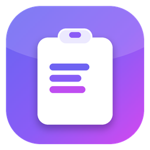
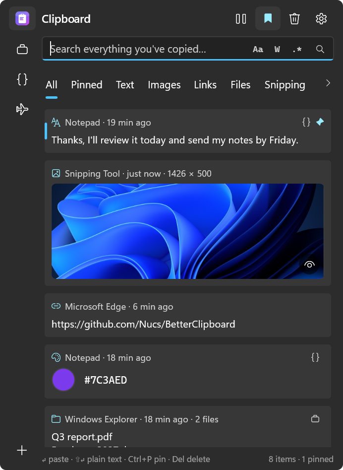
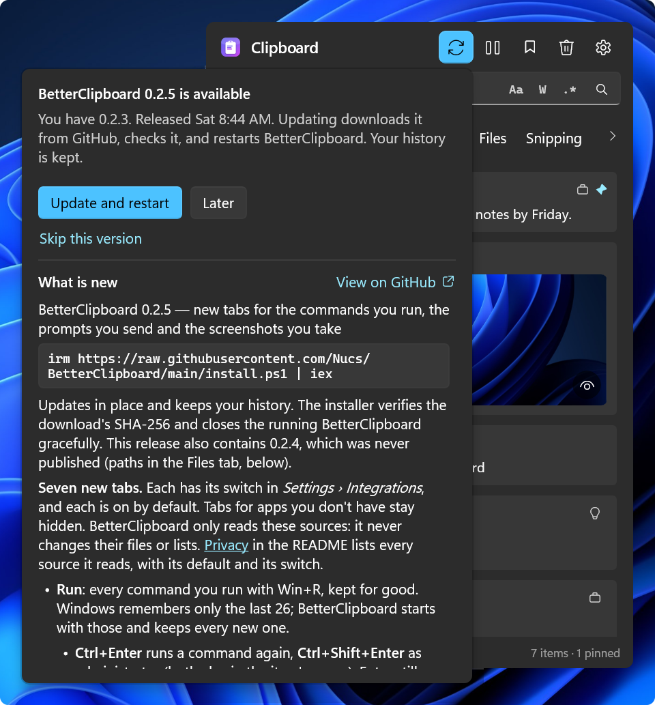
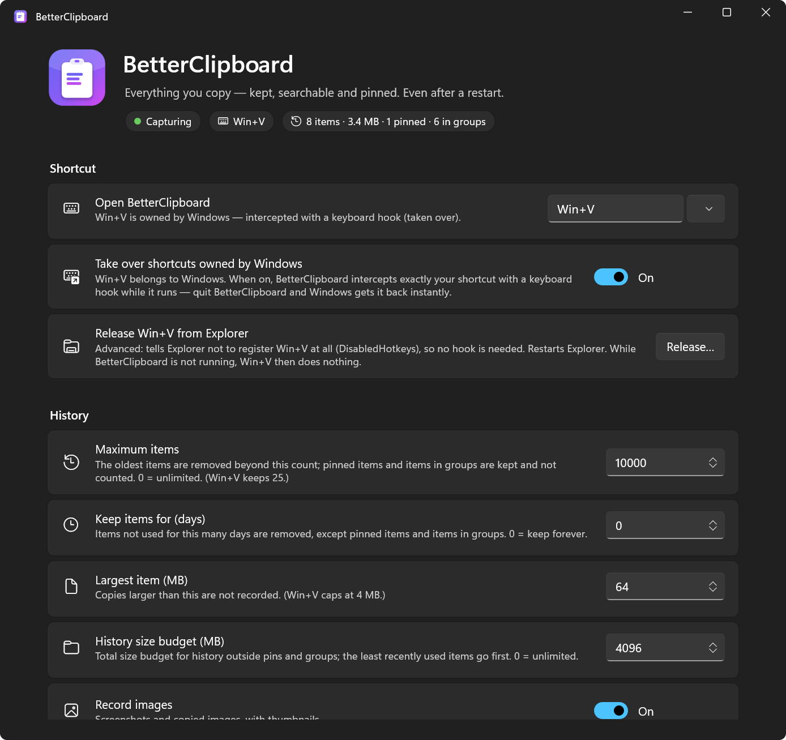
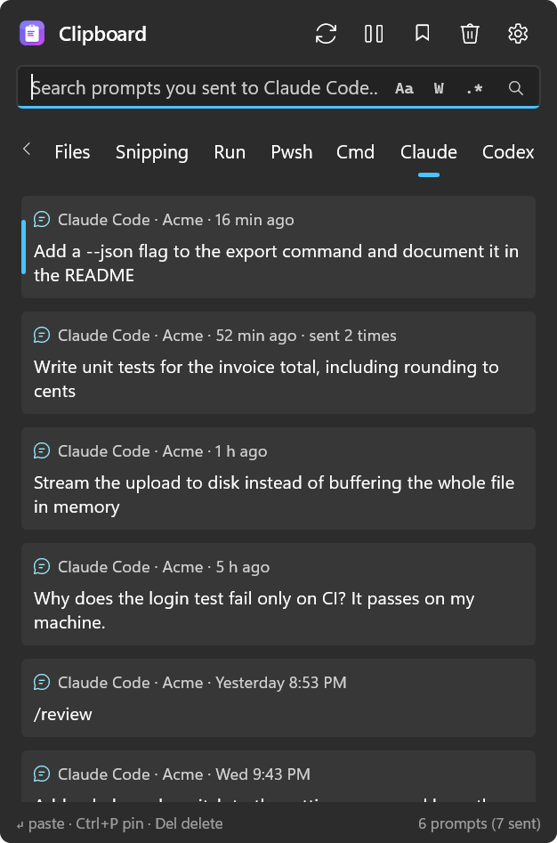

<div dir="rtl">

<div align="center">

#  BetterClipboard

[](https://github.com/Nucs/BetterClipboard/actions/workflows/ci.yml)
[](https://github.com/Nucs/BetterClipboard/releases/latest)
[](../../LICENSE)

[ENG](../../README.md) / [简体中文](README.zh-CN.md) / [Русский](README.ru.md) / [Español](README.es.md) / **עברית**

</div>

> זהו תרגום של ה-[README](../../README.md) באנגלית. הגרסה האנגלית עשויה להתעדכן לפני התרגום; כשהן שונות, הגרסה האנגלית קובעת.

<div align="center">

**היסטוריית הלוח של Win+V, כמו ש-Windows הייתה צריכה לספק מלכתחילה.** אותו קיצור מקשים, אותה חלונית ליד הסמן — אבל היא זוכרת הכול, שורדת הפעלות מחדש, מחפשת מיד ושומרת הכול מוצפן במחשב שלכם.
היא גם שומרת את מה שכלים אחרים שוכחים: צילומי המסך שלכם, פקודות Win+R, היסטוריית ה-shell וההנחיות שאתם שולחים ל-Claude Code ול-Codex.

</div>

<p align="center">
  
</p>

<a id="features"></a>
## תכונות

- **מחליפה את Win+V.** אותו קיצור מקשים, והחלונית מופיעה מיד, ליד סמן הטקסט: היא נשארת מצוירת ומעודכנת גם כשהיא מוסתרת, כך ש-Win+V רק צריך להציג אותה ([איך זה עובד](#how-it-works)). תוכנית ההתקנה משחררת את Win+V מסייר הקבצים; עותק שמריצים בלי תוכנית ההתקנה מיירט אותו באמצעות hook של המקלדת. הוסיפו קיצורים נוספים, או השאירו את Win+V ל-Windows ובחרו קיצורים משלכם: לחצו על כל מקש או צירוף ב-*הגדרות › קיצור מקשים* (כולל מקשי המקלדת הנומרית ומקשי המדיה, F13–F24 ומקש Copilot), והקיצורים שהשתמשתם בהם בעבר נשארים במרחק לחיצה ([בחירת קיצורי מקשים](#choosing-shortcuts)).
- **זוכרת הכול, גם אחרי הפעלה מחדש.** &rlm;10,000 פריטים כברירת מחדל, כל אחד עד 64 MB, עם תקציב גודל כולל ומגבלת גיל אופציונלית, הכול ניתן לשינוי. Win+V שומר 25 פריטים של עד 4 MB, והפעלה מחדש מוחקת הכול חוץ מהמוצמדים.
- **כל סוג של העתקה**, עם האפליקציה המקורית והשעה על כל כרטיס, וכרטיסיות שמסננות לפי סוג ולפי מקור. מה שמעתיקים שוב עולה לראש הרשימה במקום ליצור כפילות ([כרטיסיות](#tabs)):
  - **טקסט, טקסט מעוצב ו-HTML, קישורים וצבעים** עם דוגמית צבע.
  - **טקסטים ארוכים** מציגים את ארבע השורות הראשונות שלהם, וקו נקודות דק ועין מראים שיש עוד. השאירו את העכבר על הטקסט כדי לקרוא את כולו, או לחצו &lrm;`F3`&lrm; לתצוגה שמציירת Markdown, צובעת קוד ב-22 שפות, מסדרת מחדש את ההזחה של XML ו-JSON, גולשת וממספרת שורות ופותחת העתקות בגודל מגה-בייטים עמוד אחר עמוד ([תצוגה מקדימה של טקסט](#text-previews)).
  - **קבצים** שהועתקו בסייר הקבצים, ו**נתיבים שהועתקו כטקסט** (&lrm;`C:\…`&lrm;, &lrm;`~/.bashrc`&lrm;, &lrm;`src/app/main.cs`&lrm;), שעדיין מודבקים כטקסט ([נתיבים בכרטיסייה קבצים](#paths-in-the-files-tab)).
  - **תמונות** עם תמונות ממוזערות. השאירו את העכבר על תמונה כדי לראות אותה בגודל מלא, או פתחו אותה בתצוגה עם זום והזזה ([תצוגה מקדימה של תמונות](#image-previews)). אותה תמונה כ-PNG או כמפת סיביות היא פריט אחד. צילום מסך זוכר את הקובץ שאליו נשמר: לחיצה ימנית עליו מאפשרת להעתיק את הנתיב שלו, להעתיק אותו כקובץ, לפתוח אותו או לפתוח את התיקייה שלו, ו-*שמור בתיקייה זמנית ואז* עושה את אותו הדבר לכל תמונה ([תמונות והקבצים שלהן](#pictures-and-their-files)).
  - **ההיסטוריה של Windows עצמה:** מה ש-Win+V עדיין זוכר, כולל המוצמדים שלו, מיובא בכל הפעלה. מה שמחקתם ב-BetterClipboard לא מיובא שוב.
  - **ShareX:** כל צילום מסך ש-[ShareX](https://getsharex.com) שומר, ברגע שהוא נשמר.
  - **צילומי מסך:** כל צילום מסך שנשמר בשמירה האוטומטית של כלי החיתוך וב-&lrm;`Win+PrtScn`&lrm;.
  - **Notepad++&lrm;:** הטקסט של כרטיסיות "new" שלא נשמרו ב-[Notepad++](https://notepad-plus-plus.org/)&lrm;, שמתעדכן תוך כדי עריכה, והנתיב המלא של כל קובץ שאתם פותחים ב-Notepad++&lrm;.
  - **הפעלה:** כל פקודה שאתם מריצים עם &lrm;`Win+R`&lrm;, גם אחרי שהרשימה של Windows, בת 26 הפקודות, שוכחת אותה. &lrm;`Ctrl+Enter`&lrm; מריץ אותה שוב (&lrm;`Ctrl+Shift+Enter`&lrm;: כמנהל מערכת).
  - **Pwsh:** כל היסטוריית הפקודות של PowerShell, גם הפקודות הישנות שהחץ למעלה שלו כבר לא מגיע אליהן.
  - **Cmd:** הפקודות שהוקלדו בחלונות שורת הפקודה נשמרות גם אחרי שהחלון נסגר.
  - **Claude ו-Codex:** כל הנחיה שאתם שולחים ל-Claude Code ול-Codex, נשמרת לתמיד.
  - **Everything:** הקבצים שאתם פותחים מ-[Everything](https://www.voidtools.com/), להדבקה כקובץ או כנתיב.

  שמונה האחרונות הן כרטיסיות של אפליקציות אחרות. לכל אחת מתג משלה, וכולן מופעלות כברירת מחדל; BetterClipboard רק קורא את המקור שלהן, והכרטיסייה של אפליקציה שאין לכם נשארת מוסתרת ([כרטיסיות לאפליקציות אחרות](#tabs-for-other-apps)). *מחק את מה שנשמר…* בכרטיס של כל אחת בהגדרות מראה מה BetterClipboard שמר ממנה, חלק אחר חלק עם דוגמאות, ומוחק את מה שתסמנו; הקבצים של האפליקציה האחרת עצמה לעולם לא נוגעים בהם.
- **חיפוש מיידי** בכל שפה, כולל עברית, CJK ואימוג'י, עם המתגים של VS Code: התאמת רישיות (&lrm;`Alt+C`&lrm;), מילה שלמה (&lrm;`Alt+W`&lrm;) וביטוי רגולרי (&lrm;`Alt+E`&lrm;) ([חיפוש](#search)). ב-Win+V אין חיפוש.
- **נבנתה עבור המקלדת.** &lrm;`Enter`&lrm; מדביק באפליקציה שממנה הגעתם, ו-&lrm;`Shift+Enter`&lrm; מדביק טקסט רגיל. &lrm;`↑`&lrm; &lrm;`↓`&lrm; עוברים בין הפריטים, &lrm;`←`&lrm; &lrm;`→`&lrm; בין הכרטיסיות במעגל, ו-&lrm;`↑`&lrm; מהפריט העליון נכנס לקבוצות שלכם. &lrm;`Ctrl+1`&lrm; … &lrm;`Ctrl+9`&lrm; מדביקים את הפריט ה-n, &lrm;`Ctrl+P`&lrm; מצמיד, &lrm;`Del`&lrm; מוחק, &lrm;`F3`&lrm; מציג פריט במלואו, ומקש התפריט פותח את התפריט של פריט (העתקה בלבד, פתיחת הקישור, הצגה בסייר הקבצים, …). &lrm;`Esc`&lrm; מחזיר את המיקוד למקום שבו הייתם ([שימוש](#use)).
- **חלונית שמתאימה לכם.** היא נפתחת בכרטיסייה שהשתמשתם בה לאחרונה, גם אחרי הפעלה מחדש. גררו כל מקום ריק כדי להזיז אותה, וגררו קצה כדי לשנות את גודלה: מאז היא נפתחת בגודל הזה. כרטיסיות שלא נכנסות נגללות הצידה עם החצים ‹ ›, גלגלת העכבר או גרירה. לחיצה ימנית על כרטיסייה מזיזה אותה שמאלה או ימינה, מסתירה אותה, או מסתירה אותה יחד עם הפריטים שלה בכל הרשימות; *הצג את כל המוסתרות* מחזירה אותן, והסדר שלכם נשמר ([כרטיסיות](#tabs)). העכבר בוחר את הפריט שהוא נמצא מעליו.
- **הצמדות וקבוצות.** הצמידו את מה שאתם משתמשים בו שוב ושוב: פריטים מוצמדים מופיעים למעלה, והחלונית בכל זאת נפתחת על ההעתקה האחרונה שלכם, מיד מתחתם, כך ש-&lrm;`Win+V`&lrm; &lrm;`Enter`&lrm; מדביק את מה שהעתקתם אחרון ו-&lrm;`↑`&lrm; מגיע למוצמדים. צרו קבוצות עם סמלים משלכם, גררו כרטיסים אליהן, והציגו קבוצה אחת או כמה יחד (&lrm;`Ctrl+לחיצה`&lrm;, &lrm;`Shift+לחיצה`&lrm;, או &lrm;`Space`&lrm; על קבוצה שהגעתם אליה בחיצים). פריטים מוצמדים ומקובצים שורדים כל מגבלה, ו-*נקה* משאיר אותם ([קבוצות](#groups)).
- **צורכת מעט זיכרון.** אחרי כל שימוש היא מחזירה את הזיכרון שכבר אינו נחוץ לה: בזמן שהיא מחכה ל-Win+V הבא שלכם, העמודה *זיכרון* במנהל המשימות מראה כמה מגה-בייטים בלבד. גם מה שההגדרות משאירות אחריהן חוזר: כמה שניות אחרי שסוגרים אותן, BetterClipboard מחליף את עצמו בשקט בעותק חדש, ושום דבר לא נפתח או מהבהב ([איך זה עובד](#how-it-works)).
- **קוראת כל העתקה מיד.** העתקות במרווח של 2 אלפיות שנייה או יותר נשמרות כולן. תוכנית שמעתיקה מהר יותר דורסת את ההעתקות שלה לפני שאפליקציה כלשהי, כולל Win+V, מספיקה לקרוא אותן: BetterClipboard שומר את האחרונה וסופר את השאר (*הגדרות › אמינות הקליטה*).
- **פרטית.** בלי טלמטריה ובלי חשבון. הדבר היחיד שהיא מבקשת מעצמה משרת הוא רשימת הגרסאות הציבורית שלה ב-GitHub, פעם ביום, כדי לספר לכם על עדכונים; מתג מכבה גם את זה ([פרטיות](#privacy)).
  - **הצפנה במנוחה:** כל ההיסטוריה (ChaCha20-Poly1305), עם מפתח שרק החשבון שלכם במחשב הזה יכול לפתוח ([איך זה עובד](#how-it-works)). Win+V מצפין רק את המוצמדים שלו.
  - **העתקות פרטיות נשארות בחוץ:** העתקות שאפליקציות מסמנות כפרטיות לעולם לא נרשמות, ו-46 מנהלי סיסמאות ואפליקציות אימות מוחרגים מראש. *השהיית הקליטה* ו-*אפליקציות מוחרגות* מכסות את השאר.
  - **שכח לצמיתות** מוחק פריט ולעולם לא רושם שוב את התוכן שלו, לא משנה איזו אפליקציה מעתיקה אותו ([שכח לצמיתות](#forget-forever)).
- **שורת פקודה לסקריפטים ולסוכני AI.** הכלי &lrm;`bclip`&lrm; מציג את ההיסטוריה שלכם, מחפש בה ומריץ עליה grep, מדפיס כל פריט בית אחר בית, שם טקסט בלוח, מחכה להעתקה הבאה שלכם ומחפש בארכיון ההנחיות שלכם, עם פלט JSON. הוא כבוי כברירת מחדל ([שורת פקודה](#command-line-for-scripts-and-ai-agents)).
- **התקנה בשורה אחת.** לכל משתמש, בלי הרשאות מנהל, עם בדיקת SHA-256, &rlm;Windows 10 (גרסה 2004 ואילך) ו-Windows 11, &rlm;x64 ו-ARM64, בלי שום דבר נוסף להתקין; מאז היא מופעלת עם Windows. כמנהל מערכת, או מ-Intune או מכלי RMM, היא מותקנת לכל משתמשי המחשב, וכל משתמש עדיין יכול לכבות לעצמו את ההפעלה בכניסה. הסרה שומרת את ההיסטוריה שלכם, אלא אם תבקשו אחרת ([התקנה](#install)). מהדורה ל-Microsoft Store בנויה ומחכה לדף שלה בחנות ([מהדורת Microsoft Store](#microsoft-store-edition)).
- **עדכונים רק באישורכם.** לחצן העדכון בכותרת החלונית, משמאל להשהיה, מודגש כשיש ב-GitHub גרסה חדשה יותר, ופעם בשבוע תיאור הכלים שלו אומר זאת מעצמו לכמה שניות. לחיצה מציגה את ההחלטה — *עדכן והפעל מחדש* או *אחר כך* — עם הערות הגרסה מתחתיה. רק אז העדכון יורד, נבדק מול ה-SHA-256 של הגרסה ומותקן במקום, גם בתיקייה שחילצתם מקובץ ה-zip של הגרסה: BetterClipboard מופעל מחדש בעצמו, וההיסטוריה שלכם נשמרת ([עדכונים](#updates)).
- **בשפה שלכם.** אנגלית, סינית מפושטת (简体中文), רוסית (Русский), ספרדית (Español) ועברית, כולן בכל הורדה. ההפעלה הראשונה מציגה את השפות עם הדגלים שלהן, כשהשפה של Windows כבר בחורה: לחיצה אחת על סימן הווי הירוק וכל האפליקציה מדברת בה. עדכון מגרסה שעוד לא שאלה ישאל גם הוא פעם אחת. *הגדרות › אפליקציה › שפה* משנה אותה מאוחר יותר: בחרו שפה ולחצו *הפעל מחדש עכשיו*. העברית נקראת מימין לשמאל בתוך הפריסה הרגילה. מה שאתם מעתיקים, שמות קבצים והשמות שאתם נותנים לקבוצות לעולם אינם מתורגמים.
- **הגדרות שאפשר לחפש בהן.** הקלידו בתיבה שבראש ההגדרות (&lrm;`Ctrl+F`&lrm;), והדף ישאיר רק את ההגדרות שמתאימות, במקומן, עם האותיות שהתאימו מודגשות. כל מילה בהגדרה נחשבת — הכותרת, התיאור, המקטע, הלחצנים והאפשרויות — וגם ראשי תיבות ("שמה" עבור *שחרור מסייר הקבצים*) ושגיאות הקלדה (גם השמות באנגלית נמצאים בחיפוש, כך ש-"pasword" עובד). &lrm;`Esc`&lrm; מחזיר את כל הדף למקום שבו היה.
- **הגדרות לכל השאר:** הפעלה עם Windows, ערכת הנושא (בהירה, כהה או זו של Windows), היכן החלונית נפתחת (ליד סמן הטקסט או העכבר, או במרכז המסך הראשי או של המסך שבו אתם מקלידים — עם כמה צגים, בכל קנה מידה), ודף שמציין כל אפליקציה שהיא עובדת איתה וכל רכיב שהיא כוללת, עם הקישורים הרשמיים שלהם.

<a id="install"></a>
## התקנה

&rlm;Windows 10 גרסה 2004 ואילך / Windows 11, &rlm;x64 או ARM64. אין שום דבר נוסף להתקין (הגרסה עצמאית). ב-PowerShell:

```powershell
irm https://raw.githubusercontent.com/Nucs/BetterClipboard/main/install.ps1 | iex
```

תוכנית ההתקנה מורידה את [הגרסה](https://github.com/Nucs/BetterClipboard/releases/latest) האחרונה עבור הארכיטקטורה שלכם, **בודקת את ה-SHA-256 שלה**, מתקינה אותה למשתמש ב-&lrm;`%LOCALAPPDATA%\Programs\BetterClipboard`&lrm; (בלי הרשאות מנהל), מוסיפה קיצור דרך לתפריט התחל, מפעילה את BetterClipboard עם Windows ורושמת אותו ב-*הגדרות › אפליקציות › אפליקציות מותקנות*. היא גם **משתלטת על Win+V**: סייר הקבצים מפסיק לרשום אותו ומופעל מחדש פעם אחת (שורת המשימות מהבהבת, וחלונות תיקיות פתוחים נסגרים). ראו [השתלטות על Win+V](#taking-over-winv). הרצה נוספת מעדכנת במקום, וכך גם לחצן העדכון של האפליקציה עצמה ([עדכונים](#updates)); ההיסטוריה שלכם לעולם לא נפגעת. היא פועלת מכל תיקייה, גם מתיקייה שאין לכם הרשאת כתיבה אליה, ובסיום משאירה את ה-PowerShell שלכם באותה תיקייה.

בהפעלה הראשונה, BetterClipboard שואל מה השפה שלכם: English,&rlm; 简体中文,&rlm; Русский,&rlm; Español או עברית, כל אחת עם הדגל שלה, כשהשפה של Windows כבר בחורה. לחצו על סימן הווי הירוק (או &lrm;`Enter`&lrm;), והכול נפתח בשפה הזו. אם אתם מעדכנים מגרסה שעוד לא שאלה, ההפעלה הראשונה אחרי העדכון שואלת פעם אחת.

פעם ביום, האפליקציה המותקנת שואלת את GitHub אם יש גרסה חדשה יותר. שום דבר עליכם, על המחשב שלכם או על הלוח שלכם לא נשלח, ושום דבר לא מותקן בלי האישור שלכם ([פרטיות](#privacy)). &lrm;`-NoUpdateCheck`&lrm; מתקין כשהבדיקה הזו כבויה.

אפשרויות (העבירו אותן דרך בלוק סקריפט):

```powershell
& ([scriptblock]::Create((irm https://raw.githubusercontent.com/Nucs/BetterClipboard/main/install.ps1))) -NoTakeOverWinV -Hotkey Win+Alt+V
```

| אפשרות | השפעה |
|---|---|
| &lrm;`-NoTakeOverWinV`&lrm; | השארת Win+V ל-Windows. אז BetterClipboard נפתח עם הקיצורים של &lrm;`-Hotkey`&lrm;, או עם Win+Alt+V. אם Win+V שוחרר קודם, סייר הקבצים מקבל אותו בחזרה. |
| &lrm;`-Hotkey A, B, …`&lrm; | הקיצורים שפותחים את BetterClipboard, לדוגמה &lrm;`-Hotkey Win+Alt+V, Ctrl+Alt+F9`&lrm;. &rlm;Win+V בא ראשון, אלא אם צוין &lrm;`-NoTakeOverWinV`&lrm;. על כל אחד מהם משתלטים באותה דרך כמו על Win+V (ראו [השתלטות על Win+V](#taking-over-winv)). |
| &lrm;`-TakeOverWinV`&lrm; | ברירת המחדל. נשמרה עבור שורות פקודה ישנות; אם הקיצורים שלכם כבר לא כוללים את Win+V, היא מוסיפה אותו בחזרה. |
| &lrm;`-AddToPath`&lrm; | הוספת תיקיית ההתקנה ל-PATH של המשתמש שלכם, כדי שמסופים יוכלו להריץ את &lrm;`bclip`&lrm; (ראו [שורת פקודה](#command-line-for-scripts-and-ai-agents)). |
| &lrm;`-NoUpdateCheck`&lrm; | התקנה כשבדיקת העדכונים האוטומטית כבויה: אז BetterClipboard לעולם לא פונה ל-GitHub מעצמו. ב-*הגדרות › עדכונים* יש *בדוק עכשיו* ואת המתג שמפעיל אותה שוב. |
| &lrm;`-Version 0.1.0`&lrm; | התקנת גרסה מסוימת במקום האחרונה. |
| &lrm;`-Package <zip>`&lrm; | התקנה מקובץ zip של גרסה שנמצא בדיסק במקום להוריד אחד (התקנה לא מקוונת). שימו את ה-&lrm;`SHA256SUMS.txt`&lrm; של הגרסה לצד קובץ ה-zip, או ציינו &lrm;`-PackageSha256 <hash>`&lrm;, והוא ייבדק קודם. |
| &lrm;`-AllUsers`&lrm; | התקנה לכל המשתמשים של המחשב הזה (ב-PowerShell כמנהל מערכת); ראו [לכל משתמשי המחשב](#for-every-user-of-a-pc). |
| &lrm;`-InstallDir <path>`&lrm; | התקנה במקום אחר. |
| &lrm;`-NoStartup`&lrm; / &lrm;`-NoShortcut`&lrm; / &lrm;`-NoLaunch`&lrm; | בלי הפעלה עם Windows / בלי קיצור דרך בתפריט התחל / בלי הפעלה אחרי ההתקנה. |
| &lrm;`-Uninstall [-RemoveData]`&lrm; | הסרת האפליקציה (ההיסטוריה נשמרת, אלא אם צוין &lrm;`-RemoveData`&lrm;, שמוחק גם את התמונות הזמניות). |

מעדיפים לעשות את זה ידנית? הורידו מהגרסה את קובץ ה-zip עבור הארכיטקטורה שלכם ואת &lrm;`SHA256SUMS.txt`&lrm;, בדקו את ה-hash &rlm;(&lrm;`Get-FileHash .\BetterClipboard-*.zip`&lrm;), חלצו לכל מקום שתרצו והריצו את &lrm;`BetterClipboard.exe`&lrm;. הגרסאות עדיין לא חתומות בחתימת קוד, ולכן Windows עשוי להציג *Windows הגן על המחשב שלך* עבור עותק שהורד כך: בדקו את ה-hash ואז בחרו *מידע נוסף › הפעל בכל זאת*. ראו [מדיניות חתימת קוד](#code-signing-policy).

<a id="for-every-user-of-a-pc"></a>
### לכל משתמשי המחשב

ב-PowerShell כמנהל מערכת:

```powershell
& ([scriptblock]::Create((irm https://raw.githubusercontent.com/Nucs/BetterClipboard/main/install.ps1))) -AllUsers
```

- **מה מוגדר:** האפליקציה ב-&lrm;`Program Files\BetterClipboard`&lrm;, בתיקייה שרק מנהלי מערכת יכולים לשנות; קיצור דרך בתפריט התחל, רשומה ב-*אפליקציות מותקנות* והפעלה עם Windows לכל המשתמשים. כל משתמש שנכנס למערכת מקבל את BetterClipboard פועל, עם היסטוריה מוצפנת משלו בפרופיל שלו.
- **כל משתמש מחליט לעצמו:** כיבוי *הגדרות › אפליקציה › הפעלה עם Windows* עוצר את ההפעלה בכניסה רק עבור אותו משתמש. רשומת ההפעלה עם Windows של המשתמש עצמו, אם יש לו כזו, קודמת, כך ש-BetterClipboard לעולם לא מופעל פעמיים.
- **נבחרת מעצמה** כשמי שמתקין אינו המשתמש המחובר: כשתוכנית ההתקנה רצה כ-SYSTEM &rlm;(Intune, כלי RMM), או עם האישורים של מנהל מערכת על שולחן העבודה של מישהו אחר. עותק בפרופיל של אותו חשבון לא היה משרת אף אחד מאלה שנכנסים למחשב.
- **מה נשאר לכל משתמש לעצמו:** Win+V והקיצורים האחרים. BetterClipboard משתלט על Win+V באמצעות ה-hook של המקלדת עבור כולם, וכל משתמש יכול לשחרר אותו מסייר הקבצים ב-*הגדרות › קיצור מקשים*. &lrm;`-Hotkey`&lrm; ו-&lrm;`-NoTakeOverWinV`&lrm; חלים רק כשהמשתמש המחובר מתקין. &lrm;`-AddToPath`&lrm; מוסיף את התיקייה ל-PATH של כל משתמש.
- **עדכונים:** העותק הזה לא מחליף את עצמו ולא בודק עדכונים מעצמו, כי ייתכן שהמשתמשים שלו אינם מנהלי מערכת. מנהל מערכת מריץ שוב את אותה פקודה: כשהיא רצה כמנהל מערכת במחשב עם עותק לכל המשתמשים, תוכנית ההתקנה מעדכנת את העותק הזה. *הגדרות › עדכונים › בדוק עכשיו* עדיין אומר לכם אם יש גרסה חדשה, ותיבת הדו-שיח של העדכון מעתיקה את הפקודה.

[חבילת Chocolatey](../../packaging/chocolatey) פועלת לפי אותו כלל לגבי ההפעלה עם Windows. כשהמשתמש המחובר מתקין אותה, הרשומה שלו. כשהיא מותקנת על ידי SYSTEM או חשבון אחר, או עם &lrm;`/AllUsersStartup`&lrm;, היא לכל המשתמשים.

<a id="microsoft-store-edition"></a>
### מהדורת Microsoft Store

**עדיין לא בחנות.** המהדורה בנויה ונבדקה ([docs/microsoft-store.md](../microsoft-store.md)); הדף שלה בחנות בהכנה. זה מה שהיא:

- **מותקנת ומתעדכנת דרך החנות.** Microsoft חותמת על החבילה, ולכן Windows לא מציג אזהרת "מפרסם לא ידוע". האפליקציה עצמה לא שולחת שום בקשת רשת, כי החנות מעדכנת אותה.
- **היא שואלת קודם.** ההפעלה הראשונה שואלת מה השפה שלכם ואז מציגה מסך פתיחה עם שני מתגים, *פתיחה עם Win+V* ו-*הפעלה עם Windows*. שום דבר לא נרשם ושום קיצור לא נתפס עד שלוחצים *התחל*.
- **&rlm;Win+V בלי שינוי במערכת.** כל עוד היא פועלת, היא עונה ל-Win+V באמצעות ה-hook של המקלדת; סגרו אותה ו-Win+V חוזר מיד ל-Windows. *שחרור מסייר הקבצים* אינו חלק מהמהדורה הזו.
- **ההיסטוריה שלכם עוברת איתכם.** הכוונה היא שיהיה מותקן רק BetterClipboard אחד. כשמהדורת החנות מוצאת עותק שהתקנתם עם תוכנית ההתקנה, היא אומרת מה היא תעשה ובודקת שהיא יכולה. עם *מעבר למהדורה הזו* היא סוגרת את העותק ההוא, מעתיקה את ההיסטוריה וההגדרות שלכם, בודקת את ההעתק, מסירה את העותק האחר (מה שמחזיר את Win+V ל-Windows) ומוחקת את התיקייה הישנה. אם שלב כלשהו נכשל, ההיסטוריה שלכם נשארת במקומה. עותק לכל המשתמשים, או העותק של Chocolatey, מסיר מנהל מערכת: מהדורת החנות אומרת איך ומחכה. תוכנית ההתקנה, מצדה, אומרת לכם כשמהדורת החנות מותקנת.
- **&rlm;&lrm;`bclip`&lrm; פועל בכל מסוף** בלי רשומה ב-PATH, ברגע שמפעילים את שורת הפקודה.
- **הסרתה** מסירה גם את ההיסטוריה: היא שומרת את ההיסטוריה בנתוני האפליקציה שלה, ש-Windows מוחק יחד עם האפליקציה.

<a id="updates"></a>
## עדכונים

&rlm;BetterClipboard מתעדכן מ[הגרסאות שלו ב-GitHub](https://github.com/Nucs/BetterClipboard/releases), ורק כשאתם אומרים.

<p align="center">
  
</p>

- **לחצן העדכון** נמצא בכותרת החלונית, משמאל להשהיה. כל עוד יש לכם את הגרסה האחרונה, הוא נראה כמו שכניו. כשיש גרסה חדשה יותר, הוא מתמלא בצבע ההדגשה שלכם, ובתפריט של הסמל באזור ההודעות מופיע *עדכן ל-x.y.z…&lrm;*.
- **תזכורת פעם בשבוע.** כל עוד גרסה חדשה מחכה, תיאור הכלים של הלחצן — *עדכון זמין: BetterClipboard x.y.z* — נפתח מעצמו לכמה שניות כשאתם פותחים את החלונית, לכל היותר פעם בשבעה ימים. הוא נפתח מעל החלונית, שם הוא לא מסתיר כלום (ליד הלחצן כשהחלונית בראש המסך), ונסגר מעצמו: אין מה לסגור, וההקלדה ממשיכה כרגיל. לחיצה עליו פותחת את תיבת הדו-שיח של העדכון. גם פתיחת תיבת הדו-שיח הזו נחשבת לתזכורת, כך ש-*אחר כך* פירושו שבוע. אין תזכורת כל עוד הבדיקה האוטומטית כבויה.
- **לחיצה פותחת את תיבת הדו-שיח של העדכון:** ההחלטה למעלה — *עדכן והפעל מחדש*, *אחר כך* או *דלג על הגרסה הזו* — והערות הגרסה מתחת. כל עוד אתם מעודכנים, היא מראה מה חדש בגרסה שלכם, ואת *בדוק עכשיו*.
- **שום דבר לא מותקן בלי האישור שלכם.** *עדכן והפעל מחדש* מוריד מ-GitHub את הגרסה עבור המחשב שלכם ומשווה את ה-SHA-256 שלה ל-&lrm;`SHA256SUMS.txt`&lrm; של הגרסה ולתקציר ש-GitHub עצמו חישב. אחר כך תוכנית ההתקנה מאותה גרסה מחליפה את קובצי האפליקציה: BetterClipboard נסגר ומופעל שוב מעצמו, ברקע. ההיסטוריה, ההגדרות והקיצורים שלכם נשארים כמו שהם, והודעה אומרת לכם איך זה הלך.
- **אם עדכון נכשל,** הגרסה המותקנת נשארת במקומה וממשיכה לפעול, ותיבת הדו-שיח או הודעה אומרת למה. הורדה שלא תואמת את סכום הביקורת שלה נמחקת. תיקיית התקנה שתוכנית אחרת מחזיקה פתוחה נשארת כמו שהייתה.
- **הבדיקה:** פעם ביום (בפעם הראשונה, דקה אחרי ההפעלה), BetterClipboard מבקש מ-GitHub את הרשימה הציבורית של הגרסאות של הפרויקט הזה. הבקשה מציינת רק את גרסת האפליקציה: שום דבר עליכם, על המחשב שלכם או על הלוח שלכם לא נשלח ([פרטיות](#privacy)). *הגדרות › עדכונים* מכבה את הבדיקה, וכך גם התקנה עם &lrm;`-NoUpdateCheck`&lrm;. *בדוק עכשיו* שואל פעם אחת, לא משנה מה המתג אומר.
- **דלג על הגרסה הזו** מסיר את ההדגשה ואת התזכורת השבועית עבור אותה גרסה. הגרסה הבאה מחזירה את שתיהן.
- **גרסת פיתוח** (גרסה כמו &lrm;`0.2.10-dev.12.gabc1234`&lrm;, ראו [בנייה מקוד המקור](#build-from-source)) מקבלת קודם את הגרסאות שפורסמו לתיקיית &lrm;`dev-builds`&lrm; של המחשב שלה: *גרסת פיתוח זמינה*, ו-*עדכן והפעל מחדש* מעתיק את הגרסה מהתיקייה הזו במקום להוריד אותה. אחרת מוצעת לה תמיד הגרסה האחרונה מ-GitHub, גם אם היא ישנה יותר, כדרך חזרה לגרסה הרשמית (*התקן והפעל מחדש*). אין לה תזכורת שבועית.
- **עותק שחילצתם מקובץ ה-zip של הגרסה** מעדכן את עצמו בתיקייה שלו, החל מ-0.2.11. *עדכן והפעל מחדש* מוריד ובודק את הגרסה כמו למעלה; אחר כך הגרסה החדשה סוגרת את BetterClipboard, מחליפה את קובצי הגרסה אחד אחד ומופעלת שוב. קבצים שאינם חלק מהגרסה (שלכם, אם יש כאלה בתיקייה) נשארים כמו שהם, ואם אחד מהקבצים שלה לא ניתן להחלפה (תוכנית אחרת מחזיקה אותו פתוח), כל הקבצים חוזרים למצבם הקודם. עותק בתיקייה שאין לכם הרשאה לשנות, כמו Program Files בלי הרשאות מנהל, מקבל במקום זאת את דף ההורדה ואת פקודת ההתקנה.
- **עותק חדש יותר מחליף את הישן.** הפעילו BetterClipboard חדש יותר בזמן שישן יותר פועל (גרסה חדשה שחולצה לתיקייה חדשה, למשל), והישן נסגר והחדש ממשיך, במקום שההגדרות של הישן ייפתחו. אם *הפעלה עם Windows* מפעילה עותק ישן יותר, או עותק שכבר לא קיים, הרשומה עוברת לעותק שאתם מריצים; רשומה שכיביתם באפליקציות ההפעלה של Windows נשארת כבויה.
- **עותק שהותקן לכל המשתמשים** לא מחליף את עצמו ולא בודק מעצמו: רק מנהל מערכת יכול לשנות את התיקייה שלו. *בדוק עכשיו* עדיין שואל, ותיבת הדו-שיח מעתיקה את הפקודה להרצה ב-PowerShell כמנהל מערכת ([לכל משתמשי המחשב](#for-every-user-of-a-pc)).
- **מהדורת Microsoft Store** אין לה לחצן עדכון והיא לא שואלת את GitHub דבר: החנות מעדכנת אותה, ו-*הגדרות › עדכונים מ-Microsoft Store* פותח את הדף שלה בחנות.

<a id="use"></a>
## שימוש

לחצו **Win+V**. החלונית מופיעה מיד ליד סמן הטקסט, בכרטיסייה שהשתמשתם בה לאחרונה, עם המיקוד בתיבת החיפוש — פשוט הקלידו. ההעתקה האחרונה שלכם בחורה, כך ש-&lrm;`Enter`&lrm; מדביק אותה. הפריטים המוצמדים מופיעים מעליה (*הגדרות › הדבקה* יכולה לסדר אותם לפי זמן במקום זאת), ו-&lrm;`↑`&lrm; מגיע אליהם.

*הגדרות › קיצור מקשים › מיקום החלונית* פותח אותה במקום זאת ליד העכבר, או במרכז מסך: המסך הראשי, או המסך שבו אתם מקלידים (עם כמה צגים, המסך של החלון שבו הייתם; אחרי לחיצה על שולחן העבודה, המסך של העכבר).

| מקש | פעולה |
|---|---|
| *הקלדה* | חיפוש (לפי מחרוזת חלקית, בלי תלות ברישיות, כולל עברית, CJK ואימוג'י) |
| &lrm;`Alt+C`&lrm; / &lrm;`Alt+W`&lrm; / &lrm;`Alt+E`&lrm; | הפעלה וכיבוי של **Aa** (התאמת רישיות), **W** (מילה שלמה) ו-**.\*** (ביטוי רגולרי) בתיבת החיפוש — או לחיצה עליהם. הם נשארים כפי שהשארתם אותם. |
| &lrm;`↑`&lrm; &lrm;`↓`&lrm; &lrm;`PgUp`&lrm; &lrm;`PgDn`&lrm; | הזזת הבחירה. החלונית נפתחת על ההעתקה האחרונה שלכם, כך ש-&lrm;`↑`&lrm; מגיע קודם לפריטים המוצמדים שמעליה, מהתחתון ביותר. כשעמודת הקבוצות פתוחה, לחצו &lrm;`↑`&lrm; על הפריט העליון כדי להיכנס לקבוצות (ראו [קבוצות](#groups)). |
| &lrm;`Space`&lrm; / &lrm;`Enter`&lrm; בעמודת הקבוצות | כשהחיצים נמצאים בעמודת הקבוצות: להשאיר את הקבוצה שמתחת לטבעת ולחזור לפריטים. כשכמה קבוצות פתוחות: להוסיף לרשימה את הקבוצה שמתחת לטבעת, או להוציא אותה (ראו [קבוצות](#groups)). בכל מקום אחר, &lrm;`Space`&lrm; מקליד רווח ו-&lrm;`Enter`&lrm; מדביק. |
| &lrm;`←`&lrm; &lrm;`→`&lrm; | הכרטיסייה הקודמת / הבאה, במעגל: &lrm;`←`&lrm; בכרטיסייה הראשונה עובר לאחרונה, &lrm;`→`&lrm; באחרונה עובר לראשונה. כשאתם עורכים את טקסט החיפוש, הם מזיזים את הסמן שלו; אחרי &lrm;`↑`&lrm; או &lrm;`↓`&lrm; הם שוב מחליפים כרטיסיות. מקש לחוץ נעצר בכרטיסייה הראשונה או האחרונה. |
| העכבר מעל פריט | בוחר אותו. כרטיסיות וסמלי קבוצות נבחרים רק בלחיצה. |
| &lrm;`Enter`&lrm; / לחיצה | הדבקה באפליקציה שממנה הגעתם |
| &lrm;`Shift+Enter`&lrm; | הדבקה כטקסט רגיל |
| &lrm;`Ctrl+Enter`&lrm; | על פקודה שהרצתם עם Win+R: הרצתה שוב (&lrm;`Ctrl+Shift+Enter`&lrm;: כמנהל מערכת) |
| &lrm;`Ctrl+1`&lrm; … &lrm;`Ctrl+9`&lrm; | הדבקת הפריט ה-n |
| &lrm;`Ctrl+P`&lrm; | הצמדה / ביטול הצמדה (פריטים מוצמדים לא כפופים לשמירה ול"ניקוי") |
| &lrm;`Del`&lrm; (או &lrm;`Shift+Del`&lrm; בזמן חיפוש) | מחיקת הפריט. בכרטיסיות Pwsh,&rlm; Cmd ו-Everything, הסתרת הפקודה או הקובץ עד שתשתמשו בהם שוב. בכרטיסיות Claude ו-Codex, מחיקת ההנחיה עד שתשלחו אותה שוב. |
| &lrm;`Ctrl+F`&lrm; | חזרה לתיבת החיפוש |
| &lrm;`Ctrl+G`&lrm; | הצגה / הסתרה של עמודת הקבוצות (כמו לחצן הסימנייה) |
| &lrm;`F3`&lrm; | הצגת הפריט הנבחר: כל הטקסט שלו בתצוגת הטקסט, או תמונה בתצוגת התמונות (ראו [תצוגה מקדימה של טקסט](#text-previews)) |
| &lrm;`Menu`&lrm; / &lrm;`Shift+F10`&lrm; / לחיצה ימנית | תפריט הפריט: הדבקה, הדבקה כטקסט רגיל, העתקה בלבד, הצגה (&lrm;`F3`&lrm;), הצמדה, קבוצות (הוספה / הסרה), פתיחת קישור / הצגה בסייר הקבצים / הצגה ב-Everything, הפעלה (פקודות Win+R), הקובץ של תמונה (העתקת נתיב, העתקת תמונה כקובץ, פתיחת קובץ, פתיחת תיקייה) ו-*שמור בתיקייה זמנית ואז* (ראו [תמונות והקבצים שלהן](#pictures-and-their-files)), מחיקה, שכח לצמיתות |
| לחיצה ימנית על כרטיסייה (או &lrm;`Menu`&lrm; על כרטיסייה שלחצתם עליה) | תפריט הכרטיסייה: *הזז שמאלה*, *הזז ימינה*, *הסתר את הכרטיסייה*, *הסתר את הכרטיסייה ואת השורות שלה בלוח*, *הצג את כל המוסתרות*. לחיצה ימנית על השטח הריק של שורת הכרטיסיות מציעה גם את *הצג את כל המוסתרות* (ראו [כרטיסיות](#tabs)). |
| &lrm;`Esc`&lrm; | ניקוי החיפוש, ואז סגירה — המיקוד חוזר למקום שבו הייתם |
| גרירת כל מקום ריק | הזזת החלונית, כמו גרירה של שורת כותרת (&lrm;`Esc`&lrm; בזמן הגרירה מחזיר אותה למקומה). בפעם הבאה היא נפתחת שוב היכן ש-*מיקום החלונית* קובע. |
| גרירת קצה | שינוי גודל החלונית. מאז היא נפתחת בגודל הזה. |
| גלגלת או גרירה מעל הכרטיסיות | גלילת הכרטיסיות הצידה כשהן לא נכנסות, או לחיצה על החצים ‹ › בקצוות שלהן |
| השארת העכבר על תמונה | הצגתה בגודל מלא; לחצן העין שלה פותח תצוגה עם זום (ראו [תצוגה מקדימה של תמונות](#image-previews)) |
| השארת העכבר על טקסט ארוך | קריאת כולו וגלילתו בגלגלת (הזזת העכבר סוגרת אותו); לחיצה ימנית כדי להעתיק אותו או לתפריט הפריט; לחצן העין שלו פותח את תצוגת הטקסט, שנשארת פתוחה (ראו [תצוגה מקדימה של טקסט](#text-previews)) |
| לחצן העדכון, משמאל להשהיה | פתיחת תיבת הדו-שיח של העדכון: הערות הגרסה, ו-*עדכן והפעל מחדש* כשיש גרסה חדשה יותר (הלחצן מודגש אז; ראו [עדכונים](#updates)) |

הקלידו ולחצו &lrm;`Enter`&lrm; מהר ככל שתרצו: &lrm;`Enter`&lrm; מחכה שהחיפוש יסתיים ומדביק את ההתאמה הטובה ביותר — החדשה ביותר שאינה מוצמדת, כשהתאמות מוצמדות מופיעות מעליה.

**הדבקה לחלון שרץ כמנהל מערכת** (מסוף עם הרשאות מוגברות, למשל): Windows לא מאפשר לאפליקציה שרצה בלי הרשאות מנהל להקליד לתוכו. BetterClipboard שם את הפריט בלוח, חוזר לחלון ההוא ואומר לכם פעם אחת (בהודעה) ללחוץ &lrm;`Ctrl+V`&lrm; בעצמכם. הקיצור עצמו עובד מעל חלונות כאלה כש-Win+V משוחרר מסייר הקבצים (ברירת המחדל של תוכנית ההתקנה).

הסמל באזור ההודעות פותח את החלונית ואת ההגדרות. תיבת החיפוש בראש ההגדרות (&lrm;`Ctrl+F`&lrm;) מסננת את הדף תוך כדי הקלדה, כולל שגיאות הקלדה; &lrm;`Esc`&lrm; מנקה אותה. המקטעים שלה:

- **קיצור מקשים:** המקשים שפותחים את החלונית (הוסיפו כמה שתרצו: לחצו על התיבה ולחצו עליהם, או בחרו אחד מהתפריט שלה עם הצעות וקיצורים שהשתמשתם בהם בעבר), היכן החלונית נפתחת (ליד סמן הטקסט, ליד העכבר, במרכז המסך הראשי, או במרכז המסך שבו אתם מקלידים), ושחרור קיצורי Win+&lrm;אות מסייר הקבצים ([בחירת קיצורי מקשים](#choosing-shortcuts)).
- **היסטוריה:** כמה פריטים, לכמה ימים, באיזה גודל, מה לרשום, וכמה זמן נשמרות התמונות של *שמור בתיקייה זמנית ואז*.
- **הדבקה:** הדבקה אחרי בחירת פריט, העברת פריטים שהודבקו לראש הרשימה, מוצמדים ראשונים.
- **פרטיות:** השהיה, אפליקציות מוחרגות, *נשכחו לצמיתות*, אמינות הקליטה, ניקוי ההיסטוריה.
- **הלוח של Windows:** ההיסטוריה של Windows עצמה, ו-**ייבוא מ-Windows**, שמביא את כל מה ש-Win+V עדיין זוכר — כולל הפריטים המוצמדים שלו.
- **שילובים:** מתג אחד לכל כרטיסייה של אפליקציה אחרת, שניים ל-Notepad++&lrm; (הכרטיסיות שלו שלא נשמרו, והקבצים שאתם פותחים בו), ובכל כרטיס *מחק את מה שנשמר…*: תיבת דו-שיח שמפרטת מה BetterClipboard שמר מאותו מקור, חלק אחר חלק עם כמויות, גדלים והדוגמאות החדשות ביותר, ומוחקת את החלקים שתסמנו — ואם תרצו, מכבה קודם את המתג (ראו [כרטיסיות לאפליקציות אחרות](#tabs-for-other-apps)).
- **אפליקציה:** שפת הממשק (של Windows, או שפה שתבחרו; *הפעל מחדש עכשיו* ליד הרשימה מחיל אותה), הפעלה עם Windows (רק עבורכם, גם כש-BetterClipboard הותקן לכל המשתמשים), ערכת הנושא, שורת הפקודה, תיקיית הנתונים.
- **עדכונים:** המתג של הבדיקה היומית, *בדוק עכשיו*, ותיבת הדו-שיח של העדכון ([עדכונים](#updates)).
- **צד שלישי:** האפליקציות ש-BetterClipboard עובד איתן והרכיבים שממנו הוא בנוי, עם הקישורים הרשמיים שלהם.

**הזיכרון חוזר אחרי כל שימוש.** זמן קצר אחרי שאתם מסתירים את החלונית או סוגרים את ההגדרות, BetterClipboard מחזיר את הזיכרון שכבר אינו נחוץ לו, כך שבזמן שהוא מחכה, העמודה *זיכרון* במנהל המשימות מראה כמה מגה-בייטים בלבד. ההגדרות גם משאירות אחריהן זיכרון שרק תהליך חדש מחזיר (בערך 80 עד 100 MB), ולכן כמה שניות אחרי שסוגרים אותן, כשהחלונית סגורה והמקלדת והעכבר נחו לרגע, BetterClipboard מחליף את עצמו בשקט בעותק חדש. שום דבר לא נפתח או מהבהב, והסמן לא משתנה: הסמל באזור ההודעות נשאר במקומו, הקיצורים ממשיכים לעבוד (קיצור שנלחץ באותה שנייה פותח את החלונית רגע אחר כך), והעתקה שנעשתה בינתיים נרשמת.

<p align="center">
  
</p>

<a id="tabs"></a>
### כרטיסיות

| כרטיסייה | מה היא מציגה | מתי היא מוצגת |
|---|---|---|
| הכול | כל ההיסטוריה שלכם, החדש ביותר ראשון | תמיד |
| מוצמדים | הפריטים שהצמדתם | תמיד |
| טקסט | טקסט וטקסט מעוצב, כולל נתיבים | תמיד |
| תמונות | תמונות שהעתקתם, וצילומי מסך שנשמרו | תמיד |
| קישורים | כתובות URL שהועתקו | תמיד |
| קבצים | קבצים שהעתקתם בסייר הקבצים, וטקסט שאינו אלא נתיבים | תמיד |
| ShareX | צילומי מסך ש-ShareX שמר, וכל מה שהעתקתם מ-ShareX | כש-ShareX מותקן |
| צילומי מסך | צילומי מסך שכלי החיתוך ו-Win+PrtScn שמרו | כשבהיסטוריה שלכם יש צילום מסך מהם |
| Notepad++&lrm; | הטקסט של הכרטיסיות שלא נשמרו ב-Notepad++&lrm;, הקבצים שפתחתם ב-Notepad++&lrm;, ומה שהעתקתם בו | כשבהיסטוריה שלכם יש משהו מ-Notepad++&lrm; |
| הפעלה | פקודות שהרצתם עם Win+R | כשבהיסטוריה שלכם יש פקודת Win+R |
| Pwsh | היסטוריית הפקודות של PowerShell עצמו | כשיש ל-PowerShell קובץ היסטוריה |
| Cmd | פקודות שהוקלדו בחלונות שורת הפקודה | תמיד |
| Claude | הנחיות ששלחתם ל-Claude Code | כשיש ל-Claude Code הנחיות |
| Codex | הנחיות ששלחתם ל-Codex | כשיש ל-Codex הנחיות |
| Everything | קבצים שפתחתם ב-Everything | כש-Everything מותקן או פועל |

לכל כרטיסייה אחרי קבצים יש מתג משלה ב-*הגדרות › שילובים*. כולן מופעלות כברירת מחדל; כבו אחת והכרטיסייה שלה נעלמת. [כרטיסיות לאפליקציות אחרות](#tabs-for-other-apps) מסביר מה כל אחת קוראת.

**סדרו את הכרטיסיות** בלחיצה ימנית על אחת מהן:
- *הזז שמאלה* ו-*הזז ימינה* מזיזים אותה מקום אחד בין הכרטיסיות שאתם רואים. הכול תמיד נשארת ראשונה ואי אפשר להזיז אותה.
- *הסתר את הכרטיסייה* מוציאה את הכרטיסייה מהשורה. רק הכרטיסייה יוצאת: הפריטים שלה עדיין מופיעים בהכול ובכרטיסיות האחרות, המתג שלה ב-*הגדרות › שילובים* נשאר מופעל, ו-BetterClipboard ממשיך לאסוף עבורה. הסתרת הכרטיסייה שבה אתם נמצאים עוברת להכול. את הכול אי אפשר להסתיר.
- *הסתר את הכרטיסייה ואת השורות שלה בלוח* מוציאה גם את הפריטים של הכרטיסייה מכל הרשימות: הכול, הכרטיסיות האחרות, החיפושים. פריטים ששמתם בקבוצה נשארים היכן שהם מופיעים. שורת התחתית אומרת אז כמה מוסתרים (&lrm;`1,240 פריטים · 37 הוסתרו`&lrm;). שום דבר לא נמחק, ו-&lrm;`bclip`&lrm; עדיין מציג אותם.
- *הצג את כל המוסתרות* מחזירה את כל הכרטיסיות המוסתרות, עם מספרן, ואת הפריטים שהוסתרו איתן. לחיצה ימנית על השטח הריק של השורה מציעה אותה גם כן.

הסדר שלכם והכרטיסיות המוסתרות נשמרים, גם אחרי הפעלה מחדש. &lrm;`←`&lrm; ו-&lrm;`→`&lrm; מדלגים על כרטיסיות מוסתרות.

**החלונית נפתחת בכרטיסייה שהשתמשתם בה לאחרונה**, גם אחרי הפעלה מחדש. &lrm;`←`&lrm; ו-&lrm;`→`&lrm; עוברים בין הכרטיסיות במעגל. אם הכרטיסייה שהשתמשתם בה לאחרונה לא נמצאת (האפליקציה שלה כבר לא מותקנת, המתג שלה כבוי, או שהסתרתם אותה), החלונית נפתחת בהכול, וחוזרת לכרטיסייה שלכם כשהיא חוזרת. טקסט החיפוש והקבוצות שפתחתם לא נשמרים: כל Win+V מתחיל בחיפוש ריק על כל ההיסטוריה שלכם.

<a id="search"></a>
### חיפוש

הקלידו כדי לחפש. מילה מתאימה בכל מקום בטקסט של פריט, בכל שפה, באותיות גדולות או קטנות. שלושה מתגים בתיבת החיפוש מצמצמים את החיפוש, כמו ב-VS Code:

- &rlm;**Aa** (&lrm;`Alt+C`&lrm;): התאמת רישיות.
- &rlm;**W** (&lrm;`Alt+W`&lrm;): מילים שלמות בלבד. כך &lrm;`log`&lrm; מוצא את "log file", אבל לא את "login" או "my_log".
- &rlm;**.\*** (&lrm;`Alt+E`&lrm;): ביטוי רגולרי (תחביר .NET); &lrm;`^`&lrm; ו-&lrm;`$`&lrm; מתאימים בכל שורה. תבנית לא חוקית צובעת באדום את המסגרת של המתג ואומרת מה לא בסדר.

המתגים נשארים כפי שהשארתם אותם, וטקסט החיפוש מתנקה בכל פעם שהחלונית נפתחת. הם עובדים בכל הכרטיסיות והקבוצות, חוץ מהכרטיסייה Everything, שבה Everything עצמו מחפש.

<a id="image-previews"></a>
### תצוגה מקדימה של תמונות

- **הצצה:** השאירו את העכבר על כרטיס תמונה. אחרי רגע התמונה מופיעה בגודל מלא במרכז המסך (עד 80% ממנו). הזיזו את העכבר והיא נעלמת.
- **תצוגה:** לחצו על לחצן העין בפינה הימנית התחתונה של כרטיס תמונה. התמונה נפתחת על כל המסך ונשארת עד שתסגרו אותה. סובבו את גלגלת העכבר כדי לעשות זום לכיוון הסמן, גררו כדי להזיז, ולחצו לחיצה כפולה כדי לעבור בין התאמה לחלון לבין הגדלה. סגרו אותה עם &lrm;`Esc`&lrm;, עם לחצן ה-X שלה, או בלחיצה מחוץ לתמונה.

<a id="text-previews"></a>
### תצוגה מקדימה של טקסט

כרטיס מציג את ארבע השורות הראשונות של טקסט. כשהטקסט ארוך יותר, קו נקודות דק מתחתיהן ועין קטנה בפינת הכרטיס מראים זאת.

- **הצצה:** השאירו את העכבר על הטקסט של הכרטיס. אחרי רגע כל הטקסט מופיע במרכז החלונית, צבוע כמו שהתצוגה מציגה אותו, והגלגלת גוללת אותו. הזזת העכבר סוגרת אותו, וכך גם &lrm;`Esc`&lrm;. לחיצה ימנית כשהעכבר לא זז מציעה *העתק* ו-*בחר הכול* מעל התפריט של הפריט עצמו. טקסט של יותר מ-64,000 תווים מציג את תחילתו ואומר זאת.
- **תצוגה:** לחצו על העין, לחצו &lrm;`F3`&lrm;, או בחרו *הצג* בתפריט של הפריט. המסך מתעמעם והטקסט נפתח מעליו בכרטיס גדול:
  - &rlm;**Markdown** מצויר כמסמך: כותרות, רשימות, טבלאות, ציטוטים, קישורים ובלוקי קוד, כל בלוק קוד צבוע בשפה שלו. Markdown הוא גם האופן שבו מוצג טקסט שלא זוהתה לו שפה.
  - **קוד** נצבע ב-C#&lrm;,&rlm; Java,&rlm; Kotlin,&rlm; JavaScript,&rlm; TypeScript,&rlm; Python,&rlm; Ruby,&rlm; PHP,&rlm; Go,&rlm; Rust,&rlm; C ו-C++&lrm;,&rlm; PowerShell, סקריפטים של shell, קובצי אצווה, SQL,&rlm; CSS,&rlm; HTML,&rlm; XML,&rlm; JSON,&rlm; YAML,&rlm; INI ו-TOML, ובקובצי diff. השפה מזוהה מעצמה; לחצן השפה בוחר אחרת (זו שזוהתה מסומנת *(זוהה)*).
  - **&rlm;XML ו-JSON** מסודרים מחדש בהזחה, אלמנט או ערך אחד בכל שורה; *כפי שהועתק* מציג אותם כפי שהועתקו.
  - **גלישה** שוברת שורות ארוכות בקצה החלון (כשהיא כבויה, הן נגללות הצידה), **מספרי שורות** ממספר את שורות הקוד, ו-**A−** / **A+** (&lrm;`Ctrl+Minus`&lrm;, &lrm;`Ctrl+Plus`&lrm;, &lrm;`Ctrl+0`&lrm;, או &lrm;`Ctrl`&lrm; עם הגלגלת) משנים את גודל הטקסט. שלושתם נזכרים.
  - **העתקות בגודל מגה-בייטים** נפתחות בעמודים של כ-64,000 תווים, עם ‹ › להעברת עמודים (&lrm;`Ctrl+PageUp`&lrm;, &lrm;`Ctrl+PageDown`&lrm;); מספרי השורות ממשיכים מעמוד לעמוד.
  - בחרו והעתיקו כמו בכל מקום. הזזת העכבר לא סוגרת אותה: &lrm;`Esc`&lrm;, לחצן ה-X שלה, או לחיצה מחוץ לטקסט סוגרים.

<a id="pictures-and-their-files"></a>
### תמונות והקבצים שלהן

צילום מסך ש-ShareX, כלי החיתוך או &lrm;`Win+PrtScn`&lrm; שמרו זוכר את הקובץ שאליו נשמר: השם, התיקייה, הפורמט, הגודל והתאריכים שלו נשמרים עם התמונה בהיסטוריה שלכם.

- **לחיצה ימנית על התמונה.** התפריט נותן את שם הקובץ, עם הפורמט שלו, הגודל ומתי השתנה לאחרונה. כל עוד הקובץ בדיסק, מופיעים אחריו ארבעה פריטים: *העתק נתיב*; *העתק תמונה כקובץ*, כדי להדביק אותה בתיקייה, במייל או בצ'אט כקובץ, כמו קובץ שהועתק בסייר הקבצים; *פתח קובץ*; ו-*פתח תיקייה*, סייר הקבצים כשהקובץ בחור. קובץ שהועבר או נמחק מסומן ככזה, וארבעת הפריטים האלה לא מוצגים.
- **כל תמונה, גם כזו שהעתקתם מאפליקציה:** ל-*שמור בתיקייה זמנית ואז ›* יש את אותם ארבעה פריטים. BetterClipboard כותב קודם את התמונה כ-PNG לתיקייה משלו בין הקבצים הזמניים שלכם (&lrm;`%TEMP%\BetterClipboard\Images`&lrm;), בשם הקובץ שלה כשיש לה כזה. שמירה נוספת של אותה תמונה מוצאת את הקובץ הזה; עותק שערכתם מאז לעולם לא נדרס.
- **תמונות זמניות נמחקות כש-BetterClipboard מופעל,** אחרי 30 יום בלי שימוש. *הגדרות › היסטוריה › משך שמירת תמונות זמניות (ימים)* משנה זאת, ו-0 מוחק אותן בכל הפעלה. הן לעולם לא נמחקות בזמן ש-BetterClipboard פועל, כך שתמונה שהדבקתם זה עתה כקובץ נשארת שם עבור האפליקציה שקוראת אותה.
- **בתצוגה,** הקובץ של התמונה מוצג מעליה: השם, הפורמט, הגודל והגודל בפיקסלים בשורה אחת, התיקייה והתאריכים בשורה הבאה. לחצו על השם כדי לפתוח את הקובץ, או על התיקייה כדי לפתוח אותה בסייר הקבצים.
- **צילומי מסך שכבר בהיסטוריה שלכם** מוצאים את הקבצים שלהם פעם אחת, בהפעלה הראשונה של גרסה ששומרת אותם: כל אחד מקבל את הקובץ מהתיקיות של ShareX או מתיקיית צילומי המסך שנשמר בטווח של שתי דקות ממנו ושיש בו אותם פיקסלים.
- **קבצים בכונן רשת** לעולם לא נבדקים (תיקייה משותפת שנעלמה הייתה גורמת לתפריט לחכות), ולכן הפריטים שלהם נשארים.

<a id="paths-in-the-files-tab"></a>
### נתיבים בכרטיסייה קבצים

**הכרטיסייה קבצים** מציגה קבצים שהעתקתם בסייר הקבצים, וטקסט שאינו אלא נתיבים:

- **נתיבים מוחלטים:** &lrm;`C:\Users\you\notes.txt`&lrm;, &lrm;`C:/a/path`&lrm;, &lrm;`\\server\share`&lrm;, &lrm;`/var/log/syslog`&lrm;, &lrm;`%APPDATA%\Code`&lrm;.
- **נתיבים יחסיים:** &lrm;`~/.bashrc`&lrm;, &lrm;`./build.sh`&lrm;, &lrm;`src\app\main.cs`&lrm;, &lrm;`folder/file.cs`&lrm;.
- **כמה נתיבים:** נתיב אחד בכל שורה, כמה שורות שתרצו.
- **זה נשאר טקסט:** נתיב שהועתק עדיין מודבק כטקסט, והכרטיסייה טקסט עדיין מציגה אותו.

היא מחמירה בכוונה, ולכן אלה נשארים רק בטקסט:

- לוכסנים בתוך פרוזה (&lrm;`and/or`&lrm;, &lrm;`24/7`&lrm;);
- משפט שמתחיל בנתיב (&lrm;`C:\Windows is where …`&lrm;);
- כתובות URL, ושורת פקודה (&lrm;`./run.sh src/a.txt`&lrm;);
- נתיב יחסי בלי שם קובץ בסופו (&lrm;`src/app`&lrm;).

שם תיקייה עם רווחים נחשב כשהוא נראה כמו שם (&lrm;`C:\Program Files (x86)`&lrm;, &lrm;`D:\Games\Call of Duty`&lrm;). שמות באותיות קטנות (&lrm;`C:\Users\you\my stuff`&lrm;) נחשבים כשהם במירכאות, כפי ש-*העתק כנתיב* של סייר הקבצים כותב אותם.

<a id="groups"></a>
### קבוצות

אספו לקבוצות את מה שאתם משתמשים בו שוב ושוב — קטעי טקסט, כתובות, קישורים לפרויקט.

- **פתחו את העמודה:** לחצן הסימנייה ליד השהיה (או &lrm;`Ctrl+G`&lrm;). החלונית מתרחבת שמאלה ומופיעה עמודה של סמלים. הלוגו של הלוח למעלה הוא כל ההיסטוריה שלכם.
- **צרו קבוצה:** לחצו על **+** למטה, תנו לה שם אם תרצו, ובחרו סמל.
- **מלאו אותה:** גררו כרטיס כלשהו אל הסמל של קבוצה. אז הכרטיס מציג את הסמל של אותה קבוצה.
- **פתחו אותה:** לחצו על הסמל, והחלונית מציגה רק את הפריטים של אותה קבוצה (החיפוש וכרטיסיות הסינון עדיין עובדים בתוכה). לחצו שוב על הסמל, או על הלוגו, כדי לחזור להכול.
- **פתחו כמה:** &lrm;`Ctrl+לחיצה`&lrm; על סמלים נוספים מציגה את הקבוצות שלהם יחד, ו-&lrm;`Shift+לחיצה`&lrm; מציגה רצף של סמלים. הן מתמזגות לרשימה אחת בסדר הרגיל, כל פריט פעם אחת, והחיפוש והכרטיסיות עובדים עליה. בלי מקלדת: לחיצה ימנית על סמל › *הוסף לתצוגה*.
- **עם המקלדת:** לחצו &lrm;`↑`&lrm; על הפריט העליון. טבעת מופיעה על הסמל של מה שפתוח אצלכם: הקבוצה, או הלוגו כשאין קבוצה פתוחה (כל ההיסטוריה שלכם). שום דבר אחר עוד לא משתנה. עכשיו &lrm;`↑`&lrm; ו-&lrm;`↓`&lrm; עוברים בעמודה, וכל צעד פותח את מה שהוא נוחת עליו: &lrm;`↓`&lrm; מהלוגו פותח את הקבוצה הראשונה, ו-&lrm;`↑`&lrm; מהקבוצה הראשונה מציג שוב את כל ההיסטוריה שלכם. כדי לחזור לפריטים עם הקבוצה שאתם נמצאים עליה, לחצו &lrm;`Enter`&lrm;, &lrm;`Space`&lrm; או &lrm;`→`&lrm;, או לחצו &lrm;`↓`&lrm; על הקבוצה האחרונה. גם הקלדה, או הזזת העכבר מעל פריט, מחזירות. אחר כך &lrm;`Enter`&lrm; מדביק את הפריט הנבחר.
- **כמה קבוצות עם המקלדת:** כשיותר מקבוצה אחת פתוחה, &lrm;`↑`&lrm; על הפריט העליון שם את הטבעת על הראשונה מהן, ואז &lrm;`↑`&lrm; ו-&lrm;`↓`&lrm; מזיזים רק את הטבעת: הרשימה הממוזגת שלכם נשארת, ו-&lrm;`↓`&lrm; נעצר בקבוצה האחרונה. לחצו &lrm;`Space`&lrm; או &lrm;`Enter`&lrm; כדי להוסיף לרשימה את הקבוצה שמתחת לטבעת, או להוציא אותה. על הלוגו, הם מציגים את כל ההיסטוריה שלכם. שורת התחתית מציגה את המקשים האלה. &lrm;`→`&lrm; חוזר לפריטים, ושם &lrm;`Enter`&lrm; שוב מדביק. &lrm;`Shift+Enter`&lrm; מדביק את הפריט הנבחר כטקסט רגיל בכל רגע, גם כשהטבעת בעמודת הקבוצות.
- **הוציאו דברים:** לחיצה ימנית על כרטיס → *הסר מ-…*, או השתמשו ב-*קבוצות* באותו תפריט. לחיצה ימנית על הסמל של קבוצה מאפשרת לשנות את שמה, לשנות את הסמל שלה או למחוק אותה. מחיקת קבוצה לעולם לא מוחקת את הפריטים שלה.

פריטים בקבוצה **נשמרים כמו פריטים מוצמדים**: אף מגבלת שמירה (כמות, גיל, גודל) לא מוחקת אותם, ו-*נקה* מדלג עליהם. כשפריט עוזב את הקבוצה האחרונה שלו, שעון השמירה שלו מתחיל מחדש. הוא לא יימחק רק משום שהוא ישן, והוא שומר על מקומו ברשימה.

<a id="forget-forever"></a>
### שכח לצמיתות

העתקתם סיסמה, טוקן או כל דבר אחר שאתם לא רוצים לעולם בהיסטוריה שלכם? לחצו עליו לחיצה ימנית (או לחצו על מקש התפריט) ובחרו **שכח לצמיתות…**. הוא נמחק, ו-**BetterClipboard לעולם לא רושם אותו שוב**, לא משנה איזו אפליקציה מעתיקה אותו בפעם הבאה: דפדפן, מסוף, ShareX או &lrm;`bclip put`&lrm;. הוא גם לעולם לא מיובא מחדש מהיסטוריית הלוח של Windows עצמה.

- **מה נחשב לאותו הדבר:** הכול חייב להתאים, כולל רישיות. סופי שורות ורווחים סביב הטקסט לא משנים, כך ש-&lrm;`token`&lrm; שהועתק שוב ממסוף עם מעבר שורה אחריו גם הוא נשאר בחוץ. העתקות שכבר בהיסטוריה שלכם ונבדלות רק בזה נעלמות יחד עם זו ששוכחים.
- **תמונות וקבצים:** תמונה מזוהה לפי הפיקסלים שלה, כך שאותו צילום מסך כ-PNG או כמפת סיביות נחשב. רשימת קבצים מזוהה לפי הנתיבים שלה (לא לפי תוכן הקבצים).
- **מה נשמר:** טביעת אצבע (hash מסוג SHA-256) של התוכן, מוצפנת עם שאר ההיסטוריה שלכם, ולצידה הסוג, האורך והאפליקציה המקורית, כדי שתוכלו להבחין בין הרשומות. התוכן עצמו נעלם.
- **לא רק העתקות:** זה עובד באותו אופן על פקודה בכרטיסייה Pwsh או Cmd (סיסמה שהקלדתם, למשל), על קובץ בכרטיסייה Everything ועל הנחיה בכרטיסייה Claude או Codex. הנחיה שנשכחה יוצאת מארכיון ההנחיות ולעולם לא נשמרת בו שוב.
- **התחרטתם?** *הגדרות › נשכחו לצמיתות* מציג כל רשומה ואת מספר הפעמים שהיא נחסמה מאז. *התר שוב* רושם אותה שוב מההעתקה הבאה שלה. שום דבר שנמחק לא חוזר.

**מנהלי סיסמאות מוחרגים מראש.** *אפליקציות מוחרגות* מגיעה מלאה ב-46 מנהלי סיסמאות ואפליקציות אימות, 65 שמות תהליכים בסך הכול: 1Password,&rlm; Bitwarden,&rlm; KeePass,&rlm; KeePassXC,&rlm; LastPass,&rlm; Dashlane,&rlm; Keeper,&rlm; NordPass,&rlm; Proton Pass,&rlm; RoboForm,&rlm; Enpass ורבים נוספים. ראו את [הרשימה המלאה עם המקורות](../password-managers.md). מחקו כל מנהל שאתם כן רוצים שיירשם, והוא יישאר מחוק; עדכונים רק מוסיפים שמות חדשים בקטלוג.

<a id="taking-over-winv"></a>
## השתלטות על Win+V

&rlm;Win+V שייך לסייר הקבצים. BetterClipboard תומך בשתי דרכים לקחת אותו:

- **שחרורו מסייר הקבצים** (מה שתוכנית ההתקנה עושה, או *הגדרות › שחרור מסייר הקבצים*). סייר הקבצים מקבל הוראה לא לרשום את Win+V &rlm;(&lrm;`DisabledHotkeys`&lrm; = &lrm;`V`&lrm;), ו-BetterClipboard רושם אותו כרגיל, כך שהוא עובד גם כשחלון עם הרשאות מוגברות (מנהל מערכת) נמצא במיקוד. המחיר: כל עוד BetterClipboard לא פועל, Win+V לא עושה כלום. הסרה מחזירה את Win+V ל-Windows.
- **&rlm;hook של המקלדת — בלי שינוי במערכת** (עותק שמריצים בלי תוכנית ההתקנה, מהדורת Microsoft Store, או אחרי &lrm;`-NoTakeOverWinV`&lrm; אם מוסיפים בחזרה את Win+V). כל עוד BetterClipboard פועל, hook מקלדת ברמה נמוכה מיירט את Win+V לפני שסייר הקבצים רואה אותו. צאו מ-BetterClipboard, והחלונית של Windows עצמה חוזרת מיד.

**מעדיפים להשאיר את Win+V ל-Windows?** התקינו עם &lrm;`-NoTakeOverWinV`&lrm; ובחרו קיצורים משלכם עם &lrm;`-Hotkey`&lrm;, או הוסיפו והסירו אותם ב-*הגדרות › קיצור מקשים*. כל מספר של קיצורים יכול לפתוח את החלונית, ועל כל אחד משתלטים באותה דרך:

- **&rlm;Win ועוד אות או ספרה שסייר הקבצים מחזיק** (Win+E,&rlm; Win+R,&rlm; Win+1): סייר הקבצים יכול לשחרר אותו, כמו את Win+V. תוכנית ההתקנה עושה זאת לכל קיצור כזה שתיתנו לה; באפליקציה עושה זאת *הגדרות › שחרור מסייר הקבצים*. חלקם שייכים לחלק אחר של Windows &rlm;(Win+C, Copilot, ב-Windows 11 25H2): עליהם משתלט ה-hook של המקלדת.
- **כל קיצור אחר שאפליקציה כבר משתמשת בו** (Win+Shift+V הוא ההדבקה המתקדמת של PowerToys): ה-hook של המקלדת מיירט בדיוק את הצירוף הזה כל עוד BetterClipboard פועל. *הגדרות › השתלטות על קיצורים של Windows* מכבה זאת.
- **קיצור פנוי** (Win+Alt+V,&rlm; Ctrl+Alt+F9): BetterClipboard רושם אותו.

סייר הקבצים יכול לשחרר רק קיצור מדויק של Win+&lrm;אות או Win+&lrm;ספרה: ה-&lrm;`V`&lrm; משחרר את Win+V, אבל Win+Ctrl+V נשאר אצל Windows.

<a id="choosing-shortcuts"></a>
### בחירת קיצורי מקשים

ב-*הגדרות › קיצור מקשים*, לחצו על התיבה ו**לחצו על הקיצור**. התיבה מציגה אותו (&lrm;`Ctrl+Shift+K`&lrm;), ו-&lrm;`Enter`&lrm; או **הוסף** שומרים אותו. שום דבר לא נשמר לפני כן, כך שצירוף שנלחץ בטעות לא עולה כלום. כל עוד לתיבה יש מיקוד, היא מקבלת את המקשים גם כשהם שייכים לסייר הקבצים או ל-BetterClipboard עצמו: &lrm;`Win+E`&lrm; נכתב לתוך התיבה במקום לפתוח את סייר הקבצים.

- **כל מקש מתאים:** אותיות, ספרות וסימני פיסוק, המקלדת הנומרית (&lrm;`Ctrl+Alt+Num5`&lrm;, &lrm;`Ctrl+NumPlus`&lrm;), &lrm;`Pause`&lrm;, &lrm;`PrintScreen`&lrm;, מקשי ה-Lock, מקש התפריט (&lrm;`Apps`&lrm;), מקשי מדיה ועוצמת קול, מקשי דפדפן, &lrm;`F1`&lrm;–&lrm;`F24`&lrm; (מקש Copilot של מחשבים ניידים חדשים שולח &lrm;`Shift+Win+F23`&lrm;), ומקשים בלי שם, שנכתבים לפי הקוד שלהם (&lrm;`0x97`&lrm;, ממקלדות מאקרו).
- **מקשים שלא עושים כלום בטקסט יכולים לעמוד לבד:** &lrm;`F9`&lrm;, &lrm;`Pause`&lrm;, &lrm;`MediaPlayPause`&lrm;. מקשים שמקלידים או עורכים צריכים &lrm;`Ctrl`&lrm;, &lrm;`Alt`&lrm; או &lrm;`Win`&lrm;, כי &lrm;`V`&lrm; לבד (או &lrm;`Shift+V`&lrm;) כקיצור גלובלי היה מונע מהמקש הזה להקליד בכל האפליקציות.
- **נדחים, עם הסיבה מתחת לתיבה:** &lrm;`Ctrl+C`&lrm;, &lrm;`Ctrl+X`&lrm;, &lrm;`Ctrl+V`&lrm; ו-&lrm;`Ctrl+Insert`&lrm; (ההעתקה חייבת להמשיך לעבוד, ו-BetterClipboard מדביק בעצמו עם &lrm;`Ctrl+V`&lrm;), והמקשים ש-Windows שומר לעצמו: &lrm;`Ctrl+Alt+Delete`&lrm;, &lrm;`Win+L`&lrm;, &lrm;`Alt+Tab`&lrm;, &lrm;`Alt+Esc`&lrm;, &lrm;`Ctrl+Esc`&lrm;, &lrm;`Ctrl+Shift+Esc`&lrm; ו-&lrm;`Alt+F4`&lrm;. בתיבה הם ממשיכים לעבוד (&lrm;`Alt+Tab`&lrm; מחליף חלונות, &lrm;`Ctrl+V`&lrm; מדביק טקסט).
- **הקלדה עדיין עובדת:** אותיות, &lrm;`Backspace`&lrm; ו-&lrm;`Enter`&lrm; מגיעים לתיבה, כך שאפשר גם להקליד שם כמו &lrm;`ctrl + alt + page down`&lrm; או &lrm;`0x97`&lrm;.
- **התפריט שליד התיבה** מציג הצעות, ואחריהן **היו בשימוש בעבר**: כל קיצור שהיה לכם, החדש ביותר ראשון. סימן ווי מציין את אלה שבשימוש; לחצו על אחד כדי להוסיף או להסיר אותו.

<a id="tabs-for-other-apps"></a>
## כרטיסיות לאפליקציות אחרות

&rlm;BetterClipboard שומר גם את מה שכלים אחרים במחשב שלכם שוכחים או קוברים: צילומי מסך, הכרטיסיות של Notepad++&lrm; שלא נשמרו, פקודות Win+R, היסטוריית ה-shell, ההנחיות שאתם שולחים לסוכני תכנות מבוססי AI, והקבצים שאתם פותחים ב-Everything. לכל מקור כרטיסייה משלו ומתג משלו ב-*הגדרות › שילובים*. כולם מופעלים כברירת מחדל, והכרטיסייה של אפליקציה שאין לכם נשארת מוסתרת. BetterClipboard רק קורא את המקורות האלה; הוא לעולם לא משנה את הקבצים או הרשימות שלהם. [פרטיות](#privacy) מסכם מה כל אחד מהם קורא.

**מחיקת מה שמקור השאיר.** *מחק את מה שנשמר…* בכל כרטיס פותח תיבת דו-שיח שמראה מה BetterClipboard שמר מאותו מקור, חלק אחד בכל שורה: כמה, באיזה גודל, והדוגמאות החדשות ביותר (תמונות ממוזערות לצילומי מסך). החלקים היומיומיים מסומנים; פריטים מוצמדים ומקובצים, ורשימות הפקודות או הקבצים שהסתרתם, נשמרים אלא אם תסמנו אותם. ביטול הוא לחצן ברירת המחדל, כך ש-&lrm;`Enter`&lrm; לא מוחק כלום. הקבצים של האפליקציה האחרת לעולם לא נפגעים — צילומי המסך של ShareX נשארים בתיקיות של ShareX — ומה שמחקתם לא מיובא שוב בהשלמה הבאה, ואילו צילומי מסך, הרצות והנחיות חדשים נרשמים כל עוד המתג מופעל (*כבה גם את "…"* בתיבת הדו-שיח מכבה אותו קודם). ב-Claude Code וב-Codex, כל מה שעדיין נמצא אצל הסוכן נקרא מחדש מיד כל עוד המתג מופעל.

<p align="center">
  
</p>

<a id="sharex-screenshots"></a>
### צילומי מסך של ShareX

כש-[ShareX](https://getsharex.com) מותקן, כל צילום מסך שהוא שומר נמצא בהיסטוריה שלכם ברגע שהקובץ נכתב. החלונית מקבלת כרטיסייה **ShareX** עם צילומי המסך האלה וכל מה שהעתקתם מ-ShareX. הדביקו אחד עם &lrm;`Enter`&lrm; כמו כל פריט אחר.

- **היכן הוא מחפש.** BetterClipboard קורא את ההגדרות של ShareX עצמו:
  - התיקייה האישית: מצב נייד, הערך &lrm;`PersonalPath`&lrm; ברישום, או &lrm;`PersonalPath.cfg`&lrm;;
  - תיקיית צילומי המסך: הנתיב המותאם אישית והחלופה שלו;
  - תבניות תיקיות המשנה: &lrm;`%y-%mo`&lrm; כברירת מחדל, ועוד תיקיות נפרדות לכל מקש קיצור.

  הוא מייבא רק מתיקיות שהתבניות האלה יכולות ליצור, כך שתמונות אחרות שנשמרות בקרבת מקום (תיקייה מסונכרנת של הטלפון, למשל) נשארות בחוץ. &lrm;`UploadersConfig.json`&lrm;, שבו ShareX שומר את פרטי הכניסה להעלאה, לעולם לא נפתח.
- **שום דבר כתוב למחצה, שום דבר לא חסר.** קובץ נקרא רק אחרי ש-ShareX סיים לכתוב אותו. צילומי מסך שנשמרו כש-BetterClipboard לא פעל מגיעים בהפעלה הבאה שלו, עד 100 החדשים ביותר. בפעם הראשונה נחשבים רק צילומי מסך חדשים; הארכיון הקיים שלכם לא נפגע.
- **מדולגים:**
  - תמונות ממוזערות;
  - הקלטות מסך ב-GIF וסרטונים;
  - הכול, כל עוד *השהיית הקליטה* מופעלת.

  הוסיפו את &lrm;`ShareX`&lrm; ל-*אפליקציות מוחרגות* כדי להשאיר את ShareX בחוץ לגמרי, או כבו את *הגדרות › שילובים › צילומי מסך של ShareX*.
- צילומי מסך ש-ShareX רק מעלה או רק מעתיק אינם קבצים. ההעתקות עדיין מגיעות דרך הקליטה הרגילה של הלוח ומופיעות באותה כרטיסייה. תמונה שגם הועתקה וגם נשמרה נשמרת פעם אחת.

<a id="snipping-tool-and-winprtscn"></a>
### כלי החיתוך ו-Win+PrtScn

&rlm;Windows שומר את צילומי המסך שלכם ב-*תמונות › צילומי מסך*: השמירה האוטומטית של כלי החיתוך (&lrm;`Win+Shift+S`&lrm;, &lrm;`PrtScn`&lrm;) ו-&lrm;`Win+PrtScn`&lrm;. כל אחד מהם נמצא בהיסטוריה שלכם ברגע ש-Windows מסיים לכתוב אותו, בכרטיסייה **צילומי מסך**. הכרטיסייה מופיעה ברגע שיש בהיסטוריה שלכם צילום מסך מהם, ונעלמת כשמוחקים את האחרון.

- **פריט אחד לכל תמונה.** כלי החיתוך גם מעתיק כל גזיר ללוח. ההעתקה והקובץ השמור הופכים לפריט אחד.
- **שום דבר לא חסר.** צילומי מסך שנשמרו כש-BetterClipboard לא פעל מגיעים בהפעלה הבאה שלו, עד 100 החדשים ביותר. בפעם הראשונה, צילומי המסך שכבר נמצאים בתיקייה לא נפגעים.
- **אף פעם לא מפריע.** BetterClipboard קורא קובץ בלי לנעול אותו, כך ש-Windows תמיד יכול לסיים לכתוב אותו.
- **רק צילומי מסך טריים.** תמונה שתעתיקו או תעבירו לתיקייה מאוחר יותר לא מיובאת.
- **ההגדרות של כלי החיתוך עצמו** מוצגות ב-*הגדרות › שילובים*: האם הוא שומר אוטומטית, והאם הוא שומר לתיקייה משלו (BetterClipboard לא עוקב אחרי התיקייה ההיא).

<a id="notepad"></a>
### &rlm;Notepad++&lrm;

&rlm;[Notepad++](https://notepad-plus-plus.org/)&lrm; שומר את הטקסט של כרטיסיות "new" שלא נשמרו בקובצי גיבוי, ושוכח אותו כשסוגרים כרטיסייה כזו. BetterClipboard שומר אותו בכרטיסייה **Notepad++&lrm;**, יחד עם הנתיב המלא של כל קובץ שאתם פותחים ב-Notepad++&lrm; וכל מה שאתם מעתיקים בו. הכרטיסייה מופיעה ברגע שיש בהיסטוריה שלכם משהו מ-Notepad++&lrm;. שני מתגים ב-*הגדרות › שילובים*: *כרטיסיות Notepad++&lrm; שלא נשמרו* ו-*קבצים שנפתחו ב-Notepad++&lrm;*.

- **כרטיסיות שלא נשמרו, תמיד מעודכנות.** כרטיסייה נקראת מהגיבוי של Notepad++&lrm; ברגע שמפסיקים להקליד בה לדקה (לכל המאוחר חמש דקות אחרי השינוי הראשון שלה, אם ממשיכים להקליד). שינוי קטן מעדכן את הפריט של הכרטיסייה במקומו, והכרטיס אומר מתי נערך. ברגע שיותר מחמישית מהטקסט נעלמה (נמחקה או נכתבה מחדש, במצטבר על פני העריכות), הגרסה הישנה נשארת כפריט נפרד והטקסט החדש הופך לפריט חדש. הוספת טקסט לעולם לא מפצלת כרטיסייה. הכרטיס נותן את שם הכרטיסייה ("new 3"), גם אחרי שמשנים את שמה.
- **קבצים שאתם פותחים, כאילו העתקתם את הנתיב שלהם.** פתיחת קובץ ב-Notepad++&lrm; שמה את הנתיב המלא שלו בהיסטוריה שלכם; פתיחה נוספת שלו מאוחר יותר מעבירה את הפריט הזה מהתאריך הישן שלו לראש הרשימה. BetterClipboard שואל Notepad++&lrm; פועל אילו קבצים פתוחים בו. קבצים ש-Notepad++&lrm; משחזר מההפעלה הקודמת שלו כשהוא מופעל לא נחשבים; קבצים שאיתם אתם מפעילים אותו (לחיצה כפולה בסייר הקבצים) נחשבים.
- **בפעם הראשונה** מיובאות הכרטיסיות שלא נשמרו ש-Notepad++&lrm; זוכר באותו רגע. קבצים שנפתחו לפני כן — לא.
- **לעולם לא מפריע ל-Notepad++&lrm;.** הקבצים שלו נקראים בלי לנעול אותם, ושום דבר ב-Notepad++&lrm; לא משתנה לעולם. BetterClipboard פונה רק ל-Notepad++&lrm; שחתום על ידי היוצרים שלו. *השהיית הקליטה*, *אפליקציות מוחרגות* (הוסיפו &lrm;`notepad++`&lrm;) ומגבלת הגודל חלים.
- **מחיקת הפריט של כרטיסייה** מכובדת: הטקסט הזה לא חוזר, והשינוי הבא של הכרטיסייה הוא פריט חדש.
- **לא נראה:** קובץ שנפתח שוב כשהוא עדיין פתוח ב-Notepad++&lrm; &rlm;(Notepad++&lrm; רק עובר לכרטיסייה שלו); כרטיסיות שלא נשמרו כשבהגדרות של Notepad++&lrm; כבויים צילום מצב ההפעלה והגיבוי התקופתי (*Settings › Preferences › Backup › Enable session snapshot and periodic backup*; *הגדרות › שילובים* אומר זאת); &rlm;Notepad++&lrm; שרץ כמנהל מערכת כש-BetterClipboard לא.

<a id="winr-history"></a>
### היסטוריית Win+R

&rlm;Windows זוכר רק את 26 פקודות Win+R האחרונות שלכם. BetterClipboard שומר כל פקודה שאתם מריצים עם &lrm;`Win+R`&lrm;, בכרטיסייה **הפעלה**, החל מ-26 הפקודות ש-Windows זוכר היום. הכרטיסייה מופיעה ברגע שיש בה פקודה: אם Windows לא זוכר אף אחת, עם הפקודה הראשונה שתריצו.

- &rlm;&lrm;`Enter`&lrm; מדביק פקודה. &lrm;`Ctrl+Enter`&lrm; מריץ אותה שוב, כמו שתיבת הדו-שיח הפעלה עושה; &lrm;`Ctrl+Shift+Enter`&lrm; מריץ אותה כמנהל מערכת. שתי הפעולות נמצאות גם בתפריט הפריט.
- הרשימה של Windows עצמו לעולם לא משתנה.
- &rlm;Windows רושם פקודה רק כשהיא רצה בהצלחה. כשמריצים שוב את הפקודה החדשה ביותר, הרשימה של Windows לא משתנה, ולכן ההרצה הזו לא נראית (הפקודה כבר נמצאת בכרטיסייה).

<a id="powershell-and-command-prompt"></a>
### שורת הפקודה ו-PowerShell

- **&rlm;Pwsh** מציגה את קובץ ההיסטוריה של PowerShell עצמו: כל פקודה שהקלדתם ב-PowerShell 7 או ב-Windows PowerShell, החדשה ביותר ראשונה. החיפוש מגיע לכולן, גם לישנות שהחץ למעלה של PowerShell כבר לא טוען.
- **&rlm;Cmd** מציגה את הפקודות שהוקלדו בחלונות שורת הפקודה שלכם. שורת הפקודה שוכחת אותן כשהחלון שלה נסגר, ולכן BetterClipboard קורא את החלונות הפתוחים שלכם כל 30 שניות ושומר את מה שראה. חלונות שתוכנות אחרות פותחות (כלי בנייה, סוכני AI) מדולגים. חלון שנסגר תוך 30 שניות מהקריאה האחרונה שלו מאבד את הפקודות שהוקלדו מאז.

אף אחת מהכרטיסיות לא ממלאת את ההיסטוריה שלכם: פקודה הופכת לפריט היסטוריה רק כשמדביקים, מעתיקים, מצמידים או מקבצים אותה. היא עדיין מופיעה פעם אחת, במקומה בין הפקודות: למעלה רק כל עוד השתמשתם בה אחרי הפקודה החדשה ביותר. &lrm;`Del`&lrm; מסתיר פקודה עד שתקלידו אותה שוב, ו-*שכח לצמיתות* משאיר אותה בחוץ לתמיד. הקובץ של PowerShell וחלונות שורת הפקודה לעולם לא משתנים.

<a id="everything"></a>
### &rlm;Everything

כש-[Everything](https://www.voidtools.com/) של voidtools מותקן, הכרטיסייה **Everything** מציגה את הקבצים והתיקיות שפתחתם מתוצאות Everything, החדשים ביותר ראשונים וכמה פעמים, ובנוסף כל מה שהעתקתם ב-Everything.

- &rlm;&lrm;`Enter`&lrm; מדביק את הקובץ עצמו, כמו ש-*העתק* בסייר הקבצים היה עושה. &lrm;`Shift+Enter`&lrm; מדביק את הנתיב שלו כטקסט.
- בתפריט הפריט יש *פתח*, *הצג בסייר הקבצים* ו-*הצג ב-Everything*. פריטי קבצים בכל מקום בהיסטוריה שלכם מקבלים גם הם את *הצג ב-Everything*.
- &rlm;&lrm;`Del`&lrm; מסתיר קובץ עד שתפתחו אותו שוב ב-Everything. שום דבר ב-Everything לא משתנה לעולם.
- &rlm;BetterClipboard מדבר רק עם Everything ש-voidtools חתמה עליו, ושואל אותו על הקבצים שפתחתם רק כשהכרטיסייה נטענת. כל עוד Everything לא פועל, הכרטיסייה מציגה את ההיסטוריה ש-Everything שמר בדיסק.
- ל-Everything Lite אין ממשק לכך, ולכן הוא לא נתמך.

<a id="claude-code-and-codex-prompts"></a>
### הנחיות של Claude Code ו-Codex

כל הנחיה שאתם שולחים ל-[Claude Code](https://claude.com/product/claude-code) או ל-[Codex](https://openai.com/codex/) נשמרת במסד הנתונים המוצפן של BetterClipboard, גם אחרי שהניקוי של Claude Code עצמו מסיר הנחיות ישנות מההיסטוריה שלו.

- **מאיפה:** הקובץ &lrm;`history.jsonl`&lrm; של Claude Code בתיקיית התצורה שלו (&lrm;`%USERPROFILE%\.claude`&lrm;, או &lrm;`CLAUDE_CONFIG_DIR`&lrm;), וקובצי הסשן וההיסטוריה של Codex ב-&lrm;`%USERPROFILE%\.codex`&lrm; (או &lrm;`CODEX_HOME`&lrm;).
- **מתי:** ההנחיות ששלחתם קודם מיובאות בהפעלה הראשונה. אחר כך כל הנחיה חדשה מגיעה ברגע שהסוכן כותב אותה; BetterClipboard קורא רק את הבתים החדשים.
- **הכרטיסיות Claude ו-Codex** מציגות כרטיס אחד לכל הנחיה, החדשה ביותר ראשונה, עם תיקיית הפרויקט שלה, מתי שלחתם אותה לאחרונה וכמה פעמים. &lrm;`Enter`&lrm; מדביק אותה, &lrm;`Ctrl+P`&lrm; שומר אותה בהיסטוריית הלוח שלכם, ו-&lrm;`Del`&lrm; מוחק אותה עד שתשלחו אותה שוב. הנחיה שהדבקתם או הצמדתם מופיעה פעם אחת, לפי המאוחר מבין מתי השתמשתם בה ומתי שלחתם אותה לאחרונה.
- **בנפרד:** הנחיות לעולם לא מופיעות תחת *הכול*, ולעולם לא נספרות במגבלות של ההיסטוריה שלכם.
- **רק שלכם:** סוכני המשנה של Codex והרצות &lrm;`codex exec`&lrm; נשארים בחוץ. תמונות נספרות, לא נשמרות.
- הפקודה &lrm;`bclip prompts`&lrm; מציגה אותן ומחפשת בהן ממסוף. *מחק את מה שנשמר…* בכרטיס שבהגדרות מוחק את מה שנשמר ([מחיקת מה שמקור השאיר](#tabs-for-other-apps)).

<a id="command-line-for-scripts-and-ai-agents"></a>
## שורת פקודה לסקריפטים ולסוכני AI

הכלי &lrm;`bclip`&lrm; מאפשר למסופים, לסקריפטים ולסוכני תכנות מבוססי AI &rlm;(Claude Code,&rlm; Codex,&rlm; Copilot CLI, …) לעבוד עם ההיסטוריה שלכם: להציג אותה, לחפש בה ולהריץ עליה grep, לקרוא כל פריט בדיוק כפי שהועתק, להחזיר משהו ללוח, או לחכות להעתקה הבאה שלכם. הוא מגיע לצד האפליקציה ושואל את ה-BetterClipboard שפועל — הוא לעולם לא פותח בעצמו את ההיסטוריה המוצפנת — ומפעיל את BetterClipboard ברקע אם צריך.

**כברירת מחדל הוא כבוי.** הפעילו אותו ב-*הגדרות › שורת פקודה (bclip)* ולחצו *הוסף את bclip ל-PATH* (או התקינו עם &lrm;`-AddToPath`&lrm;). כל עוד הוא מופעל, כל תוכנית שרצה בשמכם יכולה לקרוא דרכו את היסטוריית הלוח שלכם — אותו אמון שאתם כבר נותנים לתוכניות האלה עם הקבצים שלכם. חשבונות Windows אחרים והרשת לא יכולים להתחבר, וכל פקודה נרשמת ביומן רק לפי השם שלה, לעולם לא עם תוכן.

| פקודה | מה היא עושה |
|---|---|
| &lrm;`bclip list [-n 20] [-f FILTER] [-s 2h]`&lrm; | פריטים אחרונים: מזהה (&lrm;`*`&lrm; = מוצמד), סוג, גיל, האפליקציה המקורית, שורה ראשונה. &rlm;&lrm;`FILTER`&lrm; הוא &lrm;`pinned`&lrm;, &lrm;`text`&lrm;, &lrm;`images`&lrm;, &lrm;`links`&lrm; או &lrm;`files`&lrm; (כולל נתיבים שהועתקו, מסוג &lrm;`path`&lrm;), או כרטיסייה: &lrm;`sharex`&lrm;, &lrm;`snipping`&lrm;, &lrm;`notepad++`&lrm;, &lrm;`run`&lrm;, &lrm;`pwsh`&lrm;, &lrm;`cmd`&lrm;, &lrm;`claude`&lrm;, &lrm;`codex`&lrm;, &lrm;`everything`&lrm; |
| &lrm;`bclip search <words…>`&lrm; | פריטים שמכילים את כל המילים (לפי מחרוזת חלקית, בכל שפה) |
| &lrm;`bclip grep [-i] <regex>`&lrm; | שורות מתאימות בצורה &lrm;`id:line: text`&lrm;, כמו &lrm;`grep -n`&lrm; |
| &lrm;`bclip get [ID \| -r N] [--format text\|html\|rtf\|files\|png] [-o FILE]`&lrm; | התוכן של פריט, בית אחר בית (כברירת מחדל: האחרון); תמונות צריכות &lrm;`-o file.png`&lrm; |
| &lrm;`bclip copy [ID] [--plain]`&lrm; | החזרת פריט ללוח, כמו בחירתו בחלונית |
| &lrm;`bclip put <text>`&lrm; או &lrm;`… \| bclip put`&lrm; | העתקת טקסט (או הקלט הסטנדרטי) ללוח ולהיסטוריה |
| &lrm;`bclip pin [ID]`&lrm; · &lrm;`unpin [ID]`&lrm; · &lrm;`delete ID`&lrm; | שמירת פריט לתמיד, שחרורו, או מחיקתו |
| &lrm;`bclip forget ID`&lrm; | שכח לצמיתות: מחיקת הפריט ואף פעם לא לרשום שוב את התוכן שלו (ביטול רק בהגדרות) |
| &lrm;`bclip wait [-t 60]`&lrm; | המתנה עד שתעתיקו משהו, ואז הדפסתו |
| &lrm;`bclip prompts [words…] [-a claude\|codex] [--all]`&lrm; | ההנחיות שלכם ל-Claude Code ול-Codex מהארכיון, החדשה ביותר ראשונה, שורה אחת לכל טקסט (&lrm;`--all`&lrm;: שורה אחת לכל שליחה); מילים מחפשות בהן |
| &lrm;`bclip prompt ID [-o FILE]`&lrm; | הנחיה אחת מהארכיון, בדיוק כפי ששלחתם אותה |
| &lrm;`bclip status`&lrm; | גרסה, ספירות פריטים, הנחיות בארכיון, סטטיסטיקת קליטה |

עם המסננים &lrm;`pwsh`&lrm;, &lrm;`cmd`&lrm;, &lrm;`claude`&lrm;, &lrm;`codex`&lrm; ו-&lrm;`everything`&lrm;, הפקודה &lrm;`bclip list`&lrm; מציגה מה שהדבקתם, העתקתם או שמרתם מהכרטיסיות האלה. ההנחיות עצמן נמצאות ב-&lrm;`bclip prompts`&lrm;.

הוסיפו &lrm;`--json`&lrm; לכל פקודה לפלט מובנה (מזהים, סוגים, זמנים, האפליקציה המקורית, פורמטים, התאמות grep, והקובץ של תמונה: נתיב, שם, פורמט, גודל ותאריכים). קודי יציאה: &lrm;`0`&lrm; הצלחה · &lrm;`1`&lrm; לא נמצא כלום או שהזמן תם · &lrm;`2`&lrm; שימוש שגוי · &lrm;`3`&lrm; אין גישה ל-BetterClipboard או ששורת הפקודה כבויה · &lrm;`4`&lrm; שגיאה אחרת. &lrm;`bclip help <command>`&lrm; מציג את כל האפשרויות. &lrm;`bclip`&lrm; תמיד עונה באנגלית, לא משנה מה השפה של האפליקציה או של Windows: סקריפטים וסוכנים מסתמכים על הפלט שלו.

```powershell
bclip get                                 # מה העתקתי זה עתה
bclip grep -i "exception|error" -s 1h     # שגיאות שהועתקו בשעה האחרונה, בצורה id:line: text
bclip search invoice --json               # תוצאות מובנות לסוכן
bclip get 42 -o shot.png                  # תמונה, כקובץ PNG שסוכן יכול לפתוח
bclip wait -t 120                         # העתיקו את עקבות המחסנית ואני אקרא אותן
git diff | bclip put                      # החזרת טקסט אליכם דרך הלוח
bclip list -f run -n 5                    # חמש פקודות Win+R האחרונות
bclip prompts migration -a claude         # מה שאלתי את Claude Code על ההגירה
```

<a id="how-it-works"></a>
## איך זה עובד

- **החלונית.** היא נבנית פעם אחת ולעולם לא מוסתרת בין שימושים: Windows מחזיק אותה מחוץ למסך (במצב מוסווה) בזמן שהיא נשארת מצוירת, ואחרי כל העתקה הרשימה שלה מתעדכנת ברקע. Win+V מזיז את החלונית המוכנה אל הסמן שלכם ומציג אותה על המסך בצעד אחד, בלי דהייה או החלקה. במחשב בדיקה בלי כרטיס גרפי, החלונית הייתה מלאה כ-0.1 שניות אחרי לחיצת המקש, לעומת 0.6 שניות לפני השינוי הזה.
- **זיכרון.** זמן קצר אחרי שאתם מסתירים את החלונית או סוגרים את ההגדרות (ולעולם לא כשאחת מהן מוצגת), BetterClipboard משחרר את הזיכרון שכבר אינו בשימוש ומחזיר את הדפים שלו ל-Windows; ה-Win+V הבא מחזיר אותם. תמונות מפוענחות בגודל שבו הן מצוירות, ותמונה מפוענחת בגודל מלא משתחררת כשהחלונית נסגרת. ההגדרות משאירות אחריהן מטמונים שרק תהליך חדש מחזיר, ולכן כמה שניות אחרי שהן נסגרות BetterClipboard מפעיל עותק חדש של עצמו: העותק החדש תופס את הקיצורים ומקבל את הסמל באזור ההודעות לפני שהישן יוצא, וקורא כל העתקה שנעשתה בינתיים. במחשב בדיקה בלי כרטיס גרפי הוא נזקק לכ-46 MB של זיכרון פרטי במנוחה (87 MB בגרסה 0.2.10), ובעמודה *זיכרון* במנהל המשימות הוצגו 4 עד 7 MB; &rlm;Win+V אחרי הפסקה לקח כ-13 אלפיות שנייה יותר, כדי להחזיר את הדפים.
- **קליטה.** &rlm;BetterClipboard מאזין עם &lrm;`AddClipboardFormatListener`&lrm; — אותה הודעת שינוי שבה משתמש שירות היסטוריית הלוח של Windows עצמו (ב-Windows אין API ללוח שהוא "אטומי ולעולם לא מפספס"; כל צרכן קורא את הלוח מיד אחרי שנאמר לו שהוא השתנה). הוא קורא כל שינוי מיד, ב-thread בעדיפות גבוהה.
  - **מה נמדד:** העתקות במרווח של 2 אלפיות שנייה או יותר נקלטות כולן, ובמרווח של אלפית שנייה כמעט כולן. תוכנית שמעתיקה בלולאה צפופה דורסת את ההעתקות שבאמצע לפני שמישהו, כולל Win+V, מספיק לקרוא אותן.
  - **מה קורה אז:** &rlm;BetterClipboard עדיין מקבל את ההעתקה האחרונה ומנהל ספירה מדויקת של אלה שנדרסו, שמוצגת ב"הגדרות › אמינות הקליטה".
  - **רשת ביטחון:** טיימר שמירה מפעיל מחדש את המאזין אם Windows יפסיק אי פעם למסור הודעות.
- **סימוני פרטיות.** העתקות שאפליקציות מסמנות כפרטיות (&lrm;`ExcludeClipboardContentFromMonitorProcessing`&lrm;, &lrm;`CanIncludeInClipboardHistory = 0`&lrm;, &lrm;`Clipboard Viewer Ignore`&lrm; — מנהלי סיסמאות משתמשים בהם) לעולם לא נרשמות. מנהלים רבים, במיוחד כאלה שמבוססים על Electron, לא מציבים את הסימונים האלה. רשימת האפליקציות המוחרגות תופסת אותם לפי שם התהליך שביצע את ההעתקה.
- **מקורות אחרים.** כל כרטיסייה של אפליקציה אחרת עוקבת אחרי המקור שלה בדרך הזולה ביותר שעדיין רואה כל שינוי:
  - תיקיות צילומי מסך: עוקב תיקייה;
  - רשימת Win+R: הודעת שינוי ברישום;
  - קובצי ההיסטוריה של הסוכנים: קורא ששומר נקודת ביקורת לכל קובץ וקורא רק את הבתים שנוספו מאז. עוקב תיקייה לבדו אינו מספיק: Windows לא מדווח על כתיבות לקובץ שאפליקציה אחרת מחזיקה פתוח, ולכן בדיקה קצרה כל 5 שניות מגבה אותו;
  - הכרטיסיות של Notepad++&lrm; שלא נשמרו: עוקב תיקייה על תיקיית הגיבוי שלו; כרטיסייה נקראת רק כשהיא לא משתנה במשך דקה;
  - קבצים שנפתחו ב-Notepad++&lrm;: הודעה כשכותרת החלון שלו משתנה, וכל 5 שניות שאלה אחת על מספר המסמכים הפתוחים בו; BetterClipboard שואל אילו מהם רק כשהכותרת או המספר השתנו;
  - קובץ ההיסטוריה של PowerShell ורשימת הקבצים שנפתחו ב-Everything: נקראים רק כשאתם פותחים את הכרטיסייה שלהם;
  - חלונות שורת הפקודה: נקראים על ידי תהליך עזר קצר מועד, כך שחלון שנסגר בזמן הקריאה לעולם לא יוכל לגרור איתו את BetterClipboard.
- **שכח לצמיתות.** כל מה שהיה נשמר — העתקות חיות, צילומי מסך, פקודות Win+R, פקודות והנחיות ששמרתם, &lrm;`bclip put`&lrm;, הייבוא מ-Windows — נבדק מול רשימת הנשכחים לפני שמשהו נכתב. טקסט מקבל טביעת אצבע אחרי איחוד סופי השורות וקיצוץ הרווחים שסביבו, תמונות לפי הפיקסלים המפוענחים שלהן, רשימות קבצים לפי הנתיבים שלהן. כל עוד הרשימה ריקה, אפילו לא מחושב hash. הרשימה נמצאת במסד הנתונים המוצפן, לא ב-&lrm;`settings.json`&lrm;: hash חשוף של סיסמה קצרה אפשר לנחש בלי חיבור.
- **אחסון.** מסד נתונים אחד של SQLite, מוצפן במלואו עם [SQLite3 Multiple Ciphers](https://github.com/utelle/SQLite3MultipleCiphers) &rlm;(ChaCha20-Poly1305: כל דף, יומן הכתיבה מראש, אינדקס הטקסט המלא, התמונות הממוזערות וארכיון ההנחיות). החיפוש משתמש באינדקס טריגרמות של FTS5 על הדפים המפוענחים בזיכרון.
- **המפתח.** מפתח אקראי של 256 סיביות, שנשמר רק כשהוא חתום עם DPAPI של Windows עבור החשבון שלכם, עם אנטרופיה נוספת שנגזרת (HKDF-SHA256) מה-&lrm;`MachineGuid`&lrm; של המחשב הזה ומה-SID של החשבון שלכם. שם תיקיית ההיסטוריה הוא UUIDv5 שמחושב מאותו קישור. התוצאה: ההיסטוריה נפתחת רק עבור BetterClipboard, בהתקנה הזו של Windows, כשאתם מחוברים בחשבון שלכם. היא מגינה על הנתונים במנוחה — דיסקים גנובים, גיבויים, חשבונות אחרים — אבל, כמו כל אפליקציה מבוססת DPAPI, לא מפני תוכנה זדונית שכבר רצה בשמכם. היסטוריה שכבר אי אפשר לפענח (למשל אחרי התקנה מחדש של Windows) מועברת הצידה, לעולם לא נמחקת.
- **עדכונים.** הבדיקה קוראת את רשימת הגרסאות של GitHub ושומרת עותק שלה עם תג הישות שלה, כך שרשימה שלא השתנתה עולה תשובת "לא שונה" אחת ביום. בדיקה שנכשלה מנוסה שוב אחרי 1, 2, 4 … שעות, ולעולם לא לפני שמגבלת קצב מסתיימת. עדכון שאושר מורד רק מהורדות הגרסאות של המאגר הזה, וה-SHA-256 שלו חייב להיות שווה גם ל-&lrm;`SHA256SUMS.txt`&lrm; של הגרסה וגם לתקציר ש-GitHub חישב בהעלאה. תוכנית שרצה לא יכולה להחליף את התיקייה של עצמה, ולכן האפליקציה מוציאה את &lrm;`install.ps1`&lrm; מהחבילה שנבדקה ומריצה אותו עם Windows PowerShell, בלי חלון: הוא בודק את החבילה פעם נוספת, מבקש מ-BetterClipboard להיסגר (העתקות בתור נשמרות קודם), מחליף את התיקייה בשינויי שם — החלפה שנכשלה מחזירה את התיקייה הישנה למקומה — ומפעיל שוב את האפליקציה. הוא כותב את התוצאה שלו לקובץ, שהאפליקציה קוראת בהפעלה הבאה שלה כדי לספר לכם איך זה הלך. רק תיקיית ההתקנה מושפעת. עותק שחולץ מקובץ ה-zip מעודכן במקום זאת על ידי התוכנית של הגרסה החדשה עצמה, שמופעלת מהחבילה המחולצת: היא מבקשת מ-BetterClipboard להיסגר, משנה את השם של כל אחד מקובצי הגרסה כדי להזיז אותו הצידה ומעתיקה את החדש במקומו (קובץ שלא ניתן להחלפה מחזיר את כל הקבצים), כותבת את אותו קובץ תוצאה ומפעילה שוב את האפליקציה מאותה תיקייה.
- **שפות.** כל שפת ממשק היא קטלוג אחד שמוטמע בתוכנית, עם הדגל שלה, כך שגרסה אחת מכילה את כל השפות ואף עותק לא יכול להיות חסר קובץ שפה. מחרוזות נמצאות לפי הטקסט האנגלי שלהן, כמויות מקבלות את הצורה שכל שפה צריכה (כללי הרבים של CLDR), ומחרוזת שחסרה בתרגום מוצגת באנגלית; שפה מוצעת ברגע שכמעט כולה מתורגמת. לכל מחרוזת באנגלית יש תיאור למתרגמים. שפה שנכתבת מימין לשמאל שומרת על הפריסה משמאל לימין, והטקסט שלה מוטמע מימין לשמאל כך שכל משפט נקרא בסדר שלו. היומנים והפלט של &lrm;`bclip`&lrm; נשארים באנגלית. ראו [docs/localization.md](../localization.md).

הנתונים נמצאים ב-&lrm;`%LOCALAPPDATA%\BetterClipboard`&lrm; &rlm;(&lrm;`stores\<id>\history.db`&lrm; + &lrm;`history.key`&lrm;, &lrm;`settings.json`&lrm;, &lrm;`logs\`&lrm;, &lrm;`updates\`&lrm;); מהדורת Microsoft Store שומרת את אותם קבצים בנתוני האפליקציה שלה (&lrm;`%LOCALAPPDATA%\Packages\<החבילה שלה>\LocalState\BetterClipboard`&lrm;). היומנים לעולם לא מכילים תוכן מהלוח.

המחקר שמאחורי כל זה — איך Win+V בנוי (השירות &lrm;`cbdhsvc`&lrm;, החלונית &lrm;`TextInputHost`&lrm;, מקש הקיצור של סייר הקבצים), למה הוא שוכח, פורמט האחסון שלו לפריטים מוצמדים, והמדידות שצוטטו למעלה — נמצא ב-[CLAUDE.md](../../CLAUDE.md).

<a id="privacy"></a>
## פרטיות

**שום דבר עליכם, על המחשב שלכם או על הלוח שלכם לא נשלח על ידי BetterClipboard לאף אחד.** אין לו טלמטריה ואין לו חשבון. הוא משתמש ברשת רק במקרים האלה:

- **בדיקת העדכונים, הבקשה היחידה שהוא שולח מעצמו.** פעם ביום (בפעם הראשונה, דקה אחרי שהוא מופעל), הוא מבקש מ-GitHub את הרשימה הציבורית של הגרסאות של הפרויקט הזה (&lrm;`https://api.github.com/repos/Nucs/BetterClipboard/releases`&lrm;), כדי שלחצן העדכון יוכל לספר לכם על גרסה חדשה יותר.
  - **מה נשלח:** בקשת אינטרנט רגילה בלי חשבון, עוגייה או מזהה. כמו כל בקשת אינטרנט, היא חושפת בפני GitHub את כתובת הרשת שלכם, והיא מציינת את האפליקציה ואת הגרסה שלה (&lrm;`BetterClipboard/0.2.6`&lrm;). שום דבר אחר: לא תוכן מהלוח, לא שמות קבצים, לא הגדרות. [הצהרת הפרטיות](https://docs.github.com/site-policy/privacy-policies/github-general-privacy-statement) של GitHub מתארת מה GitHub עושה עם בקשות.
  - **איך לכבות אותה:** *הגדרות › עדכונים › בדיקת עדכונים אוטומטית*, או התקנה עם &lrm;`-NoUpdateCheck`&lrm;: תוכנית ההתקנה אומרת זאת בסיומה. כבוי פירושו שאין שום בקשה עד שתלחצו *בדוק עכשיו*.
  - **מי לעולם לא בודק מעצמו:** עותק שמנהל חבילות מעדכן.
- **כשאתם מבקשים:** *בדוק עכשיו* מבקש מ-GitHub את רשימת הגרסאות. *עדכן והפעל מחדש* מוריד מ-GitHub את הגרסה ואת רשימת סכומי הביקורת שלה. תוכנית ההתקנה מורידה את הגרסה מ-GitHub. *פתח קישור*, הקישורים בהערות הגרסה והקישורים ב-*הגדרות › צד שלישי* נפתחים בדפדפן שלכם.

מלבד בדיקת העדכונים, **התוכנית הזו לא תעביר שום מידע למערכות מקושרות אחרות, אלא אם המשתמש או האדם שמתקין או מפעיל אותה ביקש זאת במפורש.**

**מהדורת Microsoft Store** לא שולחת שום בקשה מעצמה: אין לה בדיקת עדכונים, כי החנות מעדכנת אותה. היא לא רושמת כלום עד שלוחצים *התחל* בחלון הפתיחה שלה. היא לא משנה שום הגדרה של Windows: ל-Win+V עונה hook של המקלדת כל עוד האפליקציה פועלת, והיא מופעלת עם Windows דרך רשימת אפליקציות ההפעלה, שבה אפשר לכבות אותה. ההיסטוריה שלה נמצאת בתיקיית נתוני האפליקציה שלה, ש-Windows מסיר כשמסירים אותה. כשהיא מחליפה, באישורכם, עותק מתוכנית ההתקנה, היא מעתיקה את ההיסטוריה של העותק ההוא לתיקייה שלה ומסירה את הישנה; שום דבר לא יוצא מהמחשב שלכם.

מה שהוא שומר נשאר במחשב שלכם, בהיסטוריה המוצפנת שמתוארת ב-[איך זה עובד](#how-it-works). מלבד הלוח, הוא קורא עוד כמה מקומות במחשב שלכם, כל אחד מאחורי מתג משלו בהגדרות:

| מקור | מה BetterClipboard עושה איתו | ברירת מחדל | הגדרה |
|---|---|---|---|
| הלוח | שומר כל העתקה, חוץ מהעתקות שאפליקציות מסמנות כפרטיות והעתקות של *אפליקציות מוחרגות* (מנהלי סיסמאות, מראש) | מופעל | *השהיית הקליטה*, *אפליקציות מוחרגות* |
| היסטוריית הלוח של Windows עצמה | מייבא את מה ש-Win+V עדיין זוכר, כולל הפריטים המוצמדים שלו, בכל הפעלה | מופעל | *ייבוא מ-Windows › ייבוא אוטומטי בכל הפעלה של BetterClipboard* |
| תיקיות צילומי המסך של ShareX | שומר כל צילום מסך ש-ShareX שומר | מופעל, כל עוד ShareX מותקן | *צילומי מסך של ShareX* |
| תיקיית צילומי המסך של Windows | שומר כל צילום מסך שכלי החיתוך או Win+PrtScn שומרים שם | מופעל | *כלי החיתוך ו-Win+PrtScn* |
| קובצי ההפעלה והגיבוי של Notepad++&lrm; | שומר את הטקסט של הכרטיסיות שלו שלא נשמרו, שנקרא כשכרטיסייה לא משתנה במשך דקה | מופעל, כל עוד Notepad++&lrm; מותקן | *כרטיסיות Notepad++&lrm; שלא נשמרו* |
| &rlm;Notepad++&lrm; שפועל | שואל אותו אילו קבצים פתוחים בו (דרך הודעות התוספים שלו), ושומר את הנתיב של כל קובץ שאתם פותחים | מופעל, כל עוד Notepad++&lrm; פועל | *קבצים שנפתחו ב-Notepad++&lrm;* |
| רשימת Win+R של Windows | שומר כל פקודה שהרשימה רושמת | מופעל | *היסטוריית Win+R* |
| קובץ ההיסטוריה של PowerShell | מציג את הפקודות שלו בכרטיסייה Pwsh; שומר פקודה רק כשמדביקים, מעתיקים, מצמידים או מקבצים אותה | מופעל | *כרטיסיית Pwsh (היסטוריית PowerShell)* |
| חלונות שורת הפקודה שפתחתם | קורא את היסטוריית הפקודות שלהם כל 30 שניות ושומר אותה, כי שורת הפקודה שוכחת אותה כשהחלון נסגר | מופעל | *כרטיסיית Cmd (היסטוריית שורת הפקודה)* |
| &rlm;Everything של voidtools | שואל את Everything אילו קבצים פתחתם ממנו בכל פעם שהכרטיסייה Everything נטענת; זוכר קובץ רק כשאתם עושים איתו משהו (מדביקים, מעתיקים, מצמידים, מקבצים או מסתירים) | מופעל, כל עוד Everything מותקן או פועל | *Everything* |
| &rlm;Claude Code ו-Codex | שומר את ההנחיות ששלחתם אליהם, שנקראות מקובצי ההיסטוריה שלהם עצמם | מופעל | *הנחיות של Claude Code*, *הנחיות של Codex* |

- **שום דבר פרטי ביומנים:** הם רושמים מה קרה (ספירות, גרסאות, שגיאות), לעולם לא מה שהעתקתם, הרצתם, הקלדתם או שלחתם. הם תמיד באנגלית.
- **תמונות זמניות הן קבצים רגילים:** *שמור בתיקייה זמנית ואז* כותב תמונה כקובץ PNG רגיל ל-&lrm;`%TEMP%\BetterClipboard\Images`&lrm;, מחוץ להיסטוריה המוצפנת, כדי שאפליקציות אחרות יוכלו לפתוח אותה. BetterClipboard מוחק תמונות כאלה כשהוא מופעל, אחרי 30 יום בלי שימוש (*הגדרות › היסטוריה*).
- **שורת הפקודה כבויה כברירת מחדל.** כל עוד *שורת פקודה (bclip)* מופעלת, כל תוכנית שרצה בשמכם יכולה לקרוא דרכה את ההיסטוריה (ראו [שורת פקודה](#command-line-for-scripts-and-ai-agents)).
- **התכונות של Windows עצמה:** פריט שאתם מדביקים עובר ללוח כמו כל העתקה, ולכן היסטוריית הלוח של Windows והסנכרון שלה בין מכשירים (*היסטוריית הלוח בכל המכשירים שלך*) מתייחסים אליו כפי שהגדרתם אותם ב-Windows ([הצהרת הפרטיות](https://privacy.microsoft.com/privacystatement) של Microsoft מכסה אותם).
- **הסרה:** הסרה עם &lrm;`-RemoveData`&lrm; מוחקת את כל מה ש-BetterClipboard שמר, כולל התמונות הזמניות; הסרת מהדורת Microsoft Store תמיד מוחקת את ההיסטוריה, ואילו התמונות הזמניות שלה נשארות ב-&lrm;`%TEMP%\BetterClipboard`&lrm; עד שאתם או הניקוי של הקבצים הזמניים של Windows מוחקים אותן. *הגדרות › ניקוי ההיסטוריה*, ו-*מחק את מה שנשמר…* בכרטיס של כל מקור ב-*הגדרות › שילובים*, מוחקים חלקים ממנה; אף אחד מהם לא נוגע בקבצים של האפליקציות האחרות עצמן.

<a id="uninstall"></a>
## הסרה

*הגדרות › אפליקציות › אפליקציות מותקנות › BetterClipboard › הסר התקנה*, או:

```powershell
powershell -ExecutionPolicy Bypass -File "$env:LOCALAPPDATA\Programs\BetterClipboard\install.ps1" -Uninstall
```

ההיסטוריה שלכם נשארת ב-&lrm;`%LOCALAPPDATA%\BetterClipboard`&lrm;, אלא אם תוסיפו &lrm;`-RemoveData`&lrm;, שמוחק גם את התמונות ש-*שמור בתיקייה זמנית ואז* השאיר ב-&lrm;`%TEMP%\BetterClipboard`&lrm;. &rlm;Win+V, וכל קיצור Win+&lrm; אחר ש-BetterClipboard שחרר מסייר הקבצים, חוזרים ל-Windows (הוסיפו &lrm;`-KeepWinVReleased`&lrm; כדי להשאיר אותם משוחררים).

עותק לכל המשתמשים: אותה רשומה ב-*אפליקציות מותקנות* (היא מבקשת הרשאות מנהל), או ב-PowerShell כמנהל מערכת:

```powershell
powershell -ExecutionPolicy Bypass -File "$env:ProgramFiles\BetterClipboard\install.ps1" -Uninstall -AllUsers
```

ההיסטוריה של כל משתמש נשארת בפרופיל שלו.

מהדורת Microsoft Store: *הגדרות › אפליקציות › אפליקציות מותקנות › BetterClipboard › הסר התקנה*. ההיסטוריה שלה מוסרת יחד איתה.

<a id="build-from-source"></a>
## בנייה מקוד המקור

נדרש [.NET 10 SDK](https://dotnet.microsoft.com/download/dotnet/10.0) ב-Windows.

```powershell
dotnet build BetterClipboard.sln
dotnet test --solution BetterClipboard.sln        # בדיקות הלוח רצות בתחנת חלונות פרטית,
                                                  # ולכן לעולם לא נוגעות בלוח האמיתי שלכם
pwsh tools/release/package.ps1 -Version 0.1.0     # קובצי ה-zip וה-7z של הגרסה בדיוק + SHA256SUMS.txt
pwsh tools/release/package-msix.ps1 -Version 0.1.0 -Architectures x64 -NewTestCertificate
                                                  # חבילת Microsoft Store, חתומה למחשב בדיקה
```

בזמן ניסויים, הגדירו את &lrm;`BETTERCLIPBOARD_DATA_DIR`&lrm; לתיקייה זמנית, כדי שההיסטוריה האמיתית שלכם תישאר נקייה.

כדי להריץ גרסה שבניתם בעצמכם כאפליקציה המותקנת שלכם, פרסמו אותה לתיקיית dev-builds של המחשב הזה (&lrm;`%LOCALAPPDATA%\BetterClipboard\dev-builds`&lrm;); לחצן העדכון של האפליקציה המותקנת יציע אותה אז:

```powershell
pwsh tools/release/publish-dev.ps1             # בונה את ה-commit של HEAD (לעולם לא שינויים שלא נשמרו) בתור X.Y.Z-dev.N.g<sha>
pwsh tools/release/publish-dev.ps1 -Install    # בפעם הראשונה: מתקין אותה מיד (גרסה מותקנת 0.2.9 או ישנה ממנה לא יודעת
                                               # לקרוא את התיקייה); לחצן העדכון עושה את השאר
```

לחצן העדכון של גרסת פיתוח תמיד מציע גם את הגרסה האחרונה מ-GitHub, כדרך חזרה.
הגרסאות נבנות על ידי [&lrm;`.github/workflows/release.yml`&lrm;](../../.github/workflows/release.yml) מתג &lrm;`v*`&lrm;.
התרגומים נמצאים בתוך הגרסה עצמה, קובץ אחד לכל שפה: [docs/localization.md](../localization.md) מסביר איך להוסיף שפה או לתקן מחרוזת.

<a id="code-signing-policy"></a>
## מדיניות חתימת קוד

**עדיין לא חתום.** הגרסאות עד כה אינן חתומות, ולכן Windows עשוי לומר שהמפרסם לא ידוע כשאתם מריצים עותק שהורד. תוכנית ההתקנה בודקת כל הורדה מול ה-&lrm;`SHA256SUMS.txt`&lrm; של הגרסה, ואתם יכולים לעשות את אותו הדבר ידנית (ראו [התקנה](#install)). החתימה מתוכננת דרך [SignPath Foundation](https://signpath.org), שחותמת בחינם על פרויקטים בקוד פתוח. ברגע שהיא תאושר, הפסקה הזו תהיה: *Free code signing provided by [SignPath.io](https://about.signpath.io), certificate by [SignPath Foundation](https://signpath.org).*

הכללים שגרסאות חתומות פועלות לפיהם:

- **רק הקבצים של הפרויקט הזה עצמו נחתמים:** &lrm;`BetterClipboard.exe`&lrm;, &lrm;`BetterClipboard.dll`&lrm;, &lrm;`BetterClipboard.Core.dll`&lrm;, &lrm;`BetterClipboard.Windows.dll`&lrm;, &lrm;`bclip.exe`&lrm; ו-&lrm;`bclip.dll`&lrm;. כל אחד מהם נבנה על ידי GitHub Actions &rlm;([&lrm;`release.yml`&lrm;](../../.github/workflows/release.yml)) מה-commit המתויג של המאגר הזה, לעולם לא במחשב של מפתח, ונושא את שם המוצר &lrm;`BetterClipboard`&lrm; ואת הגרסה של המהדורה.
- **קבצים של יצרנים אחרים לעולם לא נחתמים בתעודה של הפרויקט הזה.** קובצי זמן הריצה של .NET ושל Windows App SDK של Microsoft, ו-CommunityToolkit.Mvvm, מגיעים עם החתימות של היצרנים שלהם. &rlm;SQLite3 Multiple Ciphers,&rlm; SQLitePCLRaw ו-ZstdSharp מגיעים לא חתומים, כפי שפרויקטי הקוד הפתוח שלהם מפרסמים אותם. כולם מפורטים ב-[THIRD-PARTY-NOTICES.md](../../THIRD-PARTY-NOTICES.md).
- **כל גרסה מאושרת ידנית** לפני שהיא נחתמת.
- **תפקידים בצוות:**
  - מבצעי commit וסוקרים: [Eli Belash (@Nucs)](https://github.com/Nucs)
  - מאשרים: [Eli Belash (@Nucs)](https://github.com/Nucs)

  שינויים מכל אחד אחר מגיעים כבקשות משיכה (pull requests), ומבצע commit סוקר אותם לפני שהם ממוזגים.
- **מדיניות פרטיות:** [פרטיות](#privacy). בקצרה: פעם ביום התוכנית מבקשת מ-GitHub את הרשימה הציבורית של הגרסאות שלה, מה שלא שולח שום דבר על המשתמש ואפשר לכבות בהגדרות או בזמן ההתקנה (&lrm;`-NoUpdateCheck`&lrm;). מלבד זאת, התוכנית הזו לא תעביר שום מידע למערכות מקושרות אחרות, אלא אם המשתמש או האדם שמתקין או מפעיל אותה ביקש זאת במפורש. אותו מקטע מפרט מה התוכנית קוראת ושומרת במחשב שלכם.

<a id="license"></a>
## רישיון

&rlm;[MIT](../../LICENSE). רכיבי צד שלישי מפורטים ב-[THIRD-PARTY-NOTICES.md](../../THIRD-PARTY-NOTICES.md), ובאפליקציה ב-*הגדרות › צד שלישי*, יחד עם האפליקציות שהיא עובדת איתן (Claude Code,&rlm; Codex,&rlm; Everything,&rlm; PowerShell ו-ShareX), כל אחת עם הקישור הרשמי שלה. BetterClipboard אינו קשור ל-Anthropic,&rlm; Microsoft,&rlm; OpenAI,&rlm; voidtools או לצוות ShareX.

</div>
