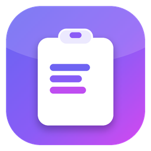
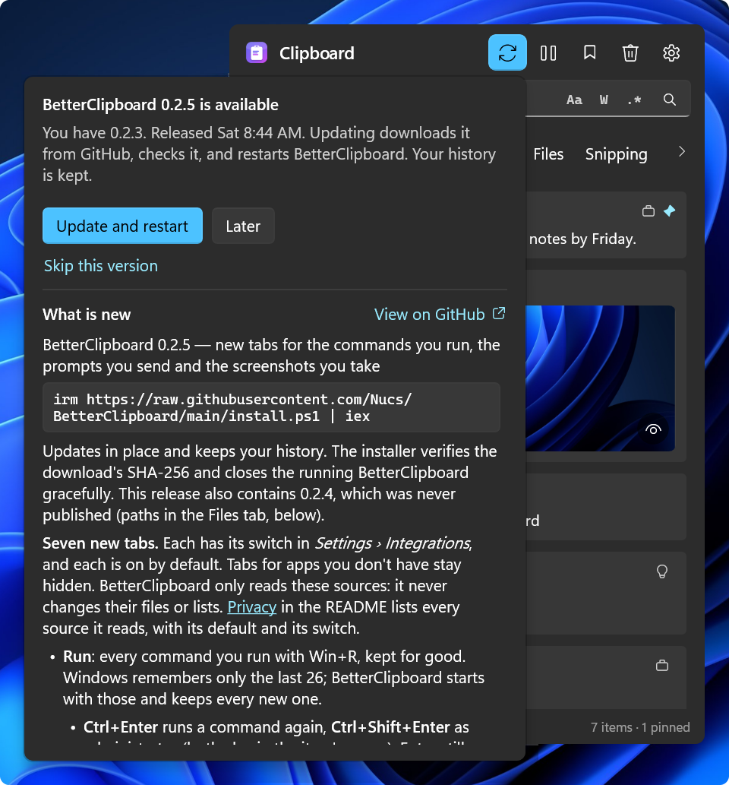
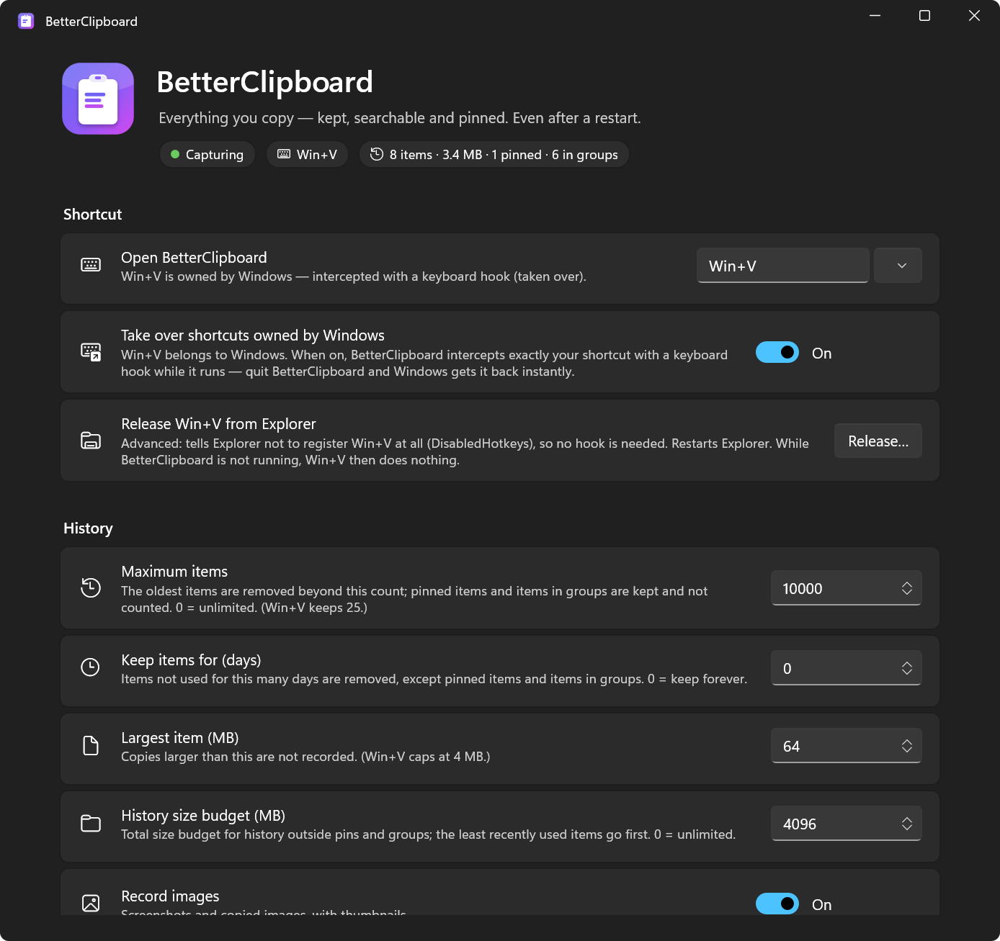
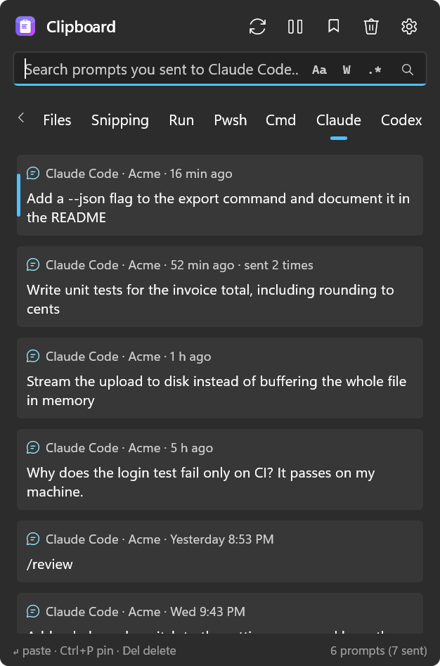

<div align="center">

#  BetterClipboard

[](https://github.com/Nucs/BetterClipboard/actions/workflows/ci.yml)
[](https://github.com/Nucs/BetterClipboard/releases/latest)
[](../../LICENSE)

[ENG](../../README.md) / [简体中文](README.zh-CN.md) / **Русский** / [Español](README.es.md) / [עברית](README.he.md)

</div>

> Это перевод английского [README](../../README.md). Английская версия может обновляться раньше перевода; если они расходятся, верна английская.

<div align="center">

**Журнал буфера обмена Win+V, каким его должна была сделать Windows.** То же сочетание клавиш, та же панель у курсора — но он помнит всё, переживает перезагрузки, ищет мгновенно и хранит всё в зашифрованном виде на вашем компьютере.
Он сохраняет и то, что забывают другие инструменты: ваши снимки экрана, команды Win+R, историю оболочки и запросы, которые вы отправляете Claude Code и Codex.

</div>

<p align="center">
  
</p>

<a id="features"></a>
## Возможности

- **Заменяет Win+V.** То же сочетание клавиш, и панель появляется сразу, у текстового курсора: пока она скрыта, она остаётся отрисованной и актуальной, так что Win+V нужно лишь показать её ([Как это устроено](#how-it-works)). Установщик освобождает Win+V от Проводника; копия, запущенная без установщика, перехватывает его клавиатурным перехватчиком (hook). Добавьте ещё сочетания или оставьте Win+V для Windows и выберите свои: нажмите любую клавишу или комбинацию в *Параметры › Сочетание клавиш* (клавиши цифровой клавиатуры и мультимедиа, F13–F24 и клавиша Copilot тоже подходят), а сочетания, которыми вы пользовались раньше, остаются в одном щелчке ([Выбор сочетаний клавиш](#choosing-shortcuts)).
- **Помнит всё, и после перезагрузки тоже.** По умолчанию 10 000 элементов, каждый до 64 МБ, с общим лимитом размера и необязательным сроком хранения — всё настраивается. Win+V хранит 25 элементов до 4 МБ, а перезагрузка стирает всё, кроме закреплённых.
- **Любые копии**, с приложением-источником и временем на каждой карточке, и вкладки, которые фильтруют по типу и по источнику. Повторно скопированное поднимается наверх, а не создаёт дубликат ([Вкладки](#tabs)):
  - **Текст, форматированный текст и HTML, ссылки и цвета** с образцом цвета.
  - **Длинные тексты** показывают первые четыре строки, а тонкая пунктирная линия и глаз говорят, что там есть ещё. Задержите мышь на тексте, чтобы прочитать его целиком, или нажмите `F3`: просмотрщик отрисовывает Markdown, раскрашивает код на 22 языках, заново расставляет отступы в XML и JSON, переносит и нумерует строки и открывает копии размером в мегабайты постранично ([Просмотр текста](#text-previews)).
  - **Файлы**, скопированные в Проводнике, и **пути, скопированные как текст** (`C:\…`, `~/.bashrc`, `src/app/main.cs`), которые по-прежнему вставляются как текст ([Пути во вкладке «Файлы»](#paths-in-the-files-tab)).
  - **Изображения** с миниатюрами. Задержите мышь на изображении, чтобы увидеть его в полный размер, или откройте его в просмотрщике с масштабированием и прокруткой ([Просмотр изображений](#image-previews)). Одна и та же картинка в PNG и в bitmap — один элемент. Снимок экрана помнит файл, в который он был сохранён: щёлкните по нему правой кнопкой, чтобы скопировать путь, скопировать изображение как файл, открыть файл или его папку, а *Сохранить во временную папку и* делает то же самое для любой картинки ([Изображения и их файлы](#pictures-and-their-files)).
  - **Собственный журнал Windows:** то, что ещё помнит Win+V, включая закреплённое, импортируется при каждом запуске. То, что вы удалили в BetterClipboard, повторно не импортируется.
  - **ShareX:** каждый снимок экрана, который сохраняет [ShareX](https://getsharex.com), в момент сохранения.
  - **Снимки:** каждый снимок экрана, который сохраняют автосохранение «Ножниц» и `Win+PrtScn`.
  - **Notepad++:** текст несохранённых вкладок «new» в [Notepad++](https://notepad-plus-plus.org/), который обновляется по мере правки, и полный путь каждого файла, который вы открываете в Notepad++.
  - **Выполнить:** каждая команда, которую вы запускаете через `Win+R`, даже после того как список Windows из 26 команд её забудет. `Ctrl+Enter` запускает её снова (`Ctrl+Shift+Enter` — от имени администратора).
  - **Pwsh:** вся история команд PowerShell, включая старые команды, до которых его стрелка вверх уже не дотягивается.
  - **Cmd:** команды, введённые в окнах командной строки, сохраняются и после закрытия окна.
  - **Claude и Codex:** каждый запрос, который вы отправляете Claude Code и Codex, сохраняется навсегда.
  - **Everything:** файлы, которые вы открываете из [Everything](https://www.voidtools.com/), чтобы вставить их как файл или как путь.

  Последние восемь — вкладки для других приложений. У каждой свой переключатель, все включены по умолчанию, BetterClipboard только читает их источник, а вкладка приложения, которого у вас нет, остаётся скрытой ([Вкладки для других приложений](#tabs-for-other-apps)). *Удалить сохранённое…* на карточке каждой из них в параметрах показывает, что BetterClipboard из неё сохранил, по частям и с примерами, и удаляет то, что вы отметите; собственные файлы другого приложения никогда не затрагиваются.
- **Мгновенный поиск** на любом языке, включая иврит, CJK и эмодзи, с переключателями как в VS Code: учёт регистра (`Alt+C`), слово целиком (`Alt+W`) и регулярное выражение (`Alt+E`) ([Поиск](#search)). В Win+V поиска нет.
- **Создан для клавиатуры.** `Enter` вставляет в приложение, из которого вы пришли, а `Shift+Enter` вставляет обычный текст. `↑` `↓` перемещают по элементам, `←` `→` — по вкладкам по кругу, а `↑` с верхнего элемента переходит к вашим группам. `Ctrl+1` … `Ctrl+9` вставляют n-й элемент, `Ctrl+P` закрепляет, `Del` удаляет, `F3` показывает элемент целиком, а клавиша меню открывает меню элемента (только копировать, открыть ссылку, показать в Проводнике, …). `Esc` возвращает фокус туда, где вы были ([Использование](#use)).
- **Панель под вас.** Она открывается на вкладке, которой вы пользовались последней, и после перезагрузки тоже. Перетащите любое пустое место, чтобы переместить её, или край, чтобы изменить размер: с тех пор она открывается этого размера. Вкладки, которые не помещаются, прокручиваются вбок стрелками ‹ ›, колёсиком мыши или перетаскиванием. Щёлкните вкладку правой кнопкой, чтобы переместить её влево или вправо, скрыть её или скрыть вместе с её элементами во всех списках; *Показать все скрытые* возвращает их, а ваш порядок сохраняется ([Вкладки](#tabs)). Мышь выделяет элемент, над которым находится.
- **Закрепления и группы.** Закрепляйте то, чем пользуетесь снова и снова: закреплённые элементы идут сверху, а панель всё равно открывается на вашей последней копии прямо под ними, так что `Win+V` `Enter` вставляет то, что вы скопировали последним, а `↑` ведёт к закреплённым. Создавайте группы со своими значками, перетаскивайте на них карточки и показывайте одну группу или несколько сразу (`Ctrl+щелчок`, `Shift+щелчок` или `Space` на группе, до которой вы дошли стрелками). Закреплённые и сгруппированные элементы переживают любые лимиты, и *Очистить* их не трогает ([Группы](#groups)).
- **Мало памяти.** После каждого использования он отдаёт память, которая ему больше не нужна: пока он ждёт вашего следующего Win+V, в столбце *Память* диспетчера задач — несколько мегабайт. То, что оставляют после себя параметры, тоже возвращается: через несколько секунд после их закрытия BetterClipboard незаметно заменяет себя свежей копией, и при этом ничего не открывается и не мигает ([Как это устроено](#how-it-works)).
- **Читает каждую копию сразу.** Копии с интервалом от 2 мс сохраняются все до одной. Программа, которая копирует быстрее, перезаписывает свои копии раньше, чем любое приложение, включая Win+V, успевает их прочитать: BetterClipboard сохраняет последнюю и считает остальные (*Параметры › Надёжность записи*).
- **Конфиденциальность.** Никакой телеметрии и никакой учётной записи. Единственное, что он сам запрашивает у сервера, — публичный список своих выпусков на GitHub, раз в день, чтобы сообщить вам об обновлениях; переключатель отключает и это ([Конфиденциальность](#privacy)).
  - **Шифрование при хранении:** весь журнал (ChaCha20-Poly1305), с ключом, который может открыть только ваша учётная запись на этом компьютере ([Как это устроено](#how-it-works)). Win+V шифрует только закреплённое.
  - **Личные копии не записываются:** копии, которые приложения помечают как личные, никогда не записываются, а 46 менеджеров паролей и приложений-аутентификаторов игнорируются с самого начала. *Приостановить запись* и *Игнорируемые приложения* покрывают остальное.
  - **Забыть навсегда** удаляет элемент и больше никогда не записывает его содержимое, какое бы приложение его ни скопировало ([Забыть навсегда](#forget-forever)).
- **Командная строка для скриптов и ИИ-агентов.** `bclip` выводит ваш журнал, ищет по нему и применяет к нему grep, печатает любой элемент байт в байт, помещает текст в буфер обмена, ждёт вашей следующей копии и ищет по архиву ваших запросов, с выводом в JSON. По умолчанию она выключена ([Командная строка](#command-line-for-scripts-and-ai-agents)).
- **Установка одной строкой.** Для пользователя, без прав администратора, с проверкой SHA-256, Windows 10 (2004 или новее) и Windows 11, x64 и ARM64, больше ничего устанавливать не нужно; с этого момента он запускается вместе с Windows. От имени администратора или из Intune либо RMM-инструмента он устанавливается для всех пользователей компьютера, и каждый пользователь по-прежнему может отключить запуск при входе для себя. При удалении ваш журнал сохраняется, если вы не попросите иначе ([Установка](#install)). Редакция для Microsoft Store собрана, проходит сертификацию Microsoft и использует тот же журнал ([Редакция Microsoft Store](#microsoft-store-edition)).
- **Обновления — с вашего согласия.** Кнопка обновления в заголовке панели, слева от паузы, подсвечивается, когда на GitHub есть более новый выпуск, и раз в неделю её подсказка сама сообщает об этом на несколько секунд. Щелчок показывает решение — *Обновить и перезапустить* или *Позже* — с заметками о выпуске под ним. Только тогда обновление скачивается, сверяется с SHA-256 выпуска и устанавливается на место, в том числе в папку, распакованную из zip-архива выпуска: BetterClipboard сам перезапускается, а ваш журнал сохраняется ([Обновления](#updates)).
- **На вашем языке.** Английский, упрощённый китайский (简体中文), русский (Русский), испанский (Español) и иврит (עברית) — все в каждой загрузке. При первом запуске показываются языки с флагами, и язык Windows уже выбран: один щелчок по зелёной галочке — и всё приложение говорит на нём. Обновление с версии, которая ещё не спрашивала, тоже спросит один раз. *Параметры › Приложение › Язык* меняет его позже: выберите язык и нажмите *Перезапустить*. Иврит читается справа налево внутри обычной разметки. То, что вы копируете, имена файлов и названия, которые вы даёте группам, никогда не переводятся.
- **Параметры с поиском.** Начните вводить текст в поле вверху параметров (`Ctrl+F`), и страница оставит только подходящие параметры, на их местах, с выделенными совпавшими буквами. Считается любое слово параметра — заголовок, описание, раздел, кнопки и варианты, — а также первые буквы слов («ооп» для *Освобождение от Проводника*) и опечатки (английские названия тоже ищутся, так что подойдёт и «pasword»). `Esc` возвращает всю страницу туда, где она была.
- **Остальные параметры:** запуск вместе с Windows, тема (светлая, тёмная или как в Windows), где открывается панель (рядом с текстовым курсором или мышью либо по центру основного экрана или экрана, на котором вы печатаете — с несколькими мониторами, при любом масштабе), и страница, где перечислены все приложения, с которыми он работает, и все компоненты в его составе, с их официальными ссылками.

<a id="install"></a>
## Установка

Windows 10 версии 2004 или новее / Windows 11, x64 или ARM64. Больше ничего устанавливать не нужно (выпуск автономный). В PowerShell:

```powershell
irm https://raw.githubusercontent.com/Nucs/BetterClipboard/main/install.ps1 | iex
```

Установщик скачивает последний [выпуск](https://github.com/Nucs/BetterClipboard/releases/latest) для вашей архитектуры, **проверяет его SHA-256**, устанавливает его для пользователя в `%LOCALAPPDATA%\Programs\BetterClipboard` (без прав администратора), добавляет ярлык в меню «Пуск», включает запуск BetterClipboard вместе с Windows и регистрирует его в *Параметры › Приложения › Установленные приложения*. Он также **забирает Win+V**: Проводник перестаёт регистрировать это сочетание и один раз перезапускается (панель задач мигнёт, а открытые окна папок закроются). См. [Перехват Win+V](#taking-over-winv). Повторный запуск обновляет установку на месте, как и кнопка обновления в самом приложении ([Обновления](#updates)); ваш журнал никогда не затрагивается. Установщик работает из любой папки, в том числе из той, куда у вас нет прав на запись, и по завершении оставляет PowerShell в этой папке.

При первом запуске BetterClipboard спрашивает ваш язык: English, 简体中文, Русский, Español или עברית, каждый со своим флагом, причём язык Windows уже выбран. Нажмите зелёную галочку (или `Enter`), и всё откроется на этом языке. Если вы обновляетесь с версии, которая ещё не спрашивала, первый запуск после обновления спросит один раз.

Раз в день установленное приложение спрашивает у GitHub, есть ли более новый выпуск. Ничего о вас, вашем компьютере или буфере обмена не отправляется, и ничего не устанавливается без вашего согласия ([Конфиденциальность](#privacy)). `-NoUpdateCheck` устанавливает с выключенной проверкой.

Параметры установки (передавайте их через блок скрипта):

```powershell
& ([scriptblock]::Create((irm https://raw.githubusercontent.com/Nucs/BetterClipboard/main/install.ps1))) -NoTakeOverWinV -Hotkey Win+Alt+V
```

| Параметр | Действие |
|---|---|
| `-NoTakeOverWinV` | Оставить Win+V для Windows. Тогда BetterClipboard открывается сочетаниями из `-Hotkey` или Win+Alt+V. Если Win+V раньше было освобождено, Проводник получает его обратно. |
| `-Hotkey A, B, …` | Сочетания, которые открывают BetterClipboard, например `-Hotkey Win+Alt+V, Ctrl+Alt+F9`. Win+V идёт первым, если не указан `-NoTakeOverWinV`. Каждое из них перехватывается так же, как Win+V (см. [Перехват Win+V](#taking-over-winv)). |
| `-TakeOverWinV` | Действует по умолчанию. Оставлен для старых командных строк; если в ваших сочетаниях больше нет Win+V, он добавляет Win+V обратно. |
| `-AddToPath` | Добавить папку установки в ваш пользовательский PATH, чтобы терминалы могли запускать `bclip` (см. [Командная строка](#command-line-for-scripts-and-ai-agents)). |
| `-NoUpdateCheck` | Установить с выключенной автоматической проверкой обновлений: тогда BetterClipboard сам никогда не обращается к GitHub. В *Параметры › Обновления* есть *Проверить сейчас* и переключатель, чтобы снова её включить. |
| `-Version 0.1.0` | Установить определённый выпуск вместо последнего. |
| `-Package <zip>` | Установить из zip-архива выпуска на диске вместо скачивания (установка без сети). Положите рядом с архивом `SHA256SUMS.txt` выпуска или укажите `-PackageSha256 <hash>`, и он будет сначала проверен. |
| `-AllUsers` | Установить для всех пользователей этого компьютера (в PowerShell от имени администратора); см. [Для всех пользователей компьютера](#for-every-user-of-a-pc). |
| `-InstallDir <path>` | Установить в другое место. |
| `-NoStartup` / `-NoShortcut` / `-NoLaunch` | Не включать запуск вместе с Windows / не создавать ярлык в меню «Пуск» / не запускать после установки. |
| `-Uninstall [-RemoveData]` | Удалить приложение (журнал сохраняется, если не указан `-RemoveData`, который удаляет и временные изображения). |

Предпочитаете вручную? Скачайте zip-архив для вашей архитектуры и `SHA256SUMS.txt` из выпуска, проверьте хеш (`Get-FileHash .\BetterClipboard-*.zip`), распакуйте куда угодно и запустите `BetterClipboard.exe`. Выпуски пока не подписаны, поэтому для копии, скачанной так, Windows может сказать *Система Windows защитила ваш компьютер*: проверьте хеш, затем выберите *Подробнее › Выполнить в любом случае*. См. [Политика подписи кода](#code-signing-policy).

<a id="for-every-user-of-a-pc"></a>
### Для всех пользователей компьютера

В PowerShell от имени администратора:

```powershell
& ([scriptblock]::Create((irm https://raw.githubusercontent.com/Nucs/BetterClipboard/main/install.ps1))) -AllUsers
```

- **Что настраивается:** приложение в `Program Files\BetterClipboard`, в папке, которую могут менять только администраторы; ярлык в меню «Пуск», запись в *Установленные приложения* и запуск вместе с Windows для всех пользователей. Каждый пользователь, который входит в систему, получает запущенный BetterClipboard со своим зашифрованным журналом в своём профиле.
- **Каждый решает за себя:** выключение *Параметры › Приложение › Запускать вместе с Windows* останавливает запуск при входе только для этого пользователя. Собственная запись пользователя о запуске вместе с Windows, если она есть, имеет приоритет, так что BetterClipboard никогда не запускается дважды.
- **Выбирается сам**, когда устанавливает не тот, кто вошёл в систему: когда установщик работает от имени SYSTEM (Intune, RMM-инструмент) или с учётными данными администратора на чужом рабочем столе. Копия в профиле этой учётной записи не служила бы никому из тех, кто входит на этом компьютере.
- **Что остаётся у каждого пользователя своим:** Win+V и другие сочетания. BetterClipboard перехватывает Win+V своим клавиатурным перехватчиком для всех, а каждый пользователь может освободить его от Проводника в *Параметры › Сочетание клавиш*. `-Hotkey` и `-NoTakeOverWinV` действуют, только когда устанавливает вошедший пользователь. `-AddToPath` добавляет папку в PATH каждого пользователя.
- **Обновления:** эта копия не заменяет себя и не проверяет обновления сама, потому что её пользователи могут не быть администраторами. Администратор снова запускает ту же команду: запущенный от имени администратора на компьютере с копией для всех пользователей, установщик обновляет эту копию. *Параметры › Обновления › Проверить сейчас* по-прежнему сообщает, есть ли новая версия, а диалог обновления копирует команду.

[Пакет Chocolatey](../../packaging/chocolatey) следует тому же правилу для запуска вместе с Windows. Если его устанавливает вошедший пользователь, запись принадлежит ему. Если его устанавливает SYSTEM или другая учётная запись или он установлен с `/AllUsersStartup`, запись действует для всех пользователей.

<a id="microsoft-store-edition"></a>
### Редакция Microsoft Store

**Пока не в магазине.** Редакция собрана и проверена ([docs/microsoft-store.md](../microsoft-store.md)), а Microsoft сертифицирует её первую отправку. Вот что она собой представляет:

- **Устанавливается и обновляется через магазин.** Microsoft подписывает пакет, поэтому Windows не показывает предупреждения о «неизвестном издателе». Само приложение вообще не делает сетевых запросов, потому что его обновляет магазин.
- **Сначала спрашивает.** При первом запуске она спрашивает язык, а затем показывает приветствие с двумя переключателями: *Открывать по Win+V* и *Запускать вместе с Windows*. Ничего не записывается и ни одно сочетание не занимается, пока вы не нажмёте *Начать*.
- **Win+V без изменений в системе.** Пока она работает, она отвечает на Win+V клавиатурным перехватчиком; закройте её — и Win+V сразу снова принадлежит Windows. *Освобождения от Проводника* в этой редакции нет.
- **Один журнал для всех вариантов установки.** Редакция из магазина хранит ваш журнал в `%LOCALAPPDATA%\BetterClipboard`, в той же папке, что и установщик, Chocolatey и переносная копия, поэтому при переходе между ними ваш журнал, закреплённые элементы и параметры сохраняются. Один раз для каждой версии Windows она проверяет, что записанное ею действительно попадает в эту папку; если нет, она хранит всё в собственной папке и сообщает об этом в *Параметры › Папка данных*.
- **Одна копия за раз.** Предполагается, что установлен только один BetterClipboard. Когда редакция из магазина находит копию, установленную установщиком, она говорит, что сделает, и проверяет, что сможет это сделать. *Перейти на эту редакцию* закрывает и удаляет ту копию (это возвращает Win+V Windows); ваш журнал остаётся на месте. (Если редакция хранит всё в собственной папке, она сначала копирует ваш журнал и параметры, проверяет копию и в конце удаляет старую папку; если какой-то шаг не удаётся, ваш журнал остаётся там, где был.) Копию для всех пользователей или копию Chocolatey удаляет администратор: редакция из магазина говорит, как это сделать, и ждёт. Установщик, в свою очередь, сообщает вам, если установлена редакция из магазина.
- **`bclip` работает в любом терминале** без записи в PATH, как только вы включите командную строку.
- **Её удаление** сохраняет ваш журнал, как и любое другое удаление: чтобы удалить его насовсем, удалите `%LOCALAPPDATA%\BetterClipboard` (*Параметры › Папка данных › Открыть* показывает эту папку). Вместе с приложением удаляется только журнал из собственной папки редакции.

<a id="updates"></a>
## Обновления

BetterClipboard обновляется из своих [выпусков на GitHub](https://github.com/Nucs/BetterClipboard/releases), и только тогда, когда вы скажете.

<p align="center">
  
</p>

- **Кнопка обновления** находится в заголовке панели, слева от паузы. Пока у вас последняя версия, она выглядит как соседние кнопки. Когда выходит более новый выпуск, она заливается цветом акцента, а в меню значка в области уведомлений появляется *Обновить до x.y.z…*.
- **Напоминание раз в неделю.** Пока новый выпуск ждёт, подсказка кнопки — *Доступно обновление: BetterClipboard x.y.z* — сама открывается на несколько секунд, когда вы открываете панель, не чаще раза в семь дней. Она открывается над панелью, где ничего не закрывает (рядом с кнопкой, когда панель у верхнего края экрана), и закрывается сама: закрывать её не нужно, и ввод продолжается как обычно. Щелчок по ней открывает диалог обновления. Открытие этого диалога тоже считается напоминанием, так что *Позже* означает «через неделю». Пока автоматическая проверка выключена, напоминаний нет.
- **Щелчок открывает диалог обновления:** сверху решение — *Обновить и перезапустить*, *Позже* или *Пропустить эту версию*, — а под ним заметки о выпуске. Пока у вас последняя версия, он показывает, что нового в вашей версии, и *Проверить сейчас*.
- **Ничего не устанавливается без вашего согласия.** *Обновить и перезапустить* скачивает выпуск для вашего компьютера с GitHub и сравнивает его SHA-256 с `SHA256SUMS.txt` выпуска и с хешем, который вычислил сам GitHub. Затем установщик из этого выпуска заменяет файлы приложения: BetterClipboard закрывается и сам запускается снова, в фоне. Ваш журнал, параметры и сочетания остаются как есть, а уведомление сообщает, как всё прошло.
- **Если обновление не удалось,** установленная версия остаётся на месте и продолжает работать, а диалог или уведомление объясняет почему. Загрузка, которая не совпадает со своей контрольной суммой, удаляется. Папка установки, которую держит открытой другая программа, остаётся как была.
- **Проверка:** раз в день (впервые — через минуту после запуска) BetterClipboard запрашивает у GitHub публичный список выпусков этого проекта. Запрос называет только версию приложения: ничего о вас, вашем компьютере или буфере обмена не отправляется ([Конфиденциальность](#privacy)). *Параметры › Обновления* отключает проверку, как и установка с `-NoUpdateCheck`. *Проверить сейчас* спрашивает один раз, что бы ни говорил переключатель.
- **Пропустить эту версию** снимает подсветку и еженедельное напоминание для этого выпуска. Следующий выпуск возвращает и то и другое.
- **Сборка для разработки** (версия вида `0.2.10-dev.12.gabc1234`, см. [Сборка из исходников](#build-from-source)) сначала получает сборки, опубликованные в папку `dev-builds` её компьютера: *Доступна сборка для разработки*, и *Обновить и перезапустить* копирует сборку из этой папки вместо скачивания. В остальных случаях ей всегда предлагается последний выпуск с GitHub, даже более старый, как путь назад к официальной версии (*Установить и перезапустить*). Еженедельного напоминания у неё нет.
- **Копия, распакованная из zip-архива выпуска,** начиная с 0.2.11 обновляет себя в своей же папке. *Обновить и перезапустить* скачивает и проверяет выпуск, как описано выше; затем новая версия закрывает BetterClipboard, заменяет файлы выпуска по одному и запускается снова. Файлы, которые не входят в выпуск (ваши собственные, если они есть в папке), остаются как есть, а если какой-то из его файлов нельзя заменить (его держит открытым другая программа), все файлы возвращаются в прежнее состояние. Копия в папке, которую вы не можете изменять, например в Program Files без прав администратора, вместо этого получает страницу загрузки и команду установки.
- **Более новая копия перенимает работу.** Запустите более новый BetterClipboard, пока работает старый (скажем, новый выпуск, распакованный в новую папку), и старый закроется, а новый продолжит работу, вместо того чтобы открылись параметры старого. Если *Запускать вместе с Windows* запускает более старую копию или копию, которой больше нет, запись переходит к копии, которую вы запускаете; запись, которую вы выключили в автозагрузке Windows, остаётся выключенной.
- **Копия, установленная для всех пользователей,** не заменяет себя и не проверяет обновления сама: её папку может менять только администратор. *Проверить сейчас* по-прежнему спрашивает, а диалог копирует команду, которую нужно выполнить в PowerShell от имени администратора ([Для всех пользователей компьютера](#for-every-user-of-a-pc)).
- **Редакция Microsoft Store** не имеет кнопки обновления и ничего не спрашивает у GitHub: её обновляет магазин, а *Параметры › Обновления из Microsoft Store* открывает её страницу в магазине.

<a id="use"></a>
## Использование

Нажмите **Win+V**. Панель сразу появляется у текстового курсора, на вкладке, которой вы пользовались последней, с фокусом в поле поиска — просто начинайте печатать. Выделена ваша последняя копия, так что `Enter` вставляет её. Закреплённые элементы перечислены над ней (*Параметры › Вставка* может вместо этого расставить их по времени), и `↑` ведёт к ним.

*Параметры › Сочетание клавиш › Положение панели* открывает её вместо этого рядом с указателем мыши или по центру экрана: основного или того, на котором вы печатаете (с несколькими мониторами — экрана с окном, в котором вы были; после щелчка по рабочему столу — экрана с указателем мыши).

| Клавиша | Действие |
|---|---|
| *ввод текста* | Поиск (по подстроке, без учёта регистра, включая иврит, CJK и эмодзи) |
| `Alt+C` / `Alt+W` / `Alt+E` | Переключают **Aa** (учёт регистра), **W** (слово целиком) и **.\*** (регулярное выражение) в поле поиска — или щёлкните по ним. Они остаются такими, какими вы их оставили. |
| `↑` `↓` `PgUp` `PgDn` | Перемещают выделение. Панель открывается на вашей последней копии, поэтому `↑` сначала ведёт к закреплённым элементам над ней, начиная с нижнего. Когда колонка групп открыта, нажмите `↑` на верхнем элементе, чтобы перейти к группам (см. [Группы](#groups)). |
| `Space` / `Enter` в колонке групп | Пока стрелки находятся в колонке групп: оставить группу под кольцом и вернуться к элементам. Пока открыто несколько групп: добавить группу под кольцом в список или убрать её (см. [Группы](#groups)). Везде в остальных местах `Space` вводит пробел, а `Enter` вставляет. |
| `←` `→` | Предыдущая / следующая вкладка, по кругу: `←` на первой вкладке ведёт к последней, `→` на последней — к первой. Пока вы правите текст поиска, они двигают его курсор; после `↑` или `↓` они снова переключают вкладки. Удерживаемая клавиша останавливается на первой или последней вкладке. |
| Мышь над элементом | Выделяет его. Вкладки и значки групп выбираются только щелчком. |
| `Enter` / щелчок | Вставить в приложение, из которого вы пришли |
| `Shift+Enter` | Вставить как обычный текст |
| `Ctrl+Enter` | На команде, которую вы запускали через Win+R: запустить её снова (`Ctrl+Shift+Enter` — от имени администратора) |
| `Ctrl+1` … `Ctrl+9` | Вставить n-й элемент |
| `Ctrl+P` | Закрепить / открепить (закреплённые элементы не подчиняются срокам хранения и «очистке») |
| `Del` (или `Shift+Del` во время поиска) | Удалить элемент. Во вкладках Pwsh, Cmd и Everything — скрыть команду или файл, пока вы снова ими не воспользуетесь. Во вкладках Claude и Codex — удалить запрос, пока вы не отправите его снова. |
| `Ctrl+F` | Вернуться в поле поиска |
| `Ctrl+G` | Показать / скрыть колонку групп (то же, что кнопка-закладка) |
| `F3` | Просмотреть выделенный элемент: весь его текст в просмотрщике текста или картинку в просмотрщике изображений (см. [Просмотр текста](#text-previews)) |
| `Menu` / `Shift+F10` / щелчок правой кнопкой | Меню элемента: вставить, вставить как обычный текст, только копировать, просмотреть (`F3`), закрепить, группы (добавить / убрать), открыть ссылку / показать в Проводнике / показать в Everything, выполнить (команды Win+R), файл картинки (копировать путь, копировать изображение как файл, открыть файл, открыть папку) и *Сохранить во временную папку и* (см. [Изображения и их файлы](#pictures-and-their-files)), удалить, забыть навсегда |
| Щелчок правой кнопкой по вкладке (или `Menu` на вкладке, по которой вы щёлкнули) | Меню вкладки: *Переместить влево*, *Переместить вправо*, *Скрыть вкладку*, *Скрыть вкладку и её строки в буфере обмена*, *Показать все скрытые*. Щелчок правой кнопкой по пустому месту строки вкладок тоже предлагает *Показать все скрытые* (см. [Вкладки](#tabs)). |
| `Esc` | Очистить поиск, затем закрыть — фокус возвращается туда, где вы были |
| Перетаскивание любого пустого места | Переместить панель, как за заголовок окна (`Esc` во время перетаскивания возвращает её назад). В следующий раз она снова открывается там, где указывает *Положение панели*. |
| Перетаскивание края | Изменить размер панели. С тех пор она открывается этого размера. |
| Колёсико или перетаскивание над вкладками | Прокрутить вкладки вбок, когда они не помещаются, или щёлкнуть стрелки ‹ › по их краям |
| Задержать мышь на изображении | Увидеть его в полный размер; его кнопка-глаз открывает просмотрщик с масштабированием (см. [Просмотр изображений](#image-previews)) |
| Задержать мышь на длинном тексте | Прочитать его целиком и прокручивать колёсиком (движение мыши закрывает его); щелчок правой кнопкой — копировать или меню элемента; его кнопка-глаз открывает просмотрщик текста, который остаётся открытым (см. [Просмотр текста](#text-previews)) |
| Кнопка обновления слева от паузы | Открыть диалог обновления: заметки о выпуске и *Обновить и перезапустить*, когда есть более новая версия (тогда кнопка подсвечена; см. [Обновления](#updates)) |

Печатайте и нажимайте `Enter` так быстро, как хотите: `Enter` ждёт окончания поиска и вставляет лучшее совпадение — самое новое из незакреплённых, когда закреплённые совпадения перечислены над ним.

**Вставка в окно, запущенное от имени администратора** (например, в терминал с повышенными правами): Windows не позволяет приложению без прав администратора печатать в такое окно. BetterClipboard помещает элемент в буфер обмена, возвращается к этому окну и один раз (уведомлением) просит вас самостоятельно нажать `Ctrl+V`. Само сочетание работает над такими окнами, когда Win+V освобождено от Проводника (так делает установщик по умолчанию).

Значок в области уведомлений открывает панель и параметры. Поле поиска вверху параметров (`Ctrl+F`) фильтрует страницу по мере ввода, с учётом опечаток; `Esc` очищает его. Разделы параметров:

- **Сочетание клавиш:** клавиши, которые открывают панель (добавляйте сколько угодно: щёлкните поле и нажмите их или выберите из меню подсказок и сочетаний, использованных раньше), где открывается панель (рядом с текстовым курсором, рядом с указателем мыши, по центру основного экрана или по центру экрана, на котором вы печатаете), и освобождение сочетаний Win+буква от Проводника ([Выбор сочетаний клавиш](#choosing-shortcuts)).
- **Журнал:** сколько элементов, сколько дней, какого размера, что записывать и как долго хранятся картинки *Сохранить во временную папку и*.
- **Вставка:** вставлять выбранный элемент, перемещать вставленные элементы наверх, закреплённые первыми.
- **Конфиденциальность:** пауза, игнорируемые приложения, *Забытые навсегда*, надёжность записи, очистка журнала.
- **Буфер обмена Windows:** собственный журнал Windows и **Импорт из Windows**, который забирает всё, что ещё помнит Win+V, — включая его закреплённые элементы.
- **Интеграции:** по одному переключателю на каждую вкладку другого приложения, два для Notepad++ (его несохранённые вкладки и файлы, которые вы в нём открываете), а на каждой карточке — *Удалить сохранённое…*: диалог, который показывает, что BetterClipboard сохранил из этого источника, по частям с количеством, размерами и последними примерами, и удаляет отмеченные части — при желании сначала выключив переключатель (см. [Вкладки для других приложений](#tabs-for-other-apps)).
- **Приложение:** язык интерфейса (язык Windows или выбранный вами; *Перезапустить* рядом со списком применяет его), запуск вместе с Windows (только для вас, даже если BetterClipboard установлен для всех пользователей), тема, командная строка, папка данных.
- **Обновления:** переключатель ежедневной проверки, *Проверить сейчас* и диалог обновления ([Обновления](#updates)).
- **Сторонние продукты:** приложения, с которыми работает BetterClipboard, и компоненты, из которых он собран, с их официальными ссылками.

**Память возвращается после каждого использования.** Вскоре после того как вы убираете панель или закрываете параметры, BetterClipboard отдаёт память, которая ему больше не нужна, так что, пока он ждёт, в столбце *Память* диспетчера задач — несколько мегабайт. Параметры к тому же оставляют после себя память, которую возвращает только новый процесс (примерно от 80 до 100 МБ), поэтому через несколько секунд после их закрытия, когда панель закрыта, а клавиатура и мышь какое-то время не используются, BetterClipboard незаметно заменяет себя свежей копией. Ничего не открывается и не мигает, а указатель не меняется: значок в области уведомлений остаётся на месте, сочетания продолжают работать (нажатое в эту секунду откроет панель чуть позже), а копия, сделанная в это время, записывается.

<p align="center">
  
</p>

<a id="tabs"></a>
### Вкладки

| Вкладка | Что в ней | Когда видна |
|---|---|---|
| Все | Весь ваш журнал, самое новое сверху | Всегда |
| Закреплённые | Элементы, которые вы закрепили | Всегда |
| Текст | Текст и форматированный текст, включая пути | Всегда |
| Изображения | Картинки, которые вы скопировали, и сохранённые снимки экрана | Всегда |
| Ссылки | Скопированные URL | Всегда |
| Файлы | Файлы, которые вы скопировали в Проводнике, и текст, который состоит только из путей | Всегда |
| ShareX | Снимки экрана, которые сохранил ShareX, и всё, что вы скопировали из ShareX | Когда установлен ShareX |
| Снимки | Снимки экрана, которые сохранили «Ножницы» и Win+PrtScn | Когда в вашем журнале есть снимок экрана от них |
| Notepad++ | Текст несохранённых вкладок Notepad++, файлы, которые вы открывали в Notepad++, и то, что вы в нём скопировали | Когда в вашем журнале есть что-то из Notepad++ |
| Выполнить | Команды, которые вы запускали через Win+R | Когда в вашем журнале есть команда Win+R |
| Pwsh | Собственная история команд PowerShell | Когда у PowerShell есть файл истории |
| Cmd | Команды, введённые в окнах командной строки | Всегда |
| Claude | Запросы, которые вы отправляли Claude Code | Когда у Claude Code есть запросы |
| Codex | Запросы, которые вы отправляли Codex | Когда у Codex есть запросы |
| Everything | Файлы, которые вы открывали в Everything | Когда Everything установлен или запущен |

У каждой вкладки после «Файлов» есть свой переключатель в *Параметры › Интеграции*. Все они включены по умолчанию; выключите один — и его вкладка исчезнет. Раздел [Вкладки для других приложений](#tabs-for-other-apps) рассказывает, что читает каждая из них.

**Расставляйте вкладки** щелчком правой кнопкой по вкладке:
- *Переместить влево* и *Переместить вправо* сдвигают её на одно место среди видимых вкладок. «Все» всегда остаётся первой и не перемещается.
- *Скрыть вкладку* убирает вкладку из строки. Уходит только вкладка: её элементы по-прежнему видны во «Всех» и в других вкладках, её переключатель в *Параметры › Интеграции* остаётся включённым, и BetterClipboard продолжает собирать для неё данные. Если скрыть вкладку, на которой вы находитесь, панель переключится на «Все». «Все» скрыть нельзя.
- *Скрыть вкладку и её строки в буфере обмена* убирает ещё и элементы вкладки из всех списков: из «Всех», из других вкладок, из результатов поиска. Элементы, которые вы поместили в группу, остаются там, где они видны. Тогда нижняя строка показывает, сколько элементов скрыто (`1 240 элементов · скрыто: 37`). Ничего не удаляется, и `bclip` по-прежнему их выводит.
- *Показать все скрытые* возвращает все скрытые вкладки (с указанием, сколько их) и элементы, скрытые вместе с ними. Щелчок правой кнопкой по пустому месту строки тоже его предлагает.

Ваш порядок и скрытые вкладки сохраняются, и после перезагрузки тоже. `←` и `→` пропускают скрытые вкладки.

**Панель открывается на вкладке, которой вы пользовались последней**, и после перезагрузки тоже. `←` и `→` проходят по вкладкам по кругу. Если последней вкладки нет (её приложение удалено, её переключатель выключен или вы её скрыли), панель открывается на «Всех» и возвращается к вашей вкладке, когда та появится. Текст поиска и открытые группы не сохраняются: каждый Win+V начинается с пустого поиска по всему журналу.

<a id="search"></a>
### Поиск

Печатайте, чтобы искать. Слово находится в любом месте текста элемента, на любом языке, в верхнем или нижнем регистре. Три переключателя в поле поиска сужают поиск, как в VS Code:

- **Aa** (`Alt+C`): учитывать регистр.
- **W** (`Alt+W`): только слова целиком. Тогда `log` находит «log file», но не «login» или «my_log».
- **.\*** (`Alt+E`): регулярное выражение (синтаксис .NET); `^` и `$` совпадают в начале и конце каждой строки. Недопустимый шаблон делает контур переключателя красным и объясняет, что не так.

Переключатели остаются такими, какими вы их оставили, а текст поиска очищается при каждом открытии панели. Они работают во всех вкладках и группах, кроме вкладки Everything, где ищет сам Everything.

<a id="image-previews"></a>
### Просмотр изображений

- **Быстрый просмотр:** задержите мышь на карточке изображения. Через мгновение картинка появляется в полный размер посреди экрана (занимая до 80% его площади). Сдвиньте мышь — и она исчезнет.
- **Просмотрщик:** щёлкните кнопку-глаз в правом нижнем углу карточки изображения. Картинка открывается на весь экран и остаётся, пока вы её не закроете. Вращайте колёсико мыши, чтобы масштабировать к указателю, перетаскивайте, чтобы сдвигать, и дважды щёлкайте, чтобы переключаться между «вписать» и «увеличить». Закрывается по `Esc`, кнопкой с крестиком или щелчком вне картинки.

<a id="text-previews"></a>
### Просмотр текста

Карточка показывает первые четыре строки текста. Если текст длиннее, об этом говорят тонкая пунктирная линия под ними и маленький глаз в углу карточки.

- **Быстрый просмотр:** задержите мышь на тексте карточки. Через мгновение весь текст появляется посреди панели, раскрашенный так же, как в просмотрщике, а колёсико прокручивает его. Движение мыши закрывает его, как и `Esc`. Щелчок правой кнопкой при неподвижной мыши предлагает *Копировать* и *Выделить всё* над собственным меню элемента. Текст длиннее 64 000 символов показывает своё начало и сообщает об этом.
- **Просмотрщик:** щёлкните глаз, нажмите `F3` или выберите *Просмотреть* в меню элемента. Экран затемняется, и текст открывается поверх него на большой карточке:
  - **Markdown** отрисовывается как документ: заголовки, списки, таблицы, цитаты, ссылки и блоки кода, каждый блок кода раскрашен на своём языке. Markdown — это ещё и то, как показывается текст, язык которого не распознан.
  - **Код** раскрашивается на C#, Java, Kotlin, JavaScript, TypeScript, Python, Ruby, PHP, Go, Rust, C и C++, PowerShell, скриптах оболочки, пакетных файлах, SQL, CSS, HTML, XML, JSON, YAML, INI и TOML, а также в diff-файлах. Язык распознаётся сам; кнопка языка выбирает другой (распознанный отмечен как *(определён)*).
  - **XML и JSON** заново расставляют отступы, по одному элементу или значению на строку; *Как скопировано* показывает их такими, какими они были скопированы.
  - **Перенос** переносит длинные строки по краю окна (если выключен — они прокручиваются вбок), **Номера строк** нумеруют строки кода, а **A−** / **A+** (`Ctrl+Minus`, `Ctrl+Plus`, `Ctrl+0` или `Ctrl` с колёсиком) меняют размер текста. Все три настройки запоминаются.
  - **Копии размером в мегабайты** открываются страницами примерно по 64 000 символов, со стрелками ‹ › для перелистывания (`Ctrl+PageUp`, `Ctrl+PageDown`); номера строк продолжаются от страницы к странице.
  - Выделяйте и копируйте как везде. Движение мыши его не закрывает: закрывают `Esc`, кнопка с крестиком или щелчок вне текста.

<a id="pictures-and-their-files"></a>
### Изображения и их файлы

Снимок экрана, который сохранили ShareX, «Ножницы» или `Win+PrtScn`, помнит файл, в который он был сохранён: его имя, папка, формат, размер и даты хранятся вместе с картинкой в вашем журнале.

- **Щёлкните картинку правой кнопкой.** Меню называет файл, его формат, размер и время последнего изменения. Пока файл на диске, за этим следуют четыре пункта: *Копировать путь*; *Копировать изображение как файл*, чтобы вставить его в папку, письмо или чат как файл, как файл, скопированный в Проводнике; *Открыть файл*; и *Открыть папку* — Проводник с выделенным файлом. Файл, который перемещён или удалён, так и обозначается, а эти четыре пункта не показываются.
- **Любая картинка, в том числе скопированная из приложения:** у *Сохранить во временную папку и ›* те же четыре пункта. BetterClipboard сначала записывает картинку как PNG в собственную папку среди ваших временных файлов (`%TEMP%\BetterClipboard\Images`), под именем её файла, если он есть. Повторное сохранение той же картинки находит этот файл; копия, которую вы с тех пор изменили, никогда не перезаписывается.
- **Временные картинки удаляются при запуске BetterClipboard**, если ими не пользовались 30 дней. *Параметры › Журнал › Хранить временные изображения (дней)* меняет это, а 0 удаляет их при каждом запуске. Пока BetterClipboard работает, они никогда не удаляются, так что картинка, которую вы только что вставили как файл, остаётся на месте для приложения, которое её читает.
- **В просмотрщике** файл картинки показан над ней: имя, формат, размер и размер в пикселях в одной строке, папка и даты — в следующей. Щёлкните имя, чтобы открыть файл, или папку, чтобы открыть её в Проводнике.
- **Снимки экрана, уже лежащие в вашем журнале,** находят свои файлы один раз, при первом запуске версии, которая их хранит: каждый получает файл из папок ShareX или папки «Снимки экрана», сохранённый в пределах двух минут от него и с теми же пикселями.
- **Файлы на сетевом диске** никогда не проверяются (пропавшая общая папка заставила бы меню ждать), поэтому их пункты остаются.

<a id="paths-in-the-files-tab"></a>
### Пути во вкладке «Файлы»

**Вкладка «Файлы»** показывает файлы, которые вы скопировали в Проводнике, и текст, который состоит только из путей:

- **Абсолютные пути:** `C:\Users\you\notes.txt`, `C:/a/path`, `\\server\share`, `/var/log/syslog`, `%APPDATA%\Code`.
- **Относительные пути:** `~/.bashrc`, `./build.sh`, `src\app\main.cs`, `folder/file.cs`.
- **Несколько:** по одному пути на строку, сколько угодно строк.
- **Это остаётся текстом:** скопированный путь по-прежнему вставляется как текст, и вкладка «Текст» по-прежнему его показывает.

Правила намеренно строгие, поэтому это остаётся только в «Тексте»:

- косые черты в обычном тексте (`and/or`, `24/7`);
- предложение, которое начинается с пути (`C:\Windows is where …`);
- URL и командная строка (`./run.sh src/a.txt`);
- относительный путь без имени файла в конце (`src/app`).

Имя папки с пробелами учитывается, когда оно похоже на имя (`C:\Program Files (x86)`, `D:\Games\Call of Duty`). Имена в нижнем регистре (`C:\Users\you\my stuff`) учитываются в кавычках — так, как их записывает *Копировать как путь* в Проводнике.

<a id="groups"></a>
### Группы

Собирайте то, чем пользуетесь снова и снова, — фрагменты текста, адреса, ссылки для проекта — в группы.

- **Откройте колонку:** кнопка-закладка рядом с паузой (или `Ctrl+G`). Панель расширяется влево, и появляется колонка значков. Логотип буфера обмена наверху — это весь ваш журнал.
- **Создайте группу:** нажмите **+** внизу, при желании дайте ей имя и выберите значок.
- **Наполните её:** перетащите любую карточку на значок группы. Тогда карточка показывает значок этой группы.
- **Откройте её:** щёлкните значок, и панель покажет только элементы этой группы (поиск и вкладки-фильтры внутри неё по-прежнему работают). Щёлкните значок ещё раз или логотип, чтобы вернуться ко всему.
- **Откройте несколько:** `Ctrl+щелчок` по другим значкам показывает их группы вместе, а `Shift+щелчок` — подряд идущие значки. Они сливаются в один список в обычном порядке, каждый элемент один раз, и поиск и вкладки работают с ним. Без клавиатуры: щелчок правой кнопкой по значку › *Добавить к показанным*.
- **С клавиатуры:** нажмите `↑` на верхнем элементе. На значке того, что у вас открыто, появляется кольцо: на группе или на логотипе, если группа не открыта (весь ваш журнал). Больше пока ничего не меняется. Теперь `↑` и `↓` проходят по колонке, и каждый шаг открывает то, на что попадает: `↓` с логотипа открывает первую группу, а `↑` с первой группы снова показывает весь журнал. Чтобы вернуться к элементам с группой, на которой вы находитесь, нажмите `Enter`, `Space` или `→` либо нажмите `↓` на последней группе. Ввод текста или движение мыши над элементом тоже возвращают. После этого `Enter` вставляет выделенный элемент.
- **Несколько групп с клавиатуры:** пока открыто больше одной группы, `↑` на верхнем элементе ставит кольцо на первую из них, а затем `↑` и `↓` двигают только кольцо: ваш объединённый список остаётся, а `↓` останавливается на последней группе. Нажмите `Space` или `Enter`, чтобы добавить группу под кольцом в список или убрать её. На логотипе они показывают весь журнал. Нижняя строка показывает эти клавиши. `→` возвращает к элементам, где `Enter` снова вставляет. `Shift+Enter` в любой момент вставляет выделенный элемент как обычный текст, в том числе пока кольцо находится в колонке групп.
- **Убирайте лишнее:** щелчок правой кнопкой по карточке → *Убрать из: …* или *Группы* в том же меню. Щелчок правой кнопкой по значку группы позволяет переименовать её, сменить значок или удалить её. Удаление группы никогда не удаляет её элементы.

Элементы в группе **хранятся как закреплённые**: ни один лимит хранения (количество, возраст, размер) их не удаляет, и *Очистить* их пропускает. Когда элемент покидает свою последнюю группу, его срок хранения начинается заново. Он не будет удалён только потому, что он старый, и сохраняет своё место в списке.

<a id="forget-forever"></a>
### Забыть навсегда

Скопировали пароль, токен или что-то ещё, чему не место в журнале? Щёлкните по нему правой кнопкой (или нажмите клавишу меню) и выберите **Забыть навсегда…**. Элемент удаляется, и **BetterClipboard больше никогда его не записывает**, какое бы приложение его ни скопировало в следующий раз: браузер, терминал, ShareX или `bclip put`. Он также никогда не импортируется повторно из собственного журнала буфера обмена Windows.

- **Что считается тем же самым:** всё должно совпадать, включая регистр букв. Концы строк и пробелы вокруг текста значения не имеют, так что `token`, снова скопированный из терминала с переводом строки после него, тоже не записывается. Копии в вашем журнале, которые отличаются только этим, исчезают вместе с той, которую вы забываете.
- **Картинки и файлы:** картинка распознаётся по пикселям, так что тот же снимок экрана в PNG или bitmap тоже считается. Список файлов распознаётся по путям (а не по содержимому файлов).
- **Что сохраняется:** отпечаток (хеш SHA-256) содержимого, зашифрованный вместе с остальным журналом, а также его тип, длина и приложение-источник, чтобы вы могли различать записи. Самого содержимого больше нет.
- **Не только копии:** это работает так же для команды во вкладке Pwsh или Cmd (например, введённого пароля), файла во вкладке Everything и запроса во вкладке Claude или Codex. Забытый запрос покидает архив запросов и больше никогда в него не попадает.
- **Передумали?** *Параметры › Забытые навсегда* показывает каждую запись и сколько раз с тех пор она была отклонена. *Снова разрешить* снова записывает её со следующей копии. То, что было удалено, не возвращается.

**Менеджеры паролей игнорируются сразу.** *Игнорируемые приложения* изначально содержат 46 менеджеров паролей и приложений-аутентификаторов, всего 65 имён процессов: 1Password, Bitwarden, KeePass, KeePassXC, LastPass, Dashlane, Keeper, NordPass, Proton Pass, RoboForm, Enpass и многие другие. См. [полный список с источниками](../password-managers.md). Удалите любой, который вы хотите записывать, и он останется удалённым; обновления только добавляют имена, которых ещё не было в каталоге.

<a id="taking-over-winv"></a>
## Перехват Win+V

Win+V принадлежит Проводнику. BetterClipboard поддерживает два способа его забрать:

- **Освободить его от Проводника** (так делает установщик, или *Параметры › Освобождение от Проводника*). Проводнику сообщается, что не нужно регистрировать Win+V (`DisabledHotkeys` = `V`), и BetterClipboard регистрирует его обычным образом, поэтому сочетание работает и тогда, когда в фокусе окно с повышенными правами (администратора). Цена: пока BetterClipboard не запущен, Win+V ничего не делает. Удаление возвращает Win+V Windows.
- **Клавиатурный перехватчик — без изменений в системе** (копия, запущенная без установщика, редакция Microsoft Store или после `-NoTakeOverWinV`, если вы снова добавите Win+V). Пока BetterClipboard работает, низкоуровневый клавиатурный перехватчик ловит Win+V раньше, чем его увидит Проводник. Закройте BetterClipboard — и собственная панель Windows сразу вернётся.

**Хотите оставить Win+V для Windows?** Установите с `-NoTakeOverWinV` и выберите свои сочетания через `-Hotkey` или добавляйте и убирайте их в *Параметры › Сочетание клавиш*. Панель может открываться любым количеством сочетаний, и каждое перехватывается одинаково:

- **Win плюс буква или цифра, которые принадлежат Проводнику** (Win+E, Win+R, Win+1): Проводник может его освободить, как Win+V. Установщик делает это для каждого такого сочетания, которое вы ему передаёте; в приложении это делает *Параметры › Освобождение от Проводника*. Некоторые принадлежат другой части Windows (Win+C, Copilot, в Windows 11 25H2): их забирает клавиатурный перехватчик.
- **Любое другое сочетание, которое уже использует какое-то приложение** (Win+Shift+V — это Advanced Paste из PowerToys): клавиатурный перехватчик ловит именно эту комбинацию, пока работает BetterClipboard. *Параметры › Перехватывать сочетания, занятые Windows* это отключает.
- **Свободное сочетание** (Win+Alt+V, Ctrl+Alt+F9): BetterClipboard его регистрирует.

Проводник может освободить только точное сочетание Win+буква или Win+цифра: `V` освобождает Win+V, а Win+Ctrl+V остаётся за Windows.

<a id="choosing-shortcuts"></a>
### Выбор сочетаний клавиш

В *Параметры › Сочетание клавиш* щёлкните поле и **нажмите сочетание**. Поле показывает его (`Ctrl+Shift+K`), а `Enter` или **Добавить** его сохраняет. До этого ничего не сохраняется, так что комбинация, нажатая по ошибке, ничего не стоит. Пока поле в фокусе, оно получает клавиши, даже если они принадлежат Проводнику или самому BetterClipboard: `Win+E` записывается в поле, а не открывает Проводник.

- **Подходит любая клавиша:** буквы, цифры и знаки препинания, цифровая клавиатура (`Ctrl+Alt+Num5`, `Ctrl+NumPlus`), `Pause`, `PrintScreen`, клавиши Lock, клавиша меню (`Apps`), клавиши мультимедиа и громкости, клавиши браузера, `F1`–`F24` (клавиша Copilot на новых ноутбуках посылает `Shift+Win+F23`) и клавиши без имени, которые записываются своим кодом (`0x97`, с макро-клавиатур).
- **Клавиши, которые ничего не делают в тексте, могут быть сами по себе:** `F9`, `Pause`, `MediaPlayPause`. Клавишам, которые печатают или редактируют, нужен `Ctrl`, `Alt` или `Win`, потому что голая `V` (или `Shift+V`) в роли глобального сочетания перестала бы печататься во всех приложениях.
- **Отклоняются, с причиной под полем:** `Ctrl+C`, `Ctrl+X`, `Ctrl+V` и `Ctrl+Insert` (копирование должно работать, а BetterClipboard и сам вставляет через `Ctrl+V`), а также клавиши, которые оставляет за собой Windows: `Ctrl+Alt+Delete`, `Win+L`, `Alt+Tab`, `Alt+Esc`, `Ctrl+Esc`, `Ctrl+Shift+Esc` и `Alt+F4`. В поле они продолжают работать (`Alt+Tab` переключает окна, `Ctrl+V` вставляет текст).
- **Ввод текста тоже работает:** буквы, `Backspace` и `Enter` попадают в поле, так что можно и ввести имя, например `ctrl + alt + page down` или `0x97`.
- **Меню рядом с полем** показывает подсказки, а затем **Использовались раньше**: все сочетания, которые у вас были, самые новые сверху. Галочка отмечает используемые; щёлкните, чтобы добавить или убрать.

<a id="tabs-for-other-apps"></a>
## Вкладки для других приложений

BetterClipboard также хранит то, что другие инструменты на вашем компьютере забывают или прячут: снимки экрана, несохранённые вкладки Notepad++, команды Win+R, историю оболочки, запросы, которые вы отправляете ИИ-агентам для программирования, и файлы, которые вы открываете в Everything. У каждого источника своя вкладка и свой переключатель в *Параметры › Интеграции*. Все они включены по умолчанию, а вкладка приложения, которого у вас нет, остаётся скрытой. BetterClipboard только читает эти источники; он никогда не меняет их файлы или списки. Раздел [Конфиденциальность](#privacy) кратко описывает, что читает каждый из них.

**Удаление того, что оставил источник.** *Удалить сохранённое…* на каждой карточке открывает диалог, который показывает, что BetterClipboard сохранил из этого источника, по одной части на строку: сколько, какого размера и последние примеры (миниатюры для снимков экрана). Повседневные части отмечены; закреплённые и сгруппированные элементы, а также скрытые вами списки команд или файлов сохраняются, если вы их не отметите. Кнопка по умолчанию — «Отмена», поэтому `Enter` ничего не удаляет. Файлы другого приложения никогда не затрагиваются — снимки экрана ShareX остаются в папках ShareX, — а удалённое не импортируется снова при следующей синхронизации, тогда как новые снимки экрана, запуски и запросы записываются, пока переключатель включён (*Также выключить: …* в диалоге сначала его выключает). Для Claude Code и Codex всё, что ещё есть у агента, сразу читается снова, пока переключатель включён.

<p align="center">
  
</p>

<a id="sharex-screenshots"></a>
### Снимки экрана ShareX

Если установлен [ShareX](https://getsharex.com), каждый сохранённый им снимок экрана попадает в ваш журнал в момент записи файла. На панели появляется вкладка **ShareX** с этими снимками и всем, что вы скопировали из ShareX. Вставляйте их через `Enter`, как любой другой элемент.

- **Где он ищет.** BetterClipboard читает собственные настройки ShareX:
  - личную папку: переносной режим, значение реестра `PersonalPath` или `PersonalPath.cfg`;
  - папку снимков экрана: пользовательский путь и его запасной вариант;
  - шаблоны подпапок: по умолчанию `%y-%mo`, плюс переопределения папок для отдельных горячих клавиш.

  Он импортирует только из папок, которые могут получиться из этих шаблонов, поэтому другие картинки, сохранённые рядом (скажем, синхронизируемая папка телефона), не попадают. `UploadersConfig.json`, где ShareX хранит учётные данные для загрузки, никогда не открывается.
- **Ничего недописанного, ничего пропущенного.** Файл читается только после того, как ShareX закончил его записывать. Снимки экрана, сохранённые, пока BetterClipboard не работал, приходят при его следующем запуске, до 100 самых новых. В первый раз учитываются только новые снимки экрана; ваш существующий архив не трогается.
- **Пропускаются:**
  - миниатюры;
  - записи экрана в GIF и видео;
  - всё, пока включено *Приостановить запись*.

  Добавьте `ShareX` в *Игнорируемые приложения*, чтобы полностью исключить ShareX, или выключите *Параметры › Интеграции › Снимки экрана ShareX*.
- Снимки экрана, которые ShareX только загружает или только копирует, файлами не являются. Копии всё равно приходят через обычную запись буфера обмена и появляются в той же вкладке. Картинка, которая была и скопирована, и сохранена, хранится один раз.

<a id="snipping-tool-and-winprtscn"></a>
### «Ножницы» и Win+PrtScn

Windows сохраняет ваши снимки экрана в *Изображения › Снимки экрана*: автосохранение «Ножниц» (`Win+Shift+S`, `PrtScn`) и `Win+PrtScn`. Каждый снимок попадает в ваш журнал в момент, когда Windows заканчивает его запись, во вкладку **Снимки**. Вкладка появляется, как только в вашем журнале есть снимок экрана от них, и исчезает, когда вы удаляете последний.

- **Один элемент на картинку.** «Ножницы» также копируют каждый снимок в буфер обмена. Копия и сохранённый файл становятся одним элементом.
- **Ничего не пропускается.** Снимки экрана, сохранённые, пока BetterClipboard не работал, приходят при его следующем запуске, до 100 самых новых. В первый раз снимки экрана, которые уже лежат в папке, не трогаются.
- **Никогда не мешает.** BetterClipboard читает файл, не блокируя его, так что Windows всегда может закончить запись.
- **Только свежие снимки экрана.** Картинка, которую вы позже скопируете или переместите в эту папку, не импортируется.
- **Собственные настройки «Ножниц»** показываются в *Параметры › Интеграции*: включено ли автосохранение и сохраняют ли они в собственную папку (за этой папкой BetterClipboard не следит).

<a id="notepad"></a>
### Notepad++

[Notepad++](https://notepad-plus-plus.org/) хранит текст своих несохранённых вкладок «new» в файлах резервных копий и забывает его, когда вы закрываете такую вкладку. BetterClipboard хранит его во вкладке **Notepad++** вместе с полным путём каждого файла, который вы открываете в Notepad++, и всем, что вы в нём копируете. Вкладка появляется, как только в вашем журнале есть что-то из Notepad++. Два переключателя в *Параметры › Интеграции*: *Несохранённые вкладки Notepad++* и *Файлы, открытые в Notepad++*.

- **Несохранённые вкладки, всегда актуальные.** Вкладка читается из резервной копии Notepad++, когда вы перестаёте в ней печатать на минуту (самое позднее через пять минут после её первого изменения, если вы продолжаете печатать). Небольшое изменение обновляет элемент вкладки на месте, а карточка сообщает, когда он был изменён. Как только пропадает больше пятой части текста (удалённого или переписанного, в сумме по всем правкам), старая версия остаётся отдельным элементом, а новый текст становится новым элементом. Дописывание текста никогда не разделяет вкладку. Карточка называет вкладку («new 3»), и после того как вы её переименуете, тоже.
- **Открытые файлы — как будто вы скопировали их путь.** Открытие файла в Notepad++ помещает его полный путь в ваш журнал; повторное открытие позже переносит этот элемент со старой даты наверх. BetterClipboard спрашивает у запущенного Notepad++, какие файлы в нём открыты. Файлы, которые Notepad++ восстанавливает из прошлого сеанса при запуске, не считаются; файлы, с которыми вы его запускаете (двойной щелчок в Проводнике), считаются.
- **В первый раз** импортируются несохранённые вкладки, которые Notepad++ помнит на этот момент. Файлы, открытые раньше, — нет.
- **Никогда не мешает Notepad++.** Его файлы читаются без блокировки, и в Notepad++ никогда ничего не меняется. BetterClipboard обращается только к Notepad++, подписанному его создателями. *Приостановить запись*, *Игнорируемые приложения* (добавьте `notepad++`) и ограничение размера действуют.
- **Удаление элемента вкладки** уважается: этот текст не возвращается, а следующее изменение вкладки становится новым элементом.
- **Не видно:** файл, открытый снова, пока он ещё открыт в Notepad++ (Notepad++ лишь переключается на его вкладку); несохранённые вкладки, пока в настройках Notepad++ выключены снимок сеанса и периодическое резервное копирование (*Settings › Preferences › Backup › Enable session snapshot and periodic backup*; *Параметры › Интеграции* об этом сообщает); Notepad++, запущенный от имени администратора, когда BetterClipboard так не запущен.

<a id="winr-history"></a>
### Журнал Win+R

Windows помнит только ваши последние 26 команд Win+R. BetterClipboard хранит каждую команду, которую вы запускаете через `Win+R`, во вкладке **Выполнить**, начиная с 26, которые Windows помнит сегодня. Вкладка появляется, как только в ней есть команда: если Windows не помнит ни одной — с первой команды, которую вы запустите.

- `Enter` вставляет команду. `Ctrl+Enter` запускает её снова, как это делает окно «Выполнить»; `Ctrl+Shift+Enter` запускает её от имени администратора. Оба действия есть и в меню элемента.
- Собственный список Windows никогда не меняется.
- Windows записывает команду, только если она успешно выполнилась. Когда вы снова запускаете свою самую новую команду, список Windows не меняется, поэтому этот запуск не виден (команда уже есть во вкладке).

<a id="powershell-and-command-prompt"></a>
### PowerShell и командная строка

- **Pwsh** показывает собственный файл истории PowerShell: каждую команду, которую вы вводили в PowerShell 7 или Windows PowerShell, самые новые сверху. Поиск охватывает их все, включая старые, которые стрелка вверх в PowerShell уже не загружает.
- **Cmd** показывает команды, введённые в окнах командной строки. Командная строка забывает их, когда её окно закрывается, поэтому BetterClipboard каждые 30 секунд читает ваши открытые окна и сохраняет то, что увидел. Окна, которые запускают другие программы (инструменты сборки, ИИ-агенты), пропускаются. Окно, закрытое в течение 30 секунд после последнего чтения, теряет команды, введённые с тех пор.

Ни одна из вкладок не заполняет ваш журнал: команда становится элементом журнала, только когда вы её вставляете, копируете, закрепляете или добавляете в группу. Она по-прежнему показывается один раз, на своём месте среди команд: наверху — только пока вы пользовались ею после самой новой команды. `Del` скрывает команду, пока вы не введёте её снова, а *Забыть навсегда* исключает её насовсем. Файл PowerShell и окна командной строки никогда не меняются.

<a id="everything"></a>
### Everything

Если установлен [Everything](https://www.voidtools.com/) от voidtools, вкладка **Everything** показывает файлы и папки, которые вы открывали из результатов Everything, самые новые сверху и с тем, сколько раз, а также всё, что вы скопировали в Everything.

- `Enter` вставляет сам файл, как это сделало бы *Копировать* в Проводнике. `Shift+Enter` вставляет его путь как текст.
- В меню элемента есть *Открыть*, *Показать в Проводнике* и *Показать в Everything*. Файловые элементы в любом месте вашего журнала тоже получают *Показать в Everything*.
- `Del` скрывает файл, пока вы снова не откроете его в Everything. В Everything никогда ничего не меняется.
- BetterClipboard обращается только к Everything, подписанному voidtools, и спрашивает у него ваши открытые файлы, только когда вкладка загружается. Пока Everything не запущен, вкладка показывает историю, которую Everything сохранил на диске.
- У Everything Lite нет интерфейса для этого, поэтому он не поддерживается.

<a id="claude-code-and-codex-prompts"></a>
### Запросы Claude Code и Codex

Каждый запрос, который вы отправляете [Claude Code](https://claude.com/product/claude-code) или [Codex](https://openai.com/codex/), хранится в зашифрованной базе данных BetterClipboard, в том числе после того, как собственная очистка Claude Code удалит старые запросы из его истории.

- **Откуда:** `history.jsonl` Claude Code в его папке конфигурации (`%USERPROFILE%\.claude` или `CLAUDE_CONFIG_DIR`), а также файлы сеансов и история Codex в `%USERPROFILE%\.codex` (или `CODEX_HOME`).
- **Когда:** запросы, отправленные раньше, импортируются при первом запуске. После этого каждый новый запрос приходит в тот момент, когда агент его записывает; BetterClipboard читает только новые байты.
- **Вкладки Claude и Codex** показывают по одной карточке на запрос, самые новые сверху, с папкой проекта, временем последней отправки и количеством отправок. `Enter` вставляет запрос, `Ctrl+P` оставляет его в журнале буфера обмена, а `Del` удаляет его, пока вы не отправите его снова. Запрос, который вы вставили или закрепили, показывается один раз — по более позднему из двух моментов: когда вы им воспользовались и когда в последний раз его отправили.
- **Отдельно от остального:** запросы никогда не появляются во «Всех» и никогда не учитываются в лимитах вашего журнала.
- **Только ваши:** субагенты Codex и запуски `codex exec` не учитываются. Изображения подсчитываются, но не сохраняются.
- `bclip prompts` выводит их и ищет по ним из терминала. *Удалить сохранённое…* на карточке в параметрах удаляет то, что было сохранено ([Удаление того, что оставил источник](#tabs-for-other-apps)).

<a id="command-line-for-scripts-and-ai-agents"></a>
## Командная строка для скриптов и ИИ-агентов

`bclip` позволяет терминалам, скриптам и ИИ-агентам для программирования (Claude Code, Codex, Copilot CLI, …) работать с вашим журналом: выводить его, искать по нему и применять grep, читать любой элемент в точности таким, каким он был скопирован, возвращать что-то в буфер обмена или ждать вашей следующей копии. Он поставляется рядом с приложением и обращается к запущенному BetterClipboard — сам он никогда не открывает зашифрованный журнал — и при необходимости запускает BetterClipboard в фоне.

**По умолчанию он выключен.** Включите его в *Параметры › Командная строка (bclip)* и нажмите *Добавить bclip в PATH* (или установите с `-AddToPath`). Пока он включён, любая программа, запущенная от вашего имени, может читать через него ваш журнал буфера обмена — то же доверие, которое вы уже оказываете этим программам в отношении своих файлов. Другие учётные записи Windows и сеть подключиться не могут, а каждая команда записывается в журнал только по имени, никогда с содержимым.

| Команда | Что делает |
|---|---|
| `bclip list [-n 20] [-f FILTER] [-s 2h]` | Последние элементы: id (`*` = закреплён), тип, возраст, приложение-источник, первая строка. `FILTER` — это `pinned`, `text`, `images`, `links` или `files` (включая скопированные пути, с типом `path`) либо вкладка: `sharex`, `snipping`, `notepad++`, `run`, `pwsh`, `cmd`, `claude`, `codex`, `everything` |
| `bclip search <words…>` | Элементы, которые содержат все слова (по подстроке, на любом языке) |
| `bclip grep [-i] <regex>` | Совпавшие строки в виде `id:line: text`, как `grep -n` |
| `bclip get [ID \| -r N] [--format text\|html\|rtf\|files\|png] [-o FILE]` | Содержимое элемента байт в байт (по умолчанию — последнего); для изображений нужен `-o file.png` |
| `bclip copy [ID] [--plain]` | Вернуть элемент в буфер обмена, как при выборе его на панели |
| `bclip put <text>` или `… \| bclip put` | Скопировать текст (или стандартный ввод) в буфер обмена и в журнал |
| `bclip pin [ID]` · `unpin [ID]` · `delete ID` | Сохранить элемент навсегда, открепить его или удалить |
| `bclip forget ID` | Забыть навсегда: удалить элемент и больше никогда не записывать его содержимое (отменить можно только в параметрах) |
| `bclip wait [-t 60]` | Ждать, пока вы что-нибудь скопируете, затем вывести это |
| `bclip prompts [words…] [-a claude\|codex] [--all]` | Ваши архивные запросы Claude Code и Codex, самые новые сверху, по одной строке на текст (`--all` — по одной строке на отправку); слова ищут по ним |
| `bclip prompt ID [-o FILE]` | Один архивный запрос, в точности таким, каким вы его отправили |
| `bclip status` | Версия, количество элементов, архивные запросы, статистика записи |

С фильтрами `pwsh`, `cmd`, `claude`, `codex` и `everything` команда `bclip list` показывает то, что вы вставили, скопировали или сохранили из этих вкладок. Сами запросы — в `bclip prompts`.

Добавьте `--json` к любой команде для структурированного вывода (id, типы, время, приложение-источник, форматы, совпадения grep и файл картинки: путь, имя, формат, размер и даты). Коды выхода: `0` — успех · `1` — ничего не найдено или истекло время · `2` — неверное использование · `3` — BetterClipboard недоступен или командная строка выключена · `4` — другая ошибка. `bclip help <command>` показывает все параметры. `bclip` всегда отвечает по-английски, каким бы ни был язык приложения или Windows: скрипты и агенты полагаются на его вывод.

```powershell
bclip get                                 # что я только что скопировал?
bclip grep -i "exception|error" -s 1h     # ошибки, скопированные за последний час, в виде id:line: text
bclip search invoice --json               # структурированные результаты для агента
bclip get 42 -o shot.png                  # изображение в виде PNG-файла, который агент может открыть
bclip wait -t 120                         # «скопируй трассировку стека, и я её прочитаю»
git diff | bclip put                      # передать вам текст обратно через буфер обмена
bclip list -f run -n 5                    # последние пять команд Win+R
bclip prompts migration -a claude         # что я спрашивал у Claude Code о миграции?
```

<a id="how-it-works"></a>
## Как это устроено

- **Панель.** Она создаётся один раз и между использованиями никогда не скрывается: Windows держит её вне экрана (в «замаскированном» состоянии), пока она остаётся отрисованной, а после каждой копии её список обновляется в фоне. Win+V перемещает готовую панель к вашему курсору и показывает её на экране за один шаг, без проявления и сдвига. На тестовом компьютере без видеокарты панель была полностью готова примерно через 0,1 с после нажатия клавиши, против 0,6 с до этого изменения.
- **Память.** Вскоре после того как вы убираете панель или закрываете параметры (и никогда, пока одно из них на экране), BetterClipboard освобождает память, которой больше не пользуется, и отдаёт её страницы Windows; следующий Win+V возвращает их. Картинки декодируются в том размере, в котором они отрисовываются, а декодированная картинка в полный размер освобождается, когда панель закрывается. Параметры оставляют после себя кэши, которые возвращает только новый процесс, поэтому через несколько секунд после их закрытия BetterClipboard запускает свою свежую копию: новая копия перенимает сочетания клавиш и значок в области уведомлений до того, как старая завершится, и читает любую копию, сделанную в промежутке. На тестовом компьютере без видеокарты ему требовалось около 46 МБ собственной памяти в покое (87 МБ в 0.2.10), а в столбце *Память* диспетчера задач было от 4 до 7 МБ; Win+V после паузы срабатывал примерно на 13 мс дольше — на возврат страниц.
- **Запись.** BetterClipboard слушает через `AddClipboardFormatListener` — то же уведомление об изменениях, которое использует собственная служба журнала буфера обмена Windows (в Windows нет «атомарного, ничего не пропускающего» API буфера обмена; каждый получатель читает буфер обмена сразу после того, как ему сообщили об изменении). Он читает каждое изменение немедленно, в потоке с высоким приоритетом.
  - **Что измерено:** копии с интервалом от 2 мс записываются все, а при 1 мс — почти все. Программа, которая копирует в плотном цикле, перезаписывает свои промежуточные копии раньше, чем кто-либо, включая Win+V, успевает их прочитать.
  - **Что происходит тогда:** BetterClipboard всё равно получает последнюю копию и ведёт точный счёт перезаписанным, который показан в «Параметры › Надёжность записи».
  - **Страховка:** сторожевой таймер заново включает слушатель, если Windows когда-нибудь перестанет доставлять уведомления.
- **Метки конфиденциальности.** Копии, которые приложения помечают как личные (`ExcludeClipboardContentFromMonitorProcessing`, `CanIncludeInClipboardHistory = 0`, `Clipboard Viewer Ignore` — их используют менеджеры паролей), никогда не записываются. Многие менеджеры, особенно на Electron, эти метки не ставят. Список игнорируемых приложений отлавливает их по имени процесса, который сделал копию.
- **Другие источники.** Каждая вкладка для другого приложения следит за своим источником самым дешёвым способом, который всё же видит каждое изменение:
  - папки снимков экрана: наблюдатель за папкой;
  - список Win+R: уведомление об изменении реестра;
  - файлы истории агентов: читатель, который хранит контрольную точку для каждого файла и читает только байты, добавленные с тех пор. Одного наблюдателя за папкой недостаточно: Windows не сообщает о записи в файл, который другое приложение держит открытым, поэтому его подстраховывает короткая проверка каждые 5 секунд;
  - несохранённые вкладки Notepad++: наблюдатель за его папкой резервных копий; вкладка читается, только когда она не меняется в течение минуты;
  - файлы, открытые в Notepad++: уведомление при изменении заголовка его окна и каждые 5 секунд один вопрос о том, сколько документов в нём открыто; какие именно, BetterClipboard спрашивает, только когда изменились заголовок или количество;
  - файл истории PowerShell и список открытых файлов Everything: читаются, только когда вы открываете их вкладку;
  - окна командной строки: читаются коротко живущим вспомогательным процессом, чтобы окно, которое закрывается во время чтения, никогда не могло увлечь за собой BetterClipboard.
- **Забыть навсегда.** Всё, что было бы сохранено, — живые копии, снимки экрана, команды Win+R, сохранённые команды и запросы, `bclip put`, импорт из Windows — сверяется со списком забытого до того, как что-либо будет записано. Текст получает отпечаток после выравнивания концов строк и обрезки пробелов вокруг, картинки — по декодированным пикселям, списки файлов — по их путям. Пока список пуст, даже хеш не вычисляется. Список хранится в зашифрованной базе данных, а не в `settings.json`: голый хеш короткого пароля можно подобрать офлайн.
- **Хранение.** Одна база данных SQLite, полностью зашифрованная с помощью [SQLite3 Multiple Ciphers](https://github.com/utelle/SQLite3MultipleCiphers) (ChaCha20-Poly1305: каждая страница, журнал предзаписи, полнотекстовый индекс, миниатюры и архив запросов). Поиск использует триграммный индекс FTS5 по расшифрованным страницам в памяти.
- **Ключ.** Случайный 256-битный ключ, который хранится только запечатанным через Windows DPAPI для вашей учётной записи, с дополнительной энтропией, выведенной (HKDF-SHA256) из `MachineGuid` этого компьютера и SID вашей учётной записи. Имя папки журнала — это UUIDv5, вычисленный из той же привязки. Итог: журнал открывается только для BetterClipboard, в этой установке Windows и только когда вы вошли под своей учётной записью. Это защищает данные при хранении — от украденных дисков, резервных копий, других учётных записей, — но, как и любое приложение на DPAPI, не от вредоносной программы, уже работающей от вашего имени. Журнал, который больше нельзя расшифровать (например, после переустановки Windows), откладывается в сторону и никогда не удаляется.
- **Обновления.** Проверка читает список выпусков GitHub и хранит его копию с её тегом сущности (ETag), так что неизменный список обходится одним ответом «не изменено» в день. Неудачная проверка повторяется через 1, 2, 4 … часа и никогда до окончания ограничения частоты запросов. Одобренное обновление скачивается только из загрузок выпусков этого репозитория, и его SHA-256 должен совпасть и с `SHA256SUMS.txt` выпуска, и с хешем, который GitHub вычислил при загрузке. Работающая программа не может заменить собственную папку, поэтому приложение достаёт `install.ps1` из проверенного пакета и запускает его в Windows PowerShell без окна: тот ещё раз проверяет пакет, просит BetterClipboard закрыться (копии из очереди сначала сохраняются), подменяет папку переименованиями — неудачная подмена возвращает старую папку на место — и снова запускает приложение. Он записывает свой результат в файл, который приложение читает при следующем запуске, чтобы рассказать вам, как всё прошло. Затрагивается только папка установки. Копию, распакованную из zip-архива, вместо этого обновляет собственная программа новой версии, запущенная из распакованного пакета: она просит BetterClipboard закрыться, переименовывает в сторону каждый файл выпуска и копирует новый на его место (файл, который нельзя заменить, возвращает все файлы назад), записывает тот же файл результата и снова запускает приложение из той же папки.
- **Языки.** Каждый язык интерфейса — это один каталог, встроенный в программу, вместе с его флагом, так что одна сборка содержит все языки и ни одна копия не может остаться без файла языка. Строки находятся по их английскому тексту, количества принимают ту форму, которая нужна каждому языку (правила множественного числа CLDR), а строка, которой нет в переводе, показывается по-английски; язык предлагается, как только он почти полностью переведён. У каждой английской строки есть описание для переводчиков. Язык с письмом справа налево сохраняет разметку слева направо, а его текст встраивается справа налево, так что каждое предложение читается в своём порядке. Журналы и вывод `bclip` остаются на английском. См. [docs/localization.md](../localization.md).

Данные хранятся в `%LOCALAPPDATA%\BetterClipboard` (`stores\<id>\history.db` + `history.key`, `settings.json`, `logs\`, `updates\`) для любого варианта установки, включая редакцию Microsoft Store (если Windows не даёт ей по-настоящему писать в эту папку, она использует `%LOCALAPPDATA%\Packages\<её пакет>\LocalState\BetterClipboard`). Журналы работы никогда не содержат содержимого буфера обмена.

Исследование, на котором всё это основано, — как устроен Win+V (служба `cbdhsvc`, панель `TextInputHost`, сочетание клавиш Проводника), почему он забывает, его формат хранения закреплённого на диске и приведённые выше измерения — находится в [CLAUDE.md](../../CLAUDE.md).

<a id="privacy"></a>
## Конфиденциальность

**BetterClipboard никому не отправляет ничего о вас, вашем компьютере или вашем буфере обмена.** У него нет телеметрии и нет учётной записи. Он использует сеть только в этих случаях:

- **Проверка обновлений — единственный запрос, который он делает сам.** Раз в день (впервые — через минуту после запуска) он запрашивает у GitHub публичный список выпусков этого проекта (`https://api.github.com/repos/Nucs/BetterClipboard/releases`), чтобы кнопка обновления могла сообщить вам о новой версии.
  - **Что отправляется:** обычный веб-запрос без учётной записи, cookie или идентификатора. Как и любой веб-запрос, он показывает GitHub ваш сетевой адрес и называет приложение и его версию (`BetterClipboard/0.2.6`). Больше ничего: ни содержимого буфера обмена, ни имён файлов, ни параметров. [Заявление о конфиденциальности](https://docs.github.com/site-policy/privacy-policies/github-general-privacy-statement) GitHub описывает, что GitHub делает с запросами.
  - **Как это выключить:** *Параметры › Обновления › Автоматически проверять обновления* или установка с `-NoUpdateCheck`: установщик сообщает об этом по завершении. «Выключено» означает отсутствие любых запросов, пока вы не нажмёте *Проверить сейчас*.
  - **Кто сам никогда не проверяет:** копия, которую обновляет менеджер пакетов.
- **Когда вы об этом просите:** *Проверить сейчас* запрашивает у GitHub список выпусков. *Обновить и перезапустить* скачивает выпуск и его список контрольных сумм с GitHub. Установщик скачивает выпуск с GitHub. *Открыть ссылку*, ссылки в заметках о выпуске и ссылки в *Параметры › Сторонние продукты* открываются в вашем браузере.

Кроме проверки обновлений, **эта программа не передаёт никакой информации другим сетевым системам, если об этом специально не попросит пользователь или человек, который её устанавливает или управляет ею.**

**Редакция Microsoft Store** вообще не делает запросов сама: у неё нет проверки обновлений, потому что её обновляет магазин. Она ничего не записывает, пока вы не нажмёте *Начать* в её окне приветствия. Она не меняет никаких параметров Windows: на Win+V отвечает клавиатурный перехватчик, пока приложение работает, а вместе с Windows она запускается через список автозагрузки, где вы можете это выключить. Её журнал лежит в её собственной папке данных приложения, которую Windows удаляет, когда вы её удаляете. Когда она с вашего согласия заменяет копию, установленную установщиком, она копирует журнал той копии в свою папку и удаляет старую; ничего не покидает ваш компьютер.

То, что он хранит, остаётся на вашем компьютере, в зашифрованном журнале, описанном в разделе [Как это устроено](#how-it-works). Помимо буфера обмена, он читает ещё несколько мест на вашем компьютере, каждое — под своим переключателем в параметрах:

| Источник | Что BetterClipboard с ним делает | По умолчанию | Параметр |
|---|---|---|---|
| Буфер обмена | Сохраняет каждую копию, кроме копий, которые приложения помечают как личные, и копий из *Игнорируемых приложений* (изначально — менеджеры паролей) | Вкл. | *Приостановить запись*, *Игнорируемые приложения* |
| Собственный журнал буфера обмена Windows | Импортирует то, что ещё помнит Win+V, включая закреплённые элементы, при каждом запуске | Вкл. | *Импорт из Windows › Импортировать автоматически при каждом запуске BetterClipboard* |
| Папки снимков экрана ShareX | Сохраняет каждый снимок экрана, который сохраняет ShareX | Вкл., пока установлен ShareX | *Снимки экрана ShareX* |
| Папка «Снимки экрана» Windows | Сохраняет каждый снимок экрана, который туда сохраняют «Ножницы» или Win+PrtScn | Вкл. | *«Ножницы» и Win+PrtScn* |
| Файлы сеанса и резервные копии Notepad++ | Сохраняет текст его несохранённых вкладок, который читается, когда вкладка минуту не меняется | Вкл., пока установлен Notepad++ | *Несохранённые вкладки Notepad++* |
| Запущенный Notepad++ | Спрашивает у него, какие файлы в нём открыты (через его сообщения для плагинов), и сохраняет путь каждого файла, который вы открываете | Вкл., пока Notepad++ запущен | *Файлы, открытые в Notepad++* |
| Список Win+R в Windows | Сохраняет каждую команду, которую записывает этот список | Вкл. | *Журнал Win+R* |
| Файл истории PowerShell | Показывает его команды во вкладке Pwsh; сохраняет команду, только когда вы её вставляете, копируете, закрепляете или добавляете в группу | Вкл. | *Вкладка Pwsh (журнал PowerShell)* |
| Открытые вами окна командной строки | Каждые 30 секунд читает их историю команд и сохраняет её, потому что командная строка забывает её при закрытии окна | Вкл. | *Вкладка Cmd (журнал командной строки)* |
| voidtools Everything | Спрашивает у Everything, какие файлы вы открывали из него, каждый раз, когда загружается вкладка Everything; запоминает файл, только когда вы с ним что-то делаете (вставляете, копируете, закрепляете, добавляете в группу или скрываете) | Вкл., пока Everything установлен или запущен | *Everything* |
| Claude Code и Codex | Сохраняет запросы, которые вы им отправили, читая их из собственных файлов истории | Вкл. | *Запросы Claude Code*, *Запросы Codex* |

- **Ничего личного в журналах работы:** они записывают то, что произошло (количества, версии, ошибки), и никогда — то, что вы копировали, запускали, вводили или отправляли. Они всегда на английском.
- **Временные картинки — это обычные файлы:** *Сохранить во временную папку и* записывает картинку как обычный PNG в `%TEMP%\BetterClipboard\Images`, вне зашифрованного журнала, чтобы другие приложения могли её открыть. BetterClipboard удаляет такие картинки при запуске, если ими не пользовались 30 дней (*Параметры › Журнал*).
- **Командная строка по умолчанию выключена.** Пока *Командная строка (bclip)* включена, любая программа, запущенная от вашего имени, может читать через неё журнал (см. [Командная строка](#command-line-for-scripts-and-ai-agents)).
- **Собственные функции Windows:** вставленный вами элемент попадает в буфер обмена, как любая копия, поэтому журнал буфера обмена Windows и его синхронизация между устройствами (*Журнал буфера обмена на всех ваших устройствах*) обращаются с ним так, как вы настроили их в Windows (их описывает [заявление о конфиденциальности](https://privacy.microsoft.com/privacystatement) Microsoft).
- **Удаление:** удаление с `-RemoveData` стирает всё, что сохранил BetterClipboard, включая временные картинки. Удаление редакции Microsoft Store сохраняет папку журнала, как и любое удаление без `-RemoveData`: удалите `%LOCALAPPDATA%\BetterClipboard`, чтобы стереть его (журнал в собственной папке этой редакции удаляется вместе с приложением). Её временные картинки остаются в `%TEMP%\BetterClipboard`, пока их не удалите вы или очистка временных файлов Windows. *Параметры › Очистить журнал* и *Удалить сохранённое…* на карточке каждого источника в *Параметры › Интеграции* удаляют его части; ни то ни другое не затрагивает собственные файлы других приложений.

<a id="uninstall"></a>
## Удаление

*Параметры › Приложения › Установленные приложения › BetterClipboard › Удалить* или:

```powershell
powershell -ExecutionPolicy Bypass -File "$env:LOCALAPPDATA\Programs\BetterClipboard\install.ps1" -Uninstall
```

Ваш журнал остаётся в `%LOCALAPPDATA%\BetterClipboard`, если вы не добавите `-RemoveData`, который также удаляет картинки, оставленные *Сохранить во временную папку и* в `%TEMP%\BetterClipboard`; этот журнал использует и редакция Microsoft Store, и удаление предупредит вас, прежде чем `-RemoveData` его очистит. Win+V и любое другое сочетание Win+…, которое BetterClipboard освободил от Проводника, возвращаются Windows (добавьте `-KeepWinVReleased`, чтобы они остались освобождёнными).

Копия для всех пользователей: та же запись в *Установленные приложения* (она запрашивает права администратора) или в PowerShell от имени администратора:

```powershell
powershell -ExecutionPolicy Bypass -File "$env:ProgramFiles\BetterClipboard\install.ps1" -Uninstall -AllUsers
```

Журнал каждого пользователя остаётся в его профиле.

Редакция Microsoft Store: *Параметры › Приложения › Установленные приложения › BetterClipboard › Удалить*. Её журнал остаётся в `%LOCALAPPDATA%\BetterClipboard`, как и у любого другого варианта установки; чтобы удалить его, удалите эту папку. Журнал в собственной папке редакции (*Параметры › Папка данных* показывает, какой из двух) удаляется вместе с ней.

<a id="build-from-source"></a>
## Сборка из исходников

Нужен [.NET 10 SDK](https://dotnet.microsoft.com/download/dotnet/10.0) в Windows.

```powershell
dotnet build BetterClipboard.sln
dotnet test --solution BetterClipboard.sln        # тесты буфера обмена работают в отдельной оконной станции,
                                                  # поэтому никогда не трогают ваш настоящий буфер обмена
pwsh tools/release/package.ps1 -Version 0.1.0     # точно такие же zip- и .7z-архивы, как в выпуске, + SHA256SUMS.txt
pwsh tools/release/package-msix.ps1 -Version 0.1.0 -Architectures x64 -NewTestCertificate
                                                  # пакет Microsoft Store, подписанный для тестового компьютера
```

Во время экспериментов указывайте в `BETTERCLIPBOARD_DATA_DIR` временную папку, чтобы ваш настоящий журнал оставался чистым.

Чтобы запустить собственную сборку вместо установленного приложения, опубликуйте её в папку dev-builds этого компьютера (`%LOCALAPPDATA%\BetterClipboard\dev-builds`); после этого кнопка обновления установленного приложения предложит её:

```powershell
pwsh tools/release/publish-dev.ps1             # собирает коммит HEAD (никогда незакоммиченные изменения) как X.Y.Z-dev.N.g<sha>
pwsh tools/release/publish-dev.ps1 -Install    # в первый раз: сразу устанавливает её (установленная 0.2.9 или старше не умеет
                                               # читать эту папку); остальное делает кнопка обновления
```

Кнопка обновления сборки для разработки всегда предлагает и последний выпуск с GitHub — как путь назад.
Выпуски собираются [`.github/workflows/release.yml`](../../.github/workflows/release.yml) из тега `v*`.
Переводы встроены в саму сборку, по одному файлу на язык: [docs/localization.md](../localization.md) объясняет, как добавить язык или исправить строку.

<a id="code-signing-policy"></a>
## Политика подписи кода

**Пока не подписано.** Выпуски до сих пор не подписаны, поэтому, когда вы запускаете скачанную копию, Windows может сказать, что издатель неизвестен. Установщик проверяет каждую загрузку по `SHA256SUMS.txt` выпуска, и вы можете сделать то же самое вручную (см. [Установка](#install)). Подпись планируется через [SignPath Foundation](https://signpath.org), которая бесплатно подписывает проекты с открытым исходным кодом. Как только её одобрят, этот абзац будет звучать так: *Free code signing provided by [SignPath.io](https://about.signpath.io), certificate by [SignPath Foundation](https://signpath.org).*

Правила, которым следуют подписанные выпуски:

- **Подписываются только собственные файлы этого проекта:** `BetterClipboard.exe`, `BetterClipboard.dll`, `BetterClipboard.Core.dll`, `BetterClipboard.Windows.dll`, `bclip.exe` и `bclip.dll`. Каждый из них собирается GitHub Actions ([`release.yml`](../../.github/workflows/release.yml)) из коммита этого репозитория с тегом, никогда на компьютере разработчика, и несёт название продукта `BetterClipboard` и версию выпуска.
- **Файлы других производителей никогда не подписываются сертификатом этого проекта.** Файлы среды выполнения Microsoft .NET и Windows App SDK, а также CommunityToolkit.Mvvm поставляются с подписями своих производителей. SQLite3 Multiple Ciphers, SQLitePCLRaw и ZstdSharp поставляются неподписанными — так, как их публикуют их проекты с открытым исходным кодом. Все они перечислены в [THIRD-PARTY-NOTICES.md](../../THIRD-PARTY-NOTICES.md).
- **Каждый выпуск одобряется вручную**, прежде чем будет подписан.
- **Роли в команде:**
  - Авторы коммитов и рецензенты: [Eli Belash (@Nucs)](https://github.com/Nucs)
  - Утверждающие: [Eli Belash (@Nucs)](https://github.com/Nucs)

  Изменения от всех остальных приходят в виде запросов на слияние, и автор коммитов проверяет их перед слиянием.
- **Политика конфиденциальности:** [Конфиденциальность](#privacy). Вкратце: раз в день программа запрашивает у GitHub публичный список своих выпусков, при этом ничего о пользователе не отправляется, и это можно выключить в параметрах или при установке (`-NoUpdateCheck`). Кроме этого, эта программа не передаёт никакой информации другим сетевым системам, если об этом специально не попросит пользователь или человек, который её устанавливает или управляет ею. В том же разделе перечислено, что программа читает и хранит на вашем компьютере.

<a id="license"></a>
## Лицензия

[MIT](../../LICENSE). Сторонние компоненты перечислены в [THIRD-PARTY-NOTICES.md](../../THIRD-PARTY-NOTICES.md), а в приложении — в *Параметры › Сторонние продукты*, вместе с приложениями, с которыми он работает (Claude Code, Codex, Everything, PowerShell и ShareX), каждое со своей официальной ссылкой. BetterClipboard не связан с Anthropic, Microsoft, OpenAI, voidtools или командой ShareX.
