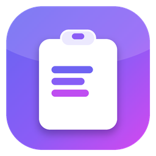
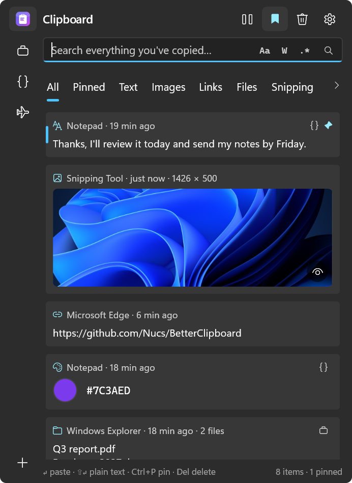
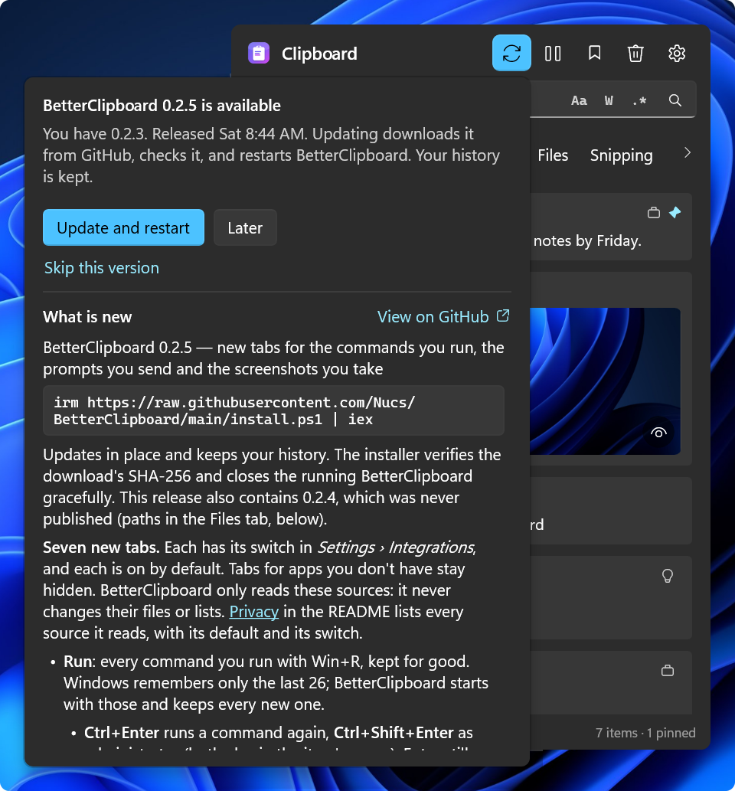
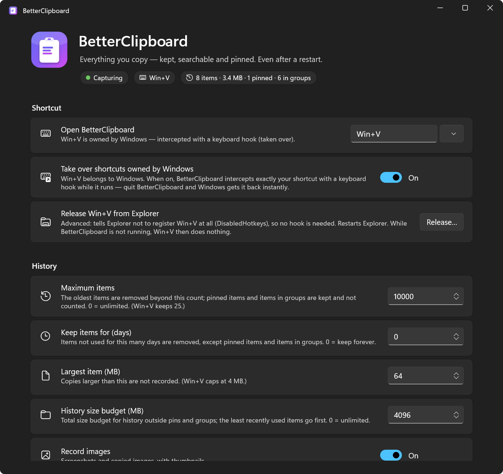
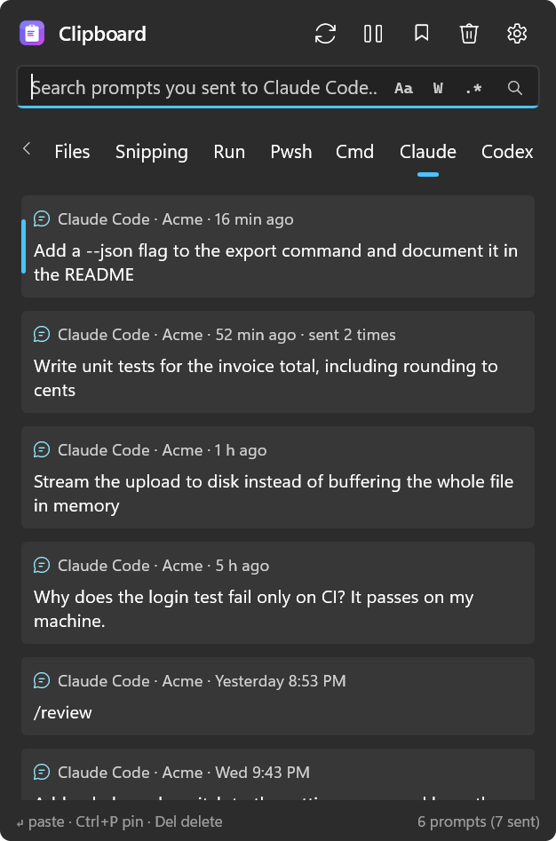

#  BetterClipboard

[ENG](../../README.md) / **简体中文**

> 本文译自英文版 [README](../../README.md)。英文版可能先于译文更新；两者不一致时，以英文版为准。

**Windows 本该自带的 Win+V 剪贴板历史。** 同样的快捷键，同样在光标旁弹出的面板——但它记住一切、重启后依然保留、搜索即时出结果，并且全部加密保存在你的电脑上。
它还会保留其他工具遗忘的内容：你的截图、Win+R 命令、Shell 历史，以及你发送给 Claude Code 和 Codex 的提示词。

[](https://github.com/Nucs/BetterClipboard/actions/workflows/ci.yml)
[](https://github.com/Nucs/BetterClipboard/releases/latest)
[](../../LICENSE)

<p align="center">
  
</p>

<a id="features"></a>
## 功能

- **接管 Win+V。** 同样的快捷键，面板立即出现在文本光标旁：它在隐藏时也保持绘制完成、内容最新，Win+V 只需把它显示出来（[工作原理](#how-it-works)）。安装程序会让资源管理器释放 Win+V；不经安装程序直接运行的副本则用键盘钩子拦截它。你可以添加更多快捷键，也可以把 Win+V 留给 Windows 并选择自己的：在 *设置 › 快捷键* 中按下任意键或组合键（包括小键盘键、媒体键、F13–F24 和 Copilot 键），用过的快捷键随时一键可选（[选择快捷键](#choosing-shortcuts)）。
- **记住一切，重启后也不丢。** 默认 10,000 个项目，每个最大 64 MB，另有总大小预算和可选的保留天数，都可以调整。Win+V 只保留 25 个、每个最大 4 MB 的项目，而且一重启，除了固定项目都会被清空。
- **各种复制内容**，每张卡片都标明来源应用和时间，并可按类型和来源分标签页筛选。再次复制同一内容时，它会移到最上方，而不是多出一个重复项（[标签页](#tabs)）：
  - **文本、富文本和 HTML、链接，以及带色块的颜色。**
  - **长文本**只显示前四行；文本更长时，下方一条细细的点线和一只眼睛会提示还有更多内容。把鼠标停在文本上即可读完全文，或按 `F3` 打开查看器：它会渲染 Markdown、为 22 种语言的代码着色、重新缩进 XML 和 JSON、自动换行并显示行号，几兆字节的复制内容也能逐页打开（[文本预览](#text-previews)）。
  - 在资源管理器中复制的**文件**，以及**以文本形式复制的路径**（`C:\…`、`~/.bashrc`、`src/app/main.cs`），它们粘贴时仍是文本（[“文件”标签页中的路径](#paths-in-the-files-tab)）。
  - 带缩略图的**图片**。鼠标停在图片上即可查看原尺寸，也可以在可缩放、可平移的查看器中打开（[图片预览](#image-previews)）。同一张图片无论是 PNG 还是位图，都只算一个项目。截图会记住它被保存成的文件：右键单击它即可复制路径、将图片复制为文件、打开文件或打开文件夹；*保存到临时文件夹后* 对任何图片都能这样做（[图片及其文件](#pictures-and-their-files)）。
  - **Windows 自己的历史：** 每次启动时导入 Win+V 仍记得的内容，包括它的固定项目。你在 BetterClipboard 中删除的内容不会被再次导入。
  - **ShareX：** [ShareX](https://getsharex.com) 保存的每张截图，在保存的那一刻就进入历史。
  - **截图：** 截图工具的自动保存以及 `Win+PrtScn` 保存的每张截图。
  - **Notepad++：** [Notepad++](https://notepad-plus-plus.org/) 未保存的“新”标签页的文本，随你编辑保持最新；以及你在 Notepad++ 中打开的每个文件的完整路径。
  - **运行：** 你用 `Win+R` 运行的每条命令，即使 Windows 那份只有 26 条的列表已经忘了它。`Ctrl+Enter` 可再次运行（`Ctrl+Shift+Enter`：以管理员身份运行）。
  - **Pwsh：** PowerShell 的完整命令历史，包括它的上箭头已经翻不到的旧命令。
  - **Cmd：** 你在命令提示符窗口中输入的命令，窗口关闭后依然保留。
  - **Claude 和 Codex：** 你发送给 Claude Code 和 Codex 的每条提示词，永久保留。
  - **Everything：** 你从 [Everything](https://www.voidtools.com/) 中打开的文件，可以作为文件粘贴，也可以粘贴其路径。

  最后八项是其他应用的标签页。每个都有自己的开关，默认开启；BetterClipboard 只读取它们的来源，你没有安装的应用，其标签页会保持隐藏（[其他应用的标签页](#tabs-for-other-apps)）。设置中每个来源卡片上的 *删除已存储的内容…* 会逐部分列出 BetterClipboard 从该来源保留的内容并附上示例，然后删除你勾选的部分；其他应用自己的文件绝不会被改动。
- **即时搜索**，支持任何语言，包括希伯来语、中日韩文字和表情符号，并提供与 VS Code 相同的开关：区分大小写（`Alt+C`）、全字匹配（`Alt+W`）和正则表达式（`Alt+E`）（[搜索](#search)）。Win+V 没有搜索。
- **为键盘而生。** `Enter` 粘贴到你原来所在的应用，`Shift+Enter` 粘贴为纯文本。`↑` `↓` 在项目间移动，`←` `→` 在标签页间循环切换，在最上面的项目上按 `↑` 进入你的分组。`Ctrl+1` … `Ctrl+9` 粘贴第 n 个项目，`Ctrl+P` 固定，`Del` 删除，`F3` 显示项目的全部内容，菜单键打开项目菜单（仅复制、打开链接、在资源管理器中显示……）。`Esc` 把焦点还给你原来的位置（[使用](#use)）。
- **随你调整的面板。** 它会在你上次使用的标签页中打开，重启后也是如此。拖动任意空白处即可移动面板，拖动边缘可调整大小，以后都按这个大小打开。放不下的标签页可以用 ‹ › 箭头、鼠标滚轮或拖动横向滚动。鼠标停在哪个项目上，就会选中哪个项目。
- **固定和分组。** 固定你常用的内容：固定的项目列在最上方，而面板仍会选中紧接在它们下方的、你最新的复制内容，因此按 `Win+V` 再按 `Enter` 会粘贴你最后复制的内容，按 `↑` 可以到达固定项目。用你自己选的图标创建分组，把卡片拖到分组上，可以只显示一个分组，也可以同时显示多个（`Ctrl+单击`、`Shift+单击`，或用方向键移到分组上后按 `Space`）。固定和分组的项目不受任何上限影响，*清空* 也会保留它们（[分组](#groups)）。
- **立即读取每次复制。** 间隔 2 毫秒及以上的复制都会被完整保留。复制得比这更快的程序，会在任何应用（包括 Win+V）读到之前就覆盖掉自己的复制：BetterClipboard 保留最后一次，并统计其余的次数（*设置 › 采集可靠性*）。
- **注重隐私。** 没有遥测，也不需要账户。它唯一会主动访问的服务器，是每天一次向 GitHub 查询本项目公开的版本列表，以便提示你有更新；可以用开关关闭（[隐私](#privacy)）。
  - **静态加密：** 整个历史都经过加密（ChaCha20-Poly1305），密钥只有你在这台电脑上的账户才能解封（[工作原理](#how-it-works)）。Win+V 只加密它的固定项目。
  - **私密复制不会被记录：** 应用标记为私密的复制永远不会被记录，46 款密码管理器和身份验证器应用默认被忽略。*暂停采集* 和 *忽略的应用* 可以处理其余情况。
  - **永久忘记** 会删除一个项目，并且以后无论哪个应用再复制相同内容，都不再记录（[永久忘记](#forget-forever)）。
- **面向脚本和 AI 代理的命令行。** `bclip` 可以列出、搜索和 grep 你的历史，逐字节输出任意项目，把文本放到剪贴板，等待你的下一次复制，并搜索你归档的提示词，支持 JSON 输出。它默认关闭（[命令行](#command-line-for-scripts-and-ai-agents)）。
- **一行命令安装。** 按用户安装，无需管理员权限，校验 SHA-256，支持 Windows 10（2004 或更新）和 Windows 11、x64 和 ARM64，无需另装任何东西；此后随 Windows 启动。以管理员身份运行，或通过 Intune、RMM 工具运行时，它会改为为这台电脑的每位用户安装，每位用户仍可以自行关闭登录时启动。卸载时会保留你的历史，除非你要求删除（[安装](#install)）。Microsoft Store 版已经构建完成，正在等待上架（[Microsoft Store 版](#microsoft-store-edition)）。
- **经你同意才更新。** 有更新的版本发布到 GitHub 时，面板标题栏中“暂停”左侧的更新按钮会高亮显示，并且每周一次，它的工具提示会自动显示几秒钟来提醒你。单击后会显示选择——*更新并重启* 或 *稍后*——下方是更新说明。只有这时才会下载更新，按版本的 SHA-256 校验后原地安装，从发布 zip 解压出来的文件夹也一样：BetterClipboard 会自行重启，你的历史保持不变（[更新](#updates)）。
- **使用你的语言。** 每个下载包都包含英文、简体中文、俄语（Русский）、西班牙语（Español）和希伯来语（עברית）。首次启动时会列出带国旗的语言，并已选中 Windows 的语言：点一下绿色对勾，整个应用就会使用这种语言。从尚未询问过语言的版本更新后，也会询问一次。以后可以在 *设置 › 应用 › 语言* 中更改：选好语言后按 *立即重启*。希伯来语在常规布局中从右向左阅读。你复制的内容、文件名以及你给分组起的名字都不会被翻译。
- **可搜索的设置。** 在设置顶部的搜索框中输入（`Ctrl+F`），页面只保留匹配的设置，它们留在原来的位置，匹配的字母会高亮显示。设置上的任何文字都算数——标题、说明、所在部分、按钮和选项——首字母（"rfe" 对应 *Release from Explorer*，即 *从资源管理器释放*）和拼写错误（"pasword"）也能找到。`Esc` 让整个页面回到原来的位置。
- **其他设置：** 随 Windows 启动、主题（浅色、深色或跟随 Windows）、面板的打开位置（文本光标旁或鼠标旁，或者主屏幕中央、你正在输入的屏幕中央——支持多显示器和不同的缩放比例），以及一个页面，列出它协作的每个应用和它附带的每个组件，并附上官方链接。

<a id="install"></a>
## 安装

需要 Windows 10 2004 或更新版本 / Windows 11，x64 或 ARM64。无需另装任何东西（发布包是自包含的）。在 PowerShell 中运行：

```powershell
irm https://raw.githubusercontent.com/Nucs/BetterClipboard/main/install.ps1 | iex
```

安装程序会为你的架构下载最新的[发布版本](https://github.com/Nucs/BetterClipboard/releases/latest)，**校验其 SHA-256**，按用户安装到 `%LOCALAPPDATA%\Programs\BetterClipboard`（无需管理员权限），添加“开始”菜单快捷方式，设置 BetterClipboard 随 Windows 启动，并在 *设置 › 应用 › 已安装的应用* 中注册。它还会**接管 Win+V**：资源管理器不再注册它，并重启一次（任务栏会闪一下，已打开的文件夹窗口会关闭）。详见[接管 Win+V](#taking-over-winv)。再次运行即可原地更新，应用自己的更新按钮也是如此（[更新](#updates)）；你的历史永远不会被改动。它可以从任何文件夹运行，包括你没有写入权限的文件夹，完成后你的 PowerShell 仍停留在那个文件夹。

首次启动时，BetterClipboard 会询问你的语言：English、简体中文、Русский、Español 或 עברית，各自带有国旗，并已选中 Windows 的语言。按下绿色对勾（或 `Enter`），所有窗口就会以这种语言打开。如果你从尚未询问过语言的版本更新，更新后的首次启动会询问一次。

已安装的应用每天会向 GitHub 查询一次是否有更新的版本。不会发送任何关于你、你的电脑或你的剪贴板的信息，未经你同意也不会安装任何东西（[隐私](#privacy)）。使用 `-NoUpdateCheck` 安装可关闭这项检查。

选项（通过脚本块传入）：

```powershell
& ([scriptblock]::Create((irm https://raw.githubusercontent.com/Nucs/BetterClipboard/main/install.ps1))) -NoTakeOverWinV -Hotkey Win+Alt+V
```

| 选项 | 作用 |
|---|---|
| `-NoTakeOverWinV` | 把 Win+V 留给 Windows。BetterClipboard 改用 `-Hotkey` 指定的快捷键打开，或用 Win+Alt+V。如果 Win+V 之前已被释放，会把它还给资源管理器。 |
| `-Hotkey A, B, …` | 打开 BetterClipboard 的快捷键，例如 `-Hotkey Win+Alt+V, Ctrl+Alt+F9`。除非指定了 `-NoTakeOverWinV`，否则 Win+V 排在第一位。每个快捷键都按与 Win+V 相同的方式接管（参见[接管 Win+V](#taking-over-winv)）。 |
| `-TakeOverWinV` | 默认行为。为兼容旧命令行而保留；如果你的快捷键中已不包含 Win+V，它会把 Win+V 加回来。 |
| `-AddToPath` | 把安装文件夹加入你的用户 PATH，使终端可以运行 `bclip`（参见[命令行](#command-line-for-scripts-and-ai-agents)）。 |
| `-NoUpdateCheck` | 安装时关闭自动更新检查：BetterClipboard 从此不会主动访问 GitHub。*设置 › 更新* 中有 *立即检查* 和重新打开它的开关。 |
| `-Version 0.1.0` | 安装指定版本，而不是最新版本。 |
| `-Package <zip>` | 从磁盘上的发布 zip 安装，而不是下载（离线安装）。把该版本的 `SHA256SUMS.txt` 放在 zip 旁边，或提供 `-PackageSha256 <hash>`，安装前会先校验。 |
| `-AllUsers` | 为这台电脑的每位用户安装（在以管理员身份运行的 PowerShell 中）；参见[为电脑的每位用户安装](#for-every-user-of-a-pc)。 |
| `-InstallDir <path>` | 安装到其他位置。 |
| `-NoStartup` / `-NoShortcut` / `-NoLaunch` | 不随 Windows 启动 / 不创建“开始”菜单快捷方式 / 安装后不启动。 |
| `-Uninstall [-RemoveData]` | 卸载应用（除非指定 `-RemoveData`，否则保留历史；`-RemoveData` 也会删除临时图片）。 |

更喜欢手动安装？从发布页面下载适合你架构的 zip 和 `SHA256SUMS.txt`，校验哈希值（`Get-FileHash .\BetterClipboard-*.zip`），解压到任意位置，然后运行 `BetterClipboard.exe`。发布版本还没有代码签名，因此对以这种方式下载的副本，Windows 可能会显示 *Windows 已保护你的电脑*：请先校验哈希值，然后选择 *更多信息 › 仍要运行*。参见[代码签名政策](#code-signing-policy)。

<a id="for-every-user-of-a-pc"></a>
### 为电脑的每位用户安装

在以管理员身份运行的 PowerShell 中：

```powershell
& ([scriptblock]::Create((irm https://raw.githubusercontent.com/Nucs/BetterClipboard/main/install.ps1))) -AllUsers
```

- **会设置什么：** 应用安装在 `Program Files\BetterClipboard`，该文件夹只有管理员可以更改；为每位用户创建“开始”菜单快捷方式、*已安装的应用* 条目和“随 Windows 启动”。每位登录的用户都会启动 BetterClipboard，并在各自的用户配置文件中拥有自己的加密历史。
- **每位用户自行决定：** 关闭 *设置 › 应用 › 随 Windows 启动* 只会停止该用户登录时的启动。如果某位用户有自己的“随 Windows 启动”条目，则以该条目为准，因此 BetterClipboard 不会启动两次。
- **自动选择此方式**：当不是已登录的用户在安装时——安装程序以 SYSTEM 身份运行（Intune、RMM 工具），或在别人的桌面上使用管理员凭据运行。装在那个账户自己配置文件中的副本，不会为在这台电脑上登录的任何人服务。
- **按用户保留的内容：** Win+V 和其他快捷键。BetterClipboard 为每个人用键盘钩子接管 Win+V，每位用户都可以在 *设置 › 快捷键* 中让资源管理器释放它。`-Hotkey` 和 `-NoTakeOverWinV` 仅在已登录的用户自己安装时生效。`-AddToPath` 会把文件夹加入每位用户的 PATH。
- **更新：** 这个副本不会自我替换，也不会自行检查更新，因为它的用户可能不是管理员。由管理员再次运行同一条命令即可：在装有“为每位用户安装”副本的电脑上以管理员身份运行时，安装程序会更新该副本。*设置 › 更新 › 立即检查* 仍会告诉你是否有新版本，更新对话框也会帮你复制这条命令。

[Chocolatey 包](../../packaging/chocolatey)对“随 Windows 启动”遵循同样的规则。由已登录的用户安装时，条目属于该用户。由 SYSTEM 或其他账户安装，或使用 `/AllUsersStartup` 时，条目对每位用户生效。

<a id="microsoft-store-edition"></a>
### Microsoft Store 版

**尚未在 Store 上架。** 这个版本已经构建并测试（[docs/microsoft-store.md](../microsoft-store.md)，英文），商品页面正在准备中。它是这样的：

- **由 Store 安装和更新。** 安装包由 Microsoft 签名，因此 Windows 不会显示“未知发布者”警告。应用本身不发出任何网络请求，因为更新由 Store 负责。
- **先征求你的同意。** 首次启动时先询问语言，然后显示欢迎页面，其中有两个开关：*用 Win+V 打开* 和 *随 Windows 启动*。在你按下 *开始* 之前，不会记录任何内容，也不会接管任何快捷键。
- **不改动系统就能使用 Win+V。** 它运行时用键盘钩子响应 Win+V；退出后，Win+V 立即回到 Windows 手中。这个版本没有 *从资源管理器释放*。
- **历史会一起迁移。** 只应安装一个 BetterClipboard。Store 版发现你用安装程序安装的副本时，会说明它要做什么，并先检查能否完成。按下 *迁移到此版本* 后，它会关闭那个副本，复制你的历史和设置，检查复制结果，卸载另一个副本（Win+V 随之还给 Windows），并删除旧文件夹。任何一步失败，你的历史都保持原样。为每位用户安装的副本或 Chocolatey 副本需要由管理员删除：Store 版会说明做法并等待。反过来，安装程序在检测到已安装 Store 版时也会提示你。
- **`bclip` 在每个终端中都能运行**，无需 PATH 条目，只要你开启命令行。
- **卸载时会连同历史一起删除**：它把历史保存在自己的应用数据中，Windows 会随应用一起删除。

<a id="updates"></a>
## 更新

BetterClipboard 从它的 [GitHub 发布版本](https://github.com/Nucs/BetterClipboard/releases)自我更新，而且只在你同意时才更新。

<p align="center">
  
</p>

- **更新按钮** 位于面板标题栏中“暂停”的左侧。当你使用的是最新版本时，它和旁边的按钮看起来一样。有更新的版本时，它会以你的强调色填充，托盘图标的菜单中也会出现 *更新至 x.y.z…*。
- **每周提醒一次。** 有新版本等待安装时，你打开面板时，按钮的工具提示——*发现更新：BetterClipboard x.y.z*——会自动显示几秒钟，七天内最多一次。它显示在面板上方，不会遮挡任何内容（面板位于屏幕顶部时显示在按钮旁边），并会自行关闭：无需任何操作，打字也不受影响。单击它会打开更新对话框。打开这个对话框也算作一次提醒，因此 *稍后* 意味着一周后再提醒。自动检查关闭时没有提醒。
- **单击打开更新对话框：** 上方是选择——*更新并重启*、*稍后* 或 *跳过此版本*——下方是更新说明。当你已是最新版本时，它会显示你当前版本的新增内容，以及 *立即检查*。
- **未经你同意，不会安装任何东西。** *更新并重启* 会从 GitHub 下载适合你电脑的版本，并将其 SHA-256 与该版本的 `SHA256SUMS.txt` 以及 GitHub 自己的摘要进行比对。然后由该版本自带的安装程序替换应用的文件：BetterClipboard 会关闭，并在后台自行重新启动。你的历史、设置和快捷键都保持不变，并会有一条通知告诉你结果。
- **如果更新失败，** 已安装的版本会保持原样并继续运行，对话框或通知会说明原因。与校验和不符的下载会被删除。如果安装文件夹被其他程序占用，它会保持原样。
- **检查方式：** 每天一次（第一次在启动一分钟后），BetterClipboard 向 GitHub 查询本项目公开的版本列表。请求中只包含应用的版本号：不会发送任何关于你、你的电脑或你的剪贴板的信息（[隐私](#privacy)）。*设置 › 更新* 可以关闭这项检查，使用 `-NoUpdateCheck` 安装也可以。无论开关如何，*立即检查* 都会查询一次。
- **跳过此版本** 会取消该版本的高亮和每周提醒。下一个版本发布时两者都会恢复。
- **从发布 zip 解压的副本** 从 0.2.11 起会在自己的文件夹中自我更新。*更新并重启* 像上面那样下载并校验该版本；然后由新版本关闭 BetterClipboard，逐个替换该版本自带的文件，再重新启动。不属于该版本的文件（如果文件夹里有你自己的文件）保持不变；如果其中某个文件无法替换（另一个程序正打开着它），所有文件都会恢复原样。位于你无权更改的文件夹中的副本（例如没有管理员权限时的 Program Files）仍会提供下载页面和安装命令。
- **较新的副本会接管。** 在较旧的 BetterClipboard 运行时启动一个较新的副本（例如把新版本解压到了新文件夹），较旧的会关闭，由较新的继续运行，而不是弹出较旧副本的设置。如果“随 Windows 启动”启动的是较旧的副本，或是一个已经不存在的副本，它会改为启动你正在运行的副本；你在 Windows 启动应用中关闭的条目仍保持关闭。
- **为每位用户安装的副本** 既不会自我替换，也不会自行检查：只有管理员可以更改它的文件夹。*立即检查* 仍会查询，对话框会复制需要在以管理员身份运行的 PowerShell 中执行的命令（[为电脑的每位用户安装](#for-every-user-of-a-pc)）。
- **Microsoft Store 版** 没有更新按钮，也不向 GitHub 查询任何内容：它由 Store 更新，*设置 › 来自 Microsoft Store 的更新* 会打开它的 Store 页面。

<a id="use"></a>
## 使用

按 **Win+V**。面板会立即出现在你的文本光标旁，打开你上次使用的标签页，搜索框已获得焦点——直接输入即可。你最新的复制内容已被选中，因此按 `Enter` 就会粘贴它。固定的项目列在它上方（*设置 › 粘贴* 可以改为按时间顺序列出），按 `↑` 可以到达它们。

*设置 › 快捷键 › 面板位置* 可以改为在鼠标旁打开，或在屏幕中央打开：主屏幕，或你正在输入的屏幕（有多个显示器时，是你所在窗口所在的屏幕；单击桌面之后，是鼠标所在的屏幕）。

| 按键 | 操作 |
|---|---|
| *输入文字* | 搜索（子字符串匹配，不区分大小写，支持希伯来语、中日韩文字和表情符号） |
| `Alt+C` / `Alt+W` / `Alt+E` | 切换搜索框的 **Aa**（区分大小写）、**W**（全字匹配）和 **.\***（正则表达式）开关，也可以直接单击。它们会保持你离开时的状态。 |
| `↑` `↓` `PgUp` `PgDn` | 移动选择。面板打开时选中你最新的复制内容，因此 `↑` 会先到达它上方的固定项目，从最下面的一个开始。分组栏打开时，在最上面的项目上按 `↑` 可进入分组（参见[分组](#groups)）。 |
| 在分组栏中按 `Space` / `Enter` | 方向键位于分组栏时：保留光环所在的分组并回到项目列表。同时打开多个分组时：把光环所在的分组加入列表，或将其移出（参见[分组](#groups)）。在其他地方，`Space` 会被输入，`Enter` 会粘贴。 |
| `←` `→` | 上一个 / 下一个标签页，循环切换：在第一个标签页按 `←` 会跳到最后一个，在最后一个按 `→` 会跳到第一个。编辑搜索文字时，它们改为移动插入点；按过 `↑` 或 `↓` 后，它们又会切换标签页。按住不放时会停在第一个或最后一个标签页。 |
| 鼠标悬停在项目上 | 选中它。标签页和分组图标只能通过单击选中。 |
| `Enter` / 单击 | 粘贴到你原来所在的应用 |
| `Shift+Enter` | 粘贴为纯文本 |
| `Ctrl+Enter` | 对用 Win+R 运行过的命令：再次运行（`Ctrl+Shift+Enter`：以管理员身份运行） |
| `Ctrl+1` … `Ctrl+9` | 粘贴第 n 个项目 |
| `Ctrl+P` | 固定 / 取消固定（固定的项目不受保留规则和“清空”影响） |
| `Del`（搜索时为 `Shift+Del`） | 删除项目。在 Pwsh、Cmd 和 Everything 标签页中，隐藏该命令或文件，直到你再次使用它。在 Claude 和 Codex 标签页中，删除该提示词，直到你再次发送它。 |
| `Ctrl+F` | 回到搜索框 |
| `Ctrl+G` | 显示 / 隐藏分组栏（与书签按钮相同） |
| `F3` | 查看所选项目：在文本查看器中显示全部文本，或在图片查看器中显示图片（参见[文本预览](#text-previews)） |
| `Menu` / `Shift+F10` / 右键单击 | 项目菜单：粘贴、粘贴为纯文本、仅复制、查看（`F3`）、固定、分组（添加 / 移除）、打开链接 / 在资源管理器中显示 / 在 Everything 中显示、运行（Win+R 命令）、图片的文件（复制路径、将图片复制为文件、打开文件、打开文件夹）和 *保存到临时文件夹后*（参见[图片及其文件](#pictures-and-their-files)）、删除、永久忘记 |
| `Esc` | 先清空搜索，再关闭——焦点回到你原来的位置 |
| 拖动任意空白处 | 移动面板，就像拖动标题栏（拖动时按 `Esc` 可放回原处）。下次仍会按 *面板位置* 的设置打开。 |
| 拖动边缘 | 调整面板大小。以后都按这个大小打开。 |
| 在标签页上滚动滚轮或拖动 | 标签页放不下时横向滚动，也可以单击两端的 ‹ › 箭头 |
| 鼠标停在图片上 | 查看原尺寸；图片的眼睛按钮会打开可缩放的查看器（参见[图片预览](#image-previews)） |
| 鼠标停在长文本上 | 阅读全文，可选择和复制，右键单击可打开项目菜单；它的眼睛按钮会打开文本查看器（参见[文本预览](#text-previews)） |
| “暂停”左侧的更新按钮 | 打开更新对话框：更新说明，有新版本时还有 *更新并重启*（此时按钮会高亮；参见[更新](#updates)） |

想打多快就打多快，然后按 `Enter`：`Enter` 会等搜索完成，再粘贴最佳匹配项——当固定的匹配项列在上方时，粘贴的是最新的那个未固定的匹配项。

**粘贴到以管理员身份运行的窗口**（例如提升权限的终端）：Windows 不允许没有管理员权限的应用向这类窗口输入。BetterClipboard 会把项目放到剪贴板，回到那个窗口，并（通过一条通知）提醒你一次自己按 `Ctrl+V`。当 Win+V 已从资源管理器释放时（安装程序的默认做法），快捷键本身在这类窗口上方也能使用。

托盘图标可以打开面板和设置。设置顶部的搜索框（`Ctrl+F`）会随着输入筛选页面，拼写错误也能找到；`Esc` 清除搜索。设置的各个部分：

- **快捷键：** 打开面板的按键（想加多少都可以：单击输入框并按下快捷键，或从它的建议和用过的快捷键菜单中选择），面板的打开位置（文本光标旁、鼠标旁、主屏幕中央，或你正在输入的屏幕中央），以及让资源管理器释放 Win+字母 快捷键（[选择快捷键](#choosing-shortcuts)）。
- **历史：** 保留多少项目、保留多少天、最大多大、记录哪些内容，以及 *保存到临时文件夹后* 的图片保留多久。
- **粘贴：** 选择后自动粘贴、把粘贴过的项目移到最上方、固定项目置顶。
- **隐私：** 暂停、忽略的应用、*永久忘记的项目*、采集可靠性、清空历史。
- **Windows 剪贴板：** Windows 自己的历史，以及 **从 Windows 导入**，它会导入 Win+V 仍记得的一切——包括它的固定项目。
- **集成：** 每个其他应用的标签页各有一个开关，Notepad++ 有两个（它未保存的标签页，以及你在其中打开的文件）；每张卡片上还有 *删除已存储的内容…*：一个对话框，逐部分列出 BetterClipboard 从该来源保留的内容（数量、大小和最新的示例），删除你勾选的部分，并可以先关闭开关（参见[其他应用的标签页](#tabs-for-other-apps)）。
- **应用：** 界面语言（跟随 Windows 或你选择的语言；按列表旁的 *立即重启* 即可生效）、随 Windows 启动（只对你自己生效，即使 BetterClipboard 是为每位用户安装的）、主题、命令行、数据文件夹。
- **更新：** 每日检查的开关、*立即检查* 和更新对话框（[更新](#updates)）。
- **第三方：** BetterClipboard 协作的应用和它使用的组件，并附上官方链接。

**关闭设置会归还它占用的内存。** 设置会留下一部分只有新进程才能归还的内存（约 80 到 100 MB），所以在你关闭设置几秒后，只要面板已关闭、键盘和鼠标也停了片刻，BetterClipboard 就会悄悄地换成一个全新的自己。不会打开任何窗口，也不会闪烁，指针也不会变化：托盘图标留在原处，快捷键照常可用（在那一秒内按下的快捷键会在片刻后打开面板），期间复制的内容也会被记录。

<p align="center">
  
</p>

<a id="tabs"></a>
### 标签页

| 标签页 | 列出的内容 | 何时显示 |
|---|---|---|
| 全部 | 你的全部历史，最新的在前 | 始终 |
| 已固定 | 你固定的项目 | 始终 |
| 文本 | 文本和富文本，包括路径 | 始终 |
| 图片 | 你复制的图片，以及保存的截图 | 始终 |
| 链接 | 复制的网址 | 始终 |
| 文件 | 你在资源管理器中复制的文件，以及纯粹由路径组成的文本 | 始终 |
| ShareX | ShareX 保存的截图，以及你从 ShareX 复制的所有内容 | 安装了 ShareX 时 |
| 截图 | 截图工具和 Win+PrtScn 保存的截图 | 你的历史中有它们保存的截图时 |
| Notepad++ | Notepad++ 未保存标签页的文本、你在 Notepad++ 中打开的文件，以及你在其中复制的内容 | 你的历史中有来自 Notepad++ 的内容时 |
| 运行 | 你用 Win+R 运行的命令 | 你的历史中有 Win+R 命令时 |
| Pwsh | PowerShell 自己的命令历史 | PowerShell 有历史文件时 |
| Cmd | 在命令提示符窗口中输入的命令 | 始终 |
| Claude | 你发送给 Claude Code 的提示词 | Claude Code 有提示词时 |
| Codex | 你发送给 Codex 的提示词 | Codex 有提示词时 |
| Everything | 你在 Everything 中打开的文件 | 安装了或正在运行 Everything 时 |

“文件”之后的每个标签页在 *设置 › 集成* 中都有自己的开关。它们默认全部开启；关闭某一个，它的标签页就会消失。[其他应用的标签页](#tabs-for-other-apps)说明了每个标签页读取的内容。

**面板会在你上次使用的标签页中打开**，重启后也是如此。`←` 和 `→` 会循环切换标签页。如果你上次使用的标签页不在了（它的应用已卸载，或它的开关已关闭），面板会在“全部”中打开，等它回来后再回到你的标签页。搜索文字和你打开的分组不会保留：每次按 Win+V 都会以空搜索、全部历史开始。

<a id="search"></a>
### 搜索

直接输入即可搜索。一个词可以匹配项目文字中的任何位置，任何语言，不分大小写。搜索框中的三个开关可以缩小搜索范围，与 VS Code 相同：

- **Aa**（`Alt+C`）：区分大小写。
- **W**（`Alt+W`）：只匹配整个词。这时 `log` 能找到“log file”，但找不到“login”或“my_log”。
- **.\***（`Alt+E`）：正则表达式（.NET 语法）；`^` 和 `$` 匹配每一行的开头和结尾。无效的表达式会让开关的轮廓变红，并说明错在哪里。

这些开关会保持你离开时的状态，而搜索文字在每次打开面板时都会清空。它们在每个标签页和分组中都有效，只有 Everything 标签页除外，那里由 Everything 自己负责搜索。

<a id="image-previews"></a>
### 图片预览

- **速览：** 把鼠标停在图片卡片上。片刻之后，图片会以原尺寸出现在屏幕中央（最多占屏幕的 80%）。移动鼠标，它就会消失。
- **查看器：** 单击图片卡片右下角的眼睛按钮。图片会铺满整个屏幕打开，直到你关闭它。转动鼠标滚轮可朝指针所在位置缩放，拖动可平移，双击可在适应窗口和放大之间切换。按 `Esc`、单击它的 X 按钮或单击图片外部即可关闭。

<a id="text-previews"></a>
### 文本预览

卡片只显示文本的前四行。文本更长时，下方一条细细的点线和卡片角落的一只小眼睛会提示这一点。

- **速览：** 把鼠标停在卡片的文本上。片刻之后，全文会出现在面板中央，着色方式与查看器相同。可以用滚轮滚动、用鼠标选择，`Ctrl+C` 复制；右键单击会在项目自己的菜单上方提供 *复制* 和 *全选*。只要鼠标停在它或卡片上，它就不会消失；按 `Esc` 关闭。超过 64,000 个字符的文本只显示开头，并会注明。
- **查看器：** 单击眼睛、按 `F3`，或在项目菜单中选择 *查看*。屏幕会变暗，文本在其上方的一张大卡片中打开：
  - **Markdown** 会渲染成文档：标题、列表、表格、引用、链接和代码块，每个代码块按自己的语言着色。无法识别语言的文本也会按 Markdown 显示。
  - **代码**会着色，支持 C#、Java、Kotlin、JavaScript、TypeScript、Python、Ruby、PHP、Go、Rust、C 和 C++、PowerShell、Shell 脚本、批处理文件、SQL、CSS、HTML、XML、JSON、YAML、INI 和 TOML，以及差异（diff）。语言会自动识别；语言按钮可以改选其他语言（识别出的语言标有 *（检测到）*）。
  - **XML 和 JSON** 会重新缩进，每个元素或值占一行；*原样* 按复制时的样子显示它们。
  - **自动换行**在窗口边缘折行（关闭时可横向滚动），**行号**为代码的每一行编号，**A−** / **A+**（`Ctrl+Minus`、`Ctrl+Plus`、`Ctrl+0`，或按住 `Ctrl` 转动滚轮）调整文字大小。三者都会被记住。
  - **几兆字节的复制内容**每次打开约 64,000 个字符的一页，用 ‹ › 翻页（`Ctrl+PageUp`、`Ctrl+PageDown`）；行号跨页连续计数。
  - 像在别处一样选择和复制；按 `Esc`、单击它的 X 按钮或单击文本外部即可关闭。

<a id="pictures-and-their-files"></a>
### 图片及其文件

ShareX、截图工具或 `Win+PrtScn` 保存的截图会记住它被保存成的文件：文件的名称、文件夹、格式、大小和日期会和图片一起保存在你的历史中。

- **右键单击图片。** 菜单会写出文件名，以及它的格式、大小和上次更改时间。只要文件还在磁盘上，后面就有四项：*复制路径*；*将图片复制为文件*，可以像在文件资源管理器中复制的文件一样，把它粘贴到文件夹、邮件或聊天中；*打开文件*；以及 *打开文件夹*，即打开文件资源管理器并选中该文件。文件已被移动或删除时，菜单会如此说明，并省略这四项。
- **任何图片，包括你从应用中复制的图片：** *保存到临时文件夹后 ›* 提供同样的四项。BetterClipboard 会先把图片作为 PNG 写入你的临时文件中它自己的文件夹（`%TEMP%\BetterClipboard\Images`），有原文件时沿用原文件的名称。再次保存同一张图片会找到这个文件；你之后编辑过的副本绝不会被覆盖。
- **临时图片会在 BetterClipboard 启动时删除**，前提是它们已经 30 天没有使用。*设置 › 历史 › 临时图片保留天数* 可以修改这个天数，0 表示每次启动时都删除。BetterClipboard 运行期间从不删除它们，因此你刚以文件形式粘贴的图片会一直留给读取它的应用。
- **在查看器中，** 图片的文件显示在图片上方：一行是名称、格式、大小和像素尺寸，下一行是文件夹和日期。单击名称可打开文件，单击文件夹可在文件资源管理器中打开它。
- **历史中已有的截图** 会在能保留文件的版本第一次启动时查找一次它们的文件：每张截图会得到 ShareX 文件夹或“屏幕截图”文件夹中、与它相差两分钟以内保存且像素相同的那个文件。
- **网络驱动器上的文件** 从不检查（已经断开的共享会让菜单卡住），因此它们的菜单项会保留。

<a id="paths-in-the-files-tab"></a>
### “文件”标签页中的路径

**“文件”标签页** 会列出你在资源管理器中复制的文件，以及纯粹由路径组成的文本：

- **绝对路径：** `C:\Users\you\notes.txt`、`C:/a/path`、`\\server\share`、`/var/log/syslog`、`%APPDATA%\Code`。
- **相对路径：** `~/.bashrc`、`./build.sh`、`src\app\main.cs`、`folder/file.cs`。
- **多个路径：** 每行一个路径，行数不限。
- **它仍是文本：** 复制的路径粘贴时仍是文本，“文本”标签页也照样列出它。

它有意设计得很严格，因此下列内容只会出现在“文本”中：

- 普通文字中的斜杠（`and/or`、`24/7`）；
- 以路径开头的句子（`C:\Windows is where …`）；
- 网址，以及命令行（`./run.sh src/a.txt`）；
- 末尾没有文件名的相对路径（`src/app`）。

包含空格的文件夹名，只要看起来像名称（`C:\Program Files (x86)`、`D:\Games\Call of Duty`）就算路径。小写的名称（`C:\Users\you\my stuff`）在加了引号时才算，资源管理器的 *复制为路径* 就是这样写的。

<a id="groups"></a>
### 分组

把你常用的东西——代码片段、地址、某个项目的链接——收集到分组中。

- **打开分组栏：** 单击“暂停”旁边的书签按钮（或按 `Ctrl+G`）。面板会向左变宽，出现一列图标。最上面的剪贴板图标代表你的全部历史。
- **创建分组：** 按底部的 **+**，可以起个名字，再选一个图标。
- **添加内容：** 把任意卡片拖到分组的图标上。之后卡片上会显示该分组的图标。
- **打开分组：** 单击图标，面板就只显示该分组的项目（搜索和筛选标签页在其中照样有效）。再次单击该图标或剪贴板图标，即可回到全部内容。
- **同时打开多个：** `Ctrl+单击` 更多图标可一起显示它们的分组，`Shift+单击` 可选中一串连续的图标。它们会按通常的顺序合并成一个列表，每个项目只出现一次，搜索和标签页对它同样有效。没有键盘时：右键单击图标 › *添加到视图*。
- **用键盘操作：** 在最上面的项目上按 `↑`。你当前打开的内容的图标上会出现一个光环：打开的分组，或在没有打开分组时（你的全部历史）出现在剪贴板图标上。此时其他内容都不变。之后 `↑` 和 `↓` 会在分组栏中逐个移动，每移动一步就打开所到之处：从剪贴板图标按 `↓` 会打开第一个分组，从第一个分组按 `↑` 会重新显示全部历史。要带着当前所在的分组回到项目列表，请按 `Enter`、`Space` 或 `→`，或在最后一个分组上按 `↓`。输入文字，或把鼠标移到某个项目上，也会回到项目列表。之后 `Enter` 会粘贴选中的项目。
- **用键盘操作多个分组：** 同时打开多个分组时，在最上面的项目上按 `↑` 会把光环放在其中第一个上，之后 `↑` 和 `↓` 只会移动光环：你合并后的列表保持不变，`↓` 会停在最后一个分组。按 `Space` 或 `Enter` 可把光环所在的分组加入列表，或将其移出。在剪贴板图标上，它们会显示你的全部历史。页脚会显示这些按键。`→` 回到项目列表，`Enter` 又会粘贴。`Shift+Enter` 随时都可以把选中的项目粘贴为纯文本，光环位于分组栏时也是如此。
- **移出内容：** 右键单击卡片 → *从…移除*，或使用同一菜单中的 *分组*。右键单击分组图标可重命名、更改图标或删除分组。删除分组永远不会删除其中的项目。

分组中的项目**会像固定项目一样被保留**：任何保留上限（数量、天数、大小）都不会删除它们，*清空* 也会跳过它们。当一个项目离开它的最后一个分组时，它的保留计时会重新开始。它不会仅仅因为旧就被删除，并且在列表中保持原来的位置。

<a id="forget-forever"></a>
### 永久忘记

复制了密码、令牌或其他你绝不想留在历史中的内容？右键单击它（或按菜单键）并选择 **永久忘记…**。它会被删除，并且**无论下次由哪个应用复制，BetterClipboard 都不会再记录它**：浏览器、终端、ShareX 或 `bclip put` 都一样。它也永远不会再从 Windows 自己的剪贴板历史中重新导入。

- **什么算相同：** 所有内容都必须一致，包括大小写。行尾和文字前后的空格不影响判断，因此从终端再次复制、后面带着换行的 `token` 同样会被拦下。
  历史中已有的、只在这方面不同的副本，会与你忘记的那个一起消失。
- **图片和文件：** 图片按像素识别，因此同一张截图无论是 PNG 还是位图都算同一个。文件列表按路径识别（而不是按文件内容）。
- **保留了什么：** 内容的指纹（SHA-256 哈希），与你的其他历史一起加密保存，另外还有它的类型、长度和来源应用，便于你区分各条目。内容本身已经不存在了。
- **不只是复制：** 它对 Pwsh 或 Cmd 标签页中的命令（例如你输入过的密码）、Everything 标签页中的文件，以及 Claude 或 Codex 标签页中的提示词同样有效。被忘记的提示词会离开提示词归档，并且永远不会再被归档。
- **改变主意了？** *设置 › 永久忘记的项目* 列出了每个条目，以及此后它被拦下的次数。*重新允许* 会从它的下一次复制开始重新记录。已删除的内容不会回来。

**密码管理器默认被忽略。** *忽略的应用* 预先填入了 46 款密码管理器和身份验证器应用，共 65 个进程名：1Password、Bitwarden、KeePass、KeePassXC、LastPass、Dashlane、Keeper、NordPass、Proton Pass、RoboForm、Enpass 等等。参见[附来源的完整列表](../password-managers.md)。删除任何你希望被记录的应用，它们会保持删除状态；更新只会添加目录中新出现的名称。

<a id="taking-over-winv"></a>
## 接管 Win+V

Win+V 归资源管理器所有。BetterClipboard 支持两种接管方式：

- **让资源管理器释放它**（安装程序的做法，或 *设置 › 从资源管理器释放*）。资源管理器被告知不再注册 Win+V（`DisabledHotkeys` = `V`），由 BetterClipboard 正常注册，因此在提升权限（管理员）的窗口获得焦点时也能使用。代价：BetterClipboard 没有运行时，Win+V 什么也不做。卸载会把 Win+V 还给 Windows。
- **键盘钩子——不改动系统**（不经安装程序直接运行的副本、Microsoft Store 版，或在 `-NoTakeOverWinV` 之后你又把 Win+V 加回来时）。BetterClipboard 运行时，一个低级键盘钩子会在资源管理器看到 Win+V 之前拦截它。退出 BetterClipboard，Windows 自己的面板立即回来。

**更想把 Win+V 留给 Windows？** 使用 `-NoTakeOverWinV` 安装，并用 `-Hotkey` 选择你自己的快捷键，或在 *设置 › 快捷键* 中添加和移除。任意数量的快捷键都可以打开面板，每个都按相同的方式接管：

- **资源管理器占用的 Win 加字母或数字**（Win+E、Win+R、Win+1）：资源管理器可以像释放 Win+V 一样释放它。安装程序会对你提供的每个此类快捷键这样做；在应用中，由 *设置 › 从资源管理器释放* 完成。有些属于 Windows 的其他部分（Win+C，即 Windows 11 25H2 上的 Copilot）：这些由键盘钩子接管。
- **其他已被某个应用使用的快捷键**（Win+Shift+V 是 PowerToys 的高级粘贴）：BetterClipboard 运行时，键盘钩子会精确拦截这个组合键。*设置 › 接管 Windows 占用的快捷键* 可以关闭这项功能。
- **空闲的快捷键**（Win+Alt+V、Ctrl+Alt+F9）：BetterClipboard 直接注册它。

资源管理器只能释放精确的 Win+字母 或 Win+数字 快捷键：`V` 会释放 Win+V，但 Win+Ctrl+V 仍归 Windows 所有。

<a id="choosing-shortcuts"></a>
### 选择快捷键

在 *设置 › 快捷键* 中，单击输入框并**按下快捷键**。输入框会显示它（`Ctrl+Shift+K`），按 `Enter` 或 **添加** 即可保存。在此之前不会保存任何东西，因此误按的组合键不会造成影响。输入框获得焦点时，即使某些按键归资源管理器或 BetterClipboard 自己所有，它也会接收：`Win+E` 会被写进输入框，而不是打开文件资源管理器。

- **任何按键都可以：** 字母、数字和标点、数字小键盘（`Ctrl+Alt+Num5`、`Ctrl+NumPlus`）、`Pause`、`PrintScreen`、各种锁定键、菜单键（`Apps`）、媒体和音量键、浏览器键、`F1`–`F24`（新款笔记本的 Copilot 键发送的是 `Shift+Win+F23`），以及没有名称的按键，它们会写成按键代码（`0x97`，来自宏键盘）。
- **在文字中不起作用的按键可以单独使用：** `F9`、`Pause`、`MediaPlayPause`。用于输入或编辑的按键需要配合 `Ctrl`、`Alt` 或 `Win`，因为把单独的 `V`（或 `Shift+V`）作为全局快捷键，会让这个键在所有应用中都无法输入。
- **会被拒绝，并在输入框下方说明原因：** `Ctrl+C`、`Ctrl+X`、`Ctrl+V` 和 `Ctrl+Insert`（复制必须能正常工作，而且 BetterClipboard 自己也用 `Ctrl+V` 粘贴），以及 Windows 保留的按键：`Ctrl+Alt+Delete`、`Win+L`、`Alt+Tab`、`Alt+Esc`、`Ctrl+Esc`、`Ctrl+Shift+Esc` 和 `Alt+F4`。这些按键在输入框中仍照常工作（`Alt+Tab` 切换窗口，`Ctrl+V` 粘贴文字）。
- **仍可以直接输入：** 字母、`Backspace` 和 `Enter` 会送到输入框，因此你也可以输入名称，例如 `ctrl + alt + page down` 或 `0x97`。
- **输入框旁边的菜单** 列出建议，然后是 **以前使用过**：你用过的每个快捷键，最新的在前。正在使用的会打勾；单击即可添加或移除。

<a id="tabs-for-other-apps"></a>
## 其他应用的标签页

BetterClipboard 还会保留你电脑上其他工具遗忘或埋没的内容：截图、Notepad++ 未保存的标签页、Win+R 命令、Shell 历史、你发送给 AI 编程代理的提示词，以及你在 Everything 中打开的文件。每个来源都有自己的标签页，并在 *设置 › 集成* 中有自己的开关。它们默认全部开启，你没有安装的应用，其标签页会保持隐藏。BetterClipboard 只读取这些来源；它从不更改它们的文件或列表。
[隐私](#privacy)总结了每个来源读取的内容。

**删除来源留下的内容。** 每张卡片上的 *删除已存储的内容…* 会打开一个对话框，逐行列出 BetterClipboard 从该来源保留的每一部分：有多少、有多大，以及最新的示例（截图显示缩略图）。日常的部分默认勾选；固定和分组的项目，以及你隐藏的命令或选取列表，除非你勾选，否则都会保留。默认按钮是“取消”，所以按 `Enter` 不会删除任何内容。其他应用的文件绝不会被改动——ShareX 的截图仍留在 ShareX 的文件夹中——你删除的内容不会在下一次补录时被重新导入；只要开关开着，新的截图、运行的命令和提示词仍会被记录（对话框中的 *同时关闭…* 会先关闭开关）。对于 Claude Code 和 Codex，只要开关开着，代理仍保存的内容会立即被重新读取。

<p align="center">
  
</p>

<a id="sharex-screenshots"></a>
### ShareX 截图

安装了 [ShareX](https://getsharex.com) 时，它保存的每张截图都会在文件写入的那一刻进入你的历史。面板会多出一个 **ShareX** 标签页，其中包含这些截图以及你从 ShareX 复制的所有内容。像其他项目一样按 `Enter` 即可粘贴。

- **在哪里查找。** BetterClipboard 会读取 ShareX 自己的设置：
  - 个人文件夹：便携模式、`PersonalPath` 注册表值或 `PersonalPath.cfg`；
  - 截图文件夹：自定义路径及其备用路径；
  - 子文件夹规则：默认为 `%y-%mo`，以及各快捷键单独设置的文件夹。

  它只从这些规则可能生成的文件夹中导入，因此保存在附近的其他图片（例如同步的手机相册文件夹）不会混进来。ShareX 存放上传凭据的 `UploadersConfig.json` 永远不会被打开。
- **不读半成品，也不漏掉。** 只有在 ShareX 写完文件之后才会读取。BetterClipboard 没有运行时保存的截图，会在下次启动时补上，最多补最新的 100 张。第一次使用时只计算新截图；你已有的截图存档保持不动。
- **会跳过：**
  - 缩略图；
  - GIF 屏幕录制和视频；
  - *暂停采集* 开启期间的所有内容。

  把 `ShareX` 加入 *忽略的应用* 可以完全排除 ShareX，或关闭 *设置 › 集成 › ShareX 截图*。
- ShareX 只上传或只复制的截图不是文件。复制的内容仍会通过正常的剪贴板采集进入，并显示在同一个标签页中。既被复制又被保存的图片只保留一次。

<a id="snipping-tool-and-winprtscn"></a>
### 截图工具和 Win+PrtScn

Windows 会把你的截图保存在 *图片 › 屏幕截图* 中：截图工具的自动保存（`Win+Shift+S`、`PrtScn`）以及 `Win+PrtScn`。每张截图都会在 Windows 写完文件的那一刻进入你的历史，显示在 **截图** 标签页中。当你的历史中有它们保存的截图时，这个标签页才会显示；删除最后一张时，它也会消失。

- **一张图片一个项目。** 截图工具还会把每次截图复制到剪贴板。复制的内容和保存的文件会合并成一个项目。
- **不会漏掉。** BetterClipboard 没有运行时保存的截图，会在下次启动时补上，最多补最新的 100 张。第一次使用时，文件夹中已有的截图保持不动。
- **从不碍事。** BetterClipboard 读取文件时不会锁定它，因此 Windows 总能写完文件。
- **只要新截图。** 你之后复制或移动到该文件夹中的图片不会被导入。
- **截图工具自己的设置** 会显示在 *设置 › 集成* 中：它是否自动保存，以及是否保存到它自己的文件夹（BetterClipboard 不会监视那个文件夹）。

<a id="notepad"></a>
### Notepad++

[Notepad++](https://notepad-plus-plus.org/) 把未保存的“新”标签页的文本保存在备份文件中，而你关闭这样的标签页时，它就忘了这些文本。BetterClipboard 把它们保留在 **Notepad++** 标签页中，同时保留你在 Notepad++ 中打开的每个文件的完整路径，以及你在其中复制的所有内容。当你的历史中有来自 Notepad++ 的内容时，这个标签页才会显示。*设置 › 集成* 中有两个开关：*Notepad++ 未保存的标签页* 和 *在 Notepad++ 中打开的文件*。

- **未保存的标签页，保持最新。** 你停止在某个标签页中输入一分钟后，BetterClipboard 才从 Notepad++ 的备份中读取它（如果你一直在输入，最迟在它第一次改动后五分钟）。小的改动会在原位置更新该标签页的项目，卡片会标明编辑时间。一旦超过五分之一的文本消失（被删除或改写，按多次编辑累计），旧版本会作为单独的项目保留，新文本成为一个新项目。继续输入更多内容永远不会拆分标签页。卡片会显示标签页的名称（“new 3”），重命名后也是如此。
- **你打开的文件，如同复制了它的路径。** 在 Notepad++ 中打开一个文件，会把它的完整路径放入你的历史；之后再次打开它，会把这个项目从原来的日期移到最上方。BetterClipboard 会询问正在运行的 Notepad++ 打开了哪些文件。Notepad++ 启动时从上次会话恢复的文件不计入；启动它时附带的文件（在资源管理器中双击）计入。
- **第一次使用时，** 会导入 Notepad++ 当时记得的未保存标签页。之前打开过的文件不会导入。
- **从不碍事。** 读取它的文件时不会锁定，也从不更改 Notepad++ 的任何内容。BetterClipboard 只询问由其开发者签名的 Notepad++。*暂停采集*、*忽略的应用*（添加 `notepad++`）和大小限制同样适用。
- **删除某个标签页的项目** 会得到尊重：这段文本不会再回来，该标签页的下一次改动会成为一个新项目。
- **看不到的情况：** 文件仍在 Notepad++ 中打开时再次打开它（Notepad++ 只会切换到它的标签页）；Notepad++ 的 *设置 › 首选项 › 备份 › 启用会话快照和定期备份* 关闭时的未保存标签页（*设置 › 集成* 会说明）；以管理员身份运行、而 BetterClipboard 不是以管理员身份运行时的 Notepad++。

<a id="winr-history"></a>
### Win+R 历史

Windows 只记得你最近 26 条 Win+R 命令。BetterClipboard 会把你用 `Win+R` 运行的每条命令保存在 **运行** 标签页中，从 Windows 当前记得的那 26 条开始。标签页中有命令时才会显示：如果 Windows 一条也不记得，就从你运行的第一条命令开始显示。

- `Enter` 粘贴命令。`Ctrl+Enter` 会像“运行”对话框一样再次运行它；`Ctrl+Shift+Enter` 以管理员身份运行。这两项也在项目菜单中。
- Windows 自己的列表永远不会被更改。
- Windows 只在命令成功运行时才记录它。当你再次运行最新的那条命令时，Windows 的列表不会变化，因此这次运行不会被看到（这条命令已经在标签页中了）。

<a id="powershell-and-command-prompt"></a>
### PowerShell 和命令提示符

- **Pwsh** 列出 PowerShell 自己的历史文件：你在 PowerShell 7 或 Windows PowerShell 中输入的每条命令，最新的在前。搜索可以覆盖所有命令，包括 PowerShell 的上箭头已经不再加载的旧命令。
- **Cmd** 列出你在命令提示符窗口中输入的命令。命令提示符会在窗口关闭时忘掉它们，因此 BetterClipboard 每 30 秒读取一次你打开的窗口，并保留读到的内容。由其他程序启动的窗口（构建工具、AI 代理）会被跳过。在上次读取后 30 秒内关闭的窗口，会丢失此后输入的命令。

这两个标签页都不会塞满你的历史：只有当你粘贴、复制、固定或分组某条命令时，它才会成为历史项目。它仍只显示一次，位于命令之间它应在的位置：只有在你于最新一条命令之后用过它时，它才排在最上方。`Del` 会隐藏一条命令，直到你再次输入它；*永久忘记* 会永久排除它。PowerShell 的文件和命令提示符窗口永远不会被更改。

<a id="everything"></a>
### Everything

安装了 voidtools 的 [Everything](https://www.voidtools.com/) 时，**Everything** 标签页会列出你从 Everything 搜索结果中打开的文件和文件夹，最新的在前并标明打开次数，另外还有你在 Everything 中复制的所有内容。

- `Enter` 粘贴文件本身，就像资源管理器的 *复制* 一样。`Shift+Enter` 粘贴它的路径文字。
- 项目菜单中有 *打开*、*在资源管理器中显示* 和 *在 Everything 中显示*。你历史中任何位置的文件项目也都有 *在 Everything 中显示*。
- `Del` 会隐藏一个文件，直到你再次在 Everything 中打开它。Everything 中的任何内容都不会被更改。
- BetterClipboard 只与 voidtools 签名的 Everything 通信，并且只在标签页加载时才向它查询你打开过的文件。Everything 没有运行时，标签页会显示 Everything 保存在磁盘上的历史。
- Everything Lite 没有这方面的接口，因此不受支持。

<a id="claude-code-and-codex-prompts"></a>
### Claude Code 和 Codex 提示词

你发送给 [Claude Code](https://claude.com/product/claude-code) 或 [Codex](https://openai.com/codex/) 的每条提示词都会保存在 BetterClipboard 的加密数据库中，即使 Claude Code 自己的清理已经把旧提示词从它的历史中删除。

- **来源：** Claude Code 配置文件夹中的 `history.jsonl`（`%USERPROFILE%\.claude`，或 `CLAUDE_CONFIG_DIR`），以及 Codex 在 `%USERPROFILE%\.codex`（或 `CODEX_HOME`）中的会话文件和历史。
- **时机：** 首次启动时导入你以前发送的提示词。之后，每条新提示词都会在代理写入的那一刻进来；BetterClipboard 只读取新增的字节。
- **Claude 和 Codex 标签页** 每条提示词一张卡片，最新的在前，标明它的项目文件夹、你上次发送的时间和次数。`Enter` 粘贴它，`Ctrl+P` 把它保留到剪贴板历史中，`Del` 会删除它，直到你再次发送它。你粘贴或固定过的提示词只显示一次，按你使用它和上次发送它这两个时间中较晚的那个排列。
- **单独保存：** 提示词永远不会出现在 *全部* 中，也永远不计入历史的上限。
- **只有你的：** Codex 的子代理和 `codex exec` 运行会被排除。图片只计数，不保存。
- `bclip prompts` 可以在终端中列出和搜索它们。设置中该卡片上的 *删除已存储的内容…* 会删除已保留的内容（[删除来源留下的内容](#tabs-for-other-apps)）。

<a id="command-line-for-scripts-and-ai-agents"></a>
## 面向脚本和 AI 代理的命令行

`bclip` 让终端、脚本和 AI 编程代理（Claude Code、Codex、Copilot CLI……）可以使用你的历史：列出、搜索和 grep 它，按复制时的原样读取任意项目，把内容放回剪贴板，或等待你的下一次复制。它随应用一起提供，通过询问正在运行的 BetterClipboard 来工作——它自己从不打开加密的历史——并在需要时在后台启动 BetterClipboard。

**它默认关闭。** 在 *设置 › 命令行（bclip）* 中打开它，然后单击 *将 bclip 添加到 PATH*（或使用 `-AddToPath` 安装）。它开启期间，任何以你的身份运行的程序都可以通过它读取你的剪贴板历史——这与你已经允许这些程序访问你的文件是同样程度的信任。其他 Windows 账户和网络都无法连接，每条命令只按名称记录到日志中，从不记录内容。

| 命令 | 作用 |
|---|---|
| `bclip list [-n 20] [-f FILTER] [-s 2h]` | 最近的项目：编号（`*` = 已固定）、类型、时间、来源应用、第一行。`FILTER` 可以是 `pinned`、`text`、`images`、`links` 或 `files`（包括复制的路径，类型为 `path`），也可以是标签页：`sharex`、`snipping`、`notepad++`、`run`、`pwsh`、`cmd`、`claude`、`codex`、`everything` |
| `bclip search <words…>` | 包含所有这些词的项目（子字符串匹配，任何语言） |
| `bclip grep [-i] <regex>` | 匹配的行，格式为 `id:line: text`，与 `grep -n` 相同 |
| `bclip get [ID \| -r N] [--format text\|html\|rtf\|files\|png] [-o FILE]` | 逐字节输出项目内容（默认：最新的项目）；图片需要 `-o file.png` |
| `bclip copy [ID] [--plain]` | 把项目放回剪贴板，就像在面板中选择它一样 |
| `bclip put <text>` 或 `… \| bclip put` | 把文字（或标准输入）复制到剪贴板和历史中 |
| `bclip pin [ID]` · `unpin [ID]` · `delete ID` | 永久保留一个项目、取消保留，或删除它 |
| `bclip forget ID` | 永久忘记：删除该项目，并且永不再记录其内容（只能在设置中撤销） |
| `bclip wait [-t 60]` | 等待你复制内容，然后输出它 |
| `bclip prompts [words…] [-a claude\|codex] [--all]` | 你归档的 Claude Code 和 Codex 提示词，最新的在前，每段文字一行（`--all`：每次发送一行）；提供的词用于搜索 |
| `bclip prompt ID [-o FILE]` | 一条归档的提示词，与你发送时完全一致 |
| `bclip status` | 版本、项目数量、归档的提示词、采集统计 |

使用 `pwsh`、`cmd`、`claude`、`codex` 和 `everything` 筛选器时，`bclip list` 显示你从这些标签页粘贴、复制或保留的内容。提示词本身在 `bclip prompts` 中。

任何命令加上 `--json` 都会输出结构化结果（编号、类型、时间、来源应用、格式、grep 匹配，以及图片的文件：路径、名称、格式、大小和日期）。退出代码：`0` 成功 · `1` 没有找到或超时 · `2` 用法错误 · `3` 无法连接 BetterClipboard 或命令行已关闭 · `4` 其他错误。`bclip help <command>` 会显示所有选项。`bclip` 的输出始终是英文，无论应用或 Windows 使用什么语言：脚本和代理依赖它。

```powershell
bclip get                                 # 我刚刚复制了什么？
bclip grep -i "exception|error" -s 1h     # 最近一小时复制的错误，格式为 id:line: text
bclip search invoice --json               # 给代理用的结构化结果
bclip get 42 -o shot.png                  # 一张图片，保存为代理可以打开的 PNG 文件
bclip wait -t 120                         # “复制堆栈跟踪，我来看”
git diff | bclip put                      # 把文字通过剪贴板交还给你
bclip list -f run -n 5                    # 最近五条 Win+R 命令
bclip prompts migration -a claude         # 我问过 Claude Code 哪些关于迁移的问题？
```

<a id="how-it-works"></a>
## 工作原理

- **面板。** 它只构建一次，在两次使用之间从不隐藏：Windows 让它保持在屏幕之外（遮蔽状态）而它仍保持绘制，并且每次复制后，它的列表都会在后台更新。Win+V 会把已经完成的面板移到你的光标旁，一步显示在屏幕上，没有淡入或滑动。在一台没有显卡的测试机上，按键后约 0.1 秒面板就完整显示，而这项改动之前需要 0.6 秒。
- **采集。** BetterClipboard 使用 `AddClipboardFormatListener` 监听——这与 Windows 自己的剪贴板历史服务使用的变化通知相同（Windows 中没有“原子的、绝不遗漏”的剪贴板 API；每个使用者都是在被告知剪贴板变化之后才去读取）。它在一个高优先级线程上立即读取每一次变化。
  - **实测结果：** 间隔 2 毫秒及以上的复制全部被采集，间隔 1 毫秒时几乎全部被采集。在紧密循环中复制的程序，会在任何人（包括 Win+V）读取之前就覆盖掉中间的复制。
  - **这时会怎样：** BetterClipboard 仍会拿到最后一次复制，并准确统计被覆盖的次数，显示在 设置 › 采集可靠性 中。
  - **安全网：** 如果 Windows 停止送达通知，看门狗会重新设置监听器。
- **隐私标记。** 被应用标记为私密的复制（`ExcludeClipboardContentFromMonitorProcessing`、`CanIncludeInClipboardHistory = 0`、`Clipboard Viewer Ignore`——密码管理器会使用这些标记）永远不会被记录。许多密码管理器，尤其是基于 Electron 的，不会设置这些标记。忽略的应用列表会按复制该内容的进程名来拦下它们。
- **其他来源。** 每个其他应用的标签页都以仍能看到每一次变化的最省资源方式监视其来源：
  - 截图文件夹：文件夹监视器；
  - Win+R 列表：注册表变化通知；
  - 代理的历史文件：一个为每个文件保存检查点、只读取此后新增字节的读取器。仅靠文件夹监视器还不够：对于另一个应用保持打开的文件，Windows 不会报告写入，因此每 5 秒一次的简短检查作为补充；
  - Notepad++ 未保存的标签页：监视其备份文件夹的文件夹监视器；标签页静置一分钟后才读取；
  - 在 Notepad++ 中打开的文件：它的窗口标题改变时的通知，以及每 5 秒一次询问它打开了多少个文档；只有标题或数量改变时，BetterClipboard 才询问是哪些文档；
  - PowerShell 的历史文件和 Everything 的已打开文件列表：只在你打开它们的标签页时读取；
  - 命令提示符窗口：由一个短暂存在的辅助进程读取，这样在读取期间关闭的窗口永远不会连带把 BetterClipboard 一起关掉。
- **永久忘记。** 所有将要保存的内容——实时复制、截图、Win+R 命令、保留的命令和提示词、`bclip put`、Windows 导入——都会在写入之前与永久忘记列表比对。文字在统一行尾并去掉前后空白后计算指纹，图片按解码后的像素，文件列表按路径。列表为空时，根本不会计算哈希。列表保存在加密数据库中，而不是 `settings.json` 中：短密码的裸哈希可能被离线猜出。
- **存储。** 一个 SQLite 数据库，用 [SQLite3 Multiple Ciphers](https://github.com/utelle/SQLite3MultipleCiphers) 完全加密（ChaCha20-Poly1305：每一页、预写日志、全文索引、缩略图和提示词归档）。搜索在内存中的已解密页面上使用 FTS5 三元组索引。
- **密钥。** 一个随机的 256 位密钥，只以 Windows DPAPI 为你的账户密封后的形式保存，并带有从这台电脑的 `MachineGuid` 和你账户的 SID 派生（HKDF-SHA256）的额外熵。历史文件夹的名称是由同一绑定计算出的 UUIDv5。结果是：只有在这个 Windows 安装上、以你的身份登录时，BetterClipboard 才能打开这份历史。它保护静态数据——被盗的磁盘、备份、其他账户——但与所有基于 DPAPI 的应用一样，无法防御已经以你的身份运行的恶意软件。无法再解密的历史（例如重装 Windows 之后）会被移到一旁，永远不会被删除。
- **更新。** 检查会读取 GitHub 的版本列表，并连同其实体标签保存一份副本，因此列表不变时每天只需一次“未修改”的回应。失败的检查会在 1、2、4……小时后重试，并且绝不早于速率限制结束的时间。经你同意的更新只会从本仓库的发布下载中获取，其 SHA-256 必须同时与该版本的 `SHA256SUMS.txt` 和 GitHub 上传时计算的摘要一致。正在运行的程序无法替换它自己的文件夹，因此应用会从已校验的包中取出 `install.ps1`，并用 Windows PowerShell 在无窗口状态下运行它：它会再次校验包，请求 BetterClipboard 关闭（排队中的复制会先保存），通过重命名交换文件夹——交换失败会把旧文件夹放回原处——然后再次启动应用。它会把结果写入一个文件，应用在下次启动时读取该文件，告诉你更新结果。只有安装文件夹会被改动。从 zip 解压的副本则由新版本自己的程序更新，该程序从解压后的包中启动：它请求 BetterClipboard 关闭，把该版本的每个文件改名移到一旁，再把新文件复制到原处（某个文件无法替换时，所有文件都会恢复原样），写入同样的结果文件，然后从同一文件夹再次启动应用。
- **语言。** 每种界面语言都是一个嵌入在程序中的目录文件（附带它的国旗），因此一个构建就包含所有语言，任何副本都不会缺少语言文件。文字按英文原文查找，数量按每种语言所需的形式表达（CLDR 复数规则），译文缺少的文字显示为英文；一种语言几乎全部译完后才会出现在语言列表中。每条英文文字都附有供译者参考的说明。从右向左书写的语言保留从左向右的布局，其文字以从右向左的方式嵌入，因此每个句子都按其自身的顺序阅读。日志和 `bclip` 的输出始终是英文。参见 [docs/localization.md](../localization.md)。

数据保存在 `%LOCALAPPDATA%\BetterClipboard` 中（`stores\<id>\history.db` + `history.key`、`settings.json`、`logs\`、`updates\`）；Microsoft Store 版把同样的文件保存在它自己的应用数据中（`%LOCALAPPDATA%\Packages\<它的包>\LocalState\BetterClipboard`）。日志从不包含剪贴板内容。

这一切背后的研究——Win+V 是如何构建的（`cbdhsvc` 服务、`TextInputHost` 面板、资源管理器的快捷键）、它为什么会遗忘、它保存固定项目的磁盘格式，以及上文引用的各项测量——都在 [CLAUDE.md](../../CLAUDE.md) 中（英文）。

<a id="privacy"></a>
## 隐私

**BetterClipboard 不会向任何人发送关于你、你的电脑或你的剪贴板的任何信息。** 它没有遥测，也不需要账户。它只在以下情况下使用网络：

- **更新检查，这是它唯一主动发出的请求。** 每天一次（第一次在启动一分钟后），它向 GitHub 查询本项目公开的版本列表（`https://api.github.com/repos/Nucs/BetterClipboard/releases`），以便更新按钮可以告诉你有更新的版本。
  - **发送的内容：** 一个普通的网页请求，没有账户、Cookie 或标识符。与任何网页请求一样，它会让 GitHub 看到你的网络地址，并注明应用及其版本（`BetterClipboard/0.2.6`）。除此之外没有别的：没有剪贴板内容，没有文件名，没有设置。GitHub 如何处理请求，见其[隐私声明](https://docs.github.com/site-policy/privacy-policies/github-general-privacy-statement)。
  - **如何关闭：** *设置 › 更新 › 自动检查更新*，或使用 `-NoUpdateCheck` 安装：安装程序在完成时会说明这一点。关闭后，在你按下 *立即检查* 之前不会有任何请求。
  - **从不主动检查的副本：** 由包管理器负责更新的副本。
- **在你要求时：** *立即检查* 会向 GitHub 查询版本列表。*更新并重启* 会从 GitHub 下载该版本及其校验和列表。安装程序会从 GitHub 下载发布版本。*打开链接*、更新说明中的链接以及 *设置 › 第三方* 中的链接会在你的浏览器中打开。

除更新检查外，**除非用户或安装、操作本程序的人明确要求，本程序不会向其他联网系统传输任何信息。**

**Microsoft Store 版** 完全不会主动发出请求：它没有更新检查，因为更新由 Store 负责。在你按下欢迎页面中的 *开始* 之前，它不会记录任何内容。它不更改任何 Windows 设置：Win+V 由应用运行时的键盘钩子响应，随 Windows 启动则通过 *启动应用* 列表实现，你可以在那里关闭它。它的历史保存在自己的应用数据文件夹中，卸载时由 Windows 删除。经你同意取代安装程序安装的副本时，它会把那个副本的历史复制到自己的文件夹并删除旧文件夹；任何内容都不会离开你的电脑。

它保存的内容都留在你的电脑上，保存在[工作原理](#how-it-works)中描述的加密历史里。除剪贴板外，它还会读取你电脑上的其他几个位置，每个都在设置中有自己的开关：

| 来源 | BetterClipboard 如何处理 | 默认 | 设置 |
|---|---|---|---|
| 剪贴板 | 保留每次复制，但应用标记为私密的复制和 *忽略的应用*（默认包括密码管理器）产生的复制除外 | 开启 | *暂停采集*、*忽略的应用* |
| Windows 自己的剪贴板历史 | 每次启动时导入 Win+V 仍记得的内容，包括它的固定项目 | 开启 | *从 Windows 导入 › 每次启动 BetterClipboard 时自动导入* |
| ShareX 的截图文件夹 | 保留 ShareX 保存的每张截图 | 安装了 ShareX 时开启 | *ShareX 截图* |
| Windows 的“屏幕截图”文件夹 | 保留截图工具或 Win+PrtScn 保存在那里的每张截图 | 开启 | *截图工具和 Win+PrtScn* |
| Notepad++ 的会话和备份文件 | 保留其未保存标签页的文本，在标签页静置一分钟后读取 | 安装了 Notepad++ 时开启 | *Notepad++ 未保存的标签页* |
| 正在运行的 Notepad++ | 询问它打开了哪些文件（通过它的插件消息），并保留你打开的每个文件的路径 | Notepad++ 运行时开启 | *在 Notepad++ 中打开的文件* |
| Windows 的 Win+R 列表 | 保留该列表记录的每条命令 | 开启 | *Win+R 历史* |
| PowerShell 的历史文件 | 在 Pwsh 标签页中列出其命令；只有当你粘贴、复制、固定或分组某条命令时才保留它 | 开启 | *Pwsh 标签页（PowerShell 历史）* |
| 你打开的命令提示符窗口 | 每 30 秒读取一次它们的命令历史并保留，因为命令提示符会在窗口关闭时忘掉它 | 开启 | *Cmd 标签页（命令提示符历史）* |
| voidtools Everything | 每当 Everything 标签页加载时，向 Everything 查询你从它打开过的文件；只有当你对某个文件进行操作（粘贴、复制、固定、分组或隐藏）时才记住它 | 安装了或正在运行 Everything 时开启 | *Everything* |
| Claude Code 和 Codex | 保留你发送给它们的提示词，从它们自己的历史文件中读取 | 开启 | *Claude Code 提示词*、*Codex 提示词* |

- **日志中没有隐私内容：** 日志记录发生了什么（数量、版本、错误），从不记录你复制、运行、输入或发送的内容。日志始终是英文。
- **临时图片是普通文件：** *保存到临时文件夹后* 会把图片作为普通 PNG 写入 `%TEMP%\BetterClipboard\Images`，它不在加密的历史中，因此其他应用可以打开它。BetterClipboard 会在启动时删除 30 天未使用的此类图片（*设置 › 历史*）。
- **命令行默认关闭。** *命令行（bclip）* 开启期间，任何以你的身份运行的程序都可以通过它读取历史（参见[命令行](#command-line-for-scripts-and-ai-agents)）。
- **Windows 自己的功能：** 你粘贴的项目会像任何复制一样进入剪贴板，因此 Windows 的剪贴板历史及其跨设备同步（*跨设备的剪贴板历史记录*）会按你在 Windows 中的设置来处理它（相关内容见 Microsoft 的[隐私声明](https://privacy.microsoft.com/privacystatement)）。
- **删除：** 使用 `-RemoveData` 卸载会删除 BetterClipboard 保存的所有内容，包括临时图片；卸载 Microsoft Store 版总是会删除历史，而它的临时图片会留在 `%TEMP%\BetterClipboard` 中，直到你或 Windows 的临时文件清理删除它们。*设置 › 清空历史*，以及 *设置 › 集成* 中每个来源卡片上的 *删除已存储的内容…*，会删除其中一部分；两者都不会改动其他应用自己的文件。

<a id="uninstall"></a>
## 卸载

*设置 › 应用 › 已安装的应用 › BetterClipboard › 卸载*，或者：

```powershell
powershell -ExecutionPolicy Bypass -File "$env:LOCALAPPDATA\Programs\BetterClipboard\install.ps1" -Uninstall
```

除非你加上 `-RemoveData`，否则你的历史会保留在 `%LOCALAPPDATA%\BetterClipboard` 中；`-RemoveData` 也会删除 *保存到临时文件夹后* 留在 `%TEMP%\BetterClipboard` 中的图片。Win+V 以及 BetterClipboard 从资源管理器释放的其他每个 Win+ 快捷键都会还给 Windows（加上 `-KeepWinVReleased` 可保持它们的释放状态）。

为每位用户安装的副本：在 *已安装的应用* 中使用同一个条目（它会请求管理员权限），或者在以管理员身份运行的 PowerShell 中：

```powershell
powershell -ExecutionPolicy Bypass -File "$env:ProgramFiles\BetterClipboard\install.ps1" -Uninstall -AllUsers
```

每位用户的历史都保留在其各自的用户配置文件中。

Microsoft Store 版：*设置 › 应用 › 已安装的应用 › BetterClipboard › 卸载*。它的历史会随之删除。

<a id="build-from-source"></a>
## 从源代码构建

需要 Windows 上的 [.NET 10 SDK](https://dotnet.microsoft.com/download/dotnet/10.0)。

```powershell
dotnet build BetterClipboard.sln
dotnet test --solution BetterClipboard.sln        # 剪贴板测试在私有窗口站中运行，
                                                  # 因此永远不会动到你真实的剪贴板
pwsh tools/release/package.ps1 -Version 0.1.0     # 与发布完全相同的 zip 和 .7z 包 + SHA256SUMS.txt
pwsh tools/release/package-msix.ps1 -Version 0.1.0 -Architectures x64 -NewTestCertificate
                                                  # Microsoft Store 安装包，为测试电脑签名
```

试验时请把 `BETTERCLIPBOARD_DATA_DIR` 设置为一个临时文件夹，以免弄乱你真实的历史。
发布版本由 [`.github/workflows/release.yml`](../../.github/workflows/release.yml) 从 `v*` 标签构建。
翻译就在构建之中，每种语言一个文件：[docs/localization.md](../localization.md) 说明了如何添加语言或修正某条文字。

<a id="code-signing-policy"></a>
## 代码签名政策

**尚未签名。** 迄今为止的发布版本都没有签名，因此运行下载的副本时，Windows 可能会提示发布者未知。安装程序会用该版本的 `SHA256SUMS.txt` 校验每一次下载，你也可以手动这样做（参见[安装](#install)）。我们计划通过 [SignPath Foundation](https://signpath.org) 进行签名，它为开源项目免费提供签名。获得批准后，这一段将改为：*Free code signing provided by [SignPath.io](https://about.signpath.io), certificate by [SignPath Foundation](https://signpath.org).*

签名的发布版本遵循以下规则：

- **只签名本项目自己的文件：** `BetterClipboard.exe`、`BetterClipboard.dll`、`BetterClipboard.Core.dll`、`BetterClipboard.Windows.dll`、`bclip.exe` 和 `bclip.dll`。每个文件都由 GitHub Actions（[`release.yml`](../../.github/workflows/release.yml)）从本仓库带标签的提交构建，从不在开发者的电脑上构建，并带有产品名称 `BetterClipboard` 和该版本的版本号。
- **其他制作者的文件绝不会用本项目的证书签名。** Microsoft 的 .NET 和 Windows App SDK 运行时文件以及 CommunityToolkit.Mvvm 带有其制作者自己的签名。SQLite3 Multiple Ciphers、SQLitePCLRaw 和 ZstdSharp 按其开源项目发布时的样子以未签名形式提供。它们都列在 [THIRD-PARTY-NOTICES.md](../../THIRD-PARTY-NOTICES.md) 中。
- **每个发布版本在签名之前都由人工批准。**
- **团队角色：**
  - 提交者和审阅者：[Eli Belash (@Nucs)](https://github.com/Nucs)
  - 批准者：[Eli Belash (@Nucs)](https://github.com/Nucs)

  其他任何人的更改都以拉取请求的形式提交，并由提交者在合并之前审阅。
- **隐私政策：** [隐私](#privacy)。简而言之：程序每天一次向 GitHub 查询其公开的版本列表，不会发送任何关于用户的信息，并且可以在设置中或安装时（`-NoUpdateCheck`）关闭。除此之外，除非用户或安装、操作本程序的人明确要求，本程序不会向其他联网系统传输任何信息。同一部分列出了本程序在你电脑上读取和保存的内容。

<a id="license"></a>
## 许可证

[MIT](../../LICENSE)。第三方组件列在 [THIRD-PARTY-NOTICES.md](../../THIRD-PARTY-NOTICES.md) 中，也列在应用的 *设置 › 第三方* 中，同时列出它协作的应用（Claude Code、Codex、Everything、PowerShell 和 ShareX），各附官方链接。BetterClipboard 与 Anthropic、Microsoft、OpenAI、voidtools 或 ShareX 团队均无关联。
