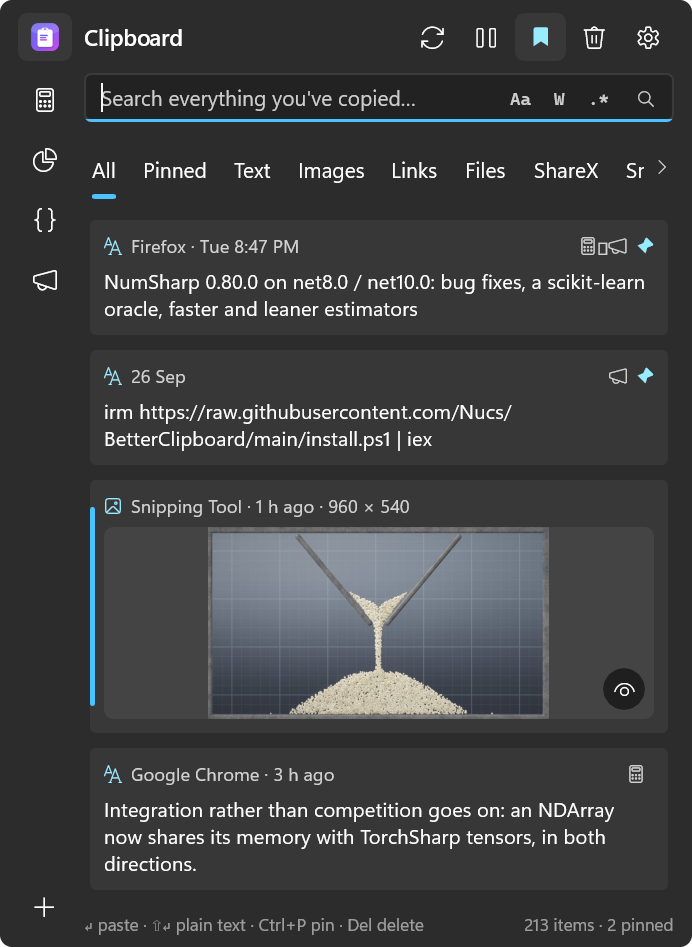
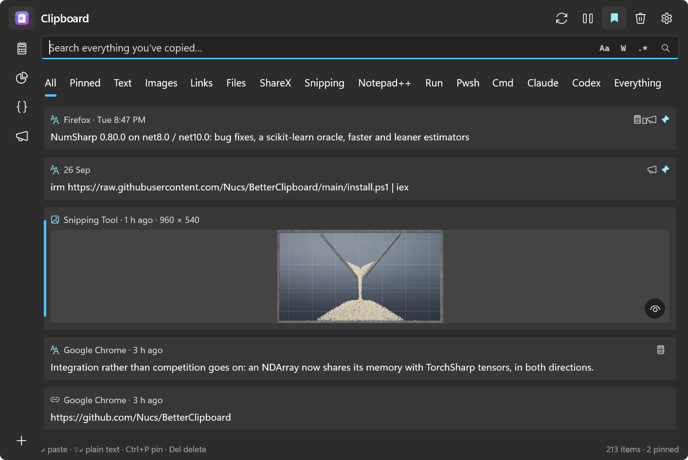

<!--
  The home page, written by hand: everything else in the manual is cut from README.md by scripts/generate_pages.py.
  Raw HTML, styled by templates/betterclipboard/public/main.css (.bc-*). Keep blank lines only between the top-level
  sections: Markdown ends an HTML block at a blank line, and a following line indented by four spaces or more would
  become a code block.
-->

  <section class="bc-hero">
    

      
Clipboard history for Windows

      <h1 class="bc-title">BetterClipboard</h1>
      
The Win+V clipboard history Windows should have shipped. Same shortcut, same panel by your cursor — but it remembers everything, survives restarts, searches instantly, and keeps it all encrypted on your PC. It also keeps what other tools forget: your screenshots, your Win+R commands, your shell history and the prompts you send to Claude Code and Codex.

      

        <pre><code class="lang-powershell">irm https://raw.githubusercontent.com/Nucs/BetterClipboard/main/install.ps1 | iex</code></pre>
        
In PowerShell. Per user, no admin rights, SHA-256 checked. <a href="docs/ways-to-install.md">Every other way to install</a>

      

      

        <a class="bc-button bc-button-primary" href="docs/install.md">Install</a>
        <a class="bc-button" href="docs/features.md">Features</a>
        <a class="bc-button" href="docs/use.md">Using the panel</a>
        <a class="bc-button" href="docs/command-line-for-scripts-and-ai-agents.md">Command line</a>
      

      
Windows 10 (2004 or newer) and Windows 11 · x64 and ARM64 · free and open source (MIT)

    

    <!-- Both photos are 947 px tall (taken at 150 % in one session, the second after widening the same panel), so one
         height scales both alike: --bc-shot-w = 692 x 600 / 947, --bc-wide-w = 1414 x 600 / 947. -->
    <figure class="bc-shot" tabindex="0" style="--bc-shot-h: 600px; --bc-shot-w: 438px; --bc-wide-w: 896px" aria-label="The BetterClipboard panel. Rest the mouse on it, or focus it, to see the same panel widened until every tab shows.">
      
      
      <figcaption>Rest the mouse on the panel to widen it: every tab shows.</figcaption>
    </figure>
  </section>

  <section class="bc-section">
    

      <h2>Find your way</h2>
      
The manual, one page per part of the README, plus guides for every way to install.

    

    

      <a class="bc-card" href="docs/ways-to-install.md">Install<strong>Every way to install</strong>
The one-line installer, the portable zip, for every user, Intune and RMM tools, Chocolatey and the Microsoft Store edition.
</a>
      <a class="bc-card" href="docs/use.md">Use<strong>The panel</strong>
Keys, tabs, search, previews, pins and groups.
</a>
      <a class="bc-card" href="docs/tabs-for-other-apps.md">Sources<strong>Tabs for other apps</strong>
ShareX, Snipping Tool, Notepad++, Win+R, PowerShell, Command Prompt, Everything, Claude Code and Codex.
</a>
      <a class="bc-card" href="docs/search.md">Find<strong>Search</strong>
Any language, with match case, whole word and regular expressions.
</a>
      <a class="bc-card" href="docs/taking-over-winv.md">Shortcuts<strong>Taking over Win+V</strong>
Released from Explorer or answered by a keyboard hook, or any shortcuts you choose.
</a>
      <a class="bc-card" href="docs/command-line-for-scripts-and-ai-agents.md">Scripts &amp; agents<strong>bclip</strong>
List, search, grep and wait for copies, with JSON output.
</a>
      <a class="bc-card" href="docs/privacy.md">Trust<strong>Privacy</strong>
What it reads, what it keeps, and the one request it makes by itself.
</a>
      <a class="bc-card" href="docs/how-it-works.md">Inside<strong>How it works</strong>
Capture, encryption at rest, memory and updates.
</a>
    

  </section>

  <section class="bc-links" aria-label="More">
    <a href="https://github.com/Nucs/BetterClipboard">GitHub repository</a>
    <a href="https://github.com/Nucs/BetterClipboard/releases">Releases</a>
    <a href="https://github.com/Nucs/BetterClipboard/blob/main/docs/translations/README.zh-CN.md">README: 简体中文</a>
    <a href="https://github.com/Nucs/BetterClipboard/blob/main/docs/translations/README.ru.md">Русский</a>
    <a href="https://github.com/Nucs/BetterClipboard/blob/main/docs/translations/README.es.md">Español</a>
    <a href="https://github.com/Nucs/BetterClipboard/blob/main/docs/translations/README.he.md">עברית</a>
  </section>

